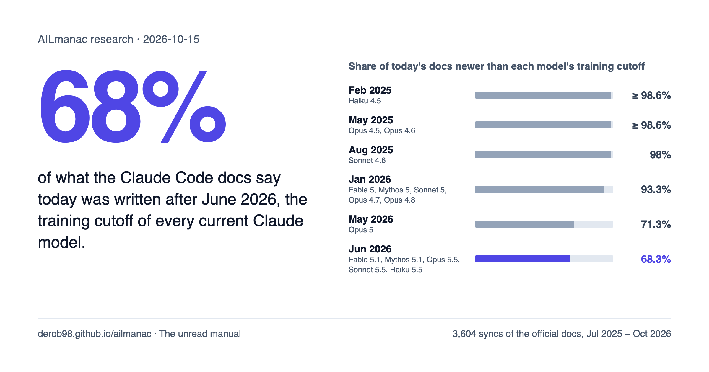
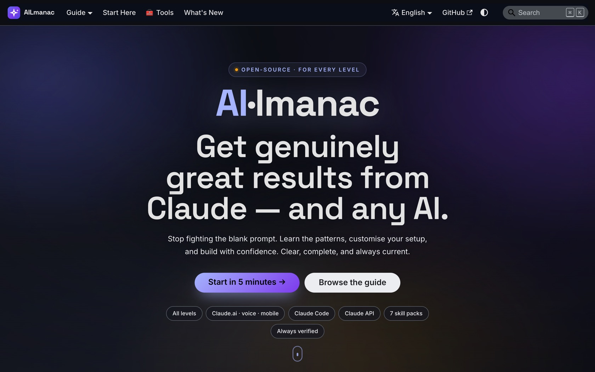
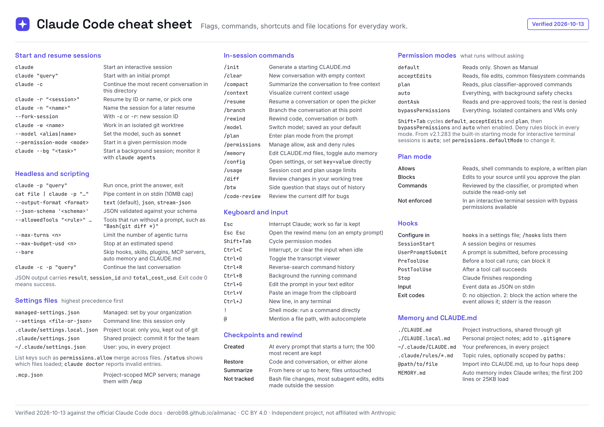
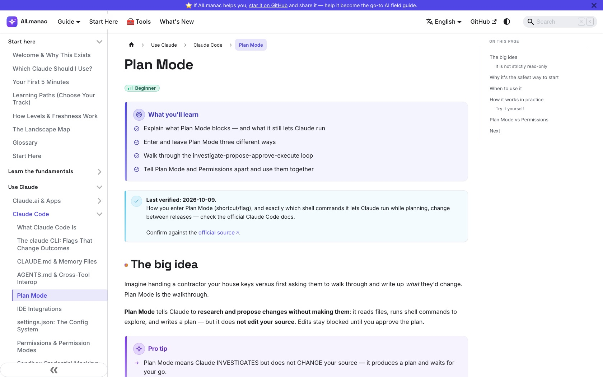

<div align="center">

# AILmanac

### The field guide to Claude and AI tools that tells you when each page was last checked.

[English](./README.md) · [简体中文](./README.zh-CN.md) · [日本語](./README.ja.md) · [Español](./README.es.md) · [Italiano](./README.it.md)

<!-- stats:start -->
**321 pages** · **276 interactive lessons** · **12 languages** · **80 pages re-verified in the last 30 days**
<!-- stats:end -->

<p>
  <a href="https://derob98.github.io/ailmanac/"></a>
</p>

<p>
  
  <a href="./CONTRIBUTING.md"></a>
  
</p>

**[The unread manual](https://derob98.github.io/ailmanac/docs/whats-new/unread-manual)** &nbsp;·&nbsp; **[Read the site](https://derob98.github.io/ailmanac/)** &nbsp;·&nbsp; **[Install it in Claude Code](#use-it-inside-claude-code)** &nbsp;·&nbsp; **[Cheat sheet](#the-claude-code-cheat-sheet)** &nbsp;·&nbsp; **[Start in 5 minutes](https://derob98.github.io/ailmanac/docs/start-here/your-first-5-minutes)** &nbsp;·&nbsp; **[Contribute](https://derob98.github.io/ailmanac/docs/contribute/contribute-in-10-minutes)**

<a href="https://derob98.github.io/ailmanac/docs/whats-new/unread-manual">
  
</a>

</div>

---

**New research: [Claude has never seen 68% of the Claude Code docs](https://derob98.github.io/ailmanac/docs/whats-new/unread-manual).** We replayed 15 months of the official docs, one week at a time. Two-thirds of what they say today was written after June 2026, the training cutoff of every current Claude model. The [`since-cutoff`](./plugins/since-cutoff) plugin tells Claude what it missed, at the start of every session.

AI tools change every week, and most guides do not say when they were written. AILmanac is a free, open guide to **Claude** (the apps, **Claude Code** and the **API**) and to the other models and agents around it. Every page is tagged by level, written in plain language, and stamped with the date it was last checked against its source.

> [!NOTE]
> AILmanac is an independent project. It is not affiliated with, sponsored by, or endorsed by Anthropic. "Claude" and "Anthropic" are trademarks of Anthropic. When AILmanac and the [official docs](https://docs.anthropic.com) disagree, the official docs win, and the pages link to them throughout.

<p align="center">
  <a href="https://derob98.github.io/ailmanac/"></a>
</p>

## Use it inside Claude Code

Two commands add the guide to Claude Code as a plugin:

```bash
claude plugin marketplace add derob98/ailmanac --sparse .claude-plugin plugins
claude plugin install ailmanac@ailmanac
```

Then, in any session:

- **Ask a question** about Claude, Claude Code, the API or MCP. The `ailmanac` skill looks the answer up in the guide and cites the page with its verified date, instead of answering from memory.
- **Run `/ailmanac:claude-md-check`** in a project. It compares your `CLAUDE.md` with the repository it describes (do those commands and paths exist?) and with how memory files load, then proposes exact fixes.
- **Seven role-based skill packs** load when they are relevant: developer workflow, research, data analysis, writing, marketing, study and everyday productivity.

The skills only read public pages from this site. Nothing about your project is sent to AILmanac. Details and a single-file install are in [`plugins/ailmanac`](./plugins/ailmanac).

A second plugin, `since-cutoff`, adds a short note at the start of each session listing the Claude Code flags, commands and hook events documented after the running model's training cutoff. It is a few lines of shell with no network access; see [`plugins/since-cutoff`](./plugins/since-cutoff).

```bash
claude plugin install since-cutoff@ailmanac
```

## The Claude Code cheat sheet

One page of flags, commands, shortcuts, permission modes and file locations. Every line was checked against the official docs on the date stamped in the corner; anything that could not be confirmed that day was left out.

<a href="https://derob98.github.io/ailmanac/docs/claude-code/cheat-sheet">
  <picture>
    <source media="(prefers-color-scheme: dark)" srcset="static/cheatsheets/claude-code-cheat-sheet-dark.png">
    
  </picture>
</a>

[PDF for printing](https://derob98.github.io/ailmanac/cheatsheets/claude-code-cheat-sheet.pdf) · [PNG, light](https://derob98.github.io/ailmanac/cheatsheets/claude-code-cheat-sheet.png) · [PNG, dark](https://derob98.github.io/ailmanac/cheatsheets/claude-code-cheat-sheet-dark.png) · [the same content as a searchable page](https://derob98.github.io/ailmanac/docs/claude-code/cheat-sheet)

## Recently added

<!-- fresh:start -->
- 2026-10-22 — [API Version 2026-10-21 — The First Breaking Version in Three Years](https://derob98.github.io/ailmanac/docs/api/api-version-2026-10-21)
- 2026-10-22 — [The .pth Backdoor: LiteLLM 1.107.0 and Code That Runs Before Your Import](https://derob98.github.io/ailmanac/docs/security/pth-backdoor-litellm-supply-chain)
- 2026-10-21 — [Agent SDK Permissions: the Six-Step Order](https://derob98.github.io/ailmanac/docs/claude-code/agent-sdk-permissions)
- 2026-10-21 — [Code Erosion: Why Your Agent Breaks What It Already Built](https://derob98.github.io/ailmanac/docs/frontiers/code-erosion-slopcodebench)
- 2026-10-21 — [DeepInfer: DeepSeek's Own Inference Engine, Read Honestly](https://derob98.github.io/ailmanac/docs/models/deepinfer-deepseek-inference-engine)
- 2026-10-20 — [Backdoored Open Weights: The Abliterated-Model Supply Chain](https://derob98.github.io/ailmanac/docs/security/backdoored-open-weights)
- 2026-10-20 — [Claude Dashboards & Claude Motion](https://derob98.github.io/ailmanac/docs/claude-app/dashboards-and-motion)
- 2026-10-20 — [The Web Your Agent Reads Isn't the Web You Read](https://derob98.github.io/ailmanac/docs/security/the-web-your-agent-reads)
<!-- fresh:end -->

Everything new is listed on the site under [What's New](https://derob98.github.io/ailmanac/docs/whats-new/models-and-pricing).

## Why AILmanac, and not only the official docs?

The official docs, cookbooks and curated lists are excellent. AILmanac does not replace them: it connects them and takes a position. It is meant to be the one link you can send a colleague, whatever their level.

| You want | The usual options | What AILmanac adds |
|---|---|---|
| **To learn in order** | Scattered tutorials | A level-tagged path from beginner to advanced, with a first result in five minutes. |
| **Facts that are still true** | Pages that go stale without saying so | A "last verified" date and source on every page, and one source of truth for model and pricing facts. |
| **To get something done** | Prose you still have to turn into action | Six in-browser tools (cost calculator, token estimator, CLAUDE.md generator, MCP config builder, prompt builder, Prompt Doctor) and copy-paste templates. |
| **The other models too** | One vendor's point of view | Field guides to GPT, Gemini, Mistral, DeepSeek, Qwen and local models, written for people who already use Claude. |
| **Your own language** | English only | Twelve languages. A page not yet translated is shown in English. |

## What's inside

<a href="https://derob98.github.io/ailmanac/docs/claude-code/plan-mode">
  
</a>

- **[Start Here](https://derob98.github.io/ailmanac/docs/start-here/welcome)**: pick a track by level or role.
- **[AI Foundations](https://derob98.github.io/ailmanac/docs/foundations/what-is-an-llm)** and **[Prompting](https://derob98.github.io/ailmanac/docs/prompting/basics)**: tokens, sampling, RAG, evals, hallucinations, then the patterns that work.
- **[Claude.ai & Apps](https://derob98.github.io/ailmanac/docs/claude-app/getting-started)**, **[Claude Code](https://derob98.github.io/ailmanac/docs/claude-code/what-is-claude-code)** and the **[Claude API](https://derob98.github.io/ailmanac/docs/api/first-call)**: the core of the guide.
- **[AI Models & Assistants](https://derob98.github.io/ailmanac/docs/models/)**: the largest section, covering every major model family and agent framework.
- **[Playbooks](https://derob98.github.io/ailmanac/docs/playbooks/coding)**, **[Walkthroughs](https://derob98.github.io/ailmanac/docs/walkthroughs/first-production-call)** and **[Templates](https://derob98.github.io/ailmanac/docs/templates/claude-md)**: outcome first, ready to copy.
- **[Tools](https://derob98.github.io/ailmanac/docs/tools/cost-calculator)**: they run in your browser, with no sign-up.
- **[Security](https://derob98.github.io/ailmanac/docs/security/prompt-injection)**, **[Power User](https://derob98.github.io/ailmanac/docs/power-user/token-economy)** and **[Frontiers](https://derob98.github.io/ailmanac/docs/frontiers/)**: for when the basics are behind you.

For agents and crawlers, a machine-readable index of every page is at [`/llms.txt`](https://derob98.github.io/ailmanac/llms.txt), following the [llms.txt](https://llmstxt.org/) convention. Every page is also served as Markdown: add `.md` to its address, or use the **Copy as Markdown** button under the title to paste a page into a chat with its source and verified date attached.

## Read it in your language

[English](https://derob98.github.io/ailmanac/) · [Español](https://derob98.github.io/ailmanac/es/) · [简体中文](https://derob98.github.io/ailmanac/zh-Hans/) · [हिन्दी](https://derob98.github.io/ailmanac/hi/) · [العربية](https://derob98.github.io/ailmanac/ar/) · [Português (Brasil)](https://derob98.github.io/ailmanac/pt-BR/) · [Русский](https://derob98.github.io/ailmanac/ru/) · [日本語](https://derob98.github.io/ailmanac/ja/) · [Deutsch](https://derob98.github.io/ailmanac/de/) · [Français](https://derob98.github.io/ailmanac/fr/) · [Italiano](https://derob98.github.io/ailmanac/it/) · [한국어](https://derob98.github.io/ailmanac/ko/)

## Contributing

The guide stays complete because people add to it. Fixing a typo, adding a glossary term, sharing a template and [translating a page](https://derob98.github.io/ailmanac/docs/contribute/translation-playbook) all count. Start with [Contribute in 10 Minutes](https://derob98.github.io/ailmanac/docs/contribute/contribute-in-10-minutes) and [`CONTRIBUTING.md`](./CONTRIBUTING.md). The project follows the [`CODE_OF_CONDUCT.md`](./CODE_OF_CONDUCT.md).

Good first contributions: report a page whose "last verified" date is old, add a worked example to a thin page, or pick a [`good first issue`](https://github.com/derob98/ailmanac/labels/good%20first%20issue).

If a page here saved you time, a star helps other people find the project. So does sharing it: [X](https://x.com/intent/post?text=AILmanac%3A%20a%20free%20field%20guide%20to%20Claude%20and%20AI%20tools%20that%20tells%20you%20when%20each%20page%20was%20last%20checked.&url=https%3A%2F%2Fgithub.com%2Fderob98%2Failmanac) · [LinkedIn](https://www.linkedin.com/sharing/share-offsite/?url=https%3A%2F%2Fgithub.com%2Fderob98%2Failmanac) · [Reddit](https://www.reddit.com/submit?url=https%3A%2F%2Fgithub.com%2Fderob98%2Failmanac&title=AILmanac%3A%20a%20field%20guide%20to%20Claude%20and%20AI%20tools%20with%20a%20verified%20date%20on%20every%20page) · [Hacker News](https://news.ycombinator.com/submitlink?u=https%3A%2F%2Fgithub.com%2Fderob98%2Failmanac&t=AILmanac%3A%20a%20field%20guide%20to%20Claude%20and%20AI%20tools%20with%20a%20verified%20date%20on%20every%20page).

## Run it locally

Requires Node.js (see [`.nvmrc`](./.nvmrc)).

```bash
npm install
npm run start     # dev server with live reload at http://localhost:3000
npm run build     # production build; fails on broken links, by design
npm run serve     # preview the production build
```

After adding pages, refresh the generated files:

```bash
node scripts/build-llms-txt.mjs   # rebuilds static/llms.txt
node scripts/build-readme.mjs     # refreshes the numbers and "Recently added" above
```

## Deploy

The site is served from the `gh-pages` branch at **https://derob98.github.io/ailmanac/**.

```bash
bash scripts/deploy.sh   # builds every locale in a temp directory, then publishes build/ to gh-pages
```

The build stops on a broken link or invalid page, so a failed build never reaches the live site. To use a custom domain, set `url` to it and `baseUrl` to `/` in `docusaurus.config.ts`, and add `static/CNAME`.

## Cite AILmanac

Referencing AILmanac in a post, course or paper? See [`CITATION.cff`](./CITATION.cff), or use GitHub's "Cite this repository" button for APA and BibTeX.

## Author and license

Created and maintained by **Gianluca De Robertis** ([@derob98](https://github.com/derob98)), with contributions from the community.

- **Prose and documentation:** [CC BY 4.0](./LICENSE-CONTENT). Reuse with attribution.
- **Code, examples, skills and config:** [MIT](./LICENSE-CODE).

See [`NOTICE`](./NOTICE) for details.
