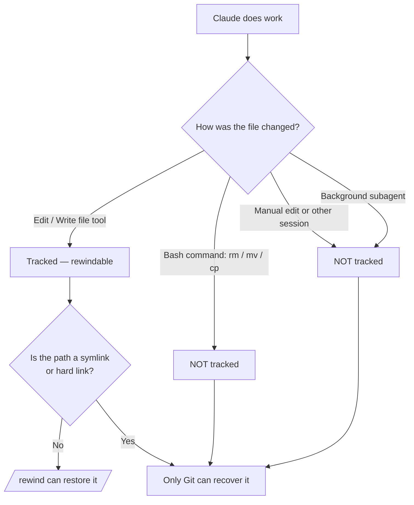

# نقاط التحقّق والتراجع

> Source: https://derob98.github.io/ailmanac/ar/docs/claude-code/checkpoints-and-rewind · AILmanac (CC BY 4.0) · last verified 2026-10-20

تراجَع عن تعديلات Claude، وأرجِع جلسة كاملة، وضغط السياق باستخدام /rewind — شبكة الأمان للتشغيلات الطموحة.

<LevelBadge level="intermediate" />

<Callout type="objectives" items={["افهم ما الذي تلتقطه نقطة التحقّق — وما الذي لا تلتقطه بصمت", "افتح قائمة التراجع بطريقتين واختر إجراء الاستعادة الصحيح في كل مرة", "ميّز بين «الاستعادة» (التراجع عن الحالة) و«التلخيص» (ضغط السياق)", "اعرف بالضبط لماذا تكمّل نقاط التحقّق Git ولا تحلّ محلّه أبدًا"]} />

<VerifyNote lastVerified="2026-10-20" source="https://code.claude.com/docs/en/checkpointing">
يتغيّر سلوك نقاط التحقّق وإجراءات قائمة التراجع والحدّ الأقصى للّقطات ومدة الاحتفاظ بها بين الإصدارات — تأكّد من ذلك في المستندات الرسمية.
</VerifyNote>

## الفكرة الكبرى

عندما تطلق Claude على تغيير طموح واسع النطاق، يكون السؤال الأكثر رعبًا: «ماذا لو سارت الأمور بشكل خاطئ بعد ثلاثة تعديلات؟» **نقاط التحقّق** هي الجواب: يلتقط Claude Code لقطة لشِفرتك تلقائيًا قبل كل تعديل، فتستطيع الرجوع إلى أي حالة سابقة بدلًا من فكّ إعادة هيكلة غير مكتملة يدويًا.

فكّر فيها على أنها **تراجع محلي عن الجلسة بأكملها** — شبكة أمان تتيح لك أن تقول «نعم، جرّب النهج الجريء» دون خوف.

## كيف تُنشأ نقاط التحقّق

أنت لا تنشئ نقاط التحقّق — إنها تحدث تلقائيًا.

<Steps items={[{title: "كل مطالبة تبدأ دورًا = نقطة تحقّق", body: "كل مطالبة تبدأ دورًا تلتقط حالة شِفرتك قبل تشغيل أدوات تعديل الملفات في Claude. لا أمر، ولا إعداد، ولا إجراءات شكلية."}, {title: "تُحفظ آخر 100 فقط", body: "يحتفظ Claude Code بلقطات الملفات لآخر 100 نقطة تحقّق في الجلسة. تُهمَل الأقدم، ولذلك لا يمكن إرجاع جلسة طويلة جدًا حتى بدايتها."}, {title: "تدوم عبر الجلسات", body: "تُحفظ نقاط التحقّق مع المحادثة، فيمكنك تشغيل /rewind حتى بعد استئناف الجلسة، وليس في الجلسة الحية فقط."}, {title: "تنظّف نفسها بنفسها", body: "تُحذف لقطات ملفات الجلسة في عملية مسح الاحتفاظ، افتراضيًا بعد نحو 30 يومًا من آخر مرة حفظت فيها الجلسة لقطة. يفشل التراجع إلى نقطة تحقّق اختفت لقطاتها مع الرسالة 'No files were restored' — ارفع cleanupPeriodDays لإبقائها مدة أطول."}]} />

## فتح قائمة التراجع

هناك طريقتان للدخول:

<Steps items={[{title: "شغّل /rewind — أو الاسمين البديلين /checkpoint و/undo", body: "اكتب أمر الشرطة المائلة في مربع المطالبة. يعمل دائمًا. الأمران /checkpoint و/undo اسمان بديلان للأمر نفسه، فاستخدم أيّ اسم يخطر ببالك."}, {title: "اضغط Esc مرتين — لكن فقط على إدخال فارغ", body: "يفتح الضغط المزدوج على Esc قائمة التراجع عندما يكون مربع المطالبة فارغًا. أما إذا كان فيه نص، فيمسح الضغط المزدوج على Esc ذلك النص بدلًا من ذلك (يُحفظ النص الممسوح في سجل الإدخال، فاضغط السهم لأعلى لاستعادته لاحقًا)."}]} />

<PromptCard title="افتح قائمة التراجع">{`/rewind`}</PromptCard>

<Callout type="warning" items={["الأسماء البديلة ألطف من معناها الحرفي: الأمر /checkpoint لا يلتقط لقطة عند الطلب (اللقطات تلقائية)، والأمر /undo لا يتراجع وحده عن آخر تعديل. الأسماء الثلاثة كلها تفتح القائمة نفسها، وفيها تختار بنفسك النقطة والإجراء."]} />

تسرد القائمة **كل مطالبة أرسلتها في هذه الجلسة**. اختر النقطة التي تريد العمل عليها، ثم اختر إجراءً واحدًا.

## الاستعادة مقابل التلخيص: الفرق الجوهري

هنا يحدث الالتباس. تقدّم القائمة *نوعين* من الإجراءات:

- إجراءات **الاستعادة** تغيّر الحالة على القرص و/أو في المحادثة — إنها تتراجع.
- إجراءات **التلخيص** لا تمسّ ملفاتك أبدًا — إنها تضغط المحادثة لتحرير مساحة في نافذة السياق.

<Callout type="warning" items={["الاستعادة = تراجع (ترجع الشِفرة أو المحادثة أو كليهما). التلخيص = ضغط السياق (الملفات على القرص لا تُمسّ).", "استخدم الاستعادة عندما يُفسد تعديلٌ شيئًا. واستخدم التلخيص عندما تتضخم الجلسة وتكون الشِفرة سليمة."]} />

### إجراءات الاستعادة

<Steps items={[{title: "استعادة الشِفرة والمحادثة", body: "ترجع ملفاتك وسجل الدردشة معًا إلى النقطة المحددة — «عودة نظيفة في الزمن» إلى تلك اللحظة."}, {title: "استعادة المحادثة", body: "ترجع الدردشة إلى تلك الرسالة مع الإبقاء على شِفرتك الحالية. مفيد لإعادة طرح سؤال دون فقدان التعديلات التي تريد الاحتفاظ بها."}, {title: "استعادة الشِفرة", body: "تتراجع عن تغييرات الملفات مع الإبقاء على المحادثة. تراجَع عن التعديلات واحتفظ بالنقاش حولها."}]} />

لا يظهر خيارا استعادة **الشِفرة** إلا عندما تحتوي نقطة التحقّق المحددة فعلًا على تغييرات ملفات متتبَّعة يمكن التراجع عنها. فإذا لم تُلتقط أي تعديلات على الملفات بعد تلك النقطة، فلن تعرض القائمة سوى **استعادة المحادثة** وخياري التلخيص و**Never mind** (الذي يعيدك إلى قائمة الرسائل دون تغيير أي شيء).

بعد استعادة المحادثة (أو اختيار «التلخيص من هنا»)، تُعاد المطالبة الأصلية من الرسالة المحددة إلى حقل الإدخال لتتمكن من إعادة إرسالها أو تعديلها.

### إجراءات التلخيص

كلاهما يضغط جزءًا من المحادثة في ملخص يولّده الذكاء الاصطناعي — مثل **`/compact` موجَّه** تختار فيه أي جانب من الرسالة المحددة تريد عصره.

<Steps items={[{title: "التلخيص من هنا", body: "تبقى الرسائل التي تسبق الرسالة المحددة سليمة. أما الرسالة المحددة وكل ما بعدها فيتحوّل إلى ملخص. استخدمه لتجاهل نقاش جانبي مع الإبقاء على السياق المبكر بكامل تفاصيله."}, {title: "التلخيص حتى هنا", body: "تتحوّل الرسائل التي تسبق الرسالة المحددة إلى ملخص؛ وتبقى الرسالة المحددة وكل ما بعدها سليمة. تبقى في نهاية المحادثة. استخدمه لضغط حديث التهيئة المبكر مع الإبقاء على العمل الأخير بنصّه الحرفي."}]} />

في الحالتين تبقى الرسائل الأصلية في سجل الجلسة، فيستطيع Claude الرجوع إلى التفاصيل، ويظهر وسم **Summarized conversation** في المكان الذي كانت فيه الرسائل المضغوطة. لتوجيه ما يركّز عليه الملخص، حدّد خيار **تلخيص** بالأسهم واكتب التعليمات في الصف الذي يحمل عبارة **add context (optional)**، ثم اضغط Enter — أما اختيار الخيار بمفتاحه الرقمي فيلخّص فورًا دون أي تعليمات.

للاطلاع على التدفق كاملًا، راجع [إدارة السياق](/docs/claude-code/context-management) — إجراءات التلخيص في `/rewind` مشرط، بينما `/compact` فرشاة عريضة.

<Callout type="note" items={["التلخيص يُبقيك في الجلسة نفسها. للتفرّع وتجربة نهج مختلف مع ترك الجلسة الأصلية سليمة، استخدم /branch أو claude --continue --fork-session بدلًا من ذلك."]} />

## التراجع إلى ما قبل `/clear`

إذا شغّلت `/clear` سابقًا في عملية Claude Code نفسها، تعرض قائمة التراجع مُدخلًا إضافيًا في الأعلى: `/resume <session-id> (previous session)`. اخترْه للعودة إلى المحادثة التي كانت نشطة قبل `/clear`.

<VerifyNote lastVerified="2026-10-20" source="https://code.claude.com/docs/en/checkpointing">
هذا المُدخل متاح فقط إلى أن تخرج من Claude Code أو تستأنف جلسة مختلفة. وبمجرد اختفائه، شغّل `/resume` واختر الجلسة السابقة من القائمة بدلًا من ذلك.
</VerifyNote>

## أين تتوقف نقاط التحقّق — الحدود التي تؤلم

تبدو نقاط التحقّق سحرية حتى تتوقف عن ذلك. هذه الثغرات مهمة:

<Steps items={[{title: "تغييرات bash غير مرئية", body: "الملفات التي تلمسها أوامر الصدفة التي يشغّلها Claude — rm وmv وcp ومولّدات الشِفرة وأدوات التنسيق — لا تُتتبَّع. تُؤخذ نقاط تحقّق فقط للتعديلات المباشرة عبر أدوات تعديل الملفات في Claude. الملف المحذوف بـ rm يُعدّ ضائعًا بالنسبة إلى التراجع."}, {title: "معظم تعديلات الوكلاء الفرعيين لا تُستعاد", body: "يعدّل الوكيل الفرعي بالأدوات نفسها، لكن جلستك لا تلتقط هذه التعديلات عادةً. الاستثناء هو المهارة المتفرعة (forked skill) العاملة في المقدمة (context: fork مع background: false)، التي تعدّل أثناء دورك أنت وتتراجع بشكل طبيعي. أي وكيل فرعي آخر — بما فيه المهارة المتفرعة في الخلفية، وهي الافتراضي — يحتاج إلى Git للتراجع. راجع /docs/claude-code/subagents."}, {title: "التغييرات الخارجية والمتزامنة غير مرئية", body: "التعديلات اليدوية التي تجريها خارج Claude Code، والتعديلات من جلسات متزامنة أخرى، لا تُلتقط عادةً — إلا إذا مسّت بالصدفة الملفات نفسها التي عدّلتها الجلسة الحالية."}, {title: "الرسائل أثناء الدور لا تحصل على نقطة تحقّق", body: "الرسالة التي تضعها في الطابور أثناء عمل Claude وتصل إليه ضمن الدور الجاري تنضمّ إلى ذلك الدور بدلًا من بدء دور جديد، فلا تحصل على نقطة تحقّق خاصة بها — وتضع عليها قائمة التراجع علامة «No code restore». للتراجع عمّا تلاها، ارجع إلى المطالبة التي بدأت الدور، وهذا يُرجع الدور بأكمله، بما في ذلك العمل المنجز قبل وصول رسالتك. أما تحديد الرسالة المعلَّمة نفسها فيظل يتيح «استعادة المحادثة»، وتبقى ملفاتك كما هي."}, {title: "الروابط الرمزية والروابط الصلبة تُتخطّى", body: "تتخطّى الاستعادة أي مسار متتبَّع هو رابط رمزي أو رابط صلب، وتحذّر برسالة 'Restored the code, but skipped N files'؛ وتحتفظ هذه الملفات بمحتواها الحالي. تقع الروابط الرمزية لمديري dotfiles والروابط الصلبة في pnpm في هذه الحالة. شغّل /debug قبل الاستعادة لتُذكر المسارات المتخطّاة بأسمائها في سجل التصحيح."}, {title: "إنها على مستوى الجلسة، لا التاريخ", body: "نقاط التحقّق وسيلة تعافٍ محلية سريعة. وهي ليست إيداعات (commits)، ولا فروعًا، ولا يمكن مشاركتها مع فريقك."}]} />

## نقاط التحقّق مقابل Git: استخدم الاثنين

يحلّان مشكلتين مختلفتين، فاجمع بينهما.

| | نقاط التحقّق (`/rewind`) | Git |
|---|---|---|
| النطاق | جلسة واحدة | تاريخ المشروع كاملًا |
| الدقة | لكل مطالبة تبدأ دورًا، تلقائيًا | لكل إيداع، عن قصد |
| هل يتتبع التغييرات التي أجراها bash؟ | لا | نعم (بعد التجهيز/الإيداع) |
| مدة البقاء | آخر 100 نقطة تحقّق، وتُمسح بعد نحو 30 يومًا من الجلسة | دائم |
| قابل للمشاركة / التعاون | لا | نعم |
| النموذج الذهني | «تراجع محلي» | «تاريخ دائم» |

<Callout type="tip" items={["أودِع الحالات العاملة في Git قبل أي تشغيل محفوف بالمخاطر وواسع النطاق — فهذا أساسك الثابت.", "استخدم /rewind للتعافي السريع داخل الجلسة بين الإيداعات دون تلويث سجل Git.", "إذا كان Claude سيشغّل bash مدمّرًا (rm/mv) أو مولّدات شِفرة أو وكلاء فرعيين في الخلفية، فاعتمد على Git — فالتراجع لن ينقذ تلك الملفات."]} />

## متى تلجأ إليه

<Steps items={[{title: "استكشاف البدائل", body: "جرّب تنفيذًا جريئًا، وإن لم يعجبك فاستعد الشِفرة والمحادثة إلى نقطة التفرّع وجرّب طريقًا آخر."}, {title: "التعافي من تعديل سيّئ", body: "تعديل أدخل خطأً قبل ثلاث مطالبات؟ استعد الشِفرة إلى ما قبله مباشرة بدلًا من تصحيح الحطام."}, {title: "التكرار على ميزة", body: "جرّب تنويعات مختلفة وأنت تعلم أن حالة سليمة معروفة تبعد عنك أمر /rewind واحدًا فقط."}, {title: "تحرير مساحة السياق", body: "هل التهم منعطف تصحيح مطوّل نافذة السياق؟ لخّص من نقطة المنتصف فصاعدًا وأبقِ تعليماتك الأصلية بكامل تفاصيلها."}]} />

<Quiz title="اختبر نفسك" questions={[{q: "شغّل Claude الأمر `rm config.old.json` عبر bash وتريد استعادة الملف. هل يستطيع `/rewind` استعادته؟", options: ["نعم — كل تغيير يجريه Claude له نقطة تحقّق", "لا — التغييرات التي يجريها bash لا تُتتبَّع؛ فقط تعديلات أدوات الملفات المباشرة", "فقط إذا شغّلت /rewind خلال 30 ثانية"], answer: 1, explain: "لا تلتقط نقاط التحقّق إلا التعديلات التي تجري عبر أدوات تعديل الملفات في Claude. الملفات التي تغيّرها أوامر bash (rm وmv وcp) لا تُتتبَّع — وهذا بالضبط ما وُجد Git من أجله."}, {q: "شِفرتك سليمة، لكن منعطف تصحيح طويلًا ملأ نافذة السياق. أي إجراء يناسب؟", options: ["استعادة الشِفرة والمحادثة إلى ما قبل المنعطف", "استعادة الشِفرة", "«التلخيص من هنا» عند بداية المنعطف"], answer: 2, explain: "تضغط إجراءات التلخيص المحادثة دون المساس بالملفات. «التلخيص من هنا» يحوّل المنعطف إلى ملخص مع إبقاء سياقك السابق سليمًا — فيحرّر مساحة السياق دون أي تغيير في الشِفرة."}, {q: "كيف تُنشأ نقطة التحقّق؟", options: ["بتشغيل /checkpoint الذي يلتقط لقطة لشِفرتك عند الطلب", "تلقائيًا — كل مطالبة تبدأ دورًا تنشئ واحدة", "فقط عندما تودِع في Git"], answer: 1, explain: "نقاط التحقّق تلقائية: كل مطالبة تبدأ دورًا تلتقط حالة الشِفرة قبل التعديل. لا خطوة يدوية — الأمر /checkpoint موجود، لكنه مجرد اسم بديل لـ /rewind ويفتح القائمة بدلًا من التقاط لقطة. لاحظ أيضًا أن الرسالة التي تصل أثناء الدور تنضمّ إلى الدور الجاري ولا تحصل على نقطة تحقّق خاصة بها."}]} />

<Flashcards title="مفردات نقاط التحقّق والتراجع" cards={[{front: "نقطة التحقّق", back: "لقطة تلقائية لشِفرتك تُؤخذ قبل كل مطالبة تبدأ دورًا. محصورة بالجلسة، تُحفظ آخر 100، وتُمسح بعد نحو 30 يومًا من الجلسة."}, {front: "/rewind", back: "يفتح قائمة التراجع التي تسرد كل مطالبة في هذه الجلسة، لتستعيد أو تلخّص من أي نقطة. الاسمان البديلان: /checkpoint و/undo. يمكن الوصول إليه أيضًا بالضغط المزدوج على Esc عند إدخال فارغ."}, {front: "إجراء الاستعادة", back: "يرجع الحالة — الشِفرة أو المحادثة أو كليهما — إلى النقطة المحددة. هذا هو «التراجع». تظهر خيارات الشِفرة فقط عندما تحتوي نقطة التحقّق تلك على تغييرات متتبَّعة."}, {front: "إجراء التلخيص", back: "يضغط جزءًا من المحادثة في ملخص بالذكاء الاصطناعي لتحرير السياق. الملفات على القرص لا تُمسّ أبدًا."}, {front: "النقطة العمياء في bash", back: "الملفات التي تغيّرها أوامر الصدفة (rm/mv/cp) لا تُؤخذ لها نقاط تحقّق — فقط تعديلات أدوات الملفات المباشرة. استخدم Git لها."}, {front: "النقطة العمياء في الوكلاء الفرعيين", back: "تتراجع فقط تعديلات المهارة المتفرعة في المقدمة. الوكلاء الفرعيون في الخلفية (بما فيهم التفرّع الافتراضي في الخلفية) يحتاجون إلى Git."}]} />

<Callout type="takeaways" items={["نقاط التحقّق لقطات تلقائية تُؤخذ قبل كل مطالبة تبدأ دورًا — تراجع محلي عن الجلسة. تُحفظ آخر 100، ثم تُمسح بعد نحو 30 يومًا من الجلسة.", "افتح قائمة التراجع بـ /rewind (الاسمان البديلان: /checkpoint و/undo) أو بالضغط المزدوج على Esc عند إدخال فارغ؛ وهي تسرد كل مطالبة أرسلتها.", "إجراءات الاستعادة تتراجع عن الحالة (الشِفرة أو المحادثة أو كليهما)؛ وإجراءات التلخيص تضغط السياق ولا تمسّ الملفات أبدًا.", "التغييرات التي يجريها bash، والخارجية، والمتزامنة، ومعظم تغييرات الوكلاء الفرعيين لا تُتتبَّع — وتُتخطّى المسارات ذات الروابط الرمزية أو الصلبة عند الاستعادة.", "نقاط التحقّق تكمّل Git ولا تحلّ محلّه: فكّر في «تراجع محلي» مقابل «تاريخ دائم قابل للمشاركة»."]} />

## التالي

- [إدارة السياق](/docs/claude-code/context-management) — `/compact` و`/clear`، وأين يندرج التلخيص في الصورة الأكبر
- [وضع التخطيط](/docs/claude-code/plan-mode) — تحقّق من الخطة ووافق عليها قبل تنفيذ التعديلات، فتحتاج إلى التراجع بوتيرة أقل
- [الأذونات](/docs/claude-code/permissions) — النصف الآخر من تشغيل المهام الطموحة بأمان
