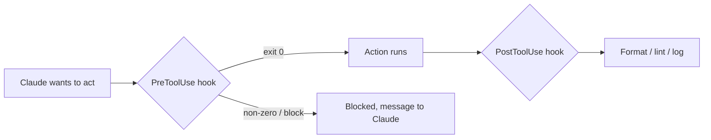

# Hooks: الأتمتة الحتمية

> Source: https://derob98.github.io/ailmanac/ar/docs/claude-code/hooks · AILmanac (CC BY 4.0) · last verified 2026-08-22

شغّل أوامر عند أحداث دورة الحياة لفرض التنسيق والبوابات والأمان.

<LevelBadge level="advanced" />

<VerifyNote lastVerified="2026-08-22" source="https://code.claude.com/docs/en/hooks">
يوثّق Claude Code أكثر من 30 حدث hook مجمّعة حسب المرحلة — القائمة الكاملة، ونحو matcher لكل حدث، وحقول مخرجات JSON العامة موجودة في المرجع الرسمي لـ hooks. تتطور الأسماء وبنية الـ payload؛ فتأكد من المصدر قبل أن تعتمد على حدث أو حقل بعينه.
</VerifyNote>

الـ Hooks هي **أوامر shell ينفّذها Claude Code تلقائيًا** عند نقاط محددة في دورة حياته. وبينما تقرر [الأذونات](/docs/claude-code/permissions) *ما إذا كان* الإجراء مسموحًا، تتيح لك الـ hooks تشغيل منطق حتمي حوله — تنسيق، تحقق، تسجيل، بوابات، حجب بيانات. بها تجعل السلوك مضمونًا بدلًا من "رجاءً تذكّر".

<Callout type="objectives" items={["متى تلجأ إلى hook بدلًا من تعليمة أو إذن أو skill", "دورة الحياة الكاملة: أحداث الجلسة، والـ prompt، والأداة، والوكيل الفرعي، والمهمة، والضغط، ونهاية الدور", "كيف يُربط الـ hook: الحدث، والـ matcher، وحمولة JSON على stdin", "الطريقتان اللتان يحجب بهما الـ hook إجراءً — رمز الخروج 2 مقابل JSON على stdout", "حقول مخرجات JSON العامة المشتركة بين الأحداث: continue وadditionalContext وsystemMessage وreloadSkills وsessionTitle وsuppressOutput وupdatedInput", "الممارسات الجيدة والأخطاء الشائعة التي تفرّق بين hooks سريعة وآمنة وأخرى بطيئة وصامتة"]} />

## متى تلجأ إلى hook

استخدم الـ hook عندما تريد سلوكًا *مضمونًا* لا مجرد مطلوب. كل مهمة شائعة تقابل حدثًا من دورة الحياة:

- **تنسيق / lint تلقائي** بعد كل تعديل لملف (`PostToolUse` على `Edit|Write`).
- **حجب** إجراء يخالف قاعدة قبل أن يعمل (`PreToolUse`).
- **حجب بيانات** من رسالة المساعد قبل وصولها إلى الطرفية (`MessageDisplay`).
- **إعادة تحميل الـ skills** أو ضبط **عنوان الجلسة** بعد `SessionStart`.
- **الإشعار أو التسجيل** عند انتهاء جلسة أو إكمال مهمة أو فشل دور (`Stop` و`StopFailure` و`SessionEnd`).
- **حقن السياق** عند بدء الجلسة أو عند تحميل التعليمات.

## كيف تعمل

تسجّل الـ hooks في [`settings.json`](/docs/claude-code/settings) بمطابقة **حدث** (وغالبًا matcher — عادةً اسم أداة، وأحيانًا نوع وكيل فرعي أو مُشغّل ضغط أو نوع إشعار). عند إطلاق الحدث، يشغّل Claude أمرك ويمرّر **حمولة JSON عبر stdin** (اسم الحدث والجلسة وحقولًا خاصة بالحدث مثل اسم الأداة ومدخلاتها). رمز خروج أمرك وstdout يحددان ما يحدث بعد ذلك.

<Steps items={[{title: "طابِق حدثًا", body: "سجّل الـ hook في settings.json تحت حدث دورة الحياة الذي يهمك — مثلًا PostToolUse لأتمتة ما بعد الأداة، أو MessageDisplay لحجب البيانات."}, {title: "ضيّق النطاق بـ matcher", body: "أضف matcher كي لا يُطلق الـ hook إلا عند الحاجة، مثلًا matcher \"Edit|Write\" لتعديلات الملفات، أو matcher \"startup|resume\" على SessionStart."}, {title: "اقرأ الحمولة من stdin", body: "عند إطلاق الحدث، يشغّل Claude أمرك ويمرّر حمولة JSON عبر stdin — اسم الحدث والجلسة والحقول الخاصة بالحدث (tool_name وtool_input وnotification وغيرها)."}, {title: "قرّر ما يحدث بعد ذلك", body: "يحدد رمز خروج أمرك ومخرجاته النتيجة: السماح للإجراء بالمرور، أو تشغيل منطقك، أو حجبه، أو إرجاع JSON منظّم لتغيير ما يراه Claude."}]} />

```json
{
  "hooks": {
    "PostToolUse": [
      {
        "matcher": "Edit|Write",
        "hooks": [
          { "type": "command", "command": "jq -r '.tool_input.file_path' | xargs npx prettier --write" }
        ]
      }
    ]
  }
}
```

يقرأ الـ hook أعلاه مسار الملف المعدَّل من JSON القادم عبر stdin (`.tool_input.file_path`) وينسّقه. لا تفترض أن متغير بيئة يحمل المسار — **اقرأه من stdin.** أما عناصر المسار الجاهزة مثل `${CLAUDE_PROJECT_DIR}` فهي *متاحة* لتحديد موقع السكربتات.

## دورة الحياة في لمحة

تمتد hooks في Claude Code على الجلسة كلها، لا على استدعاءات الأدوات فقط. جمّعها حسب المرحلة لتعرف أين تعلّق منطقك.

| المرحلة | الأحداث | الاستخدام المعتاد |
| --- | --- | --- |
| **الجلسة** | `SessionStart` و`SessionEnd` و`Setup` و`InstructionsLoaded` و`ConfigChange` و`CwdChanged` و`DirectoryAdded` و`FileChanged` | حقن السياق عند البدء، ولقطة عند النهاية، والتفاعل مع إعادة تحميل `CLAUDE.md` أو تغيّر `.env` على القرص |
| **الـ Prompt** | `UserPromptSubmit` و`UserPromptExpansion` | وضع بوابة على الـ prompt أو إعادة كتابته قبل أن يراه Claude |
| **الأداة** | `PreToolUse` و`PermissionRequest` و`PermissionDenied` و`PostToolUse` و`PostToolUseFailure` و`PostToolBatch` | السماح بإجراء/رفضه، والتصعيد إلى إنسان، والتنسيق بعد التعديلات، وإعادة المحاولة بعد رفض الوضع التلقائي |
| **الوكيل الفرعي** | `SubagentStart` و`SubagentStop` | تسجيل التشغيل/الإيقاف، ومنع وكيل فرعي من العودة |
| **المهمة** | `TaskCreated` و`TaskCompleted` | التراجع عن مهمة أُنشئت بالخطأ، ووضع بوابة على الإكمال |
| **الضغط** | `PreCompact` و`PostCompact` | أخذ لقطة من السجل قبل الضغط، والتحقق بعده |
| **النموذج** | `PreModelSwitch` و`PostModelSwitch` | حجب تبديل النموذج قبل أن يُطبَّق؛ والتفاعل بعد تغيّر النموذج، بما في ذلك عندما تستعيده جلسة مستأنفة |
| **الدور** | `Stop` و`StopFailure` و`Notification` و`MessageDisplay` | الإشعار عند الاكتمال، والتنبيه عند فشل الـ API، وحجب البيانات من النص المعروض |
| **الفريق + MCP** | `TeammateIdle` و`Elicitation` و`ElicitationResult` و`WorktreeCreate` و`WorktreeRemove` | التنسيق بين الجلسات، ووضع بوابة على elicitation الخاصة بـ MCP، وتغليف عمليات worktree |

حقول stdin الدقيقة لكل حدث، ونحو الـ matcher، وقواعد الحجب موجودة في [المرجع الرسمي لـ hooks](https://code.claude.com/docs/en/hooks). القائمة أعلاه هي الخريطة؛ والمرجع هو الأرض.

## كيف يحجب الـ hook

هناك طريقتان بحسب الحدث:

- **رمز الخروج 2** — يُفشل الـ hook الإجراء، وما كتبه إلى **stderr** يصبح الرسالة التي يراها Claude. بسيط ويعمل مع hooks الأوامر على الأحداث الحاجبة (`PreToolUse` و`UserPromptSubmit` و`UserPromptExpansion` و`Stop` و`SubagentStop` و`TeammateIdle` و`TaskCreated` و`TaskCompleted` و`ConfigChange` و`PostToolBatch` و`PreCompact` و`PreModelSwitch` و`Elicitation` و`ElicitationResult` و`WorktreeCreate` و`WorktreeRemove`). على `PermissionRequest` يُتجاهل الخروج 2؛ ارفض عبر كائن `decision` الخاص به بدلًا من ذلك.
- **JSON على stdout (خروج 0)** — أعد قرارًا منظّمًا. بالنسبة إلى `PreToolUse` هو `permissionDecision` بقيمة `"allow"` أو `"deny"` أو `"ask"` (ضع الاستدعاء أمام المستخدم) أو `"defer"` (فقط لتشغيلات `-p` التي يقودها تطبيق يستأنفها)، مع `permissionDecisionReason`. الأحداث غير الحاجبة (`PostToolUse` و`Notification` و`MessageDisplay` و`StopFailure` ومعظم أحداث الجلسة) تتجاهل محاولات الحجب — لكن مخرجات JSON الخاصة بها ما زالت قادرة على توجيه ما يراه Claude بعد ذلك.

السكربت أدناه hook من نوع `PreToolUse` على أداة Bash. اقرأه من الأعلى إلى الأسفل: يستخرج الأمر من stdin، وإن بدا مدمّرًا يكتب سببًا إلى stderr ويخرج بالرمز 2 للحجب.

```bash
#!/usr/bin/env bash
# PreToolUse hook on the Bash tool: refuse to delete things.
command=$(jq -r '.tool_input.command' < /dev/stdin)
if [[ "$command" == rm\ * || "$command" == *"rm -rf"* ]]; then
  echo "Blocked: destructive 'rm' is not allowed by policy." >&2
  exit 2
fi
exit 0
```

## حقول مخرجات JSON العامة

تقبل معظم الأحداث كائن JSON منظّمًا على stdout يوجّه ما يحدث بعد ذلك — منفصلًا عن حقول القرار الخاصة بالحدث مثل `permissionDecision`. أكثرها فائدة:

| الحقل | ماذا يفعل | أين يعمل |
| --- | --- | --- |
| **`continue`** | إن كان `false` يتوقف Claude عن المعالجة كليًا — وله الأسبقية على كل قرار خاص بحدث | معظم الأحداث |
| **`systemMessage`** | يضيف رسالة إلى سياق Claude / السجل ليرى سبب تصرفك | معظم الأحداث الحاجبة |
| **`additionalContext`** | يحقن سياقًا إضافيًا يستطيع Claude قراءته والعمل به في الدور التالي | `SessionStart` و`UserPromptSubmit` وغيرها |
| **`reloadSkills`** | يعيد فحص مجلدات الـ skills كي تلتقط الجلسة skill كتبته للتو | `SessionStart` (وأحداث جلسة أخرى) |
| **`sessionTitle`** | يضبط عنوان الجلسة في الواجهة — تحت `hookSpecificOutput` في `SessionStart` | `SessionStart` |
| **`suppressOutput`** | يخفي مخرجات الأداة عن Claude (مفيد للأوامر الكثيرة الضجيج) | أحداث الأدوات |
| **`updatedInput`** | يعيد كتابة مدخلات الأداة قبل تشغيلها (مثل إضافة علَم `--dry-run`) | `PreToolUse` |
| **`terminalSequence`** | يُصدر تسلسلات هروب للطرفية — جرس، وعنوان نافذة، وشارة إشعار | `Notification` و`StopFailure` وغيرها |

حقول القرار الخاصة بالأحداث — `permissionDecision` (`"allow"` أو `"deny"` أو `"ask"` أو `"defer"`، إضافة إلى `permissionDecisionReason`) على `PreToolUse`، و`decision.behavior` (`"allow"` أو `"deny"`) على `PermissionRequest`، و`retry: true` على `PermissionDenied` ليحاول Claude الاستدعاء المرفوض مجددًا — تُضاف فوق هذه الحقول العامة.

## النموذج الذهني

يعمل hook من نوع `PreToolUse` *قبل* الإجراء ويستطيع حجبه؛ ويعمل hook من نوع `PostToolUse` *بعد* نجاحه ويتفاعل مع النتيجة.



<Flashcards title="أحداث الـ Hook في لمحة" cards={[{front: "PreToolUse", back: "يُطلق قبل تشغيل الإجراء. استخدمه للحجب أو وضع بوابة — مثل رفض أمر مدمّر قبل تنفيذه. حقل القرار: permissionDecision."}, {front: "PostToolUse", back: "يُطلق بعد إجراء مطابق. استخدمه للتنسيق أو الـ lint أو تسجيل ما تغيّر للتو. غير حاجب."}, {front: "MessageDisplay", back: "يُطلق أثناء عرض نص رسالة المساعد. استخدمه لحجب الأسرار أو البيانات الشخصية من الطرفية — للعرض فقط، ولا يستطيع الحجب."}, {front: "SessionStart", back: "يُطلق عند بداية الجلسة (أو استئنافها). استخدمه لحقن السياق عبر additionalContext، أو reloadSkills بعد ظهور skill جديدة، أو ضبط sessionTitle."}, {front: "Stop / StopFailure", back: "يُطلق Stop عندما ينهي Claude دورًا بنجاح؛ ويُطلق StopFailure عندما ينتهي الدور بخطأ API (rate_limit أو overloaded أو auth وغيرها). أشعِر أو أعد المحاولة تلقائيًا في صيغة الفشل."}, {front: "PreCompact / PostCompact", back: "يُطلقان حول ضغط السياق. يستطيع PreCompact الحجب (خروج 2) أو أخذ لقطة من السجل أولًا؛ ويتفاعل PostCompact مع الحالة بعد الضغط."}]} />

## الممارسات الجيدة

- **اجعل الـ hooks سريعة وidempotent** — فهي تعمل كثيرًا. تتشارك كل hooks الـ `SessionEnd` ميزانية واحدة مقدارها 1.5 ثانية، فأبقِ عمل نهاية الجلسة في أدنى حد.
- **افشل بصوت عالٍ عند المشكلات الحقيقية**، لكن لا تحجب بسبب أمور شكلية.
- **عامِل مخرجات الـ hook كتغذية راجعة إلى Claude** — رسالة واضحة على stderr (خروج 2) أو في `systemMessage` (JSON) تساعده على تصحيح نفسه.
- **فضّل مخرجات JSON على رموز الخروج** حين تريد قول أكثر من "محجوب" — فـ `permissionDecision: "ask"` على `PreToolUse` يدفع القرار إلى إنسان دون إغلاق الباب بعنف، و`additionalContext` يتيح لك *التوجيه* لا الرفض فقط.
- تعمل الـ hooks بصلاحيات الـ shell لديك — راجع أي hook لم تكتبه ([مراجعة الشيفرة من أطراف ثالثة](/docs/security/reviewing-third-party-code)).

## أخطاء شائعة

- **قراءة مسار الملف من متغير بيئة.** المسار موجود في JSON القادم عبر stdin (`.tool_input.file_path`)، لا في `$CLAUDE_FILE_PATH`. مرّر stdin عبر `jq`.
- **الحجب الصامت.** إن خرج hook من نوع `PreToolUse` بالرمز 2 دون شيء على stderr، فإن Claude محجوب لكنه لا يعرف *السبب* ولا يستطيع التكيّف. اكتب دائمًا سببًا واضحًا (أو استخدم `permissionDecisionReason`).
- **محاولة حجب حدث غير حاجب.** يُطلق `PostToolUse` *بعد* تشغيل الأداة — والخروج 2 مجرد رسالة تُهمس في أذن Claude، ولا يستطيع التراجع عن الإجراء. إن أردت وضع بوابة فعلّق على `PreToolUse`.
- **Hooks بطيئة.** يعمل hook من نوع `PostToolUse` بعد *كل* تعديل مطابق. أداة lint تستغرق 3 ثوانٍ تجعل الجلسة كلها تبدو بطيئة — أبقِ الـ hooks سريعة، ويفضّل ألا تعمل إلا على ما تغيّر.
- **matchers واسعة أكثر من اللازم.** `matcher: ".*"` يُطلق على كل أداة. ضيّق باسم دقيق أو قائمة `Edit|Write` أو حقل `if` الخاص بكل handler (مثل `"if": "Bash(git push *)"`).
- **نسيان أن للأحداث غير المتعلقة بالأدوات matchers أيضًا.** يطابق `SessionStart` القيم `startup|resume|clear|compact|fork`؛ ويطابق `Notification` أنواعًا مثل `permission_prompt|idle_prompt|agent_completed`؛ ويطابق `PreCompact` القيمتين `manual|auto`. أي hook واحد مربوط بمجموعة فرعية خاطئة يُطلق إما أكثر من اللازم أو لا يُطلق أبدًا.
- **الوثوق بـ hooks لم تكتبها.** يشغّل الـ hook أي shell بصلاحياتك. راجع أي hook قادم من إضافة أو قالب أولًا — انظر [مراجعة الشيفرة من أطراف ثالثة](/docs/security/reviewing-third-party-code).

<Callout type="warning" items={["يشغّل الـ hook أي shell بصلاحياتك — لا تربط أبدًا hook قادمًا من إضافة أو قالب دون قراءته أولًا."]} />

## وصفات تستحق الاقتباس

قوالب النسخ واللصق الجاهزة في [وصفات Hooks وsettings.json](/docs/templates/hooks-settings). وهذه بعض الوصفات عالية الأثر لتري شكل الأحداث الأحدث:

<PromptCard title="تنسيق الملفات المعدَّلة تلقائيًا (PostToolUse على Edit|Write)">{`{
  "hooks": {
    "PostToolUse": [
      {
        "matcher": "Edit|Write",
        "hooks": [
          { "type": "command", "command": "jq -r '.tool_input.file_path' | xargs npx prettier --write" }
        ]
      }
    ]
  }
}`}</PromptCard>

<PromptCard title="ضبط عنوان جلسة لكل مشروع عند البدء (SessionStart)">{`{
  "hooks": {
    "SessionStart": [
      {
        "matcher": "startup|resume",
        "hooks": [
          {
            "type": "command",
            "command": "jq -nc --arg t \\"$(basename \\"$PWD\\") — $(git rev-parse --abbrev-ref HEAD 2>/dev/null || echo detached)\\" '{hookSpecificOutput:{sessionTitle:$t}}'"
          }
        ]
      }
    ]
  }
}`}</PromptCard>

<PromptCard title="إعادة تحميل الـ skills بعد SessionStart (تلتقط skill كتبتها للتو)">{`{
  "hooks": {
    "SessionStart": [
      {
        "matcher": "startup|resume",
        "hooks": [
          { "type": "command", "command": "printf '{\\"reloadSkills\\": true}\\n'" }
        ]
      }
    ]
  }
}`}</PromptCard>

<PromptCard title="حجب مفاتيح API من نص المساعد المعروض (MessageDisplay)">{`{
  "hooks": {
    "MessageDisplay": [
      {
        "hooks": [
          {
            "type": "command",
            "command": "jq -r '.message.content' | sed -E 's/(sk-[A-Za-z0-9_-]{20,})/sk-***REDACTED***/g'"
          }
        ]
      }
    ]
  }
}`}</PromptCard>

<PromptCard title="الإشعار عند فشل الدور (StopFailure — حدود المعدل، الحمل الزائد، المصادقة)">{`{
  "hooks": {
    "StopFailure": [
      {
        "matcher": "rate_limit|overloaded|authentication_failed|billing_error",
        "hooks": [
          { "type": "command", "command": "osascript -e 'display notification \\"Claude Code turn failed — check the terminal\\" with title \\"Claude Code\\"'" }
        ]
      }
    ]
  }
}`}</PromptCard>

<Quiz title="اختبر نفسك" questions={[{q: "أين يجد الـ hook مسار الملف الذي عُدِّل للتو؟", options: ["في متغير البيئة $CLAUDE_FILE_PATH", "في حمولة JSON على stdin، عند .tool_input.file_path", "في وسيط سطر أوامر يمرّره Claude"], answer: 1, explain: "المسار موجود في JSON القادم عبر stdin (.tool_input.file_path)، لا في متغير بيئة. مرّر stdin عبر jq لقراءته."}, {q: "يخرج hook من نوع PreToolUse بالرمز 2. ماذا يحدث؟", options: ["يُسمح بالإجراء ويُسجَّل stdout", "يُحجب الإجراء، وما كتبه الـ hook إلى stderr يصبح الرسالة التي يراها Claude", "يتجاهل Claude النتيجة لأن الخروج 2 محجوز"], answer: 1, explain: "رمز الخروج 2 يُفشل الإجراء؛ ويصبح stderr الرسالة التي يراها Claude. اكتب دائمًا سببًا واضحًا ليتمكن Claude من التكيّف."}, {q: "تريد أن تلتقط الجلسة skill أضفتها للتو إلى .claude/skills/ دون إعادة تشغيل. أي حقل مخرجات، وعلى أي حدث؟", options: ["reloadSkills: true على SessionStart", "restart: true على Stop", "refresh: true على PostToolUse"], answer: 0, explain: "إصدار {\"reloadSkills\": true} من hook على SessionStart يعيد فحص مجلدات الـ skills كي تلتقط الجلسة الحالية الـ skills الجديدة أو المعدَّلة."}, {q: "تريد حجب الأسرار من نص Claude قبل ظهوره على شاشة المستخدم. أي حدث؟", options: ["PreToolUse", "PostToolUse", "MessageDisplay"], answer: 2, explain: "يُطلق MessageDisplay أثناء عرض نص رسالة المساعد — وهو المكان المناسب لتحويل النص أو حجب بياناته في طريقه إلى الطرفية. ولا يستطيع الحجب."}]} />

<Callout type="takeaways" items={["تجعل الـ Hooks السلوك مضمونًا لا مطلوبًا فقط — منطق حتمي حول الإجراءات التي لا تفعل الأذونات معها سوى السماح أو الرفض.", "تمتد دورة الحياة على أكثر من 30 حدثًا عبر مراحل الجلسة والـ prompt والأداة والوكيل الفرعي والمهمة والضغط والدور — اختر المرحلة الصحيحة قبل كتابة السكربت.", "سجّل في settings.json مقابل حدث مع matcher؛ يمرّر Claude حمولة JSON على stdin ويقرأ رمز خروجك ومخرجاتك.", "اقرأ مسار الملف من stdin (.tool_input.file_path) — لا من متغير بيئة.", "احجب برمز الخروج 2 (يصبح stderr هو الرسالة) أو بـ JSON منظّم على stdout (permissionDecision على أحداث الأدوات، و{continue: false} لإيقاف كل شيء).", "حقول المخرجات العامة — additionalContext وsystemMessage وreloadSkills وsessionTitle وsuppressOutput وupdatedInput — تتيح لك توجيه Claude لا السماح أو الرفض فقط.", "أبقِ الـ hooks سريعة وidempotent وذات matcher ضيّق — وراجع أي hook لم تكتبه، لأنه يعمل بصلاحيات الـ shell لديك."]} />

## التالي

- [Mods: الإضافات داخل العملية](/docs/claude-code/mods) — الشقيق داخل العملية: وسيط TypeScript يستطيع *إعادة كتابة* الحدث بدلًا من السماح به أو حجبه فقط، ويصل إلى كل حدث في هذه الصفحة بصيغة `classic.<Event>`
- [settings.json](/docs/claude-code/settings) · [الأذونات](/docs/claude-code/permissions)
- [Skills](/docs/claude-code/skills) — الخبرة مقابل الأتمتة
- [تحصين التشغيلات المستقلة](/docs/security/hardening-autonomous-runs)
