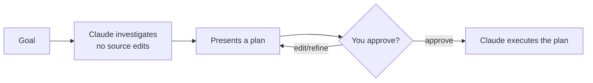

# وضع التخطيط

> Source: https://derob98.github.io/ailmanac/ar/docs/claude-code/plan-mode · AILmanac (CC BY 4.0) · last verified 2026-10-09

تحقَّق واقترح قبل تنفيذ أي تعديل — أأمن طريقة للتعامل مع التغييرات الكبيرة، والقيود التي لا يفرضها.

<LevelBadge level="beginner" />

<Callout type="objectives" items={["اشرح ما الذي يمنعه وضع التخطيط — وما الذي يسمح لـ Claude بتشغيله رغم ذلك", "ادخل إلى وضع التخطيط واخرج منه بثلاث طرق مختلفة", "تتبّع حلقة التحقيق ثم الاقتراح ثم الموافقة ثم التنفيذ", "ميّز بين وضع التخطيط والأذونات (Permissions) واستخدمهما معًا"]} />

<VerifyNote lastVerified="2026-10-09" source="https://code.claude.com/docs/en/permission-modes">
طريقة الدخول إلى وضع التخطيط (اختصار/خيار)، وأوامر الصدفة (shell) التي يسمح لـ Claude بتشغيلها أثناء التخطيط تحديدًا، تتغيّر بين الإصدارات — راجع وثائق Claude Code الرسمية.
</VerifyNote>

## الفكرة الأساسية

تخيّل أنك تسلّم مقاولًا مفاتيح بيتك مباشرةً، مقابل أن تطلب منه أولًا أن يتجوّل في البيت ويكتب *ما* الذي سيغيّره. وضع التخطيط هو تلك الجولة.

**وضع التخطيط** يطلب من Claude أن **يبحث ويقترح التغييرات دون أن ينفّذها**: يقرأ الملفات، ويشغّل أوامر الصدفة للاستكشاف، ويكتب خطة — لكنه **لا يعدّل شيفرتك المصدرية**. تبقى التعديلات محجوبة حتى توافق على الخطة.

<Callout type="tip" items={["وضع التخطيط يعني أن Claude يحقّق (INVESTIGATE) لكنه لا يغيّر (CHANGE) شيفرتك المصدرية — يُنتج خطة وينتظر إشارتك."]} />

### إنه ليس للقراءة فقط بصرامة

الاستكشاف يحتاج أحيانًا إلى أمر، لذا فوضع التخطيط يعني *عدم التعديل*، لا *عدم التنفيذ*. ما يحدث لأمر الصدفة أثناء التخطيط يعتمد على الجلسة — أول حالة تنطبق هي المعتمدة:

<Steps items={[{title: "جلسات الطرفية التفاعلية التي تتوفر فيها أذونات التجاوز (bypass permissions)", body: "قيود وضع التخطيط لا تُفرض. ما زال Claude مُوجَّهًا بأن يخطّط دون تعديل، لكن أي تعديل أو أمر يحاول تنفيذه أثناء التخطيط يعمل دون سؤال. يحتفظ وضع التخطيط بقيوده في كل مكان آخر — تشغيلات -p بلا واجهة، وAgent SDK، ولوحة الدردشة في إضافة VS Code."}, {title: "وضع auto متاح وuseAutoModeDuringPlan مفعّل (الافتراضي)", body: "يراجع المُصنِّف (classifier) أوامر الصدفة بدلًا من سؤالك، باستثناء عمليات حذف المسارات الحرجة. الأوامر المعتمدة تعمل، والمرفوضة تُحجب."}, {title: "وضع auto غير متاح، أو useAutoModeDuringPlan معطّل", body: "الأوامر الخارجة عن المجموعة المدمجة للقراءة فقط تطلب موافقتك."}]} />

<Callout type="warning" items={["إذا شغّلت Claude بالخيار --allow-dangerously-skip-permissions، يصبح وضع التخطيط تعليمة قوية لا حاجزًا صارمًا. تعامل معه على أنه اصطلاح للتخطيط، لا بيئة معزولة (sandbox)."]} />

## لماذا هو أأمن طريقة للبدء

في أي عمل كبير أو محفوف بالمخاطر أو غير مألوف، تريد أن ترى *ما* الذي ينوي Claude فعله قبل أن يلمس مستودعك. وضع التخطيط يفصل **التفكير** عن **التنفيذ**:

العائد: تكتشف الافتراضات الخاطئة *قبل* أن تتحوّل إلى شيفرة خاطئة.

## متى تستخدمه

<Callout type="tip" items={["دائمًا في التغييرات الكبيرة أو متعددة الملفات، وعمليات الترحيل، وإعادة الهيكلة", "عند العمل في قاعدة شيفرة لا تعرفها بالكامل بعد", "عندما تريد خطة قابلة للمراجعة لمشاركتها مع زميل"]} />

في التعديلات الصغيرة الواضحة يمكنك تجاوزه — لكن عند الشك، خطّط أولًا.

## كيف يعمل عمليًا

اتبع الحلقة. كل خطوة تمهّد للتالية — لا ينتقل Claude إلى التعديل إلا *بعد* موافقتك.

<Steps items={[{title: "ادخل وضع التخطيط وصِف هدفك", body: "اضغط Shift+Tab للتنقل بين أوضاع الأذونات حتى يظهر في شريط الحالة 'plan mode on'، أو ابدأ موجّهًا واحدًا بـ /plan. وللبدء من هناك، شغّل Claude بالأمر claude --permission-mode plan. ثم صِف ما تريد تحقيقه."}, {title: "Claude يحقّق", body: "يقرأ الملفات ذات الصلة، ويشغّل أوامر استكشافية، ويطرح أسئلة توضيحية."}, {title: "Claude يعيد خطة خطوة بخطوة", body: "الملفات التي ستتغيّر، والنهج، وكيفية التحقق من النتيجة. اضغط Ctrl+G لفتح الخطة المقترحة في محرّرك وتعديلها مباشرة."}, {title: "توافق أو تُحسِّن", body: "اختر 'Yes, and use auto mode' أو 'Yes, manually approve edits' أو 'No, keep planning'. تؤدي الموافقة إلى الخروج من وضع التخطيط إلى وضع الأذونات الذي يصفه ذلك الخيار، ويبدأ Claude التعديل."}]} />

للخروج من وضع التخطيط دون الموافقة على خطة، اضغط `Shift+Tab` مرة أخرى. ولجعله الوضع الافتراضي لجلسات الطرفية في مشروع، اضبط `defaultMode` على `plan` في `.claude/settings.json` — راجع [الإعدادات](/docs/claude-code/settings).

### جرّب بنفسك

انسخ هذا إلى جلسة تخطيط حقيقية وراقب الحلقة وهي تتكشّف:

<PromptCard title="ابدأ جلسة تخطيط">{`I want to migrate our auth from sessions to JWT. Stay in Plan Mode: investigate the current setup, ask anything you need, then propose a step-by-step plan with files to change and how to verify — don't edit anything yet.`}</PromptCard>

:::tip اقرنه بملف CLAUDE.md
ملف [CLAUDE.md](/docs/claude-code/claude-md) الجيد يجعل الخطط أدق — إذ يخطّط Claude وفي ذهنه أعرافك وضوابطك.
:::

## وضع التخطيط مقابل الأذونات

خلط كلاسيكي. هما يحلّان مشكلتين مختلفتين ويعملان معًا:

- **وضع التخطيط** = "تحقَّق واقترح، لا تعدّل بعد." (هذه الصفحة.)
- **[الأذونات](/docs/claude-code/permissions)** = بمجرد البدء بالتنفيذ، *أي* الإجراءات مسموح بها دون سؤال.

فكّر فيها هكذا: **هل ننفّذ الآن** (وضع التخطيط) مقابل **أي الإجراءات مسموح بها عند التنفيذ** (الأذونات).

<Flashcards cards={[{front: "في أي حالة يضع وضع التخطيط Claude Code؟", back: "البحث والاقتراح: يقرأ الملفات، ويشغّل أوامر الصدفة للاستكشاف، ويكتب خطة، لكنه لا يعدّل شيفرتك المصدرية. تبقى التعديلات محجوبة حتى توافق."}, {front: "كيف تدخل وضع التخطيط وكيف تخرج منه؟", back: "ادخل بـ Shift+Tab أو ببادئة /plan على موجّه واحد أو بـ claude --permission-mode plan. اخرج دون موافقة بالضغط على Shift+Tab مجددًا."}, {front: "ما حلقة وضع التخطيط؟", back: "تحقيق ← عرض خطة ← توافق أو تُحسِّن ← Claude ينفّذ."}, {front: "متى تلجأ إلى وضع التخطيط؟", back: "افتراضيًا للأعمال الكبيرة أو المحفوفة بالمخاطر أو غير المألوفة (تغييرات متعددة الملفات، ترحيل، إعادة هيكلة، قواعد شيفرة مجهولة). تجاوزه فقط في التعديلات الصغيرة الواضحة."}, {front: "وضع التخطيط مقابل الأذونات؟", back: "وضع التخطيط يحدّد ما إذا كنا سننفّذ الآن؛ الأذونات تحدّد أي الإجراءات مسموح بها عند التنفيذ."}]} />

<Callout type="takeaways" items={["وضع التخطيط هو بحث واقتراح: يقرأ Claude ويشغّل أوامر استكشافية لكنه لا يعدّل شيفرتك المصدرية حتى توافق على الخطة", "ليس للقراءة فقط بصرامة — الأوامر أثناء التخطيط إما يراجعها المُصنِّف، أو تطلب موافقتك، أو (مع توفر أذونات التجاوز في طرفية تفاعلية) تعمل دون أي حجب", "ادخل بـ Shift+Tab أو ببادئة /plan أو بـ --permission-mode plan؛ تنقل الموافقة الجلسة إلى الوضع الذي يسمّيه خيار الموافقة", "استخدمه افتراضيًا للأعمال الكبيرة أو المحفوفة بالمخاطر أو غير المألوفة؛ وتجاوزه فقط في التعديلات الصغيرة الواضحة", "وضع التخطيط يحدّد ما إذا كنا سننفّذ الآن؛ الأذونات تحدّد أي الإجراءات مسموح بها عند التنفيذ"]} />

<Quiz title="اختبر نفسك" questions={[{q: "ماذا يستطيع Claude Code أن يفعل في وضع التخطيط؟", options: ["تعديل الملفات وتشغيل أي أمر", "قراءة الملفات وتشغيل أوامر الصدفة للاستكشاف — لكن دون تعديل شيفرتك المصدرية حتى توافق", "الإجابة عن الأسئلة فقط، دون أي وصول إلى الملفات"], answer: 1, explain: "وضع التخطيط يعني عدم التعديل، لا عدم التنفيذ. يقرأ Claude الملفات ويشغّل أوامر استكشافية (يراجعها المُصنِّف أو تطلب موافقتك بحسب الجلسة)، لكن التعديلات على شيفرتك المصدرية تبقى محجوبة حتى توافق على الخطة."}, {q: "متى تلجأ إلى وضع التخطيط؟", options: ["فقط لتصحيح أخطاء الإملاء في سطر واحد", "للتغييرات الكبيرة أو متعددة الملفات، وعمليات الترحيل، وإعادة الهيكلة، أو قواعد الشيفرة غير المألوفة", "أبدًا — فهو يبطئك فحسب"], answer: 1, explain: "استخدمه دائمًا للتغييرات الكبيرة أو متعددة الملفات، وعمليات الترحيل، وإعادة الهيكلة، وعند العمل في قاعدة شيفرة لا تعرفها بالكامل بعد. التعديلات الصغيرة الواضحة يمكنها تجاوزه."}, {q: "ما الترتيب الصحيح لحلقة وضع التخطيط؟", options: ["التنفيذ، ثم التحقيق، ثم الموافقة", "التحقيق دون تعديل، وعرض خطة، ثم موافقتك أو تحسينك، ثم تنفيذ Claude", "الموافقة أولًا، ثم يحقّق Claude ويعدّل"], answer: 1, explain: "يحقّق Claude دون تعديل شيفرتك المصدرية، ويعرض خطة، وتوافق أنت أو تُحسِّن، وعندها فقط ينتقل إلى تنفيذ الخطة."}, {q: "كيف يختلف وضع التخطيط عن الأذونات؟", options: ["هما اسمان للميزة نفسها", "وضع التخطيط = تحقَّق واقترح، لا تعدّل بعد؛ الأذونات = بمجرد البدء بالتنفيذ، أي الإجراءات مسموح بها دون سؤال", "الأذونات تقرّر هل نخطّط؛ ووضع التخطيط يقرّر أي الملفات تُعدَّل"], answer: 1, explain: "وضع التخطيط يفصل التفكير عن التنفيذ. الأذونات تتحكم في الإجراءات المسموح بها دون سؤال حين يبدأ Claude بالتنفيذ. هما يعملان معًا."}]} />

## التالي

- [الأذونات وأوضاع الأذونات](/docs/claude-code/permissions)
- [إدارة السياق](/docs/claude-code/context-management) — أبقِ الجلسات الطويلة فعّالة
- [شرح تطبيقي: خصّص Claude Code لمستودع حقيقي](/docs/walkthroughs/customize-claude-code)
