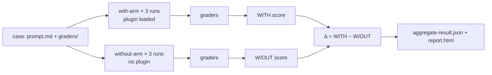

# Plugin Evals: اختبر إضافتك باستخدام claude plugin eval

> Source: https://derob98.github.io/ailmanac/ar/docs/claude-code/plugin-evals · AILmanac (CC BY 4.0) · last verified 2026-09-14

أثبت أن إضافة Claude Code تفيد فعلًا: اكتب حالات تقييم، وصحّحها بستة أنواع من الـ graders، واقرأ الفرق بين التشغيل مع الإضافة وبدونها، وحاكِ خوادم MCP، واجعل النتيجة بوابة في CI.

<LevelBadge level="advanced" />

<VerifyNote lastVerified="2026-09-14" source="https://code.claude.com/docs/en/plugin-evals">
صدر الأمر `claude plugin eval` ضمن Claude Code **الإصدار v2.1.269 (11 سبتمبر 2026)** وهو موثّق بوصفه ميزة حديثة: مخطط الحالة هو `1.1`، ونتيجة JSON هي `schemaVersion: 1`، ويمكن لـ Anthropic إيقاف الأمر من جهة الخادم ("plugin eval is currently unavailable"). القيم الافتراضية والأعلام ودلالات الـ graders أدناه مأخوذة من الصفحة الرسمية بالتاريخ المذكور؛ أعد التحقق منها قبل ربط بوابة صارمة في CI.
</VerifyNote>

<Callout type="objectives" items={[
  "افهم ما يقيسه plugin eval ولا يقيسه `claude plugin validate` ولا الاختبار اليدوي: هل *تُفعَّل* الـ skill، وهل تتفوق على نموذج بلا إضافة",
  "اقرأ الأرقام الثلاثة في كل نتيجة — WITH وW/OUT وΔ — واعرف لماذا تُستبعد بعض الـ graders عمدًا من الدرجة",
  "اختر بين أنواع الـ graders الستة (أربعة مجانية واثنان يعتمدان على نموذج حَكَم) واكتب معايير تصحيح تعطي إشارة مستقرة",
  "حاكِ خوادم MCP الخاصة بالإضافة ليكون التشغيل قابلًا للتكرار ولا يلمس الخدمة الحقيقية أبدًا",
  "اربط بوابة CI بنماذج مثبّتة وسقف للتكلفة وعقد رموز الخروج"
]} />

حتى الآن كان لدى كاتب الإضافة أداتان: `claude plugin validate` التي تتحقق من أن ملفات manifest وfrontmatter قابلة للقراءة، وعيناه. لا تجيب أيٌّ منهما عن السؤال الذي يحدد ما إذا كانت الإضافة تستحق التثبيت: **عندما يكتب المستخدم طلبًا طبيعيًا، هل يختار Claude الـ skill، وهل النتيجة أفضل مما كان Claude سيفعله على أي حال؟** يجيب `claude plugin eval` عن هذا تحديدًا. فهو يشغّل كل حالة في جلسة مؤقتة لا تحمّل سوى إضافتك، ثم يشغّلها مجددًا بلا أي إضافة، ويصحّح الاثنين، ويعرض الفرق.

هذه الصفحة لمن لديه بالفعل [إضافة](/docs/claude-code/plugins-marketplaces) أو [skill](/docs/claude-code/skills) تعمل. إذا كنت تريد المفهوم فقط، فاقرأ القسمين الأولين والاختبار القصير.

## النموذج الذهني: ذراعان وفرق

كل حالة هي **prompt** إضافةً إلى **grader** واحد أو أكثر. الـ grader هو فحص نجاح/فشل لما أنتجه Claude. لكل حالة، يشغّل Claude Code:

- **الذراع مع الإضافة** (with-arm): جلسة headless جديدة لا تحمّل سوى إضافتك، يُرسَل الـ prompt، ويعمل Claude حتى ينتهي أو يبلغ حد الأدوار/الوقت، ثم تُطبَّق الـ graders؛
- **الذراع بدون الإضافة** (without-arm): نفس الـ prompt، وبالعدد نفسه من التشغيلات، دون إضافة.

تشغّل كل ذراع الحالة **ثلاث مرات افتراضيًا**، لأن تشغيلًا واحدًا لوكيل غير حتمي لا يخبرك بشيء تقريبًا. درجة التشغيل هي نسبة الـ graders التي نجحت (موزونة إن حدّدت أوزانًا). ودرجة الحالة هي متوسط التشغيلات. تحصل على:

| العمود | المعنى |
|---|---|
| `WITH` | متوسط الدرجة مع تحميل الإضافة |
| `W/OUT` | متوسط الدرجة بدون إضافة |
| `Δ` | `WITH − W/OUT` — ما أضافته الإضافة فعلًا |

النقطة غير البديهية: **درجة `WITH` المرتفعة وحدها لا تثبت شيئًا.** إذا نالت حالة 1.0 في الذراعين، فقد حلّها Claude بدونك، وتكون إضافتك عبئًا زائدًا لذلك الـ prompt. الرقم Δ هو ما يبرّر وجود الإضافة. توثيق Anthropic نفسه يسمّي أشيع نتيجة أولى: Δ قريب من الصفر *مع* فشل grader الـ skill-fired، أي أن Claude لم يختر skill الخاصة بك قط مع الصياغة الطبيعية. هذه مشكلة في `description` داخل `SKILL.md` وليست مشكلة كود، ولم يكن لأي اختبار يدوي تستدعي فيه الـ skill باسمها أن يكتشفها.



### لماذا تُستبعد بعض الـ graders من الدرجة

فحص مثل "استُدعيت أداة `Skill`" لا يمكن أن ينجح أبدًا في الذراع بدون إضافة. لو احتُسب لسحب `W/OUT` نحو الصفر وضخّم Δ مجانًا. لذلك في التشغيل ثنائي الذراع **يستبعد** Claude Code **من الدرجة، في الذراعين**، كل grader من نوع `tool_used` تكون قيمة `tool` فيه `Skill`، إضافةً إلى أي شيء تعلّمه بـ `arm: with-only`. وتظل تظهر في التقرير مؤشرات نجاح/فشل (يضع لها التقرير شارة "plugin-fired indicator")، ويعلّمها JSON بـ `scored: false`. وتنتج عن ذلك قاعدتان حدّيتان:

- إذا كانت *كل* الـ graders في حالة ما ستُستبعد، فإنها تُحتسب بصورة عادية، وإلا لما بقي شيء للتقييم.
- `arm: both` يجبر الـ grader على الاحتساب في الذراعين. وهذا ما تريده في فحص "يجب ألا تُستدعى الـ skill" على prompt مُضلِّل، ويُكتب بصيغة `tool_used` مع `min: 0` و`max: 0`.

نتيجة تستحق التذكّر: قد تُبلغ المجموعة نفسها عن **درجة مطلقة مختلفة** مع `--ablation none` (ذراع واحدة، دون استبعاد) مقارنةً بالوضع الافتراضي ثنائي الذراع. قارن المتماثل بالمتماثل عند رسم الاتجاهات.

## تشريح حالة

تعيش المجموعة في `evals/` داخل الإضافة (أو في دليل آخر تسمّيه). كل حالة مجلد يحتوي `prompt.md` أو `case.yaml` أو كليهما، إضافةً إلى مجلد `graders/` فيه ملف Markdown واحد لكل grader.

```text
my-plugin/
├── .claude-plugin/plugin.json
├── skills/...
└── evals/
    ├── drafts-commit-message/
    │   ├── prompt.md            # frontmatter: run limits; body: the user's request
    │   └── graders/
    │       ├── criteria.md      # type: llm — rubric in the body
    │       └── skill-fired.md   # type: tool_used, tool: Skill
    ├── ignores-unrelated-request/
    │   └── ...
    ├── mocks/                   # optional suite-wide MCP mocks
    └── results/                 # written by each run — add to .gitignore
```

يُرسَل متن الـ prompt إلى Claude **كما هو تمامًا**. أمران يوقعان من يكتب لأول مرة:

- يبدأ كل تشغيل في **دليل عمل فارغ** مع home مؤقت، بلا إعدادات مستخدم، ولا `CLAUDE.md`، ولا خوادم MCP شخصية، ولا إضافات أخرى، ومع قائمة سماح فقط لمتغيرات البيئة (الأساسية مثل `PATH`، ومصادقة المزوّد، ومعظم `ANTHROPIC_*`/`CLAUDE_CODE_*`، وأي شيء اسمه `EVAL_*`). إذا احتاجت المهمة إلى ملفات، فضعها في الـ prompt أو ولّدها بسكربت scaffold أو أرفقها مع الإضافة.
- إشارات `@path` في الـ prompt **لا** تُوسَّع إلى مرفقات. امنح `Read` في `allowed_tools` إن كان على Claude فتح ملف.

أهم حقول frontmatter في `prompt.md`:

| الحقل | الافتراضي | ملاحظة |
|---|---|---|
| `runs` | 3 | من 1 إلى 50 لكل ذراع؛ `--runs` يتجاوزه |
| `max_turns` | 10 | حتى 200. بلوغه يُسجَّل خطأ تشغيل وغالبًا يخفض الدرجة، فكن سخيًّا |
| `timeout_seconds` | 300 | حتى 3600 لكل تشغيل |
| `allowed_tools` | `[]` | تُمنح الأدوات للقراءة فقط بمجرد سردها؛ وما عداها يحتاج إلى منح عبر CLI |
| `model` | افتراضي الجلسة | `--model` يتجاوزه؛ ثبّته في CI |
| `env` | `{}` | يجب أن تطابق المفاتيح `EVAL_[A-Z0-9_]*` وإلا فشل التشغيل |
| `plugins` | أقرب إضافة تحتويه | اضبطه على `["../.."]` إذا لم يعثر الاكتشاف التلقائي على إضافتك |

يحمل `case.yaml` الحقول نفسها (حقول التنفيذ تحت `execution:`) إضافةً إلى ثلاثة تشير إلى ملفات أخرى: `context.scaffold_script` (سكربت Bash يهيّئ مساحة العمل، لا يعمل إلا مع `--scaffold`)، و`context.history_file` (سجل `.jsonl` يُستأنف ليصبح الـ prompt الدور التالي)، و`context.add_dirs` (أدلة fixtures يستطيع Claude قراءتها).

## أنواع الـ graders الستة

أربعة تُحسب من السجل والملفات ولا تكلّف شيئًا. واثنان يستدعيان نموذج حَكَم ويضيفان إلى الفاتورة.

| النوع | مجاني؟ | ينجح عندما |
|---|---|---|
| `regex` | نعم | يُعثر على تعبير نمطي JavaScript في الهدف (`last_message` افتراضيًا، أو `trace` أو `files` أو ملف بعينه أو `mock_calls`). `match: not_contains` للغياب، و`match: "count:N"` لعدد دقيق. عدم حساسية الحالة يوضع في `flags: i`؛ و`(?i)` المضمّن غير مدعوم |
| `tool_used` | نعم | تقع استدعاءات `tool` التي يطابق مدخلها المرمّز بـ JSON قيمة `input_match` بين `min` (الافتراضي 1) و`max` (بلا حد). `min: 0, max: 0` يؤكد أن الأداة لم تُستدعَ قط |
| `tool_order` | نعم | استُدعيت الأداتان ويسبق أول تطابق لـ `before` أول تطابق لـ `after` |
| `file_exists` | نعم | ملف **أنشأه Claude** يطابق نمط `path` (أو لا يطابق شيء مع `exists: false`). الملفات التي أنشأها scaffold أو عدّلها Claude فحسب لا تُحتسب |
| `llm` | لا | يصوّت نموذج حَكَم بـ PASS على معيارك في **صوتين من ثلاثة** على الأقل |
| `baseline` | لا | يرى حَكَم أن التشغيل يفي بالمعايير على الأقل بقدر سجل مرجعي حفظته باسم `baseline_file` |

**لا توجد graders بكود مخصص.** إذا أردت التحقق من نجاح بناء أو اختبار، فاجعل الـ prompt يطلب من Claude تشغيله وكتابة النتيجة في ملف، وصحّح هذا الملف بـ `regex`، وأكّد أن الأمر نُفِّذ بـ grader من نوع `tool_used` يسمّي `input_match` فيه ذلك الأمر.

الـ grader الخاص بـ skill-fired الذي تريده كل حالة تقريبًا يبدو هكذا (استبدل اسم الـ skill؛ والنمط يطابق أيضًا الصيغة ذات المساحة الاسمية `plugin:skill`):

<PromptCard title="graders/skill-fired.md — did my skill actually run?">{`---
type: tool_used
tool: Skill
input_match: '"skill"\\s*:\\s*"(?:[\\w-]+:)?your-skill-name"'
---`}</PromptCard>

ومعيار الحَكَم بجواره، مكتوبًا بشروط PASS/FAIL ملموسة بدل الصفات:

<PromptCard title="graders/criteria.md — a rubric that gives a stable verdict">{`---
type: llm
weight: 2
---

PASS if the reply is a single conventional-commit subject line under 72 characters,
starts with "refactor:", and mentions both the rename (getUser -> fetchUser) and the
number of call sites updated.
FAIL if the reply contains more than one candidate message, asks a clarifying
question, or omits the rename.`}</PromptCard>

### عادات تُبقي الدرجات مستقرة

هذه ممارسات توصي بها الوثائق الرسمية، وتتفق مع ما يتعلمه بالطريقة الصعبة كل من شغّل خطوط LLM-as-judge:

- **صحّح المخرجات الطويلة بـ `regex` على الملف، لا بحَكَم `llm`.** يزداد تباين الحَكَم بطول ما يقرؤه. احتفظ بـ graders من نوع `llm` للرسائل النهائية القصيرة.
- **grader واحد على النتيجة وآخر على المسار.** يخبرك grader من نوع `regex`/`llm`/`file_exists` بأن الإجابة صحيحة؛ ويخبرك `tool_used`/`tool_order` بأن *إضافتك* هي من أنتجتها. تحتاج إلى الاثنين لتفسير Δ.
- **اشتبه في الحَكَم قبل الإضافة حين يكون Δ سالبًا ولكن الـ skill فُعِّلت.** الحَكَم الافتراضي نموذج صغير سريع؛ وقد يُسقط إجابة صحيحة لأن تنسيقها يختلف عن المعيار. أعد التشغيل بـ `--judge-model sonnet` وشدّد المعيار كي لا يحسم التنسيق.
- **كرّر على حالة واحدة بذراع واحدة**، ثم أكّد بثلاث تشغيلات: `--case <name> --runs 1 --ablation none`. مع ذراع واحدة يعرض الجدول `SCORE` و`PASS%` بدل `WITH`/`W/OUT`/`Δ`.

## حاكِ خوادم MCP

إذا كانت skills الإضافة تستدعي أدوات MCP، فإن التشغيل **لا يبدأ الخوادم الحقيقية أبدًا ما لم تطلب ذلك**. بدلًا من ذلك يسجّل Claude Code بديلًا باسم كل خادم ويجيب عن استدعاءات الأدوات من ملفات Markdown: `evals/mocks/<server>/<tool>.md` للمجموعة كلها، أو مجلد `mocks/` الخاص بالحالة للتجاوز حالةً بحالة. متن الملف هو نتيجة الأداة، مع استبدالات `{{input.<field>}}` وإدراجات `{{file:fixtures/...}}`. الأداة التي ليس لها ملف mock ببساطة غير متاحة لـ Claude.

<PromptCard title="evals/mocks/tracker/create_issue.md — a mock that also asserts the input">{`---
expect:
  title: string
  priority: [low, medium, high]
---

Created issue #4821: {{input.title}}`}</PromptCard>

تحوّل كتلة `expect:` الـ mock إلى تأكيد: الاستدعاء الذي يخالفها **يُجهض التشغيل بدرجة 0** ويسجّل الخادم والأداة والسبب. وجّه grader إلى `target: mock_calls` لتصحيح ما طلبته الإضافة من الخادم. وللخوادم التي تعتمد إجاباتها على المحادثة، يتيح `type: agent` لنموذج صغير أن يلعب دور الخادم؛ وتحفظ التشغيلات النظيفة إجاباته في `results/<timestamp>/mock-recordings/`، وبمجرد نسخ تسجيل إلى `mocks/.replay/<server>/` تعيد التشغيلات اللاحقة تشغيله دون استدعاء نموذج. أودِع `.replay/` في المستودع ليكون CI حتميًّا. ويمنح `_tools.json` (استجابة `tools/list` محفوظة) الأدوات المحاكاة أوصافها ومخططاتها الحقيقية بدل عنصر نائب متساهل.

لاستخدام الخوادم الحقيقية: `--allow-real-servers` يبدأ التي ليس لها mocks؛ و`--mocks off` يتجاهل الـ mocks كلها. وفي الحالتين تعمل تلك العمليات **بصفتك، خارج الـ sandbox**، وتظل أدواتها تحتاج إلى منح صريح مثل `--allow-tools "mcp__plugin_my-plugin_github__*"`.

## التشغيل

<Steps items={[
  {title: "ولّد المجموعة", body: "من جذر الإضافة شغّل `claude plugin eval init`. يفتح جلسة تفاعلية يقرأ فيها Claude الإضافة، ويسأل عن شكل النتيجة الجيدة، ويقترح prompts ينبغي أن تفعّلها وأخرى لا ينبغي، ويصمّم الـ graders، ويجربها مرة واحدة، ويكتب دليل حالة لكل prompt. أما `claude plugin eval init --bare <name>` فيكتب قالبًا فارغًا بدلًا من ذلك (الصيغة الوحيدة التي تعمل بلا طرفية، مثل CI)."},
  {title: "شغّل المجموعة كاملة", body: "`claude plugin eval .` يشغّل كل حالة، في الذراعين، ثلاث مرات لكل منهما. في أول مرة يسأل `Trust this plugin directory?`؛ وداخل مستودع git، الموافقة تعني الوثوق بالمستودع كله، حتى في الجلسات التفاعلية. يُطبع سطر تقدّم لكل تشغيل مع حكم كل grader؛ ثم جدول ملخص ومسار `Report:`."},
  {title: "امنح فقط ما تحتاجه الحالات", body: "لا تتوقف التشغيلات أبدًا لطلب إذن. الأدوات المدمجة التي تحتاج إلى منح لم تمنحه (`Bash` و`Write` و`Edit` و`WebFetch` و`WebSearch`) تُزال من الجلسة بالكامل. امنحها للتشغيل كله: `--allow-tools Write Edit \"Bash(npm test *)\"`. أي منح لـ Bash يعمل داخل sandbox على مستوى نظام التشغيل في Claude Code؛ وعلى جهاز بلا واجهة sandbox خلفية (Windows الأصلي) يُرفض التشغيل بدل تشغيله بلا حصر."},
  {title: "اقرأ التقرير", body: "`report.html` ملف واحد قائم بذاته بلا طلبات خارجية. في الأعلى: سطر حكم (أثر الإضافة بالنقاط مقابل baseline، والحالات التي تحسّنت/استقرت/تراجعت) وخمس بطاقات (درجة المجموعة، Δ الاستئصال، درجة baseline، الحالات الناجحة، التشغيلات الكاملة). تعرض بطاقة كل حالة Δ وشريط درجة بعلامة عند العتبة؛ والـ Δ السالب يحصل على حافة يسرى حمراء. الـ graders الفاشلة تكون مفتوحة مسبقًا مع أصوات الحَكَم والمقطع الذي رآه."},
  {title: "قرّر وجهة التقرير", body: "عند تسجيل الدخول باشتراك claude.ai وتفعيل artifacts، يُنشر التقرير أيضًا كـ artifact خاص ويُطبع عنوان `Published:`؛ و`--no-publish` يبقيه محليًّا. المصادقة بمفتاح API لا تنشر أبدًا. والتشغيل المُطلَق من داخل جلسة Claude Code يبقى محليًّا ما لم تضف `--publish-report`."}
]} />

أمر المجموعة الكاملة مع الأعلام التي ستحتاجها فعلًا:

<PromptCard title="Run the suite with a stronger judge and a cost ceiling">{`claude plugin eval . \\
  --judge-model sonnet \\
  --max-cost-usd 10 \\
  --allow-tools Read Write "Bash(npm test *)" \\
  -j 4`}</PromptCard>

ملاحظات على الأعلام: `-j`/`--concurrency` يتراوح بين 1 و8 ولا يختصر إلا الزمن الفعلي، لأن كل التشغيلات تتقاسم حد معدل حسابك. و`--max-cost-usd` سقف على **تقدير السعر المعلن**، يُفحص قبل بدء كل تشغيل؛ والتشغيلات الجارية تكتمل، فقد يتجاوز الإنفاق السقف بمقدارها، وأي شيء لم يبدأ يجعل الأمر يخرج بالرمز 2 مع `partial: true`. ضع الهدف (`.`) **قبل** `--tag` و`--allow-tools` و`--json`: كلٌّ منها يأخذ قائمة أو قيمة اختيارية وسيبتلع هدفًا يأتي بعده (الخطأ "`--json` output path must end in `.json`" هو هذه الزلّة بعينها).

## كم تكلّف

كل تشغيل وكل صوت حَكَم هو استدعاء نموذج حقيقي على حسابك، يُحتسب من استخدام خطتك أو فاتورة API. الحساب التقريبي: `cases × runs` تشغيلًا للوكيل في الذراع مع الإضافة، ومثلها في الذراع بدونها، إضافةً إلى **ثلاثة استدعاءات قصيرة للحَكَم لكل grader من نوع `llm` أو `baseline` في كل تشغيل**. الحالة الوحيدة في الشرح الرسمي بgraderين (واحد `llm` وواحد `tool_used`) أجرت ستة تشغيلات للوكيل في 74 ثانية بتقدير سعر معلن نحو $0.41. ثلاث رافعات تُبقي المجموعة في المتناول:

- يخفض `--ablation none` تشغيلات الوكيل إلى النصف حين تكرّر على الـ graders ولا تحتاج إلى Δ.
- graders مجانية فقط (`regex` و`tool_used` و`tool_order` و`file_exists`) للمجموعة التي تعمل مع كل commit؛ وgraders الحَكَم للمجموعة الليلية.
- خطأ حد الاستخدام أو حد المعدل في منتصف المجموعة يجعل كل تشغيل لاحق **ينتهي بذلك الخطأ وغالبًا ينال 0، ولا تُوسَم المجموعة بـ `partial`**، فقد يبدو تشغيل مخنوق تمامًا كتراجع. افحص عمود `NOTES` أو `cases[].arms.with[].error` قبل تصديق هبوط مفاجئ.

## اجعل CI يعتمد عليه

<PromptCard title="CI job — pinned models, local report, exit code drives the build">{`claude plugin eval . \\
  --trust-plugin \\
  --json results.json \\
  --threshold 0.8 \\
  --model claude-sonnet-5 \\
  --judge-model claude-haiku-4-5 \\
  --no-publish \\
  --max-cost-usd 20`}</PromptCard>

سبب وجود كل علم:

- يقرّ `--trust-plugin` بقرار الثقة الخاص بأول تشغيل. بدونه يُرفض عمل غير تفاعلي بالرمز 1 (أو يتعلق عند المطالبة إذا خصّص الـ runner طرفية TTY). مرّره فقط للإضافات التي كنت ستشغّل كودها ومجموعتها على جهازك.
- يُثبَّت `--model` و`--judge-model` **ثباتًا** كي لا يُخلَط بين طرح نموذج جديد وتراجع في الإضافة. وهذا أهم مما يبدو: الوكيل قيد الاختبار يستخدم افتراضيًا `ANTHROPIC_MODEL` أو النموذج الافتراضي الحالي في Claude Code، وهو يتغير مع الإصدارات.
- `--threshold 0.8` لأن القيمة الافتراضية **1.0**، مما يجعل الأمر يخرج بالرمز 1 كلما كانت أي حالة أقل من الكمال. وعتبة 1.0 على متوسط ثلاث تشغيلات لوكيل غير حتمي بوابة متقلبة.
- يكتب `--json results.json` مستند النتيجة المُرقَّم بإصدار (`schemaVersion: 1`، بصيغة camelCase، وتُضاف الحقول الجديدة دون إعادة تسمية) ويُسكت مخرجات التقدّم.

عقد رموز الخروج:

| الخروج | المعنى |
|---|---|
| 0 | كل حالة عند العتبة أو فوقها وكل ملفات الحالات حُمِّلت |
| 1 | حالة دون العتبة، أو تعذّر تحميل ملف حالة، أو لم تُوجد حالات، أو تعذّر بدء تشغيل، أو دليل غير موثوق بلا `--trust-plugin`، أو خيار غير صالح |
| 2 | تشغيل جزئي: بلغ سقف التكلفة، أو رُفضت بيانات الاعتماد عند أول تشغيل أو قبله. يُكتب `results.json` مع ذلك بـ `partial: true` |
| 130 / 143 | قُوطع / أُنهي (مثل انتهاء مهلة CI). تُكتب نتائج جزئية |

مشكلات كتابة التقرير أو نشره **لا** تغيّر رمز الخروج أبدًا. عند رسم الاتجاهات، أسقِط المستندات التي فيها `partial: true` والتشغيلات الموسومة بـ `skippedPaidGraders`، لأن درجاتها غير قابلة للمقارنة.

الحقول التي يقرؤها سكربت البوابة من JSON: `aggregates.overallScore` و`aggregates.casesPassed` / `casesTotal` و`aggregates.meanDelta`، ولكل حالة `cases[].aggregates.score` و`.delta` (يُحذف حين لا تكون الذراعان قابلتين للمقارنة). والتشغيل الذي له `cases[].arms.with[].error` غير فارغ (مثل `timed out after 300s`) يظل يُصحَّح بحسب ما أنتجه، فالخطأ لا يعني الدرجة 0؛ أما التشغيل `aborted` (انطلق `expect:` في mock) فينال 0 مع بقاء `error` بقيمة `null`.

## ما الذي يستطيع التشغيل الوصول إليه وما لا يستطيع

اقرأ هذا قبل تقييم إضافة لم تكتبها. توجيه `claude plugin eval` إلى دليل هو قرار الثقة نفسه الذي يتخذه `claude --plugin-dir`: تُحمَّل skills الإضافة **وhooks** وتعمل على جهازك بصفتك. العزل يقيّد ما يستطيعه *الوكيل قيد الاختبار*؛ وليس حدًّا في مواجهة كود الإضافة نفسه، ونجاح المجموعة لا يقول شيئًا عن أمان الإضافة.

- **وكيل معزول.** يحصل كل تشغيل على home ودليل عمل وإعدادات Claude Code مؤقتة، ويعمل كعملية فرعية `claude -p`، ولا يستطيع قراءة دليل الـ evals (فلا يرى prompts الحالة ولا graders ولا حالات الجوار)، وأداة Artifact مُعطَّلة.
- **تظل الإعدادات المُدارة سارية.** القيود التي نشرها مسؤول على الجهاز تسري داخل التشغيل، لذا قد تختلف النتائج على حاسوب مُدار عنها على runner CI غير مُدار.
- **منافذ هروب اختيارية.** يعمل `scaffold_script` الخاص بالحالة بصفتك، خارج الـ sandbox، ومع `--scaffold` فقط. وخوادم MCP الحقيقية مع `--allow-real-servers` أو `--mocks off` فقط. ولا يمكن لـ `allowed_tools` في الحالة ولا لـ frontmatter `allowed-tools` في الـ skill أن يوسّعاها.
- **الشبكة.** أوامر الـ shell التي تمنحها تتبع قواعد شبكة الـ sandbox؛ ومنح `WebFetch(domain:…)` يصل إلى ذلك النطاق مباشرة؛ وhooks الإضافة وأي خادم MCP حقيقي تبدؤه يمكنها الوصول إلى أي مضيف.

بالنسبة إلى إضافة طرف ثالث تأتي بـ hooks أو تحتاج إلى خوادمها الحقيقية، تعامل مع الدرجات بوصفها استرشادية ما لم تشغّل المجموعة في حاوية أو على runner CI. راجع [Reviewing Third-Party Code](/docs/security/reviewing-third-party-code) للقائمة الأشمل.

## مرجع سريع: المزالق

- الـ `target` الافتراضي لـ `regex` هو `last_message`. وعند استهداف `trace` يكون JSON في كل سطر، فتظهر علامات الاقتباس بصيغة `\"` وتكون فواصل الأسطر مهرَّبة.
- `files` هي **قائمة مسارات** أنشأها Claude، لا محتوياتها. لتصحيح المحتوى استخدم `{ source: file, path: <path> }` كـ `target`/`focus`. يرى حَكَم `llm` صور PNG/JPEG/GIF/WebP كصور ويرفض الملفات الثنائية الأخرى (`.pptx`، PDF).
- حَكَم `llm` الذي يقرأ `trace` لا يرى سوى **أول 12 وآخر 12 رسالة**.
- يرى `file_exists` فقط الملفات التي أُنشئت أثناء التشغيل. أما الملف الذي ولّده scaffold أو عُدِّل فقط فهو غير مرئي له؛ صحّح محتواه أو استخدم `tool_used` على `Edit`.
- المفاتيح المجهولة في frontmatter الخاص بـ `prompt.md` خطأ، ويجب أن تكون مفاتيح `env` من نمط `EVAL_*`.
- تقييم إضافة مثبّتة بالاسم (`name@marketplace`) يكتب النتائج تحت `./evals/results/` في دليلك الحالي ويتخطى مطالبة الثقة.
- صيغة حالات plugin-eval **منفصلة** عن ملف `evals/evals.json` الذي تستخدمه إضافة skill-creator لتقييم الـ skills.

<Flashcards cards={[
  {front: "with-arm / without-arm", back: "مجموعتا تشغيلات الحالة: بإضافتك وحدها محمَّلة، وبلا أي إضافة. Δ هو درجة الذراع مع الإضافة ناقص درجة الذراع بدونها."},
  {front: "لماذا لا يُحتسب `tool_used: Skill` في الدرجة؟", back: "لا يمكن أن ينجح بدون الإضافة، فاحتسابه يسحب W/OUT إلى الصفر ويضخّم Δ. يُستبعد في الذراعين ويظهر كمؤشر على تفعيل الإضافة."},
  {front: "العتبة الافتراضية", back: "1.0 — أي حالة أقل من الكمال تجعل الأمر يخرج بالرمز 1. اضبط `--threshold` على عتبتك الحقيقية في CI."},
  {front: "قاعدة أصوات الحَكَم", back: "ينجح grader من نوع `llm` حين يصوّت الحَكَم بـ PASS في صوتين من ثلاثة على الأقل؛ ويقارن grader من نوع `baseline` بسجل مرجعي محفوظ."},
  {front: "رمز الخروج 2", back: "تشغيل جزئي: بلغ سقف --max-cost-usd أو رُفضت بيانات الاعتماد. يُكتب results.json مع ذلك بـ partial: true."},
  {front: "كتلة `expect:` في الـ mock", back: "حارس مدخلات لأداة MCP محاكاة. الاستدعاء المخالف يُجهض التشغيل بدرجة 0 ويسجّل الخادم والأداة والسبب."},
  {front: "متغيرات EVAL_*", back: "متغيرات البيئة المخصصة الوحيدة التي تصل إلى التشغيل. وكل ما عداها من الـ shell لديك محجوب باستثناء قائمة سماح صغيرة."}
]} />

<Quiz title="اختبر نفسك" questions={[
  {q: "نالت حالة 1.00 في WITH و1.00 في W/OUT. ماذا يخبرك ذلك؟", options: ["الإضافة تعمل بشكل مثالي", "يحلّ Claude هذا الـ prompt بدون الإضافة، فلا تضيف الإضافة شيئًا هنا", "الـ graders معطّلة", "نموذج الحَكَم أضعف مما ينبغي"], answer: 1, explain: "Δ يساوي صفرًا. الدرجة المرتفعة في الذراع مع الإضافة وحدها لا تثبت أبدًا أن الإضافة أفادت؛ الفرق بين الذراعين وحده يثبت ذلك."},
  {q: "يشغّل عمل CI الأمر `claude plugin eval . --json results.json` بلا أعلام أخرى ويخرج بالرمز 1 رغم أن كل حالة نالت 0.9. لماذا؟", options: ["وضع JSON يخرج دائمًا بالرمز 1", "قيمة --threshold الافتراضية 1.0، لذا فإن 0.9 فشل", "كان دليل الإضافة موثوقًا", "--json يعطّل التقييم"], answer: 1, explain: "العتبة الافتراضية هي الكمال (1.0). مرّر --threshold 0.8 أو عتبتك. ومرّر أيضًا --trust-plugin في CI، وإلا فإن فحص الدليل غير الموثوق يخرج بالرمز 1 كذلك."},
  {q: "أي أنواع الـ graders لا تكلّف شيئًا إضافيًا عند التشغيل؟", options: ["llm وbaseline", "regex وtool_used وtool_order وfile_exists", "regex فقط", "الستة كلها مجانية"], answer: 1, explain: "أربعة graders تُحسب من السجل والملفات. أما llm وbaseline فيضيف كلٌّ منهما ثلاثة استدعاءات قصيرة للحَكَم في كل تشغيل."},
  {q: "Δ سالب لكن grader الـ skill-fired نجح في كل تشغيل للذراع مع الإضافة. ماذا يقول الإرشاد الرسمي أن تفحص أولًا؟", options: ["احذف الإضافة", "ارفع max_turns", "الحَكَم: أعد التشغيل بـ --judge-model sonnet وشدّد المعيار كي لا يحسم التنسيق", "أضف حالات أكثر"], answer: 2, explain: "قد يُسقط حَكَم صغير إجابة صحيحة لأن تنسيقها يختلف عن المعيار. اشتبه في الحَكَم قبل الإضافة."},
  {q: "تتلقى أداة MCP محاكاة في تشغيل استدعاءً يخالف مدخله كتلة `expect:` في الـ mock. ماذا يحدث؟", options: ["يعيد الاستدعاء سلسلة خطأ ويستمر التشغيل", "يُجهَض التشغيل بدرجة 0 ويُسجَّل السبب", "يُتخطى الـ grader", "يبدأ الخادم الحقيقي بديلًا"], answer: 1, explain: "expect: تأكيد. الاستدعاء المخالف يُجهض التشغيل وينال 0 ويظهر في JSON بوصفه `aborted` مع الخادم والأداة والسبب."},
  {q: "أيٌّ من الآتي يستطيع الوكيل قيد الاختبار الوصول إليه أثناء التشغيل؟", options: ["إعدادات ~/.claude لديك وCLAUDE.md", "خوادم MCP الشخصية لديك", "الـ prompt والـ graders الخاصة بالحالة", "أدوات القراءة فقط المسرودة في allowed_tools للحالة، إضافةً إلى ما منحته بـ --allow-tools"], answer: 3, explain: "التشغيلات معزولة: home وإعدادات مؤقتة، بلا إعدادات شخصية، ولا إضافات أخرى، ودليل الـ evals مخفي عن الوكيل."}
]} />

## المصادر ومزيد من القراءة

- [Test plugins with evals](https://code.claude.com/docs/en/plugin-evals) — المرجع الرسمي الذي بُنيت عليه هذه الصفحة: صيغة الحالات وجدول الـ graders والخيارات ورموز الخروج والعزل
- [Plugin CLI reference: `claude plugin eval`](https://code.claude.com/docs/en/plugins/cli-reference#plugin-eval) — كل علم، مع `plugin eval init` لتهيئة مجموعة
- [Plugins reference: `experimental.evals`](https://code.claude.com/docs/en/plugins-reference#fields) — حقل manifest الذي يشير إلى دليل evals غير افتراضي
- [Claude Code changelog, v2.1.269 (11 سبتمبر 2026)](https://code.claude.com/docs/en/changelog) — مدخل الإصدار
- [Skills: frontmatter وكيف يحسم `description` التفعيل](https://code.claude.com/docs/en/skills)
- [Sandboxing](https://code.claude.com/docs/en/sandboxing) — الـ sandbox على مستوى نظام التشغيل الذي يُطبَّق عند منح Bash لتشغيل
- [Headless mode](https://code.claude.com/docs/en/headless) — العملية الفرعية `claude -p` التي يقوم عليها كل تشغيل

## التالي

- [Plugins & Marketplaces](/docs/claude-code/plugins-marketplaces) — غلّف ما اختبرته للتو وانشره حين تصبح المجموعة خضراء
- [Skills](/docs/claude-code/skills) — حقل `description` هو ما يطلب منك grader الـ skill-fired الفاشل إصلاحه
- [Reviewing Third-Party Code](/docs/security/reviewing-third-party-code) — قبل تشغيل إضافة شخص آخر (وhooks الخاصة بها) عبر eval على جهازك
