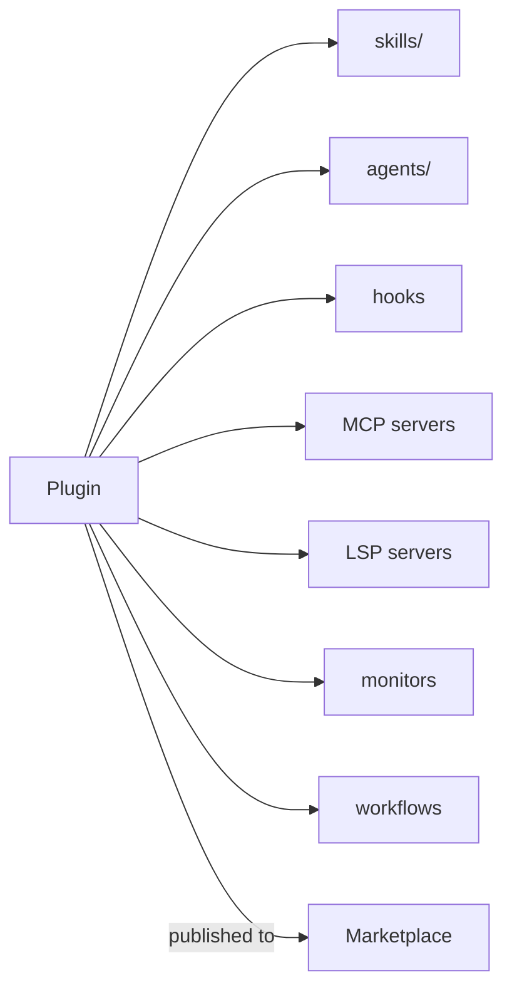

# الإضافات والأسواق

> Source: https://derob98.github.io/ailmanac/ar/docs/claude-code/plugins-marketplaces · AILmanac (CC BY 4.0) · last verified 2026-10-22

اجمع المهارات والوكلاء والأوامر والـ hooks وMCP في وحدة واحدة قابلة للتثبيت.

<LevelBadge level="advanced" />

<VerifyNote lastVerified="2026-10-22" source="https://code.claude.com/docs/en/plugins">
بنية الإضافات وآليات الأسواق تتطور بسرعة — تأكد من التفاصيل في وثائق Claude Code الرسمية.
</VerifyNote>

تجمع **الإضافة** (plugin) عدة تخصيصات — [المهارات](/docs/claude-code/skills) و[الوكلاء الفرعيين](/docs/claude-code/subagents) و[أوامر الشرطة المائلة](/docs/claude-code/slash-commands) و[الـ hooks](/docs/claude-code/hooks) و[خوادم MCP](/docs/claude-code/mcp)، ومنذ Claude Code v2.1.287 أيضًا [**mod**](/docs/claude-code/mods) — في وحدة واحدة مُصدَّرة وقابلة للتثبيت. أما **السوق** (marketplace) فهو فهرس للإضافات يمكن للناس اكتشافها وتثبيتها.

## لماذا تهم الإضافات

- **سلّم مجموعة أدوات الفريق بخطوة واحدة.** بدلًا من أن تطلب من الجميع نسخ خمسة ملفات، انشر إضافة؛ يثبّتها زملاؤك فيحصلون على الأوامر والـ hooks والوكلاء واتصالات MCP نفسها.
- **الإصدارات.** حدّث الإضافة فيحصل الجميع على الإصدار الجديد.
- **التوزيع.** يجعل السوق مجموعة أدواتك (أو مجموعات أدوات الآخرين) سهلة الاكتشاف.

## ما الذي يوجد داخلها عادةً

الإضافة مجلد منظَّم من المكوّنات. ملف البيان `.claude-plugin/plugin.json` **اختياري**: فبدونه يحمّل Claude Code ما يجده في [البنية القياسية](https://code.claude.com/docs/en/plugins-reference#standard-layout) — لذلك فإن مجلدًا لا يحتوي إلا على `SKILL.md` يُحمَّل فعلًا كإضافة. اكتب ملف بيان عندما تريد بيانات وصفية، أو رقم إصدار، أو مكوّنًا خارج مجلده الافتراضي، أو قيمًا يضبطها المستخدم.

إلى جانب المهارات، يمكن للإضافة أن تجمع وكلاء فرعيين و hooks وخوادم MCP، وحديثًا [خوادم LSP](https://code.claude.com/docs/en/plugins-reference#lspservers) لفهم الشيفرة، و[مراقِبات](https://code.claude.com/docs/en/plugins-reference#monitors) في الخلفية، و[سير عمل](https://code.claude.com/docs/en/workflows#distribute-a-workflow-in-a-plugin)، ومجلد `bin/` للملفات التنفيذية، وإعدادات افتراضية. اجعل كل إضافة **متماسكة** — إضافة «اصطلاحات الفريق» أو إضافة «أدوات Python» — بدلًا من خليط عشوائي.

## الثقة قبل التثبيت

:::warning قد تحمل الإضافات شيفرة قابلة للتنفيذ
تعمل الـ hooks وخوادم MCP داخل الإضافة بصلاحياتك. ثبّت من مصادر تثق بها وراجع أولًا ما تفعله الإضافة — راجع [مراجعة الشيفرة من أطراف ثالثة](/docs/security/reviewing-third-party-code).
:::

## مسار لتوسيع إعدادك

التدرّج الطبيعي: ملف `CLAUDE.md` ← بضع [مهارات](/docs/claude-code/skills) و[أوامر](/docs/claude-code/slash-commands) ← اجمعها في إضافة ← انشرها في سوق لفريقك أو للمجتمع. هذه الخطوة الأخيرة جزء من الطريقة التي يريد بها AILmanac المساعدة في نمو المنظومة.

## التالي

- [Mods: إضافات داخل العملية](/docs/claude-code/mods) — مكوّن الإضافة الوحيد الذي يعمل *داخل* Claude Code ويمكنه استبدال سلوكه المدمج
- [تقييمات الإضافات (Plugin Evals)](/docs/claude-code/plugin-evals) — أثبت أن الإضافة مفيدة باستخدام `claude plugin eval` قبل نشرها
- [المهارات](/docs/claude-code/skills) · [الوكلاء الفرعيون](/docs/claude-code/subagents) · [MCP](/docs/claude-code/mcp)
- [مراجعة الشيفرة من أطراف ثالثة](/docs/security/reviewing-third-party-code)
- [حزم المهارات](/docs/templates/skills) من AILmanac
