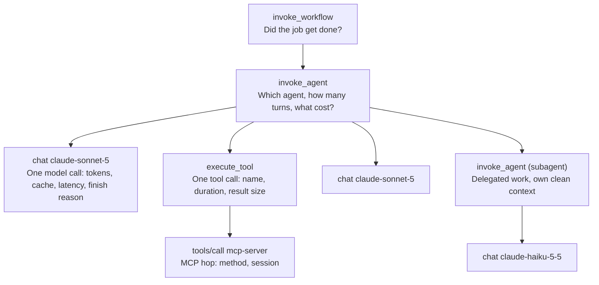

# Agent-Observability: einen Agenten tracen, den man nicht reproduzieren kann

> Source: https://derob98.github.io/ailmanac/de/docs/api/agent-observability · AILmanac (CC BY 4.0) · last verified 2026-10-09

Ein Agentenlauf ist ein nicht-deterministischer verteilter Trace, also lässt er sich nicht durch erneutes Ausführen debuggen — man muss ihn aufgezeichnet haben. Diese Seite behandelt, was aufzuzeichnen ist: die OpenTelemetry-GenAI-Span-Formen (und warum jedes gen_ai.*-Attribut noch immer „Development“ ist), die exakten Metrik- und Event-Namen von Claude Code, die request-id, die Ihren Trace mit dem Anthropic-Support verknüpft, und die drei Datenschutzfallen in der Agenten-Telemetrie.

<LevelBadge level="advanced" />

Wenn ein Agent in Produktion zum ersten Mal etwas Unerklärliches tut, werden Sie versuchen, es zu reproduzieren. Sie führen denselben Prompt mit denselben Tools erneut aus und erhalten eine andere, völlig vernünftige Antwort — und der Fehler ist weg, nicht behoben, er wartet nur.

Dieser Moment ist das ganze Argument dieser Seite. Ein klassischer Dienst ist deterministisch genug, dass Logs eine Annehmlichkeit sind: Aus den Eingaben lässt sich das Verhalten wieder ableiten. Ein Agentenlauf ist ein **nicht-deterministischer verteilter Trace** — Token für Token gesampelt, verzweigt anhand von Tool-Ergebnissen, die sich inzwischen geändert haben, verteilt über Ihren Prozess, den Modellanbieter und beliebig viele MCP-Server. Man kann ihn nicht neu ableiten. Entweder Sie haben ihn aufgezeichnet, oder er ist weg.

Agent-Observability heißt also nicht „später ein Dashboard hinzufügen“. Sie entscheidet darüber, ob Ihre Vorfälle überhaupt debugbar sind. Die gute Nachricht: 2026 gibt es dafür endlich ein gemeinsames Vokabular. Die schlechte — und der Grund, warum der erste Versuch der meisten Teams neu gebaut werden muss — ist, dass das Vokabular **noch nicht stabil ist**, und kaum jemand sagt Ihnen das, bevor Sie 40 Panels an Attributnamen hängen, die sich ausdrücklich ändern dürfen.

<Callout type="objectives" items={[
  "Die vier Span-Typen kennen, die ein Agentenlauf erzeugen sollte, und was an jedem hängt",
  "Verstehen, warum jedes gen_ai.*-Attribut noch das „Development“-Label von OpenTelemetry trägt — und wie man Dashboards baut, die das überleben",
  "Den OpenTelemetry-Export von Claude Code mit den exakten Variablennamen einschalten und die ausgegebenen Metriken und Events lesen",
  "Die request-id erfassen, die einzige Kennung, die der Anthropic-Support nachschlagen kann",
  "Die drei Datenschutzfallen vermeiden: Identität wird nicht geschwärzt, das Gating von Inhalten gilt pro Signal, und Ihr Collector-Endpunkt ist ein Exfiltrationspfad",
  "Ein Kardinalitätsbudget festlegen, bevor die Metrik-Rechnung kommt"
]} />

:::info[Sie müssen diese Instrumentierung möglicherweise nicht mehr selbst schreiben]
Seit Oktober 2026 senden die Claude API und das Claude SDK diese Spans selbst, in der Beta — einschließlich Spans für Dinge, die Ihr Prozess nicht sehen kann, etwa jede Modellanfrage innerhalb einer API-Anfrage und jedes Server-Tool, das die API ausgeführt hat. Diese Seite bleibt die Seite darüber, was die Namen *bedeuten* und wie man auf Namen aufbaut, die sich ändern dürfen. Für die Einrichtung, die Überlappungsregel, die Token-Zahlen ehrlich hält, und die Zustellsemantik siehe [first-party OpenTelemetry tracing](/docs/api/opentelemetry-tracing).
:::

## Warum erneutes Ausführen kein Debugging ist

Vier Eigenschaften eines Agentenlaufs brechen jeweils einen normalen Debugging-Reflex:

| Eigenschaft | Der Reflex, den sie bricht |
| --- | --- |
| **Sampling ist stochastisch** | „Führ es nochmal mit derselben Eingabe aus.“ Dieselbe Eingabe ist nicht derselbe Lauf. |
| **Tool-Ergebnisse sind live** | Selbst bei Temperatur 0 liefert ein Tool, das eine Datenbank, eine Uhr oder das Web liest, etwas Neues. Die Trajektorie weicht bei Schritt 2 ab. |
| **Die Entscheidung steckt im Kontext, nicht im Code** | Ihr Stacktrace zeigt `callModel()`. Er zeigt nicht die 180 KB angesammelter Historie, die das Modell das falsche Tool wählen ließ. |
| **Fehler sind oft still** | Ein defekter Agent wirft selten eine Exception. Er liefert eine selbstsichere falsche Antwort mit HTTP 200. Es gibt nichts abzufangen. |

Der letzte Punkt verdient Nachdruck, weil er die üblichen Instrumentierungsprioritäten umkehrt. In einem typischen Dienst instrumentiert man zuerst die Fehler. Bei einem Agenten **sind die interessanten Fehler Erfolge** — Turns, die abgeschlossen wurden, Geld gekostet haben und das Falsche getan haben. Wenn Sie nur Spans aufzeichnen, die mit `error.type` endeten, haben Sie die einfache Hälfte Ihrer Probleme aufgezeichnet.

## Die vier Spans eines Agentenlaufs

Die GenAI Semantic Conventions von OpenTelemetry definieren die Formen. Das nützliche mentale Modell sind vier verschachtelte Ebenen, die jeweils eine andere Frage beantworten.

Die Namensregeln sind spezifiziert, und sie zu befolgen macht Ihre Traces in einem Tool lesbar, das Sie nicht selbst geschrieben haben:

- **Inference-Span** — `gen_ai.operation.name` ist `chat` (oder `embeddings`, `text_completion`, `generate_content`); der Span-Name ist `{gen_ai.operation.name} {gen_ai.request.model}`, also `chat claude-sonnet-5`. Span-Kind `CLIENT`.
- **Agent-Spans** — `create_agent {gen_ai.agent.name}` und `invoke_agent {gen_ai.agent.name}`, mit Rückfall auf das nackte `invoke_agent`, wenn der Name nicht verfügbar ist. Es gibt sowohl eine Client- als auch eine interne Variante, wodurch sich ein gehosteter Agent und Ihre eigene Schleife unterscheiden lassen.
- **Workflow-Span** — `invoke_workflow {gen_ai.workflow.name}`, für die Multi-Agent-Orchestrierung oberhalb der Agenten.
- **Tool-Span** — `execute_tool`, für die tatsächliche Tool-Ausführung.
- **MCP-Spans** — eine eigene Konvention: Span-Name `{mcp.method.name} {target}` (oder nur `{mcp.method.name}`, wenn es kein Ziel mit niedriger Kardinalität gibt), wobei `mcp.method.name` erforderlich und `mcp.session.id` empfohlen ist. Auch `gen_ai.operation.name` an einem MCP-Tool-Call-Span zu setzen, wird ausdrücklich empfohlen, damit Konsumenten MCP-Tool-Aufrufe wie jeden anderen Tool-Aufruf behandeln können.

Die Attribute pro Aufruf, die ihre Bytes wert sind: `gen_ai.provider.name`, `gen_ai.request.model`, `gen_ai.response.model` (die beiden unterscheiden sich, wenn der Anbieter einen Snapshot festpinnt), `gen_ai.usage.input_tokens`, `gen_ai.usage.output_tokens`, `gen_ai.usage.cache_read.input_tokens`, `gen_ai.usage.cache_write.input_tokens`, `gen_ai.usage.reasoning.output_tokens`, `gen_ai.response.finish_reasons` und, für Streaming, `gen_ai.response.time_to_first_chunk`.

Speziell für Anthropic gibt es eine Anbieter-Konvention, die die generische überschreibt: `gen_ai.provider.name` MUSS `"anthropic"` sein und SOLLTE **bei der Span-Erzeugung** gesetzt werden, statt am Ende nachgetragen zu werden. Dieses Detail ist wichtiger, als es aussieht — Tail-based Sampling und anbieterbezogene Routing-Regeln können nur auf Attribute reagieren, die beim Start des Spans existieren.

<VerifyNote lastVerified="2026-10-09" source="https://github.com/open-telemetry/semantic-conventions-genai">
Span-Namen, Operationsnamen und Attributnamen oben stammen aus dem Repository der OpenTelemetry GenAI Semantic Conventions (`docs/gen-ai/gen-ai-spans.md`, `gen-ai-agent-spans.md`, `anthropic.md`, `mcp.md`). Jedes Dokument darin ist mit **Status: Development** markiert. Prüfen Sie erneut, bevor Sie sich auf einen bestimmten Namen verlassen.
</VerifyNote>

## Das, wovor niemand warnt: Die Konventionen sind nicht stabil

Hier ist die Tatsache, die Ihr Design prägen sollte und die Sie auf keiner Observability-Landingpage eines Anbieters finden.

**Jedes einzelne `gen_ai.*`-Attribut, jeder Span, jede Metrik und jedes Event ist als „Development“ markiert** — der Begriff von OpenTelemetry für das, was früher „experimental“ hieß. Kein einziges ist Stable. Und 2026 sind die Konventionen physisch umgezogen: Das GenAI-Material hat das Haupt-Repository `open-telemetry/semantic-conventions` verlassen und lebt nun in einem eigenen Repository `open-telemetry/semantic-conventions-genai`, das **überhaupt keinen getaggten Release hat** — null Tags, null Releases, bei täglich eingehenden Commits.

Lesen Sie die Attributtabellen in diesem Repo, und die Asymmetrie ist fast komisch. An einem GenAI-Inference-Span tragen `error.type`, `server.address` und `server.port` das grüne **Stable**-Label — die drei, die nichts mit GenAI zu tun haben. Alles, was den Span *zu einem LLM-Span* macht, ist Development.

Verstehen Sie das also nicht als „benutzen Sie die Konventionen nicht“. Benutzen Sie sie — ein gemeinsames Vokabular, das sich vielleicht ändert, schlägt ein maßgeschneidertes, das garantiert nicht übertragbar ist. Verstehen Sie es als **koppeln Sie nichts Teures direkt an diese Namen.** Drei Gewohnheiten machen das billig:

<Steps items={[
  {
    "title": "Über eine Mapping-Schicht ausgeben, nicht über Inline-String-Literale",
    "body": "Ein Modul, das jeden Attributschlüssel besitzt, den Ihre App schreibt. Wenn `gen_ai.usage.reasoning.output_tokens` umbenannt wird, ändern Sie eine Konstante statt 60 Aufrufstellen. Das ist eine Datei mit zwanzig Zeilen und die Maßnahme mit dem höchsten Ertrag auf dieser Seite."
  },
  {
    "title": "Die Konventionsversion als Resource-Attribut festhalten",
    "body": "Versehen Sie jeden Span mit der Semconv-Revision, gegen die Sie ausgegeben haben — ein Commit-SHA tut es, da es keine Tags zum Zitieren gibt. In sechs Monaten lässt sich ein alter Trace nur korrekt interpretieren, wenn man weiß, welche Schreibweise er verwendete. Ohne das spaltet eine Umbenennung stillschweigend eine Metrik in zwei, und Sie mitteln über beide."
  },
  {
    "title": "Auf abgeleitete Werte alarmieren, nicht auf rohe Attributnamen",
    "body": "Definieren Sie `cost_per_completed_task`, `cache_hit_ratio`, `tool_error_rate` einmal, in der Abfrageschicht oder einer Recording-Rule, und richten Sie jedes Dashboard und jeden Alarm darauf aus. Eine Umbenennung bricht dann laut eine Definition statt leise vierzig Panels."
  },
  {
    "title": "Die eigene Kennung des Anbieters neben den standardisierten behalten",
    "body": "Die Konventionen mögen sich ändern; die `request-id` nicht. Siehe den nächsten Abschnitt — das ist Ihr Notausgang, wenn ein Trace mit dem Anbieter abgeglichen werden muss."
  }
]} />

## Die Kennung, die Vorfälle tatsächlich löst: `request-id`

Jede Claude-API-Antwort trägt einen `request-id`-Response-Header mit einem Wert wie `req_018EeWyXxfu5pfWkrYcMdjWG`. Derselbe Wert erscheint als Feld `request_id` in Fehler-Antwortbodys. Es ist die Kennung, nach der der Anthropic-Support fragt, und die einzige, mit der jemand auf der anderen Seite Ihren konkreten Aufruf ansehen kann.

Setzen Sie sie auf den Span. Sie kostet 30 Bytes und ist der Unterschied zwischen „der Agent ist um 03:12 UTC gescheitert, hier sind 900 Kandidaten-Anfragen“ und einem einzigen Lookup.

<PromptCard title="Die Anthropic-Request-ID auf den aktuellen Span übertragen (Python)">
{`import anthropic
from opentelemetry import trace

client = anthropic.Anthropic()
span = trace.get_current_span()

message = client.messages.create(
    model="claude-sonnet-5",
    max_tokens=1024,
    messages=[{"role": "user", "content": "Hello, Claude"}],
)

# The Python and TypeScript SDKs expose it directly on the response object.
span.set_attribute("anthropic.request_id", message._request_id)
span.set_attribute("gen_ai.usage.input_tokens", message.usage.input_tokens)
span.set_attribute("gen_ai.usage.output_tokens", message.usage.output_tokens)`}
</PromptCard>

Drei Besonderheiten, die man kennen sollte, bevor man sie braucht:

- **Python und TypeScript** stellen sie als `_request_id` an Response-Objekten der obersten Ebene bereit. **C#, Go, Java und PHP** stellen sie über ihre Raw-Response-Accessoren bereit (`with_raw_response` / `.withResponse()` / `.withRawResponse()` / `WithRawResponse` / `option.WithResponseInto` / `->raw`). **Ruby** braucht Middleware pro Anfrage, weil das SDK sie nicht am Objekt bereitstellt.
- **Fehler tragen sie trotzdem.** Wenn ein Aufruf fehlschlägt, steht `request_id` im JSON-Fehlerbody — die Korrelation überlebt also genau den Fall, in dem Sie sie am meisten brauchen.
- **Auf Claude Platform on AWS gibt es zwei IDs, und die primäre ist nicht die von Anthropic.** `x-amzn-requestid` ist die primäre ID und die in CloudTrail indizierte; `request-id` ist sekundär. Nutzen Sie die AWS-ID für CloudTrail-Lookups und die Anthropic-ID für Tickets beim Anthropic-Support. Halten Sie beide fest, beschriftet, sonst verbringen Sie einen Nachmittag mit der Suche im falschen System.

<VerifyNote lastVerified="2026-10-09" source="https://platform.claude.com/docs/en/api/errors">
Der `request-id`-Header, das Fehlerbody-Feld `request_id`, die Accessoren pro SDK und das Doppel-ID-Verhalten auf Claude Platform on AWS sind alle auf der Seite zu Claude-API-Fehlern dokumentiert. Header- und Feldnamen sind stabile API-Oberfläche; die Ergonomie pro SDK ändert sich mit den SDK-Versionen.
</VerifyNote>

## Claude Code: der eine Agent, der bereits alles exportiert

Wenn Ihr Agent Claude Code *ist* — in CI, in einer Flotte oder über ein Team hinweg —, müssen Sie nichts instrumentieren. Er bringt einen OpenTelemetry-Exporter mit. Die meisten Teams, die ihn im großen Maßstab betreiben, haben das nie eingeschaltet, was schade ist, denn es beantwortet „was kostet uns das und funktioniert es“ direkt.

<PromptCard title="Claude-Code-Telemetrie gegen einen lokalen OTLP-Collector aktivieren">
{`export CLAUDE_CODE_ENABLE_TELEMETRY=1
export OTEL_METRICS_EXPORTER=otlp
export OTEL_LOGS_EXPORTER=otlp
export OTEL_EXPORTER_OTLP_PROTOCOL=grpc
export OTEL_EXPORTER_OTLP_ENDPOINT=http://localhost:4317
export OTEL_EXPORTER_OTLP_HEADERS="Authorization=Bearer your-token"
claude`}
</PromptCard>

`CLAUDE_CODE_ENABLE_TELEMETRY=1` ist der Hauptschalter — ohne ihn wird nichts exportiert, egal was Sie sonst setzen. Danach wählen Sie Exporter pro Signal: `OTEL_METRICS_EXPORTER` akzeptiert `otlp`, `prometheus`, `console` oder `none`; `OTEL_LOGS_EXPORTER` akzeptiert `otlp`, `console`, `none`. **Traces sind separat und durch ein Beta-Gate geschützt**: Setzen Sie zusätzlich `CLAUDE_CODE_ENHANCED_TELEMETRY_BETA=1`, dann `OTEL_TRACES_EXPORTER`. Die Export-Intervalle betragen standardmäßig 60.000 ms für Metriken und 5.000 ms für Logs.

Die Metriken sind der Teil, auf dem sich ein Dashboard lohnt, weil die Kostenmetriken fein genug zugeordnet sind, um echte Fragen zu beantworten:

| Metrik | Was sie beantwortet |
| --- | --- |
| `claude_code.cost.usage` (USD) | Ausgaben, zuordenbar nach Modell und nach Anfragequelle — Hauptagent vs. Subagent vs. Hilfsaufruf |
| `claude_code.token.usage` (Tokens) | Dieselbe Form in Tokens, also das, was Sie tatsächlich optimieren |
| `claude_code.session.count` | Adoption. Gleichbleibende Sessions bei steigenden Kosten sind eine andere Geschichte als wenn beides steigt. |
| `claude_code.active_time.total` (s) | Aktive Zeit, im Gegensatz zu einem offen gelassenen Terminal |
| `claude_code.lines_of_code.count` | Änderungsvolumen — ein Nenner, nie ein Ziel |
| `claude_code.code_edit_tool.decision` | **Das Qualitätssignal.** Akzeptieren/Ablehnen bei Edit-Tools. Steigende Ablehnungen heißen, dass der Agent schlechtere Arbeit vorschlägt. |
| `claude_code.commit.count`, `claude_code.pull_request.count` | Ergebnis, das den Rechner tatsächlich verlassen hat |

Die Events (als Logs exportiert) sind die Aufzeichnung pro Aktion: `claude_code.user_prompt`, `claude_code.assistant_response`, `claude_code.tool_result`, `claude_code.tool_decision`, `claude_code.api_request`, `claude_code.api_error`, `claude_code.api_refusal`, `claude_code.api_retries_exhausted`, `claude_code.permission_mode_changed`, `claude_code.mcp_server_connection`, `claude_code.skill_activated`, `claude_code.plugin_installed`, `claude_code.plugin_loaded`, `claude_code.at_mention`, `claude_code.auth`, `claude_code.hook_registered`, `claude_code.managed_settings_resolved`, `claude_code.internal_error`, dazu `claude_code.api_request_body` / `claude_code.api_response_body` für rohe Payloads.

Zwei davon verdienen am ersten Tag eine gespeicherte Abfrage. `claude_code.api_retries_exhausted` ist die Form eines Ausfalls, der Ihre Entwickler erreicht — es feuert, nachdem das Backoff des SDK aufgegeben hat. Und `claude_code.permission_mode_changed` ist ein Audit-Trail: So finden Sie heraus, dass die Flotte in einem lockereren Modus lief, als Ihre Richtlinie vorsieht, ohne irgendjemandes Transkript zu lesen.

<VerifyNote lastVerified="2026-10-09" source="https://code.claude.com/docs/en/monitoring-usage">
Variablennamen, Exporter-Optionen, Metriknamen, Event-Namen und das Beta-Gate für Traces stammen aus den Claude-Code-Monitoring-Docs. Claude Code wird häufig aktualisiert und diese Oberfläche wächst — bestätigen Sie die Namen anhand der offiziellen Seite, bevor Sie Alarme darauf aufbauen.
</VerifyNote>

### Zuordnung über mehrere Teams, günstig

Eine Variable erledigt die Arbeit einer ganzen Tagging-Strategie. `OTEL_RESOURCE_ATTRIBUTES` wird als Metrik-Labels exportiert (gesteuert über `OTEL_METRICS_INCLUDE_RESOURCE_ATTRIBUTES`, standardmäßig an), die Kostenstellen-Zuordnung ist also ein Einzeiler in dem, was Ihre Entwicklungsumgebungen bereitstellt:

<PromptCard title="Agenten-Ausgaben einem Team und einer Kostenstelle zuordnen">
{`export OTEL_RESOURCE_ATTRIBUTES="department=engineering,team.id=platform,cost_center=eng-123"`}
</PromptCard>

## Die drei Datenschutzfallen

Hier laufen gut gemeinte Telemetrie-Rollouts schief, und alle drei lassen sich vermeiden, wenn man vor dem Livegang des Collectors davon weiß.

**1. Inhalte werden standardmäßig geschwärzt. Identität nicht.** Die Standardeinstellungen von Claude Code sind bei *Inhalten* wirklich konservativ: Prompts, Assistenten-Antworten, Tool-Parameter und Tool-Ausgaben werden geschwärzt, sofern Sie nicht pro Signal zustimmen (`OTEL_LOG_USER_PROMPTS`, `OTEL_LOG_ASSISTANT_RESPONSES`, `OTEL_LOG_TOOL_DETAILS`, `OTEL_LOG_TOOL_CONTENT`, `OTEL_LOG_RAW_API_BODIES`), und Namen von Drittanbieter-Plugins erscheinen als Platzhalter `"third-party"`, bis `OTEL_LOG_TOOL_DETAILS=1` gesetzt ist. Aber `user.email` — die echte Adresse aus der Anmeldung oder aus den eigenen Zugangsdaten einer Cloud-Session — ist enthalten, wenn verfügbar, und `organization.id` ist bei Authentifizierung immer vorhanden. Die Standardhaltung lautet also: *„Wir wissen nicht, was sie getippt haben, wir wissen genau, wer sie sind.“*

Das ist der richtige Standard für die meisten Unternehmen und der falsche für manche. Wichtig ist die Abgrenzung zum Nachbarn: `user.id` ist eine zufällige anonyme Kennung, die beim ersten Start erzeugt und in `~/.claude.json` gespeichert wird — dokumentiert als ohne personenbezogene Daten und nicht von Ihrem Claude-Konto abgeleitet. `user.account_uuid` und `user.account_id` sind die kontobezogenen, und sie lassen sich per `OTEL_METRICS_INCLUDE_ACCOUNT_UUID` abwählen. Entscheiden Sie bewusst, welche dieser drei Ihr Collector halten soll, und sagen Sie Ihren Entwicklern, welche es ist.

**2. Das Einschalten der Inhaltserfassung verschiebt Ihre Geheimnisse in ein zweites System.** `OTEL_LOG_TOOL_CONTENT=1` ist ein nachvollziehbarer Wunsch — in der Tool-Ausgabe sind die meisten Agentenfehler sichtbar. Es heißt aber auch, dass jede Datei, die Ihr Agent gelesen hat, jede Befehlsausgabe und alles, was eine `.env` zufällig enthielt, jetzt in Ihrem Observability-Backend liegt, unter dessen Aufbewahrungsrichtlinie und Zugriffskontrollen statt unter denen Ihres Repos. Betrachten Sie das Einschalten so, als gäben Sie Ihrem Observability-Anbieter dieselbe Freigabe wie Ihrer Versionsverwaltung, denn genau das ist es. Wenn Sie es nur während eines Vorfalls brauchen, schalten Sie es für den Vorfall ein.

**3. Ihr Collector-Endpunkt ist ein Exfiltrationskanal.** Das ist die Falle mit Zähnen. Telemetrie wird über Umgebungsvariablen konfiguriert, und in Cloud-Umgebungen sind diese für alle Nutzer lesbar — ein vom Entwickler gesetztes `OTEL_EXPORTER_OTLP_ENDPOINT` kann also die Telemetrie einer ganzen Session an einen Host umleiten, von dem Sie nie gehört haben. Die Empfehlung der Docs selbst ist die Lösung: Zugangsdaten und Endpunkte in serverseitig verwaltete Einstellungen legen statt in ambiente Umgebungsvariablen, wo verwaltete Zugangsdaten vom Entwickler gesetzte Variablen entfernen können, genau um den Export an nicht autorisierte Collector zu verhindern. Wenn Sie irgendeine Inhaltserfassung aktiviert haben, ist das keine Hygienefrage mehr, sondern die Kontrolle, auf die es ankommt.

Für rotierende Zugangsdaten gibt es statt eines statischen Tokens einen Hook für dynamische Header: Zeigen Sie `otelHeadersHelper` auf ein Skript, das JSON ausgibt; es läuft beim Start und danach ungefähr alle 29 Minuten (einstellbar über `CLAUDE_CODE_OTEL_HEADERS_HELPER_DEBOUNCE_MS`). Es funktioniert mit `http/protobuf` und `http/json`, nicht mit `grpc` — ein Detail, das Sie sonst eine Stunde kostet, da der Quickstart grpc nutzt.

## Kardinalität: ein Budget wählen, bevor die Rechnung kommt

Agenten-Telemetrie erzeugt auffallend leicht Labels mit hoher Kardinalität, weil die natürlichen Kennungen pro Lauf gelten. Eine Session-ID ist per Definition pro Session einzigartig; hängen Sie sie an eine Metrik, und Sie haben pro Session eine eigene Zeitreihe fabriziert.

Claude Code legt den Zielkonflikt offen, statt ihn zu verstecken, und die Standardwerte verraten, wie die Entwickler abwägen:

| Variable | Standard | Fügt hinzu |
| --- | --- | --- |
| `OTEL_METRICS_INCLUDE_SESSION_ID` | `true` | `session.id`, `ccr.session.id` — **höchste Kardinalität der Gruppe** |
| `OTEL_METRICS_INCLUDE_ACCOUNT_UUID` | `true` | `user.account_uuid`, `user.account_id` |
| `OTEL_METRICS_INCLUDE_RESOURCE_ATTRIBUTES` | `true` | was immer Sie in `OTEL_RESOURCE_ATTRIBUTES` setzen |
| `OTEL_METRICS_INCLUDE_VERSION` | `false` | `app.version` |
| `OTEL_METRICS_INCLUDE_ENTRYPOINT` | `false` | `app.entrypoint` |
| `OTEL_METRICS_INCLUDE_REPOSITORY` | `false` | `vcs.*`-Repository-Attribute |

Die übertragbare Regel, über Claude Code hinaus: **Kennungen pro Lauf gehören auf Spans und Events, nicht auf Metrik-Labels.** Spans sind ohnehin einer pro Lauf, eine Session-ID dort ist also kostenlos und macht den Trace verknüpfbar. An einem Counter oder Histogramm multipliziert sie Ihre Serienzahl mit Ihrem Traffic. Wenn eine Zahl nur für einen Lauf aussagekräftig ist, ist sie keine Metrik.

Die Session-ID ist standardmäßig an, weil das Verknüpfen von Metriken mit Traces wirklich nützlich ist. Wenn Ihr Backend pro Serie abrechnet, ist das der erste Schalter, den Sie umlegen sollten — und das Erste, was Sie prüfen, wenn die Rechnung überrascht.

## Ein Startplan für die Instrumentierung

Kein Reifegradmodell. Die Reihenfolge unten ist so gewählt, dass jeder Schritt für sich nützlich ist und Sie dort aufhören können, wo es dazu passt, wie viel Ihre Agenten Sie kosten können.

<Steps items={[
  {
    "title": "Pro Turn Token-Zahlen, Cache-Aufteilung, Modell und request-id aufzeichnen",
    "body": "Vor jedem Dashboard. Input, Output, Cache Read, Cache Write, Reasoning-Tokens, angefragtes Modell, geantwortetes Modell und die Request-ID des Anbieters. Dieser eine Datensatz beantwortet die meisten Kostenfragen und macht jeden Vorfall mit dem Anbieter abgleichbar. Wenn Sie auf dieser Seite sonst nichts tun, tun Sie das."
  },
  {
    "title": "Die Schleife spannen, nicht nur den Aufruf",
    "body": "Ein Span pro Agenten-Aufruf, der einen Span pro Modellaufruf und einen pro Tool-Aufruf umschließt. Der teure Agentenfehler steckt fast nie in einem einzelnen Aufruf — es ist eine Schleife, die elf Turns für einen Zwei-Turn-Job brauchte, und das sehen Sie ohne den Eltern-Span nicht."
  },
  {
    "title": "Pro Oberfläche ein Qualitätssignal hinzufügen",
    "body": "Kosten ohne Qualitäts-Nenner optimieren darauf hin, weniger zu tun. Bei Claude Code wird Ihnen claude_code.code_edit_tool.decision geliefert. Bei Ihrem eigenen Agenten wählen Sie, was Ihre Nutzer ohnehin implizit akzeptieren oder ablehnen, und zeichnen es vom ersten Tag an als Span-Attribut auf."
  },
  {
    "title": "Auf abgeleitete Verhältnisse alarmieren, und den Budget-Alarm zuerst setzen",
    "body": "cost_per_completed_task, cache_hit_ratio, tool_error_rate, turns_per_task. Ein Agent, der still von 3 auf 30 Turns gestiegen ist, ist in einer ruhigen Woche bei den absoluten Kosten unsichtbar und am Verhältnis offensichtlich. Koppeln Sie das mit einem echten Ausgabenlimit — Telemetrie sagt Ihnen, dass es passiert ist, sie stoppt es nie."
  },
  {
    "title": "Die Inhaltserfassung bewusst entscheiden und die Entscheidung aufschreiben",
    "body": "Standardmäßig aus, bei Vorfällen an, in beiden Fällen dokumentiert — einschließlich der Identitätsattribute, die Ihr Collector hält. Das Team hat ein Recht darauf, es zu wissen; in einem Jahr Sie auch."
  }
]} />

## Häufige Fehler

- **Den Modellaufruf instrumentieren, aber nicht die Schleife.** Die Daten auf Aufrufebene sehen gut aus, bis Sie merken, dass Sie für 30 Turns zahlen. Ohne Eltern-Span gibt es kein `turns_per_task`, an dem man es merkt.
- **Nur fehlgeschlagene Spans behalten.** Agenten scheitern mit HTTP 200. Sampeln Sie auch Erfolge, sonst enthält Ihr Trace-Speicher nur die Fehler, die ohnehin schon einfach waren.
- **`gen_ai.*`-Namen fest in Dashboards einbauen.** Sie sind alle Development, in einem Repo ohne getaggten Release, mit täglich eingehenden Commits. Ein Mapping-Modul, ein Resource-Attribut für die Semconv-Version.
- **Session- oder Lauf-IDs auf Metrik-Labels setzen.** Eine Serie pro Lauf. Setzen Sie sie auf Spans, wo sie kostenlos und nützlicher sind.
- **Kosten ohne Qualitätssignal messen.** Jeder Hebel, der Kosten senkt, senkt auch die geleistete Arbeit. Ein Verhältnis ist ein Ziel; eine rohe Kostenzahl ist eine Falle.
- **Die `request-id` verwerfen.** Sie hat 30 Bytes und ist die einzige Kennung, die die Grenze in die Systeme des Anbieters überschreitet.
- **Tool-Inhalte „vorläufig“ loggen.** Die Aufbewahrung ist sofort und real, und „vorläufig“ hat kein Enddatum. Entscheiden, für den Vorfall einschalten, danach ausschalten.
- **Annehmen, dass der Transport aus dem Quickstart alles unterstützt.** Dynamische Auth-Header funktionieren mit `http/protobuf` und `http/json` — nicht mit dem `grpc`, das Ihnen der Quickstart in die Hand gibt.
- **Kosten-Telemetrie als Kontrolle behandeln.** `claude_code.cost.usage` zählt *nach* Abschluss jeder Anfrage hoch. Es ist eine ausgezeichnete Beobachtung und hat noch nie etwas blockiert.

## Realitätscheck über Anbieter hinweg

Die Konventionen sind von Haus aus anbieterneutral — `semantic-conventions-genai` enthält eigene Dokumente für Anthropic, OpenAI, AWS Bedrock und Azure AI Inference neben den generischen, was eine gemischte Flotte überhaupt erst beherrschbar macht. Zwei Dinge bleiben Ihnen zum Normalisieren:

**Token-Abrechnung bedeutet nicht überall dasselbe.** Gecachter Input, Reasoning-Tokens und multimodale Tokens werden pro Anbieter unterschiedlich bepreist und manchmal unterschiedlich gezählt, daher ist `gen_ai.usage.input_tokens` über Anbieter hinweg summiert eine Zahl ohne Bedeutung. Rechnen Sie am Rand in Geld um, mit dem jeweiligen Tarif des Anbieters, und aggregieren Sie das Geld. Kosten sind die einzige tatsächlich vergleichbare Einheit.

**Die eigene Request-Kennung des Anbieters hat kein Standardattribut.** Jeder Anbieter hat eine, jeder nennt sie anders, und die Konventionen schreiben nicht vor, wo sie landet. Wählen Sie einen Schlüssel — `provider.request_id` ist so gut wie jeder andere — und schreiben Sie die von jedem Anbieter hinein, wobei `gen_ai.provider.name` bereits am Span steht, um sie zu unterscheiden.

<Quiz questions={[
  {
    "q": "Warum ist „lokal reproduzieren“ keine tragfähige Debugging-Strategie für einen Agentenlauf?",
    "options": [
      "Lokale Rechner sind zu langsam, um Frontier-Modelle auszuführen",
      "Sampling ist stochastisch und Tool-Ergebnisse sind live, daher weicht die Trajektorie schon nach wenigen Schritten ab, selbst bei Temperatur 0",
      "Agenten-Frameworks verschlüsseln ihre Traces",
      "Der Anbieter lehnt wiederholte identische Anfragen ab"
    ],
    "answer": 1,
    "explain": "Ein Agentenlauf ist ein nicht-deterministischer verteilter Trace. Das Sampling variiert, und Tools, die eine Datenbank, eine Uhr oder das Web lesen, liefern etwas Neues, sodass die Trajektorie früh abweicht. Der Lauf lässt sich nicht aus seinen Eingaben neu ableiten — entweder wurde er aufgezeichnet, oder er ist weg."
  },
  {
    "q": "Welche Attribute an einem GenAI-Inference-Span tragen das „Stable“-Label von OpenTelemetry?",
    "options": [
      "gen_ai.request.model und gen_ai.usage.input_tokens",
      "nur gen_ai.provider.name",
      "error.type, server.address und server.port — die generischen, die nicht GenAI-spezifisch sind",
      "Alle, seit Semconv v1.42.0"
    ],
    "answer": 2,
    "explain": "Jedes gen_ai.*-Attribut, jeder Span, jede Metrik und jedes Event ist als Development markiert. Die Stable-Labels an einem GenAI-Span gehören den generischen Attributen — error.type, server.address, server.port. Das ist die Asymmetrie, um die man herum designen muss: Leiten Sie teure Dashboards über eine Mapping-Schicht und abgeleitete Metriken statt über rohe gen_ai.*-Namen."
  },
  {
    "q": "Sie aktivieren die Claude-Code-Telemetrie mit den dokumentierten Standardwerten. Was hält Ihr Collector?",
    "options": [
      "Vollständige Prompts und Tool-Ausgaben, aber keine Identität",
      "Nichts, bis Sie zusätzlich CLAUDE_CODE_ENHANCED_TELEMETRY_BETA=1 setzen",
      "Metriken und Events mit user.email und organization.id, aber mit geschwärzten Prompts, Antworten und Tool-Inhalten",
      "Nur aggregierte Zählungen ganz ohne Attribute"
    ],
    "answer": 2,
    "explain": "Inhalte sind standardmäßig geschwärzt — Prompts, Antworten, Tool-Details und Tool-Inhalte brauchen jeweils ihre eigene Opt-in-Variable. Identität nicht: user.email ist enthalten, wenn verfügbar, und organization.id ist bei Authentifizierung immer vorhanden. Das Beta-Gate gilt speziell für Traces, nicht für Metriken und Events."
  },
  {
    "q": "Wohin gehört eine Kennung pro Session?",
    "options": [
      "Auf Metrik-Labels, damit man Ausgaben nach Session gruppieren kann",
      "Auf Spans und Events, nie auf Metrik-Labels",
      "Nirgendwohin — sie sind immer personenbezogene Daten",
      "Nur in die Logs der rohen API-Request-Bodys"
    ],
    "answer": 1,
    "explain": "Ein Span repräsentiert ohnehin einen Lauf, daher kostet eine Session-ID dort nichts und macht den Trace verknüpfbar. An einem Counter oder Histogramm erzeugt sie eine Zeitreihe pro Session und multipliziert Ihre Serienzahl mit Ihrem Traffic. Claude Code setzt OTEL_METRICS_INCLUDE_SESSION_ID standardmäßig auf true, weil die Verknüpfung nützlich ist — es ist der erste Schalter, den Sie umlegen, wenn Ihr Backend pro Serie abrechnet."
  }
]} />

<Flashcards cards={[
  { "front": "Warum Agentenläufe aufgezeichnet statt reproduziert werden müssen", "back": "Stochastisches Sampling + live Tool-Ergebnisse + die Entscheidung liegt im angesammelten Kontext + stille Fehler mit HTTP 200. Die Trajektorie weicht innerhalb weniger Schritte ab, der Lauf lässt sich also nicht aus seinen Eingaben neu ableiten." },
  { "front": "Name des GenAI-Inference-Spans", "back": "{gen_ai.operation.name} {gen_ai.request.model} — z. B. 'chat claude-sonnet-5'. Span-Kind CLIENT. Operationsnamen sind u. a. chat, embeddings, text_completion, generate_content." },
  { "front": "Namen der Agent- und Workflow-Spans", "back": "create_agent {gen_ai.agent.name} · invoke_agent {gen_ai.agent.name} (nacktes 'invoke_agent' ohne Namen; es gibt Client- und interne Varianten) · invoke_workflow {gen_ai.workflow.name} · execute_tool für die Tool-Ausführung." },
  { "front": "MCP-Span-Konvention", "back": "Span-Name {mcp.method.name} {target}, oder nur {mcp.method.name} ohne Ziel mit niedriger Kardinalität. mcp.method.name Required, mcp.session.id Recommended. Auch gen_ai.operation.name zu setzen wird empfohlen, damit MCP-Tool-Aufrufe mit anderen Tool-Aufrufen gruppiert werden." },
  { "front": "Anthropic-Anbieterkonvention", "back": "gen_ai.provider.name MUSS \"anthropic\" sein und SOLLTE bei der Span-Erzeugung gesetzt werden — nicht am Ende nachgetragen, damit Sampling- und Routing-Regeln darauf reagieren können." },
  { "front": "Stabilitätsstatus von gen_ai.* (Okt. 2026)", "back": "Alles Development, nichts Stable. Die Konventionen sind nach open-telemetry/semantic-conventions-genai umgezogen, das null Tags und null Releases hat und täglich Commits erhält. Nur error.type, server.address und server.port sind an einem GenAI-Span Stable." },
  { "front": "Instabile Konventionen überleben", "back": "1) Ein Mapping-Modul besitzt jeden Attributschlüssel. 2) Jeden Span mit dem Semconv-Commit versehen, gegen den ausgegeben wurde. 3) Auf abgeleitete Verhältnisse alarmieren, nicht auf rohe Namen. 4) Die eigene Request-ID des Anbieters daneben behalten." },
  { "front": "Anthropic request-id", "back": "Response-Header request-id (z. B. req_018EeWyXxfu5pfWkrYcMdjWG); derselbe Wert wie request_id in Fehlerbodys. _request_id an Python/TS-Response-Objekten; anderswo Raw-Response-Accessoren; in Ruby Middleware. Die einzige ID, die der Anthropic-Support nachschlagen kann." },
  { "front": "Claude Platform on AWS — zwei Request-IDs", "back": "x-amzn-requestid ist primär und in CloudTrail indiziert; die request-id von Anthropic ist sekundär. AWS-ID für CloudTrail-Lookups, Anthropic-ID für den Anthropic-Support. Beide beschriftet festhalten." },
  { "front": "Hauptschalter der Claude-Code-Telemetrie", "back": "CLAUDE_CODE_ENABLE_TELEMETRY=1, dann OTEL_METRICS_EXPORTER (otlp/prometheus/console/none) und OTEL_LOGS_EXPORTER (otlp/console/none). Traces brauchen zusätzlich CLAUDE_CODE_ENHANCED_TELEMETRY_BETA=1, dann OTEL_TRACES_EXPORTER." },
  { "front": "Qualitätsmetrik von Claude Code", "back": "claude_code.code_edit_tool.decision — Akzeptieren/Ablehnen bei Edit-Tools. Die eine Metrik, die den Kosten einen Nenner gibt: steigende Ablehnungen heißen, dass der Agent schlechtere Arbeit vorschlägt, selbst wenn die Ausgaben gleich bleiben." },
  { "front": "Zwei Claude-Code-Events für den ersten Tag", "back": "claude_code.api_retries_exhausted (ein Ausfall, der Ihre Entwickler erreicht, nachdem das Backoff aufgegeben hat) und claude_code.permission_mode_changed (Audit-Trail für eine Flotte, die lockerer läuft als die Richtlinie, ohne Transkripte zu lesen)." },
  { "front": "Standardwerte für Inhalt vs. Identität", "back": "Inhalt standardmäßig geschwärzt (OTEL_LOG_USER_PROMPTS / _ASSISTANT_RESPONSES / _TOOL_DETAILS / _TOOL_CONTENT / _RAW_API_BODIES jeweils Opt-in). Identität nicht: user.email wenn verfügbar, organization.id bei Authentifizierung immer." },
  { "front": "user.id vs. user.account_uuid in Claude Code", "back": "user.id ist eine zufällige anonyme Kennung, die beim ersten Start in ~/.claude.json erzeugt wird — dokumentiert als ohne personenbezogene Daten und nicht vom Konto abgeleitet. user.account_uuid / user.account_id sind kontobezogen und per OTEL_METRICS_INCLUDE_ACCOUNT_UUID abwählbar." },
  { "front": "Telemetrie-Konfiguration als Exfiltrationskanal", "back": "Umgebungsvariablen in Cloud-Umgebungen sind für alle Nutzer lesbar, daher kann ein vom Entwickler gesetztes OTEL_EXPORTER_OTLP_ENDPOINT die Telemetrie einer Session umleiten. Endpunkte und Zugangsdaten in serverseitig verwaltete Einstellungen legen, wo verwaltete Zugangsdaten vom Entwickler gesetzte Variablen entfernen." },
  { "front": "Dynamische OTel-Auth-Header", "back": "otelHeadersHelper zeigt auf ein Skript, das JSON ausgibt; läuft beim Start und ca. alle 29 Minuten (CLAUDE_CODE_OTEL_HEADERS_HELPER_DEBOUNCE_MS). Funktioniert mit http/protobuf und http/json — NICHT mit grpc, das der Quickstart nutzt." },
  { "front": "Kardinalitätsregel für Agenten", "back": "Kennungen pro Lauf gehören auf Spans und Events, nie auf Metrik-Labels — eine Session-ID an einem Counter bedeutet eine Zeitreihe pro Session. Wenn eine Zahl nur für einen Lauf aussagekräftig ist, ist sie keine Metrik." },
  { "front": "Warum Token-Summen über Anbieter hinweg bedeutungslos sind", "back": "Gecachter Input, Reasoning-Tokens und multimodale Tokens werden pro Anbieter unterschiedlich gezählt und bepreist. Am Rand mit dem jeweiligen Tarif in Geld umrechnen, dann das Geld aggregieren — Kosten sind die einzige vergleichbare Einheit." }
]} />

<Callout type="takeaways" items={[
  "Einen Agentenlauf kann man nicht reproduzieren, also ist Observability kein optionales Tooling — sie ist die einzige Aufzeichnung, die es geben wird.",
  "Zeichnen Sie die interessanten Erfolge auf, nicht nur die Fehler. Agenten scheitern mit HTTP 200 und einer selbstsicheren falschen Antwort.",
  "Jeder gen_ai.*-Name ist „Development“, in einem Repo ohne getaggten Release. Nutzen Sie die Konventionen; leiten Sie Dashboards über eine Mapping-Schicht und abgeleitete Metriken.",
  "Spannen Sie die Schleife, nicht nur den Aufruf. Der teure Fehler sind elf Turns für einen Zwei-Turn-Job, und er ist auf Aufrufebene unsichtbar.",
  "Setzen Sie die request-id auf jeden Span. Sie hat 30 Bytes und ist die einzige Kennung, die in die Systeme des Anbieters hineinreicht.",
  "Claude Code exportiert das alles bereits — mit einer Umgebungsvariable. claude_code.code_edit_tool.decision ist der Qualitäts-Nenner, der den meisten Teams fehlt.",
  "Inhalte werden standardmäßig geschwärzt, Identität nicht. Wissen Sie, welche von user.id, user.email und user.account_uuid Ihr Collector hält, und sagen Sie es Ihrem Team.",
  "Ihr OTLP-Endpunkt ist ein Exfiltrationspfad. Verwalten Sie ihn serverseitig, besonders sobald irgendeine Inhaltserfassung an ist.",
  "IDs pro Lauf auf Spans, nie auf Metrik-Labels. Kosten-Telemetrie beobachtet; sie hat noch nie eine einzige Anfrage blockiert."
]} />

## Weiter

- [First-party OpenTelemetry tracing](/docs/api/opentelemetry-tracing) — die Spans, die API und SDK jetzt für Sie senden, und die eine Regel, die verhindert, dass sie Ihre Tokens doppelt zählen
- [Cache diagnostics](/docs/api/cache-diagnostics) — die Felder pro Anfrage, die erklären, *warum* ein Cache-Read, auf den Sie gezählt hatten, nicht stattfand
- [Hard spend caps](/docs/models/hard-spend-caps) — die Durchsetzungsschicht, die diese Seite nur beobachtet: welche Anbieter die Anfrage tatsächlich blockieren
- [Evaluating agents](/docs/playbooks/evaluating-agents) — die Qualitätssignale, die Sie gerade aufzuzeichnen begonnen haben, in ein wiederholbares Urteil verwandeln

## Quellen & weiterführende Literatur

- [OpenTelemetry GenAI semantic conventions](https://github.com/open-telemetry/semantic-conventions-genai) — das eigene Repository, in das die GenAI-Konventionen umgezogen sind: Span- und Agent-Span-Dokumente, Anbieter-Dokumente für Anthropic / OpenAI / Bedrock / Azure, die MCP-Konventionen und die Development-Statuslabels an allen davon
- [Generative AI semantic conventions — OpenTelemetry](https://opentelemetry.io/docs/specs/semconv/gen-ai/) — der Umzugshinweis („This page has moved and is no longer maintained in this repository“)
- [Monitoring usage — Claude Code](https://code.claude.com/docs/en/monitoring-usage) — die Telemetrie-Variablen, Exporter, Metrik- und Event-Namen, Schalter für Inhalts-Gating und Kardinalität, dynamische Header und die Empfehlung zu serverseitig verwalteten Einstellungen für Zugangsdaten
- [Claude API errors — Anthropic](https://platform.claude.com/docs/en/api/errors) — der `request-id`-Header und das Fehlerfeld `request_id`, die Accessoren pro SDK und die doppelten Request-IDs auf Claude Platform on AWS
- [Model Context Protocol specification](https://modelcontextprotocol.io/specification/2025-06-18/basic/transports) — Session-Management, das `mcp.session.id` identifiziert
- Verwandt: [Fehler und Rate Limits](/docs/api/errors-and-rate-limits) · [Agenten bauen](/docs/api/building-agents) · [MCP-Token-Kosten](/docs/claude-code/mcp-token-cost) · [Langlaufende Agent-Harnesses](/docs/frontiers/long-running-agent-harnesses) · [Was Ihr Agent hochlädt](/docs/security/what-your-agent-uploads) · [AI-Gateways](/docs/models/ai-gateways-litellm-openrouter-portkey)
