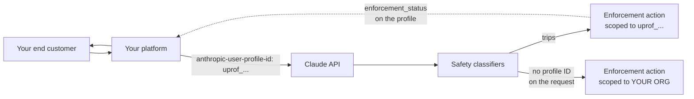

# Benutzerprofile & Durchsetzung: Lass nicht einen Kunden deine ganze Organisation sperren

> Source: https://derob98.github.io/ailmanac/de/docs/api/user-profiles-and-enforcement · AILmanac (CC BY 4.0) · last verified 2026-11-02

Der Leitfaden für Betreiber zu Claude-API-Benutzerprofilen — ordne jede Anfrage einem Endkunden zu, damit eine Sicherheitsbeschränkung oder Sperre ein einzelnes Profil trifft statt deine gesamte Organisation. Vollständige Feldreferenz, die vier enforcement_status-Werte, das enac_-Aktionsschema, Organisations-Webhooks und die Polling-Schleife, die du brauchst, weil die Ereigniszustellung noch nicht aktiv ist.

<LevelBadge level="advanced" />

<Callout type="objectives" items={[
  "Das Problem des Wirkungsradius, das jede KI-Plattform hat: Ohne Zuordnung kann ein einzelner missbräuchlicher Endkunde dazu führen, dass deine gesamte Organisation beschränkt wird",
  "Wie du einen Endkunden registrierst (POST /v1/user_profiles) und jede Anfrage zuordnest (der Header anthropic-user-profile-id)",
  "application vs. passthrough — welcher access_type zu der Art passt, wie du Claude verkaufst, und warum der falsche die Zuordnung schwächt",
  "Die vier enforcement_status-Werte und die genaue Regel, die einen auswählt, einschließlich pending (das die erzählende Dokumentation auslässt)",
  "Das Schema enforcement_actions: sechs Gründe, der nächste Schritt verify und die Regeln zur Vorwärtskompatibilität, die Anthropic dich defensiv zu codieren bittet",
  "Warum Organisations-Webhooks noch kein Ersatz für eine Polling-Schleife sind — und die genaue Listenabfrage, die jedes beschränkte Profil findet",
  "Wo das stillschweigend nichts bewirkt: Claude Platform on AWS, Bedrock und von Google verwaltetes Google Cloud verhalten sich jeweils anders",
]} />

<VerifyNote lastVerified="2026-11-02" source="https://platform.claude.com/docs/en/manage-claude/user-profiles">
Benutzerprofile wurden am **20. Oktober 2026** eingeführt; die Felder `enforcement_status` und `enforcement_actions` kamen am **21. Oktober 2026** zusammen mit der [API-Version 2026-10-21](/docs/api/api-version-2026-10-21) hinzu. Organisations-Webhooks sind **Beta** (`webhooks-2026-10-07`), und Anthropics eigene Dokumentation hält fest, dass die **Ereigniszustellung nicht aktiv ist** — du kannst Endpunkte registrieren, aber es werden noch keine Ereignisse gesendet. Feldnamen und Enum-Werte stammen aus dem [Leitfaden zu Benutzerprofilen](https://platform.claude.com/docs/en/manage-claude/user-profiles), der [List-User-Profiles-Referenz](https://platform.claude.com/docs/en/api/user_profiles/list) und dem [Leitfaden zu Organisations-Webhooks](https://platform.claude.com/docs/en/manage-claude/organization-webhooks). Prüfe erneut, bevor du eine harte Abhängigkeit auslieferst.
</VerifyNote>

Wenn du Claude weiterverkaufst, ein KI-Gateway betreibst oder auf der Claude API ein Produkt baust, bei dem sich Tausende Fremde anmelden, hast du ein Problem, das Single-Tenant-Entwickler nicht haben: **Anthropics automatisierte Sicherheitsklassifikatoren laufen über deinen API-Traffic, und jede Anfrage kommt unter deiner Organisation an.** Ein Endkunde, der etwas tut, das einen Klassifikator auslöst, ist aus Anthropics Sicht nicht von *dir* zu unterscheiden. Die Durchsetzungsmaßnahme, die folgt, gilt für deine gesamte Organisation — und reißt alle anderen Kunden mit.

Benutzerprofile sind die Lösung. Du sagst Anthropic, für welchen Endkunden jede Anfrage ist, und eine Durchsetzungsmaßnahme trifft stattdessen dieses Profil. Der Rest deines Traffics läuft weiter.

:::tip[Das ist eine Kontrolle des Wirkungsradius, keine Abrechnungsfunktion]
Profile sind nicht abrechenbar und ändern keine Preise. Sie gewähren oder entziehen von sich aus nichts. Ihre gesamte Aufgabe ist, die Durchsetzung *gezielt* zu machen — was nur hilft, wenn du den Traffic zugeordnet hast, **bevor** etwas schiefgeht. Es gibt keine rückwirkende Zuordnung.
:::

## Die Version in einem Absatz

Erstelle mit `POST /v1/user_profiles` ein Profil pro Endkunde, speichere die zurückgegebene ID `uprof_…` im Datensatz deines Kunden und sende sie bei jeder Anfrage, die du für diesen Kunden stellst, im Header `anthropic-user-profile-id`. Betreibe dann eine Schleife, die deine Profile gefiltert nach `enforcement_status[]=restricted` und `enforcement_status[]=banned` auflistet, damit du von einer Maßnahme erfährst, bevor es dein Support-Postfach tut. Anfragen **ohne** Profil-ID zählen als deine eigene Nutzung — und löst eine davon einen Klassifikator aus, bist du zurück bei der organisationsweiten Durchsetzung.

## Die Einrichtung in vier Schritten

<Steps items={[
  {title: "Trenne deinen eigenen Traffic in eine andere Organisation", body: "Ein Profil gehört zu einer Organisation, nicht zu einem Workspace, daher reichen getrennte Workspaces innerhalb einer Organisation nicht aus. Halte den Endkunden-Traffic in einer Organisation und deine interne Nutzung in einer anderen. Nur die Endkunden-Organisation braucht Profile."},
  {title: "Registriere jeden Endkunden einmal, beim Onboarding", body: "POST /v1/user_profiles gibt ein Profil mit einer uprof_-ID zurück. Der Endpunkt ist NICHT idempotent — jeder Aufruf erzeugt ein neues Profil, auch wenn reference_id mit einem bereits vorhandenen übereinstimmt. Erstelle es in deinem Anmeldeablauf und speichere die ID; lass nie eine Dienstinstanz spontan ein eigenes erstellen."},
  {title: "Sende die ID bei jeder Anfrage für diesen Kunden", body: "Der Header anthropic-user-profile-id. Die SDKs und die ant-CLI stellen ihn als Argument bereit (user_profile_id; userProfileId in Java, UserProfileID in Go/C#, --user-profile-id in der CLI). Er funktioniert gleich bei Messages, Token-Zählung, Message Batches und der OpenAI-SDK-Kompatibilitätsschicht."},
  {title: "Polle auf Durchsetzungsmaßnahmen und halte Profile aktuell", body: "Liste Profile nach enforcement_status auf, um Beschränkungen und Sperren zu finden. Aktualisiere ein Profil, wenn sich die Angaben oder der Kontostatus des Kunden ändern; lösche es, wenn er sein Konto schließt oder dich bittet, seine Daten zu löschen."},
]} />



Die gestrichelte Linie ist die, die du selbst bauen musst. Anthropic setzt die Durchsetzungsfelder; nichts schickt sie dir heute zu.

## Entscheide, wer ein Profil bekommt

Wofür ein Profil *steht*, hängt davon ab, wie du Claude verkaufst. Das Feld `access_type` hält fest, welcher Fall zutrifft, und ein falscher Wert schwächt die Zuordnung, für die du das Profil eingerichtet hast.

| Für wen der Traffic ist | Was zu erstellen ist | `access_type` |
| --- | --- | --- |
| Ein angemeldeter Benutzer deines Produkts | Ein Profil pro Benutzer, bei der Anmeldung erstellt | `application` — **der Standard**, verwendet, wenn du das Feld weglässt |
| Ein Unternehmen, dem du API-Zugriff weiterverkaufst (Gateway, Reseller) | Ein Profil pro **Unternehmen**, nicht pro Person darin | `passthrough` — **nicht** der Standard, du musst es also senden |
| Die Nutzung deiner eigenen Organisation | Nichts. Eine Anfrage ohne Profil-ID zählt als deine eigene Nutzung — halte sie in einer separaten Organisation | n. z. |
| Ein Workspace in deiner Organisation | Kein separates Profil. Ein Profil gehört zur Organisation, und seine ID funktioniert über jeden Workspace darin | n. z. |

<PromptCard title="Einen Reseller-Kunden registrieren (passthrough)">{`curl https://api.anthropic.com/v1/user_profiles \\
  -H "x-api-key: $ANTHROPIC_API_KEY" \\
  -H "anthropic-version: 2023-06-01" \\
  -H "content-type: application/json" \\
  -d '{
    "name": "Acme Analytics, Inc.",
    "access_type": "passthrough",
    "external_user_details": {
      "reference_id": "cust-8f2a1c",
      "country": "US"
    }
  }'`}</PromptCard>

Lass bei einem `application`-Profil `access_type` weg und beschreibe in `name` und `external_user_details` eine Person statt eines Unternehmens.

:::warning[Ein passthrough-Profil identifiziert ein Unternehmen, keine Person]
Stammt eine Anfrage über einen Reseller von einem identifizierbaren Menschen, sende *zusätzlich* eine Kennung dieses Menschen im Feld `metadata.user_id` der Messages-Anfrage selbst — das ist ein anderes Objekt als das `metadata` des Profils. Ohne sie sieht Anthropic zwar, dass sich das Unternehmen falsch verhält, aber nicht, welcher seiner Benutzer, und die mögliche Maßnahme fällt entsprechend grob aus.
:::

### Was du Anthropic sagen solltest, und was nicht

Jedes Feld ist optional. Du kannst `name`, `metadata` (bis zu 16 Paare; Schlüssel ≤ 64 Zeichen, Werte ≤ 512) und sieben Felder innerhalb von `external_user_details` senden: `entity_type`, `country`, `reference_id`, `onboarded_at`, `account_status`, `name_hash`, `email_hash`. Ein Profil enthält **nur**, was du sendest, plus die von Anthropic gesetzten Status — niemals Gesprächsinhalte, und Anthropic prüft nichts davon.

Vier Regeln, die du verinnerlichen solltest, bevor du den Onboarding-Code schreibst:

- **Lass Unbekanntes weg, sende keine Platzhalter.** Du kannst einen Wert in `external_user_details` später ersetzen, aber **niemals löschen**. Die API lehnt `null` mit einem 400 ab. Ein `"unknown"`-String, den du am ersten Tag geschrieben hast, ist dauerhaft.
- **`country` ist das Land des *Kunden***, nicht deins.
- **`reference_id` ist deine eigene Kennung** für den Kunden. Sie muss nicht eindeutig sein und ist kein Schlüssel zur Deduplizierung — siehe die Warnung zur fehlenden Idempotenz oben.
- **Wenn du keinen Namen oder keine E-Mail teilen kannst, sende einen Hash.** `name_hash` und `email_hash` lassen Anthropic erkennen, welche deiner Profile eine Identität *teilen*, ohne sie je zu erhalten. Die Hashfunktion wählst du — aber verwende für jedes Profil dieselbe Funktion und dieselbe Normalisierung von Groß-/Kleinschreibung und Leerzeichen, denn nur identisch berechnete Werte stimmen überein. Ein Feld für eine Klartext-E-Mail-Adresse gibt es überhaupt nicht.

## Jede Anfrage zuordnen

<PromptCard title="Ein Messages-Aufruf, einem Endkunden zugeordnet">{`curl https://api.anthropic.com/v1/messages \\
  -H "x-api-key: $ANTHROPIC_API_KEY" \\
  -H "anthropic-version: 2023-06-01" \\
  -H "anthropic-user-profile-id: $PROFILE_ID" \\
  -H "content-type: application/json" \\
  -d '{
    "model": "claude-opus-5-5",
    "max_tokens": 1024,
    "messages": [{"role": "user", "content": "Hello, Claude"}]
  }'`}</PromptCard>

Modell-IDs ändern sich — siehe [Aktuelle Modelle & Preise](/docs/whats-new/models-and-pricing) für das aktuelle Angebot.

Auf der Claude API, Claude Platform on AWS, von Anthropic gehosteten Microsoft-Foundry-Deployments und von Anthropic verwaltetem Claude auf Google Cloud wird die ID **bei jeder Anfrage validiert**: Eine fehlerhaft aufgebaute ID oder eine, die zu einer anderen Organisation gehört, liefert einen `400` `invalid_request_error`. Diese organisationsübergreifende Prüfung schlägt auf eine bestimmte, überraschende Weise zu — wenn du Traffic unter zwei Organisationen sendest (sagen wir eine auf der Claude API und eine auf Claude Platform on AWS), wird ein von der einen erstelltes Profil von der anderen abgelehnt.

**Message Batches ist die Ausnahme.** Beim Erstellen eines Batches wird nur das *Format* der ID geprüft. Eine wohlgeformte ID, die nicht zu deiner Organisation gehört, lässt das Erstellen des Batches trotzdem zu, und dann schlägt jede Anfrage darin einzeln fehl, mit einem `errored`-Ergebnis, das denselben `invalid_request_error` trägt. Wenn du Batches zuordnest, validiere die ID vor dem Absenden selbst — siehe [Message Batches](/docs/api/message-batches).

### Wo es stillschweigend weniger leistet

Das ist die Tabelle, die du lesen solltest, bevor du annimmst, dass die Zuordnung funktioniert.

| Plattform | Dort Profile erstellen? | ID senden in | Funktionieren die Durchsetzungsfelder? |
| --- | --- | --- | --- |
| Claude API | Ja | Header `anthropic-user-profile-id` | Ja |
| Claude Platform on AWS | Ja | Header `anthropic-user-profile-id` | **Nein** — immer `unrestricted` / leer |
| Microsoft Foundry (von Anthropic gehostet) | Ja | Header `anthropic-user-profile-id` | Ja |
| Claude Models on Google Cloud (von Anthropic verwaltet) | Ja | Header `anthropic-user-profile-id` | Ja |
| Claude Models on Google Cloud (von Google verwaltet) | Nein — auf der Claude API oder Claude Platform on AWS erstellen | Header `anthropic-user-profile-id` | Nur Formatprüfung |
| Claude in Amazon Bedrock | Nein — auf der Claude API oder Claude Platform on AWS erstellen | **Feld** `user_profile_id` **im Request-Body** | Nur Formatprüfung |

Drei Folgerungen:

1. **Auf Claude Platform on AWS ist `enforcement_status` immer `unrestricted` und `enforcement_actions` immer leer** — und Anthropic lehnt dort keine Anfragen wegen einer offenen Maßnahme ab. Baue kein Dashboard, das „alles in Ordnung“ von einer Plattform abliest, die nichts anderes melden kann.
2. **Auf Bedrock und von Google verwaltetem Google Cloud wird die ID formatgeprüft, aber nie nachgeschlagen.** Eine Antwort `200` bestätigt **nicht**, dass die ID einem echten Profil entspricht. Eine ID mit Tippfehler, die aber wohlgeformt ist, sieht genau wie ein Erfolg aus, ordnet aber nichts zu.
3. **Bei Bedrock ist die ID ein Body-Feld, kein Header** — `"user_profile_id": "uprof_…"` auf oberster Ebene. Und sie funktioniert nicht mit der älteren Bedrock-Integration, die du über `InvokeModel` oder `Converse` aufrufst.

Für Bedrock und von Google verwaltetes Google Cloud musst du außerdem das **Konto verknüpfen** mit der Anthropic-Organisation, der deine Profile gehören, im Verification Portal unter `portal.anthropic.com` bei **Linked accounts** (Admin startet die Verknüpfung → jemand mit IAM-Zugriff führt einen bereitgestellten Befehl aus → der Admin schließt die Verifizierung ab). Programmfreigaben, die an ein Profil gebunden sind, gelten für die Anfragen dieses Kontos erst, wenn das Portal es als **Linked** anzeigt.

## Den Durchsetzungsstatus lesen

Jede Antwort, die ein Profil zurückgibt — create, retrieve, update und jede Zeile einer Liste — enthält `enforcement_status` und `enforcement_actions`.

```json
{
  "type": "user_profile",
  "id": "uprof_011CZkZCu8hGbp5mYRQgUmz9",
  "enforcement_status": "restricted",
  "enforcement_actions": [
    {
      "type": "restriction",
      "id": "enac_011CZkZEq4TnWb7xLfRgPm2v",
      "reason": "fraud_or_abuse",
      "action": null,
      "opened_at": "2026-10-02T19:30:00Z",
      "expires_at": null
    }
  ]
}
```

### Die vier Status — und der eine, den der Leitfaden auslässt

`enforcement_status` wird von **der ersten zutreffenden Regel** bestimmt, in dieser Reihenfolge:

| Wert | Regel |
| --- | --- |
| `banned` | Eine offene Maßnahme ist ein `ban` |
| `pending` | Eine Beschränkung, die eine Identitätsprüfung aufheben *kann*, ist offen, der Endbenutzer hat diese Prüfung eingereicht, Anthropics Bearbeitung ist nicht abgeschlossen, und das `reason` keiner offenen Maßnahme ist `account_compromise` |
| `restricted` | Irgendeine Maßnahme ist offen |
| `unrestricted` | Keine Maßnahme ist offen |

:::warning[Anthropics eigene Dokumentation ist sich über die Anzahl der Werte nicht einig]
Der [Leitfaden zu Benutzerprofilen](https://platform.claude.com/docs/en/manage-claude/user-profiles) und der [Leitfaden zu Organisations-Webhooks](https://platform.claude.com/docs/en/manage-claude/organization-webhooks) beschreiben `enforcement_status` beide mit drei Werten — `unrestricted`, `restricted`, `banned`. Die [API-Referenz](https://platform.claude.com/docs/en/api/user_profiles/list) dokumentiert **vier**, mit `pending` als Zusatz, und akzeptiert `pending` im Listenfilter `enforcement_status[]`. Betrachte die API-Referenz beim Enum als maßgeblich und behandle `pending` ausdrücklich: Es ist der eine Zustand, in dem der Endkunde etwas gegen das Problem unternimmt, und es als generisches `restricted` zu behandeln, verliert dieses Signal. Wir haben die Abweichung gemeldet; dieser Hinweis entfällt, sobald sie bereinigt ist.
:::

### Das Aktionsobjekt

`enforcement_actions` listet die **offenen** Maßnahmen auf und ist leer, wenn es keine gibt. Eine Maßnahme, die endet, verlässt die Liste einfach.

| Feld | Bedeutung |
| --- | --- |
| `type` | `restriction` (Anthropic hat eingeschränkt, wie es den Endbenutzer bedient; er kann teilweise weiterhin bedient werden) oder `ban` (Anthropic hat aufgehört, ihn zu bedienen, und plant nicht, es wieder zu tun) |
| `id` | Die ID der Maßnahme, mit Präfix `enac_`, stabil, solange die Maßnahme offen ist |
| `reason` | Einer von `unsupported_region`, `fraud_or_abuse`, `high_harm`, `usage_policy_violation`, `account_compromise`, `unspecified` |
| `action` | Der nächste Schritt: `verify` (der Endbenutzer kann sie jetzt durch das Bestehen einer Identitätsprüfung aufheben) oder `null` (er kann im Moment nichts tun — **auch während Anthropic eine bereits eingereichte Prüfung bearbeitet**). Bei einem Ban immer `null` |
| `opened_at` | Wann Anthropic sie eröffnet hat (RFC 3339) |
| `expires_at` | Wann sie von selbst endet, oder `null`, wenn sie kein Enddatum hat. Bei einem Ban immer `null`, und immer `null`, wenn `reason` gleich `account_compromise` ist |

Solange eine Maßnahme offen ist, lehnt Anthropic einige oder alle Inferenzanfragen ab, die die ID dieses Profils tragen.

Zwei Felder sind **schreibgeschützt**: Eine Create- oder Update-Anfrage, die `enforcement_status` oder `enforcement_actions` enthält, liefert einen `400`. Und verwechsle `enforcement_status` (Anthropics Entscheidung) nicht mit `external_user_details.account_status` (`active` / `suspended` / `blocked` — *deine* Entscheidung über das Konto). Sie sind unabhängig, und du wirst beide wollen: Dass Anthropic einen Kunden beschränkt, den du für aktiv hältst, ist genau der Alarm, bei dem es sich lohnt, jemanden zu rufen.

### Codiere die Regeln zur Vorwärtskompatibilität jetzt

Anthropic behält sich vor, Enum-Werte hinzuzufügen, und sagt dir, wie du degradieren sollst. Schreibe diese vier Zeilen defensiver Zuordnung gleich am ersten Tag, statt später einen Absturz auszuliefern:

| Nicht erkannter… | Behandeln als |
| --- | --- |
| `enforcement_status` | `restricted` |
| Aktions-`type` | `restriction` |
| `reason` | `unspecified` |
| `action` | `null` |

## Du brauchst trotzdem eine Polling-Schleife

Der vorgesehene Echtzeitweg sind **Organisations-Webhooks** (Beta, `webhooks-2026-10-07`), verwaltet unter `/v1/organizations/webhooks` mit zwei Ereignistypen:

| Ereignis | Auslöser |
| --- | --- |
| `user_profile.enforcement_action_opened` | Anthropic eröffnet eine Durchsetzungsmaßnahme für ein Profil |
| `user_profile.enforcement_action_resolved` | Eine Maßnahme endet — Anthropic löst sie auf, oder ihr `expires_at` verstreicht |

:::warning[Die Ereigniszustellung ist nicht aktiv]
Anthropics Dokumentation hält klar fest, dass diese beiden Ereignisse **nicht gesendet** werden, ein registrierter Endpunkt also nichts empfängt. Du kannst Endpunkte registrieren und deinen Handler gegen das dokumentierte Ereignisformat bauen, aber zum Verifizierungsdatum dieser Seite ist **Polling der einzige Mechanismus, der dir tatsächlich von einer Durchsetzungsmaßnahme erzählt.** Baue zuerst die Schleife und betrachte den Webhook-Handler als Upgrade-Pfad.
:::

<PromptCard title="Jedes beschränkte oder gesperrte Profil finden (die Schleife, die du wirklich brauchst)">{`curl --globoff "https://api.anthropic.com/v1/user_profiles?\\
enforcement_status[]=restricted&\\
enforcement_status[]=banned&\\
limit=100" \\
  -H "x-api-key: $ANTHROPIC_API_KEY" \\
  -H "anthropic-version: 2026-10-21"`}</PromptCard>

Hier gibt es eine nicht offensichtliche Paginierungsregel, und sie zu überspringen ist der Weg zu einem Monitor, der Kunden stillschweigend übersieht:

:::warning[Eine kurze Seite bedeutet nicht das Ende der Liste]
Ist `enforcement_status[]` gesetzt, prüft der Dienst pro Anfrage eine **begrenzte Anzahl von Profilen**. Eine Seite kann weniger Profile als `limit` enthalten — **oder gar keine** — und trotzdem einen `next_page`-Cursor tragen. **Nur ein `null` bei `next_page` bedeutet, dass die Auflistung vollständig ist.** Fordere weiter Seiten an, bis dahin. Der Filter kann außerdem mit `overloaded_error` fehlschlagen, wenn die Maßnahmen eines Profils momentan nicht gelesen werden können — wiederhole also, statt das als „keine Ergebnisse“ zu behandeln.
:::

Zwei weitere Fallen im selben Bereich:

- **Beobachte nicht `updated_at`.** Anthropic sagt, dass eine Änderung an den Durchsetzungsfeldern es *nicht zuverlässig* verschiebt. Vergleiche die Feldwerte mit dem, was du zuletzt gespeichert hast.
- **Lass den Legacy-Beta-Header weg.** Jede Anfrage, deren Header `anthropic-beta` `user-profiles-2026-09-04` oder früher trägt, **lässt beide Durchsetzungsfelder ganz weg** und lässt den Filter `enforcement_status[]` einen `400` liefern. Das Symptom — jedes Profil wirkt `unrestricted`, weil das Feld fehlt — liest sich genau wie eine gute Nachricht. Entferne den Wert, um die Felder zu erhalten.

### Falls und sobald Ereignisse tatsächlich fließen

Das Ereignisformat ist bereits spezifiziert, daher lohnt es sich, den Handler zu schreiben. Ereignisse tragen **IDs, nicht den Zustand**: `data.id` ist die Profil-ID, `data.enforcement_action_id` die `enac_`-ID.

```json
{
  "type": "event",
  "id": "whe_4f2a9c1e7b3d5a8f0e6c2b9d1a7f3e5c",
  "created_at": "2026-10-15T17:02:41Z",
  "data": {
    "type": "user_profile.enforcement_action_opened",
    "id": "uprof_011CZkZCu8hGbp5mYRQgUmz9",
    "enforcement_action_id": "enac_011CZkZEq4TnWb7xLfRgPm2v",
    "organization_id": "org_011CZkZBj9RsYd3wNcHvKq6t"
  }
}
```

Die Aufgabe des Handlers ist also immer dieselbe: das Profil abrufen und seinen aktuellen Zustand lesen. Rekonstruiere den Zustand nie aus der Reihenfolge der Ereignisse — Anthropic warnt, dass Ereignisse **verspätet oder in falscher Reihenfolge** eintreffen können, und garantiert nur, dass das Profil die Änderung (oder eine spätere) bereits widerspiegelt, wenn ein Ereignis eintrifft. Zustellungen folgen der Spezifikation [Standard Webhooks](https://www.standardwebhooks.com/) mit den Headern `webhook-id`, `webhook-timestamp` und `webhook-signature`; prüfe die Signatur gegen das `whsec_`-Geheimnis des Endpunkts, bevor du irgendetwas vertraust, **antworte innerhalb von 5 Sekunden mit 2xx** und erledige langsame Arbeit danach, und **dedupliziere anhand der Ereignis-`id`** (derselbe Wert wie `webhook-id`), weil ein Endpunkt dasselbe Ereignis zweimal erhalten kann. Fehlgeschlagene Zustellungen werden in den nächsten Minuten einige Male wiederholt und dann verworfen — die Polling-Schleife ist also auch dauerhaft dein Aufholmechanismus.

Betriebliche Grenzen der Endpunkte, die man vorab kennen sollte: Eine Organisation kann bis zu **32** Endpunkte haben (deaktivierte zählen mit); die URL muss **HTTPS auf Port 443 mit einem öffentlichen Domainnamen** sein, keine IP; zwei *aktivierte* Endpunkte dürfen keine URL teilen; und Anthropic **deaktiviert** einen Endpunkt **automatisch**, der ein `3xx` zurückgibt, auf eine nicht öffentliche IP auflöst oder weiter fehlschlägt — seine Ereignisse werden dauerhaft übersprungen, statt später wiedergegeben zu werden. Der Zugang ist beschränkt: Deine Organisation muss Organisations-Webhooks von deinem Account-Team aktivieren lassen, darf keine aktivierte HIPAA-Readiness haben und darf auf ihrem Standard-Workspace keinen vom Kunden verwalteten Verschlüsselungsschlüssel verwenden. Siehst du bei diesen Endpunkten einen `404`, ist die übliche Ursache der fehlende Beta-Header oder eine nicht freigeschaltete Organisation — keine falsche ID.

Beachte auch: **Das Löschen eines Profils beendet seine offenen Maßnahmen, ohne ein `…_resolved`-Ereignis auszusenden**, und eine Maßnahme, die vor der Registrierung deines Endpunkts geöffnet wurde, erzeugt ebenfalls kein `…_opened`-Ereignis. Beide Lücken schließt dieselbe Listenabfrage.

## Profile aktuell halten

`POST /v1/user_profiles/[id]` ändert nur die Felder, die du sendest, mit drei unterschiedlichen Merge-Semantiken, die du nicht vermischen solltest:

- `name` und `access_type` — **ersetzen** den gespeicherten Wert.
- Jedes Feld in `external_user_details` — **ersetzt** den gespeicherten Wert und kann nicht gelöscht werden (`null` → `400`).
- `metadata` — **führt Schlüssel für Schlüssel zusammen**. Ein gesendeter Schlüssel überschreibt, **ein leerer String löscht den Schlüssel**, und weggelassene Schlüssel bleiben unberührt.

<PromptCard title="Ein Konto auf deiner Seite sperren und einen Metadata-Schlüssel entfernen">{`curl "https://api.anthropic.com/v1/user_profiles/$PROFILE_ID" \\
  -H "x-api-key: $ANTHROPIC_API_KEY" \\
  -H "anthropic-version: 2023-06-01" \\
  -H "content-type: application/json" \\
  -d '{
    "external_user_details": {"account_status": "suspended"},
    "metadata": {"trial_cohort": ""}
  }'`}</PromptCard>

`DELETE /v1/user_profiles/[id]` löscht dauerhaft alles, was **du** geliefert hast — `name`, `external_user_details`, `metadata`. Es entfernt **nicht** die Trust-and-Safety-Aufzeichnungen, die Anthropic zu dieser Profil-ID führt. Drei Dinge, die du richtig machen solltest:

1. **Höre auf, die ID zu senden, bevor du löschst.** Für bis zu etwa **10 Minuten** nach einem Löschen können Inferenzanfragen mit der gelöschten ID noch erfolgreich sein; danach lehnen die Plattformen, die Profile nachschlagen, sie mit einem `400` ab — und Bedrock sowie von Google verwaltetes Google Cloud, die sie nicht nachschlagen, akzeptieren sie für immer weiter.
2. **Eine Löschanfrage eines fortbestehenden Kunden bedeutet erstellen-umschalten-löschen** — neues Profil, Traffic umlenken, das alte löschen.
3. **Ein `404` bei einem wiederholten Löschen bedeutet, dass das erste funktioniert hat.** Wiederhole Serverfehler; lies das `404` als Erfolg.

## Häufige Fehler

| Fehler | Was tatsächlich passiert |
| --- | --- |
| Das Profil träge bei der ersten Anfrage anlegen, über `reference_id` als Schlüssel | `POST /v1/user_profiles` ist nicht idempotent. Du erhältst pro Aufruf eine neue `uprof_`, und dein Traffic verteilt sich auf doppelte Profile, sodass kein einzelnes das Signal ansammelt, auf dem die Durchsetzung beruht |
| Den eigenen internen Traffic in derselben Organisation halten | Nicht zugeordnete Anfragen zählen als deine Nutzung; löst eine davon einen Klassifikator aus, gilt die Maßnahme wieder organisationsweit — genau das Ergebnis, das Profile verhindern sollen |
| Getrennte Workspaces statt getrennter Organisationen nutzen | Ein Profil gilt auf Organisationsebene. Seine ID funktioniert über jeden Workspace, sodass Workspaces hier keine Isolation bieten |
| `user-profiles-2026-09-04` in `anthropic-beta` belassen | Beide Durchsetzungsfelder verschwinden aus jeder Antwort, und der Listenfilter liefert 400. Jeder Kunde wirkt unauffällig |
| Die Paginierung bei der ersten kurzen Seite beenden | Mit `enforcement_status[]` ist eine kurze oder leere Seite normal. Nur `next_page: null` beendet die Liste — wer früher aufhört, übersieht gesperrte Kunden |
| `updated_at` auf Änderungen pollen | Es bewegt sich nicht zuverlässig, wenn sich die Durchsetzung ändert. Vergleiche die Feldwerte |
| „Alles in Ordnung“ von Claude Platform on AWS ablesen | Es meldet immer `unrestricted` ohne Maßnahmen. Es kann dir nichts anderes sagen |
| Ein `200` bei Bedrock als Beweis für die Zuordnung werten | Bedrock prüft nur das Format der ID. Eine wohlgeformte, aber falsche ID ordnet nichts zu und liefert Erfolg |
| `access_type: application` für ein weiterverkaufendes Unternehmen senden | Die Zuordnung beschreibt dann einen „Benutzer“, der in Wirklichkeit ein ganzes Unternehmen ist, und das Signal pro Person darin geht verloren, sofern du nicht auch `metadata.user_id` sendest |
| Einen Platzhalter in `external_user_details` schreiben | Werte können ersetzt, aber nie gelöscht werden. Der Platzhalter ist dauerhaft |

## Quiz

<Quiz questions={[
  {
    q: "Dein Monitor listet Profile mit enforcement_status[]=restricted&enforcement_status[]=banned auf und erhält eine Seite mit 0 Profilen und einem next_page, das nicht null ist. Was sollte er tun?",
    options: [
      "Aufhören — eine leere Seite bedeutet, dass es keine beschränkten Profile gibt",
      "Weiter Seiten anfordern, bis next_page null ist",
      "Dieselbe Seite wiederholen, da eine leere Seite immer ein Fehler ist",
      "Den Filter entfernen und stattdessen jedes Profil durchsuchen"
    ],
    answer: 1,
    explain: "Ist enforcement_status[] gesetzt, prüft der Dienst pro Anfrage eine begrenzte Anzahl von Profilen, sodass eine Seite weniger Profile als limit enthalten kann — oder gar keine — und dennoch einen next_page-Cursor trägt. Nur ein null bei next_page bedeutet, dass die Auflistung vollständig ist. Bei der ersten kurzen Seite aufzuhören ist der Weg, auf dem ein Monitor gesperrte Kunden stillschweigend übersieht."
  },
  {
    q: "Du betreibst ein KI-Gateway, das API-Zugriff an Unternehmen weiterverkauft. Jede Anfrage trägt anthropic-user-profile-id, und jedes Profil hat enforcement_status: unrestricted — doch die Inferenz für einen Kunden wird weiterhin abgelehnt. Du rufst die Claude API direkt auf. Was ist die wahrscheinlichste Ursache?",
    options: [
      "Das external_user_details.account_status des Profils steht auf blocked",
      "Du sendest user-profiles-2026-09-04 (oder früher) im Header anthropic-beta, sodass die Durchsetzungsfelder in jeder Antwort fehlen",
      "passthrough-Profile melden keinen Durchsetzungsstatus",
      "Das Profil wurde vor mehr als 10 Minuten gelöscht"
    ],
    answer: 1,
    explain: "Unter user-profiles-2026-09-04 und früheren Beta-Werten lassen Antworten enforcement_status und enforcement_actions ganz weg — und der Filter enforcement_status[] liefert einen 400. Ein fehlendes Feld wird zu nichts deserialisiert, was dein Code als „in Ordnung“ liest. Entferne den Wert aus anthropic-beta, um die Felder zu erhalten. (account_status ist deine eigene Entscheidung und veranlasst Anthropic nie zur Ablehnung; access_type beeinflusst das Reporting nicht; ein gelöschtes Profil würde beim Abrufen 404 liefern.)"
  },
  {
    q: "Bei einem Profil ist eine Beschränkung mit dem reason \"fraud_or_abuse\" offen. Der Endkunde hat die von Anthropic verlangte Identitätsprüfung eingereicht, und die Bearbeitung läuft noch. Was zeigt enforcement_status, und was zeigt das Feld `action` der Maßnahme?",
    options: [
      "restricted, und action ist \"verify\"",
      "pending, und action ist null",
      "pending, und action ist \"verify\"",
      "unrestricted, weil eine eingereichte Prüfung die Maßnahme aufhebt"
    ],
    answer: 1,
    explain: "pending ist genau der Zustand, in dem eine aufhebbare Beschränkung offen ist, die Prüfung eingereicht wurde, die Bearbeitung nicht abgeschlossen ist und das reason keiner offenen Maßnahme account_compromise ist. Und `action` ist null, solange diese Bearbeitung läuft — null bedeutet „der Endbenutzer kann im Moment nichts tun“, was auch das Warten auf eine bereits eingereichte Prüfung einschließt. Beachte, dass die erzählenden Leitfadenseiten pending ganz auslassen; die API-Referenz dokumentiert es."
  }
]} />

<Flashcards title="Die ID-Präfixe und Header" cards={[
  {front: "uprof_", back: "Eine Benutzerprofil-ID. Von POST /v1/user_profiles zurückgegeben; speichere sie im Datensatz deines Kunden."},
  {front: "enac_", back: "Eine ID einer Durchsetzungsmaßnahme. Stabil, solange die Maßnahme offen ist; verlässt enforcement_actions, wenn die Maßnahme endet."},
  {front: "wep_", back: "Die ID eines Organisations-Webhook-Endpunkts. Bis zu 32 pro Organisation, deaktivierte eingeschlossen."},
  {front: "whsec_", back: "Das Signaturgeheimnis eines Organisations-Webhook-Endpunkts. Wird nur beim Erstellen des Endpunkts oder beim Neugenerieren des Geheimnisses zurückgegeben — bewahre es sicher auf."},
  {front: "anthropic-user-profile-id", back: "Der Anfrage-Header, der einen Aufruf einem Endkunden zuordnet. Bei Claude in Amazon Bedrock wird er stattdessen zu einem Body-Feld user_profile_id auf oberster Ebene."},
  {front: "webhooks-2026-10-07", back: "Der anthropic-beta-Wert, der bei jeder Anfrage an /v1/organizations/webhooks erforderlich ist. Fehlt er, kommt 404, nicht 400."},
  {front: "access_type: application", back: "Der Standard. Ein Profil pro einzelnem Endbenutzer deines Produkts."},
  {front: "access_type: passthrough", back: "Nicht der Standard — du musst ihn senden. Ein Profil pro Unternehmen, dem du Claude-Zugriff weiterverkaufst."},
  {front: "enforcement_status: pending", back: "Eine aufhebbare Beschränkung ist offen, der Endbenutzer hat eine Identitätsprüfung eingereicht, die Bearbeitung ist nicht abgeschlossen, und keine offene Maßnahme ist account_compromise. Nur in der API-Referenz dokumentiert."},
]} />

<Callout type="takeaways" items={[
  "Zuordnung ist präventiv und lässt sich nicht rückwirkend anwenden — eine ohne Profil-ID gesendete Anfrage ist für immer die eigene Nutzung deiner Organisation.",
  "Baue die Polling-Schleife vor dem Webhook-Handler: Anthropic hält fest, dass die Ereigniszustellung nicht aktiv ist, daher ist das Auflisten nach enforcement_status[] heute der einzige funktionierende Mechanismus.",
  "Paginiere, bis next_page null ist. Mit dem Filter enforcement_status[] ist eine kurze oder leere Seite zu erwarten, nicht das Ende der Liste.",
  "Entferne user-profiles-2026-09-04 und früher aus anthropic-beta, sonst verschwinden beide Durchsetzungsfelder stillschweigend, und jeder Kunde wirkt unbeschränkt.",
  "Behandle pending ausdrücklich und ordne unbekannte Enum-Werte, wie Anthropic es verlangt, restricted / restriction / unspecified / null zu.",
  "Kenne deine Plattform: Claude Platform on AWS kann die Durchsetzung gar nicht melden, und Bedrock sowie von Google verwaltetes Google Cloud prüfen die ID nur im Format — ein 200 dort ist kein Beweis für die Zuordnung.",
]} />

## Weiter

- [Die Admin-API: deine Claude-Organisation automatisieren](/docs/api/admin-api) — die Endpunkte auf Organisationsebene, neben denen diese Profil- und Webhook-Aufrufe stehen, einschließlich der Frage, welche Zugangsdaten jeder braucht.
- [Managed Agents: Domain-Beschränkungen](/docs/api/managed-agents-domain-restrictions) — die andere Kontrolle vom Oktober 2026, um einzugrenzen, was deine Agenten erreichen dürfen.
- [Inference Hooks: Inline-DLP für Claude Enterprise](/docs/api/inference-hooks) — Durchsetzung, die du selbst betreibst, bevor das Modell einen Prompt sieht, statt einer Durchsetzung, die Anthropic nachträglich anwendet.
- [Verantwortungsvolle Nutzung, Ethik & Verifizierung](/docs/security/responsible-use) — die Richtlinienseite derselben Frage.
