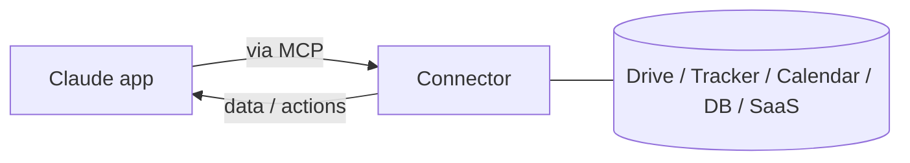

# Connectors (MCP) in den Apps

> Source: https://derob98.github.io/ailmanac/de/docs/claude-app/connectors · AILmanac (CC BY 4.0) · last verified 2026-08-02

Externe Tools und Daten aus den Claude-Apps erreichen.

<LevelBadge level="intermediate" />

<Callout type="objectives" items={[
  "Verstehen, was ein Connector hinzufügt, das der Chat allein nicht kann",
  "Sehen, warum Connectors, MCP-Server in Claude Code und MCP in der API derselbe Standard mit drei Hüten sind",
  "Einen mit minimalen Rechten in drei Schritten einrichten",
  "Die zwei Risiken kennen, die Sie eingehen: Zugriff und nicht vertrauenswürdige Inhalte, die darüber ankommen"
]} />

<VerifyNote lastVerified="2026-08-02" source="https://platform.claude.com/docs">
Welche Connectors es gibt und wie sie je nach Tarif verfügbar sind, ändert sich häufig — bestätigen Sie die aktuellen Optionen in der App bzw. im Help Center.
</VerifyNote>

**Connectors** lassen die Claude-Apps **über den Chat hinaus** greifen — in Ihre Tools und Daten (Laufwerke, Issue-Tracker, Kalender, Datenbanken und mehr) —, damit Claude aus echten Systemen antworten und auf ihnen handeln kann. Unter der Haube werden sie vom offenen **[Model Context Protocol (MCP)](/docs/claude-code/mcp)** angetrieben.

## Was sie leisten

Ohne Connectors weiß Claude nur, was in der Konversation steht. Mit einem Connector kann es (mit Ihrer Erlaubnis) relevante Informationen aus einem verbundenen Dienst holen — z. B. ein Dokument finden, aktuelle Issues lesen, einen Kalender prüfen — und sie in seiner Antwort verwenden.

## Überall derselbe Standard

Connectors sind die **App-seitige** Form von MCP. Dasselbe Protokoll treibt [MCP in Claude Code](/docs/claude-code/mcp) und [in der API](/docs/api/mcp) an. Lernen Sie das Konzept einmal; es gilt über alle Oberflächen hinweg.

## Einrichten & nutzen

<Steps items={[
  {
    title: "Den Dienst verbinden",
    body: "Autorisieren Sie per OAuth, wo unterstützt. Das ist der Schritt, der die Vertrauensbeziehung schafft — alles danach erbt, was Sie hier gewähren."
  },
  {
    title: "Minimale Rechte gewähren",
    body: "Nur den Zugriff, den die Aufgabe braucht. Ein Connector, der nur Dokumente finden muss, braucht keine Schreibrechte, und eine reine Leseberechtigung ist die günstigste Sicherheitskontrolle, die Ihnen zur Verfügung steht."
  },
  {
    title: "Ganz natürlich fragen",
    body: "Sie rufen den Connector nicht auf; Sie beschreiben das Ziel. „Finde mein Q3-Planungsdokument und fasse die Risiken zusammen“ — Claude entscheidet, welches Tool es heranzieht."
  }
]} />

<PromptCard title="Über einen verbundenen Dienst hinweg fragen">
{`Find my Q3 planning doc and summarize the risks.`}
</PromptCard>

## Sicherheit

:::warning[Ein Connector ist Zugriff + (manchmal) Aktionen]
- Autorisieren Sie nur Dienste und Scopes, denen Sie vertrauen.
- Aus externen Quellen geholte Inhalte können [Prompt Injection](/docs/security/prompt-injection) enthalten — seien Sie vorsichtig, wenn ein Connector nicht vertrauenswürdiges Material liest.
- Prüfen Sie, was ein Connector eines Drittanbieters kann, bevor Sie ihn aktivieren ([Code von Drittanbietern prüfen](/docs/security/reviewing-third-party-code)).
:::

<Quiz questions={[
  {
    q: "Ein Connector holt ein geteiltes Dokument, das jemand außerhalb Ihres Teams geschrieben hat. Welches spezifische Risiko entsteht dadurch?",
    options: [
      "Das Dokument zählt auf das Speicherlimit Ihres Tarifs",
      "Prompt Injection — nicht vertrauenswürdige Inhalte, die über den Connector eintreffen, können Anweisungen enthalten",
      "Der Connector erhält automatisch Schreibzugriff auf das Dokument",
      "Claude kann keine Dokumente lesen, die es nicht selbst erstellt hat"
    ],
    answer: 1,
    explain: "Aus externen Quellen geholte Inhalte können Prompt Injection enthalten. Der Connector ist der Zustellweg für Material, das Sie nicht geschrieben haben, und genau deshalb warnt der Sicherheitshinweis vor nicht vertrauenswürdigem Material."
  },
  {
    q: "Sie brauchen Claude nur zum Finden und Lesen von Dokumenten. Welchen Scope sollten Sie gewähren?",
    options: [
      "Vollzugriff, damit Sie nie neu autorisieren müssen",
      "Nur den Zugriff, den die Aufgabe braucht — minimale Rechte",
      "Was immer der Connector standardmäßig anfordert",
      "Keinen Scope; Connectors funktionieren ohne Autorisierung"
    ],
    answer: 1,
    explain: "Minimale Rechte. Ein Connector, der nur Dokumente finden muss, braucht keine Schreibrechte, und was Sie bei der Einrichtung gewähren, wird von allem geerbt, was der Connector danach tut."
  },
  {
    q: "Wie hängen App-Connectors, MCP-Server in Claude Code und MCP in der API zusammen?",
    options: [
      "Drei unabhängige Integrationssysteme, die zufällig einen Namen teilen",
      "Drei Oberflächen desselben offenen Protokolls — das Konzept einmal lernen",
      "Connectors sind ein Legacy-Format, das MCP ersetzt hat",
      "Nur die API-Version ist echtes MCP; die anderen sind vereinfacht"
    ],
    answer: 1,
    explain: "Connectors sind die App-seitige Form von MCP. Dasselbe Protokoll treibt MCP-Server in Claude Code und MCP in der API an, das Konzept überträgt sich also auf alle drei Oberflächen."
  }
]} />

<Callout type="takeaways" items={[
  "Ohne Connector weiß Claude nur, was in der Konversation steht; mit einem kann es mit Ihrer Erlaubnis aus echten Systemen lesen und darauf handeln.",
  "Connectors sind MCP mit seinem App-seitigen Hut — dasselbe Protokoll wie MCP-Server in Claude Code und MCP in der API.",
  "Die Einrichtung hat drei Schritte: verbinden, minimale Rechte gewähren, dann einfach das Ziel beschreiben.",
  "Sie gehen zwei Risiken ein: den gewährten Zugriff und nicht vertrauenswürdige Inhalte, die darüber ankommen. Scope eng fassen und externes Material als nicht vertrauenswürdig behandeln."
]} />

## Weiter

- [MCP-Server in Claude Code](/docs/claude-code/mcp)
- [MCP & Anbindung an Tools (API)](/docs/api/mcp)
- [KI in Ihren bestehenden Tools](/docs/claude-app/ai-in-your-tools)
- [Claudeforce: Salesforce in Claude](/docs/claude-app/claudeforce-salesforce-in-claude) — ein reales Plugin, das das 4-Tool-MCP-Muster in 37 Vertriebs-Skills verwandelt
