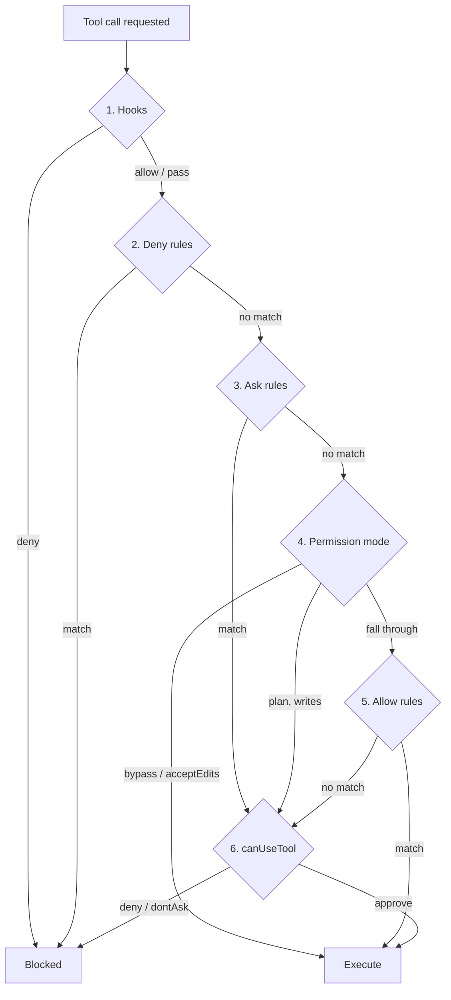

# Agent-SDK-Berechtigungen: die Sechs-Schritte-Reihenfolge

> Source: https://derob98.github.io/ailmanac/de/docs/claude-code/agent-sdk-permissions · AILmanac (CC BY 4.0) · last verified 2026-10-21

Jeder Berechtigungsfehler bei einem Headless-Agenten ist ein Reihenfolgefehler. Die sechs Schritte, die das Agent SDK auswertet — welche nur verbieten, welche nur erlauben können, und die fünf Wege, auf denen allowedTools stillschweigend nichts bewirkt.

<LevelBadge level="advanced" />

<Callout type="objectives" items={[
  "Die sechs Schritte, die das Agent SDK für jeden Tool-Aufruf der Reihe nach durchläuft",
  "Welche Schritte nur verbieten, welche nur erlauben und welche beides können — das mentale Modell, das den Rest naheliegend macht",
  "Warum ein früh genehmigtes Tool nie deinen canUseTool-Callback erreicht und was du stattdessen nutzt, wenn eine Prüfung bei jedem Aufruf laufen muss",
  "Die fünf Konfigurationen, in denen allowedTools wie ein Schloss aussieht und keines ist",
  "Wie sich Deny-Regeln unterscheiden, wenn du ein Tool benennst oder ein Muster darin eingrenzt",
  "Was ein Subagent erbt — und den einen Modus, den er nicht erbt",
  "Den Notausschalter, den keine Regel, kein Modus und kein Hook außer Kraft setzen kann"
]} />

Die meisten konfigurieren die Berechtigungen eines Agenten so, wie sie eine Firewall konfigurieren würden: Regeln schreiben und annehmen, dass die spezifischste gewinnt. Das Claude Agent SDK funktioniert nicht so. Es durchläuft für jeden Tool-Aufruf eine **feste Pipeline aus sechs Schritten**, und jeder Schritt hat eine andere *Befugnis* — manche können nur blockieren, manche nur genehmigen, und nur zwei können beides.

Bringst du die Reihenfolge durcheinander, lieferst du einen Agenten aus, der abgesichert aussieht und es nicht ist. Das ist die häufigste Klasse von Harness-Fehlern, und fast nie ist es ein Tippfehler in einer Regel.

<VerifyNote lastVerified="2026-10-21" source="https://code.claude.com/docs/en/agent-sdk/permissions">
Die Auswertungsreihenfolge, das Verhalten der Modi und die Versionsgrenzen unten stammen aus Anthropics Referenz zu Agent-SDK-Berechtigungen und der Referenz zu Berechtigungsmodi. Berechtigungsoberflächen ändern sich oft, und mehrere Verhaltensweisen hängen von bestimmten Claude-Code-Versionen ab (inline vermerkt) — prüfe beide Seiten erneut, bevor du dich auf eine Ausnahme verlässt.
</VerifyNote>

## Die sechs Schritte

<Steps items={[
  {title: "Hooks", body: <>Dein <code>PreToolUse</code>-Hook läuft <strong>zuerst</strong>, vor jeder anderen Prüfung. Ein Hook-Deny ist endgültig — er blockiert den Aufruf sogar im Modus <code>bypassPermissions</code>. Ein Hook-<code>allow</code> dagegen ist <em>nicht</em> endgültig: Die Schritte 2 und 3 laufen trotzdem.</>},
  {title: "Deny-Regeln", body: <>Aus <code>disallowedTools</code> und <code>settings.json</code>. Ein Treffer blockiert den Aufruf in jedem Modus, <code>bypassPermissions</code> eingeschlossen.</>},
  {title: "Ask-Regeln", body: <>Aus <code>settings.json</code>. Ein Treffer genehmigt oder blockiert nicht — er <em>leitet</em> den Aufruf weiter an Schritt 6, deinen Callback, sogar im Modus <code>bypassPermissions</code>.</>},
  {title: "Berechtigungsmodus", body: <>Hier hat der aktive Modus sein Wort. <code>bypassPermissions</code> genehmigt, was ihn erreicht; <code>acceptEdits</code> genehmigt Dateioperationen im erlaubten Bereich; <code>plan</code> zwingt Tools zum Bearbeiten von Dateien und zum Schreiben per Shell unabhängig von Allow-Regeln zu deinem Callback. Andere Modi reichen den Aufruf weiter.</>},
  {title: "Allow-Regeln", body: <>Aus <code>allowedTools</code> und <code>settings.json</code>. Ein Treffer genehmigt den Aufruf. Auch Aufrufe, die das Tool von sich aus genehmigt, werden hier aufgelöst, ohne dass eine Regel nötig wäre — ein Lesezugriff auf eine Datei in deinen Arbeitsverzeichnissen, ein schreibgeschützter Bash-Befehl.</>},
  {title: "canUseTool", body: <>Alles, was noch ungeklärt ist, erreicht deinen Callback zur Entscheidung. Im Modus <code>dontAsk</code> wird dieser Schritt übersprungen und der Aufruf <strong>verweigert</strong>.</>}
]} />

## Das Modell, das alles sinnvoll macht

Vergiss die Rangfolge. Frage stattdessen: *Was darf dieser Schritt tun?*

| Schritt | Kann verweigern | Kann genehmigen | Kann an deinen Callback weiterleiten |
|---|---|---|---|
| **1. Hooks** | Ja — endgültig, übersteht `bypassPermissions` | Ja, aber die Schritte 2–3 laufen trotzdem | — |
| **2. Deny-Regeln** | Ja — endgültig, übersteht `bypassPermissions` | Nein | — |
| **3. Ask-Regeln** | Nein | Nein | Ja — übersteht `bypassPermissions` |
| **4. Berechtigungsmodus** | Nein | Ja (`bypassPermissions`, `acceptEdits`) | Ja (`plan`, für Schreibzugriffe) |
| **5. Allow-Regeln** | Nein | Ja | Nein |
| **6. canUseTool** | Ja | Ja | — |

Drei Folgerungen ergeben sich direkt aus dieser Tabelle, und sie erklären fast jede Überraschung:

- **Deny schlägt alles.** Deny-Regeln und Hook-Verweigerungen liegen vor dem Modus, daher gibt es keinen Modus, der sie aufhebt. Das ist der einzige Mechanismus, auf den du dich verlassen kannst, um Fähigkeiten zu *entfernen*.
- **Allow schlägt nichts.** Allow-Regeln liegen bei Schritt 5, *unter* dem Modus. Sie können einen permissiven Modus nicht einschränken — sie genehmigen nur vorab Arbeit, die sonst eine Rückfrage ausgelöst hätte.
- **Dein Callback ist die letzte Instanz, nicht das Tor.** Er läuft nur bei Aufrufen, die nichts darüber aufgelöst hat. Jede Prüfung darin wird für alles übersprungen, was früher genehmigt wurde.

<Callout type="warning">
Wenn du Sicherheitsprüfungen in `canUseTool` schreibst, hast du sie an der falschen Stelle platziert. Ein Aufruf, der durch eine Allow-Regel, durch `acceptEdits` oder durch `bypassPermissions` genehmigt wurde, erreicht den Callback nie — deine Prüfung schlägt nicht fehl, sie läuft schlicht nicht. Prüfungen, die für **jeden** Aufruf gelten müssen, gehören in einen `PreToolUse`-Hook, der in Schritt 1 läuft und dessen Verweigerung sogar `bypassPermissions` übersteht.
</Callout>

## Fünf Wege, auf denen `allowedTools` kein Schloss ist

`allowedTools` liest sich wie eine Allowlist. Es ist eine **Liste zur Vorab-Genehmigung**. Alles, was du weglässt, steht Claude weiterhin zur Verfügung; es fällt nur zum Modus und dann zu deinem Callback durch. Fünf konkrete Fallen:

### 1. Es beschränkt `bypassPermissions` nicht

Das ist die große. Nicht aufgeführte Tools treffen keine Allow-Regel, also fallen sie zu Schritt 4 durch — wo `bypassPermissions` sie genehmigt.

<PromptCard title="Sieht abgesichert aus. Genehmigt Bash, Write und Edit.">{`// WRONG — bypassPermissions approves everything unlisted
const options = {
  allowedTools: ["Read"],
  permissionMode: "bypassPermissions"
};`}</PromptCard>

Brauchst du `bypassPermissions`, willst aber bestimmte Tools loswerden, funktioniert nur ein Hebel: `disallowedTools` — es landet in Schritt 2, vor dem Modus.

### 2. `dontAsk` ist der Modus, der eine Allowlist exakt macht

Um „diese Tools und sonst nichts“ zu erreichen, kombiniere die Vorab-Genehmigung mit einem Modus, der verweigert, statt nachzufragen.

<PromptCard title="Ein wirklich schreibgeschützter Agent">{`const options = {
  allowedTools: ["Read", "Glob", "Grep"],
  permissionMode: "dontAsk"
};`}</PromptCard>

Aufgeführte Tools laufen. Alles andere, was eine Rückfrage ausgelöst hätte, wird verweigert, und `canUseTool` wird nie aufgerufen. Beachte, was ohne Auflistung weiterhin läuft: schreibgeschützte Bash-Befehle, Lesezugriffe auf Dateien in deinen Arbeitsverzeichnissen und Tools wie `Agent`, die vor dem Ausführen nicht nachfragen. Um eines davon vollständig aus der Anfrage zu entfernen, füge seinen bloßen Namen zu `disallowedTools` hinzu.

### 3. Ein bloßer Name genehmigt das *ganze* Tool

Die Abdeckung hängt von der Form des Eintrags ab, und der Unterschied ist groß:

| Eintrag | Was er vorab genehmigt |
|---|---|
| `"Read"` | Jeden `Read`-Aufruf (außer Lesezugriffen auf Netzwerkpfade) |
| `"Bash(npm test *)"` | Nur passende `Bash`-Aufrufe. Andere `Bash`-Aufrufe fallen weiterhin zu deinem Callback durch |

Die Eingrenzung ist alles. `"Bash"` in einer Allow-Liste ist eine andere Sicherheitshaltung als `"Bash(npm test *)"`, und das Typsystem sagt es dir nicht.

### 4. Nicht verankerte Globs werden stillschweigend ignoriert

Allow-Regeln akzeptieren Tool-Namen-Globs **nur** nach einem literalen Präfix `mcp__<server>__`, und das Server-Segment muss frei von Globs sein.

| Eintrag | Wirkung |
|---|---|
| `"mcp__puppeteer__*"` | Funktioniert — jedes Tool des `puppeteer`-Servers |
| `"mcp__github__get_*"` | Funktioniert — die `get_`-Tools dieses Servers |
| `"*"` oder `"mcp__*"` | **Ignoriert.** Genehmigt nichts vorab |

Die letzte Zeile scheitert in die stille Richtung — du bekommst mehr Rückfragen, nicht weniger Berechtigungen —, aber wenn du sie in der Erwartung einer pauschalen Genehmigung geschrieben hast, wirst du einen Nachmittag damit verbringen.

### 5. TypeScript warnt dich, auf einem Kanal, den du nicht abhörst

Übergibst du einen `canUseTool`-Callback in einer Konfiguration, in der das SDK weiß, dass der Callback überdeckt wird, gibt es einmalig eine Node-Prozesswarnung mit dem Code `CLAUDE_SDK_CAN_USE_TOOL_SHADOWED` aus. Zwei Konfigurationen lösen sie aus: `permissionMode: "bypassPermissions"` und jeder **bloße** `allowedTools`-Eintrag wie `"Read"`.

<PromptCard title="Die Überdeckungswarnung in deinen eigenen Logs sichtbar machen">{`process.on("warning", (w) => {
  if (w.code === "CLAUDE_SDK_CAN_USE_TOOL_SHADOWED") {
    console.error("[harness] canUseTool will be skipped:", w.message);
  }
});`}</PromptCard>

Eingegrenzte Einträge wie `Bash(ls *)` und der Modus `acceptEdits` lösen sie nicht aus, und Allow-Regeln aus Settings-Dateien sind für die Prüfung unsichtbar — ein sauberer Lauf ist also kein Beweis dafür, dass dein Callback erreichbar ist.

## Deny-Regeln: ein Tool benennen vs. darin eingrenzen

Deny-Einträge verhalten sich je nach Form unterschiedlich, und der Unterschied betrifft, *was Claude sehen kann*, nicht nur, was es tun kann.

| Eintrag | Wirkung |
|---|---|
| `disallowedTools: ["Bash"]` | Die `Bash`-Tool-Definition wird **aus der Anfrage entfernt**. Claude sieht das Tool nie und kann es nicht versuchen |
| `disallowedTools: ["Bash(rm *)"]` | `Bash` bleibt verfügbar. Aufrufe, die *wie geschrieben* auf `rm *` passen, werden in jedem Modus verweigert. Andere `Bash`-Aufrufe — auch `/bin/rm` — fallen durch |
| `disallowedTools: ["*"]` | Jede Tool-Definition wird entfernt. Tool-Namen-Globs **werden** in Deny-Regeln unterstützt: `"mcp__*"` trifft jedes MCP-Tool aller Server |

Zwei Dinge zum Verinnerlichen. Erstens: Die bloße Form ist strikt stärker: Das Tool aus dem Kontext zu entfernen ist besser, als seine Aufrufe zu verweigern, denn ein Tool, das Claude nicht sehen kann, erzeugt keine fehlgeschlagenen Versuche und keine Umwege über einen anderen Pfad. Zweitens: `Bash(rm *)` trifft **den Text wie geschrieben** — die Lücke bei `/bin/rm` ist kein Fehler, sondern der dokumentierte Geltungsbereich einer textuellen Regel. Betrachte eingegrenzte Bash-Verweigerungen als Leitplanken gegen das Offensichtliche, niemals als Sicherheitsgrenze.

### Pfadregeln: vier Anker und ein toter Buchstabe

Eingegrenzte `Read`- und `Edit`-Regeln nehmen ein Pfadmuster, und zwei Details erwischen jeden:

- **`Edit(path)` steuert jedes eingebaute Tool, das Dateien schreibt** — auch `Write` und `NotebookEdit`. Eine `Write(path)`-Regel wird von den Dateiberechtigungsprüfungen **nie getroffen**. Wenn du `Write(//secrets/**)` geschrieben hast, hast du nichts geschrieben.
- **Ein doppelter Schrägstrich bedeutet das Dateisystem.** `Edit(//secrets/**)` blockiert Schreibzugriffe überall unter `/secrets` auf dem Datenträger. Ein einzelner führender Schrägstrich verankert stattdessen bei der *Quelle* der Regel — bei einer Regel, die über `allowedTools` oder `disallowedTools` übergeben wird, ist das das Arbeitsverzeichnis der Session, sodass `Edit(/secrets/**)` `/secrets` auf dem Datenträger **nicht** schützt.

<PromptCard title="Schreibzugriffe auf einen echten Dateisystempfad blockieren">{`// // = absolute filesystem path. One slash anchors at the rule's source.
const options = {
  disallowedTools: ["Edit(//etc/**)", "Edit(//secrets/**)", "Read(//secrets/**)"]
};`}</PromptCard>

## Die Modi und was jeder tatsächlich bringt

<Flashcards cards={[
  {front: "default", back: "Keine modusbasierten Auto-Genehmigungen. Aufrufe, die eine Genehmigung brauchen und keine Allow-Regel treffen, gehen an canUseTool. Seit Claude Code v2.1.302 startet deine App hier, sofern du keinen Modus setzt oder eine Settings-Datei permissions.defaultMode bereitstellt."},
  {front: "dontAsk", back: "Jeder Aufruf, der eine Rückfrage auslösen würde, wird verweigert — canUseTool wird nie aufgerufen. Vorab genehmigte Tools und Aufrufe ohne Genehmigungsbedarf laufen weiterhin. Der Modus, der eine Liste zur Vorab-Genehmigung in eine exakte Allowlist verwandelt."},
  {front: "acceptEdits", back: "Genehmigt automatisch Dateibearbeitungen sowie mkdir, touch, rm, rmdir, mv, cp, sed — aber nur im Arbeitsverzeichnis oder in additionalDirectories. Bash außerhalb des Dateisystems braucht weiterhin normale Berechtigungen."},
  {front: "plan", back: "Schreibgeschützte Tools verhalten sich wie bei default. Dateibearbeitungen werden nie automatisch genehmigt — weder durch eine Allow-Regel noch durch ein PreToolUse-allow. Sie erreichen canUseTool. Seit v2.1.212 gilt das auch für Shell-Befehle, die Dateien verändern."},
  {front: "bypassPermissions", back: "Genehmigt, was Schritt 4 erreicht. Hooks, Deny-Regeln und Ask-Regeln laufen weiterhin davor. Unter Linux und macOS verweigert er den Start als root oder unter sudo außerhalb einer erkannten Sandbox."},
  {front: "auto", back: "Ein Klassifikatormodell prüft Aktionen wie Shell-Befehle und Netzwerkanfragen und erlaubt oder blockiert jede einzelne. Erfordert ein unterstütztes Modell; der Wechsel zu einem nicht unterstützten setzt die Session auf den Modus default zurück."}
]} />

Zwei Verhaltensweisen, die man festhalten sollte, weil sie in Produktion zuschlagen:

**Der Modus `auto` degradiert fast unbemerkt.** Wechselst du per `setModel()` oder `applyFlagSettings()` zu einem Modell, das `auto` nicht unterstützt, wechselt die Session in den Modus `default`. Du erhältst eine `system`-Nachricht mit dem Subtyp `status` und `permissionMode: "default"` — in TypeScript als `SDKStatusMessage` typisiert —, und ab da erreichen Aufrufe deinen Callback. Den Modellwechsel zurückzunehmen stellt `auto` **nicht** wieder her; du musst `setPermissionMode("auto")` erneut aufrufen. (v2.1.299 oder neuer.)

**Subagenten erben, mit einer Weigerung.** Ein Subagent läuft im Berechtigungsmodus des Parents, es sei denn, du setzt `permissionMode` in seiner `AgentDefinition` *und* der Parent ist in `default`, `dontAsk` oder `plan`. Auch dann wendet Claude Code einen Wert `"bypassPermissions"` aus einer `AgentDefinition` nie an — ein Subagent läuft nur dann in `bypassPermissions`, wenn es die Parent-Session selbst tut (v2.1.267+). Diese Ausnahme gibt es, weil Subagenten oft andere System-Prompts und lockereres Verhalten haben als dein Hauptagent; das Erben von Bypass würde dem am wenigsten beaufsichtigten Teil deines Harness vollen autonomen Systemzugriff geben. Siehe [Subagenten](/docs/claude-code/subagents).

## Der Notausschalter, den nichts außer Kraft setzt

`rm`- und `rmdir`-Löschungen, die auf einen **kritischen Pfad** zielen, werden nie durch eine Allow-Regel oder durch einen `PreToolUse`-Hook mit `allow` genehmigt. Kritische Pfade sind die Dateisystemwurzel, jedes direkte Kind der Wurzel (`/usr`, `/etc`, `/data`), dein Home-Verzeichnis, Windows-Laufwerkswurzeln und deren Verzeichnisse oberster Ebene sowie dein Arbeitsverzeichnis und dessen Eltern. Eine passende Deny-Regel blockiert den Befehl weiterhin vollständig; der Punkt ist, dass kein *Genehmigungs*pfad ihn freigeben kann.

Was stattdessen passiert, hängt vom Modus ab:

| Modus | Ergebnis bei einer Löschung eines kritischen Pfads |
|---|---|
| `default`, `acceptEdits`, `bypassPermissions` | Fragt nach Genehmigung |
| `auto` | Fragt im Terminal, mit Zeitlimit. **Anderswo — einschließlich jeder Agent-SDK-Session — wird sie verweigert** |
| `dontAsk` | Verweigert sie |

Die mittlere Zeile ist für ein Harness die entscheidende: Eine Agent-SDK-Session im Modus `auto` verweigert Löschungen kritischer Pfade, **ohne deinen Callback aufzurufen**, und weist Claude an, stattdessen zu berichten, was gelöscht werden sollte. Beginnt dein Agent plötzlich, Löschungen zu schildern, die er nicht durchgeführt hat, ist das der Grund — keine Modellregression.

Die Prüfung reicht auch in Konstrukte hinein, bei denen eine nicht gesetzte Variable zu einer Wurzellöschung expandieren würde: `rm -rf "$DIR"/*`, `rm -rf "$1"/*`, wenn nichts `$1` bindet, `D=$(pwd); rm -rf "$D"` sowie Löschungen in Subshells, Command Substitutions oder `bash -c`-Skripten. Die dokumentierte Lösung besteht darin, die Expansion abzusichern, damit die Shell bei leerem Wert einen Fehler meldet, statt die Wurzel zu löschen.

<PromptCard title="Eine Glob-Löschung die Prüfung auf kritische Pfade bestehen lassen">{`# Flagged: expands to a removal from / when DIR is unset
rm -rf "$DIR"/*

# Passes: :? makes the shell exit with an error instead
rm -rf "\${DIR:?}"/*`}</PromptCard>

## Weitere Dinge, die kein Modus automatisch genehmigt

Neben Löschungen kritischer Pfade entkommen diese immer einem permissiven Modus — sie erreichen in den meisten Modi deinen Callback und werden in `dontAsk` **verweigert**, weil dieser Modus nie nachfragt:

- Tools, die eine ausdrückliche **Ask-Regel** trifft
- **`AskUserQuestion`** und MCP-Tools, deren Server `_meta["anthropic/requiresUserInteraction"]` setzt (v2.1.199+)
- **Connector-Tools, die deine Organisation auf `ask` gesetzt hat** — der Callback erhält die Begründung `Your organization requires approval for this tool`
- Lesezugriffe auf **Netzwerkpfade**, die keine Allow-Regel genehmigt

„Ich habe `bypassPermissions` gesetzt, warum werde ich trotzdem gefragt?“ hat also vier Antworten, bevor du zum Fehlerbericht greifst. Und im TypeScript SDK gibt es einen fünften Hebel: `permissionPrompts: "none"` (v2.1.259+) verhindert, dass dein Callback in Schritt 6 überhaupt aufgerufen wird — ein `PermissionRequest`-Hook bekommt weiterhin eine Chance, und wenn er sich einer Entscheidung enthält, wird der Aufruf verweigert.

## Zwei Rezepte

### Ein Tor, das wirklich bei jedem Aufruf läuft

Muss eine Prüfung bedingungslos sein — Audit-Logging, ein Scanner für geheime Pfade, eine Kostenobergrenze —, setze sie in Schritt 1.

Ein `PreToolUse`-Hook hat zwei Wege zu blockieren, und beide stehen einem Command-Hook zur Verfügung, den du auch außerhalb des SDK ausführen kannst: **Exit-Code 2**, wobei alles, was du auf stderr schreibst, zur Begründung wird, die Claude sieht, oder **JSON auf stdout** mit einer `permissionDecision` von `"deny"` plus einer `permissionDecisionReason`.

<PromptCard title="PreToolUse-Hook: das einzige bedingungslose Tor">{`# Runs before deny rules, ask rules, the mode, and allow rules.
# A deny here survives bypassPermissions.
# Wire it to hooks.PreToolUse in settings.json, or pass it in the SDK's hooks option.
jq -e '.tool_input | tostring | test("AKIA|BEGIN PRIVATE KEY|ghp_")' >/dev/null \\
  && { echo "secret material in tool input" >&2; exit 2; } || exit 0`}</PromptCard>

Die In-Process-Callback-Form, die das TypeScript- und das Python-SDK akzeptieren, gibt dieselben Entscheidungsfelder statt eines Exit-Codes zurück. Bestätige die Form des Wrappers anhand der [Hooks-Referenz](/docs/claude-code/hooks) für deine SDK-Version, bevor du auslieferst — die Auswertungs*position* ist der stabile Teil, die Signatur des Handlers weniger.

### Verschärfen, während das Vertrauen wächst

Der Berechtigungsmodus ist keine einmalige Entscheidung. In einer Streaming-Session kannst du restriktiv beginnen und ihn lockern, nachdem du die ersten Schritte des Agenten geprüft hast, mit `set_permission_mode()` in Python oder `setPermissionMode()` in TypeScript. Der neue Modus gilt sofort für alle folgenden Tool-Anfragen.

<PromptCard title="In default starten, nach Prüfung des Vorgehens lockern">{`const q = query({
  prompt: "Refactor the auth module",
  options: {permissionMode: "default"}
});

// ...review the first turns, then:
await q.setPermissionMode("acceptEdits");`}</PromptCard>

Der umgekehrte Zug ist für einen langen Lauf der interessantere: auf `dontAsk` verschärfen, sobald der Agent in eine Phase eintritt, die keine neuen Fähigkeiten braucht.

## Woher die Regeln kommen können

Allow-, Deny- und Ask-Regeln können auch deklarativ in `.claude/settings.json` stehen. Das SDK liest sie, wenn die Settings-Quelle `project` aktiviert ist, was bei den Standardoptionen von `query()` der Fall ist — **aber wenn du `settingSources` ausdrücklich setzt, musst du `"project"` aufnehmen, sonst wirken die Regeln deiner Settings-Datei stillschweigend nicht mehr.** Das ist ein klassischer Vorfall: Jemand fügt `settingSources: ["user"]` der Reproduzierbarkeit halber hinzu und löscht dabei unbemerkt die gesamte Deny-Liste des Projekts. Siehe [Einstellungen](/docs/claude-code/settings) für die Rangfolge der Dateien, und denke daran, dass Allow-Regeln aus Settings-Dateien für die Prüfung `CLAUDE_SDK_CAN_USE_TOOL_SHADOWED` ebenfalls unsichtbar sind.

<Quiz questions={[
  {
    q: "Du setzt allowedTools: [\"Read\"] und permissionMode: \"bypassPermissions\". Kann der Agent Bash ausführen?",
    options: [
      "Nein — nur Read steht auf der Allowlist",
      "Ja — Bash trifft keine Allow-Regel, fällt also zum Modus durch, der es genehmigt",
      "Nur schreibgeschützte Bash-Befehle",
      "Ja, aber zuerst wird canUseTool aufgerufen"
    ],
    answer: 1,
    explain: "Allow-Regeln sind Schritt 5, unter dem Modus in Schritt 4. allowedTools genehmigt vorab; es beschränkt nie. Um ein Tool unter bypassPermissions zu blockieren, nutze disallowedTools, das in Schritt 2 landet — vor dem Modus."
  },
  {
    q: "Eine Sicherheitsprüfung muss bei jedem einzelnen Tool-Aufruf laufen, ohne Ausnahme. Wohin gehört sie?",
    options: [
      "In den canUseTool-Callback",
      "In eine Ask-Regel in settings.json",
      "In einen PreToolUse-Hook",
      "In permissionMode: \"dontAsk\""
    ],
    answer: 2,
    explain: "Hooks sind Schritt 1 — vor Deny-Regeln, Modus und Allow-Regeln — und eine Hook-Verweigerung übersteht sogar bypassPermissions. canUseTool ist Schritt 6 und wird für alles, was früher genehmigt wurde, vollständig übersprungen; Prüfungen dort laufen also bei automatisch genehmigten Tools stillschweigend nicht."
  },
  {
    q: "Welcher Deny-Eintrag verhindert, dass Claude das Bash-Tool überhaupt sieht?",
    options: [
      "disallowedTools: [\"Bash(*)\"]",
      "disallowedTools: [\"Bash\"]",
      "allowedTools: [] mit permissionMode: \"dontAsk\"",
      "Eine Deny-Regel in settings.json für Bash(rm *)"
    ],
    answer: 1,
    explain: "Eine Deny-Regel mit bloßem Namen entfernt die Tool-Definition aus der Anfrage, bevor die Auswertung beginnt, sodass Claude sie nie sieht. Eine eingegrenzte Regel wie Bash(rm *) lässt Bash verfügbar und verweigert nur Aufrufe, die wie geschrieben auf dieses Muster passen — /bin/rm fällt durch."
  }
]} />

<Callout type="takeaways" items={[
  "Sechs Schritte, feste Reihenfolge: Hooks, Deny-Regeln, Ask-Regeln, Berechtigungsmodus, Allow-Regeln, canUseTool.",
  "Deny liegt vor dem Modus und ist daher absolut. Allow liegt dahinter und kann immer nur vorab genehmigen.",
  "allowedTools ist eine Liste zur Vorab-Genehmigung, keine Allowlist — kombiniere es mit dontAsk, um es exakt zu machen.",
  "Prüfungen in canUseTool laufen für automatisch genehmigte Aufrufe nicht. Bedingungslose Prüfungen gehören in einen PreToolUse-Hook.",
  "Edit(path) deckt Write und NotebookEdit ab; eine Write(path)-Regel trifft nichts. // verankert am Dateisystem, ein einzelnes / an der Quelle der Regel.",
  "Ein Subagent erbt den Modus des Parents, erbt aber nie einen bypassPermissions-Wert aus seiner eigenen Definition.",
  "Löschungen kritischer Pfade mit rm sind ein Notausschalter, den keine Allow-Regel und kein Hook-allow freigeben kann — und eine Agent-SDK-Session im Modus auto verweigert sie, ohne dich aufzurufen.",
  "Wer settingSources ohne \"project\" setzt, verwirft stillschweigend jede Regel in .claude/settings.json."
]} />

## Weiter

- [Berechtigungen & Berechtigungsmodi](/docs/claude-code/permissions) — die interaktive Seite desselben Systems, einschließlich der Frage, warum `auto` zum Startmodus wurde
- [Hooks](/docs/claude-code/hooks) — Schritt 1, das einzige bedingungslose Tor in der Pipeline
- [Autonome Läufe absichern](/docs/security/hardening-autonomous-runs) — die Checkliste, die die Primitive dieser Seite umsetzen
- [Headless-Modus & das Agent SDK](/docs/claude-code/headless-and-agent-sdk) — die Schleife überhaupt erst zum Laufen bringen
