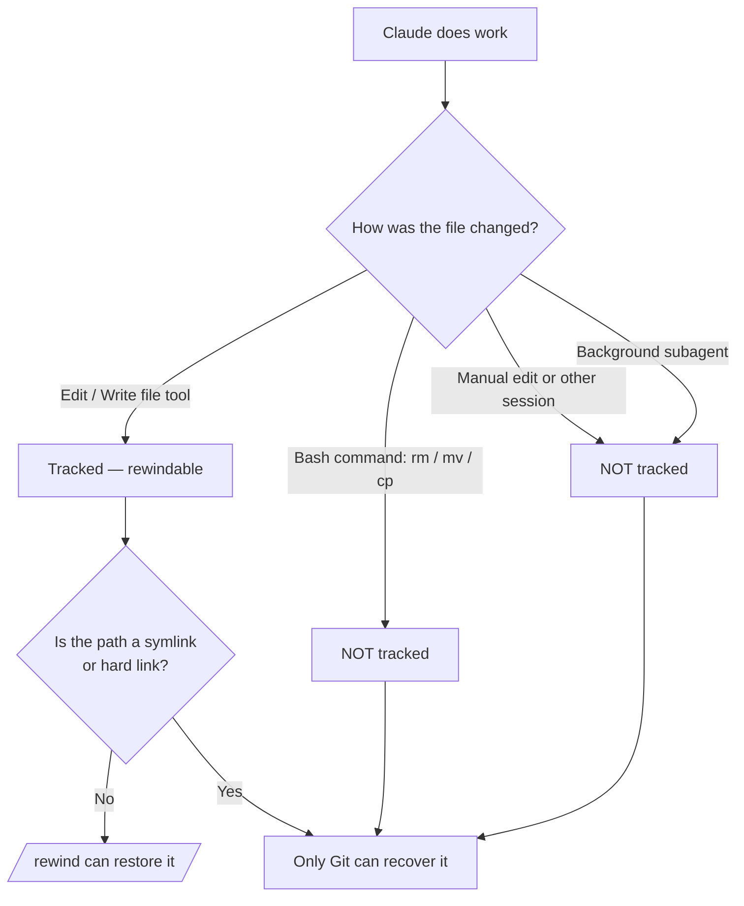

# Checkpoints & Rewind

> Source: https://derob98.github.io/ailmanac/de/docs/claude-code/checkpoints-and-rewind · AILmanac (CC BY 4.0) · last verified 2026-10-20

Änderungen von Claude rückgängig machen, eine ganze Sitzung zurückrollen und den Kontext mit /rewind komprimieren — das Sicherheitsnetz für ehrgeizige Läufe.

<LevelBadge level="intermediate" />

<Callout type="objectives" items={["Verstehen, was ein Checkpoint erfasst — und was er stillschweigend nicht erfasst", "Das Rewind-Menü auf zwei Wegen öffnen und jedes Mal die richtige Wiederherstellungsaktion wählen", "„Restore“ (Zustand rückgängig machen) von „Summarize“ (Kontext komprimieren) unterscheiden", "Genau wissen, warum Checkpoints Git ergänzen, aber nie ersetzen"]} />

<VerifyNote lastVerified="2026-10-20" source="https://code.claude.com/docs/en/checkpointing">
Das Checkpoint-Verhalten, die Aktionen des Rewind-Menüs, das Snapshot-Limit und die Aufbewahrung ändern sich zwischen Releases — prüfe es in der offiziellen Dokumentation.
</VerifyNote>

## Die Grundidee

Wenn du Claude auf eine ehrgeizige, weitreichende Änderung loslässt, ist die beängstigendste Frage: „Was, wenn es drei Änderungen tief schiefgeht?“ **Checkpointing** ist die Antwort: Claude Code erstellt vor jeder Änderung automatisch einen Snapshot deines Codes, sodass du zu einem früheren Zustand zurückspulen kannst, statt ein halbfertiges Refactoring von Hand zu entwirren.

Stell es dir als **lokales Rückgängigmachen für die ganze Sitzung** vor — ein Sicherheitsnetz, mit dem du ohne Angst sagen kannst: „Ja, probier den kühnen Ansatz.“

## Wie Checkpoints entstehen

Du erstellst keine Checkpoints — sie entstehen automatisch.

<Steps items={[{title: "Jeder Prompt, der einen Turn startet = ein Checkpoint", body: "Jeder Prompt, der einen Turn startet, erfasst den Zustand deines Codes, bevor Claudes Dateibearbeitungs-Tools laufen. Kein Befehl, keine Konfiguration, kein Aufwand."}, {title: "Nur die 100 neuesten werden behalten", body: "Claude Code behält Datei-Snapshots für die 100 neuesten Checkpoints einer Sitzung. Ältere werden verworfen, sodass sich eine sehr lange Sitzung nicht bis zu ihrem Anfang zurückspulen lässt."}, {title: "Sie bleiben über Sitzungen hinweg erhalten", body: "Checkpoints werden zusammen mit der Konversation gespeichert, sodass du /rewind auch nach dem Fortsetzen einer Sitzung ausführen kannst, nicht nur in der laufenden."}, {title: "Sie räumen sich selbst auf", body: "Die Datei-Snapshots einer Sitzung werden im Aufbewahrungslauf gelöscht, standardmäßig etwa 30 Tage nachdem die Sitzung zuletzt einen gespeichert hat. Das Zurückspulen zu einem Checkpoint, dessen Snapshots verschwunden sind, schlägt mit 'No files were restored' fehl — erhöhe cleanupPeriodDays, um sie länger zu behalten."}]} />

## Das Rewind-Menü öffnen

Es gibt zwei Wege hinein:

<Steps items={[{title: "/rewind ausführen — oder die Aliasse /checkpoint und /undo", body: "Gib den Slash-Befehl am Prompt ein. Funktioniert immer. /checkpoint und /undo sind Aliasse für denselben Befehl — nimm also den Namen, der dir gerade einfällt."}, {title: "Zweimal Esc drücken — aber nur bei leerer Eingabe", body: "Doppel-Esc öffnet das Rewind-Menü, wenn das Prompt-Feld leer ist. Steht Text darin, löscht Doppel-Esc stattdessen diesen Text (der gelöschte Text landet im Eingabeverlauf, mit der Pfeiltaste nach oben holst du ihn zurück)."}]} />

<PromptCard title="Das Rewind-Menü öffnen">{`/rewind`}</PromptCard>

<Callout type="warning" items={["Die Alias-Namen sind freundlicher, als sie wörtlich gemeint sind: /checkpoint erstellt keinen Snapshot auf Abruf (Snapshots entstehen automatisch), und /undo macht nicht von selbst die letzte Änderung rückgängig. Alle drei Namen öffnen dasselbe Menü, in dem du weiterhin den Punkt und die Aktion wählst."]} />

Das Menü listet **jeden Prompt, den du in dieser Sitzung gesendet hast**. Wähle den Punkt, auf den du reagieren willst, und dann eine Aktion.

## Restore vs. Summarize: die entscheidende Unterscheidung

Hier entsteht die Verwirrung. Das Menü bietet zwei *Arten* von Aktionen:

- **Restore**-Aktionen ändern den Zustand auf der Festplatte und/oder in der Konversation — sie machen rückgängig.
- **Summarize**-Aktionen berühren deine Dateien nie — sie komprimieren die Konversation, um Platz im Kontextfenster zu schaffen.

<Callout type="warning" items={["Restore = rückgängig machen (setzt Code, Konversation oder beides zurück). Summarize = Kontext komprimieren (Dateien auf der Festplatte bleiben unberührt).", "Greife zu Restore, wenn eine Änderung etwas kaputtgemacht hat. Greife zu Summarize, wenn die Sitzung aufgebläht ist, der Code aber in Ordnung."]} />

### Die Restore-Aktionen

<Steps items={[{title: "Restore code and conversation", body: "Setzt sowohl deine Dateien als auch den Chatverlauf auf den gewählten Punkt zurück — ein sauberes „Zeit zurückdrehen“ zu diesem Moment."}, {title: "Restore conversation", body: "Spult den Chat zu dieser Nachricht zurück, behält aber deinen aktuellen Code. Nützlich, um eine Frage neu zu stellen, ohne Änderungen zu verlieren, die du behalten willst."}, {title: "Restore code", body: "Setzt Dateiänderungen zurück, behält aber die Konversation. Die Änderungen rückgängig machen, die Diskussion darüber behalten."}]} />

Die beiden **Code**-Restore-Optionen erscheinen nur, wenn der gewählte Checkpoint tatsächlich verfolgte Dateiänderungen zum Zurücksetzen hat. Wurden nach diesem Punkt keine Dateiänderungen erfasst, bietet das Menü nur **Restore conversation**, die zwei Summarize-Optionen und **Never mind** (das zur Nachrichtenliste zurückkehrt, ohne etwas zu ändern).

Nach dem Wiederherstellen der Konversation (oder der Wahl von „Summarize from here“) wird der ursprüngliche Prompt der gewählten Nachricht ins Eingabefeld zurückgelegt, damit du ihn erneut senden oder bearbeiten kannst.

### Die Summarize-Aktionen

Beide komprimieren einen Teil der Konversation zu einer KI-generierten Zusammenfassung — wie ein **gezieltes `/compact`**, bei dem du wählst, welche Seite der gewählten Nachricht zusammengepresst wird.

<Steps items={[{title: "Summarize from here", body: "Nachrichten VOR der gewählten Nachricht bleiben unverändert. Die gewählte Nachricht und alles danach werden zu einer Zusammenfassung. Nutze es, um eine Nebendiskussion zu verwerfen und frühen Kontext in vollem Detail zu behalten."}, {title: "Summarize up to here", body: "Nachrichten VOR der gewählten Nachricht werden zu einer Zusammenfassung; die gewählte Nachricht und alles danach bleibt unverändert. Du bleibst am Ende der Konversation. Nutze es, um frühes Setup-Geplauder zu komprimieren und die jüngste Arbeit wörtlich zu behalten."}]} />

Die ursprünglichen Nachrichten bleiben in beiden Fällen im Sitzungsprotokoll, sodass Claude weiterhin auf die Details zugreifen kann, und an der Stelle der komprimierten Nachrichten erscheint eine Markierung **Summarized conversation**. Um zu steuern, worauf sich die Zusammenfassung konzentriert, markiere mit den Pfeiltasten eine **Summarize**-Option und tippe Anweisungen dort, wo die Zeile **add context (optional)** zeigt, und drücke dann Enter — wählst du die Option mit ihrer Zifferntaste, wird sofort ohne Anweisungen zusammengefasst.

Den gesamten Ablauf findest du unter [Kontext-Management](/docs/claude-code/context-management) — die Summarize-Aktionen von `/rewind` sind ein Skalpell, wo `/compact` ein breiter Pinsel ist.

<Callout type="note" items={["Summarize hält dich in derselben Sitzung. Um abzuzweigen und einen anderen Ansatz auszuprobieren, während die ursprüngliche Sitzung unangetastet bleibt, nutze stattdessen /branch oder claude --continue --fork-session."]} />

## Zurückspulen über ein `/clear` hinaus

Wenn du früher im selben Claude-Code-Prozess `/clear` ausgeführt hast, zeigt das Rewind-Menü oben einen zusätzlichen Eintrag: `/resume <session-id> (previous session)`. Wähle ihn aus, um zu der Konversation zurückzuspringen, die vor `/clear` aktiv war.

<VerifyNote lastVerified="2026-10-20" source="https://code.claude.com/docs/en/checkpointing">
Dieser Eintrag ist nur verfügbar, bis du Claude Code beendest oder eine andere Sitzung fortsetzt. Ist er weg, führe stattdessen `/resume` aus und wähle die vorherige Sitzung aus der Liste.
</VerifyNote>

## Wo Checkpoints enden — die Grenzen, die wehtun

Checkpoints wirken magisch, bis sie es nicht mehr tun. Diese Lücken zählen:

<Steps items={[{title: "Bash-Änderungen sind unsichtbar", body: "Dateien, die von Shell-Befehlen berührt werden, die Claude ausführt — rm, mv, cp, Codegeneratoren, Formatter — werden NICHT verfolgt. Nur direkte Änderungen über Claudes Dateibearbeitungs-Tools werden als Checkpoint erfasst. Eine mit rm gelöschte Datei ist für Rewind verloren."}, {title: "Die meisten Subagent-Änderungen werden nicht wiederhergestellt", body: "Ein Subagent bearbeitet mit denselben Datei-Tools, aber deine Sitzung erfasst diese Änderungen meist nicht. Die Ausnahme ist ein im Vordergrund geforkter Skill (context: fork mit background: false), der während deines eigenen Turns bearbeitet und normal zurückgespult wird. Jeder andere Subagent — auch ein im Hintergrund geforkter Skill, der Standard — braucht Git zum Rückgängigmachen. Siehe /docs/claude-code/subagents."}, {title: "Externe und gleichzeitige Änderungen sind unsichtbar", body: "Manuelle Änderungen außerhalb von Claude Code und Änderungen aus anderen gleichzeitigen Sitzungen werden normalerweise nicht erfasst — es sei denn, sie betreffen zufällig dieselben Dateien, die die aktuelle Sitzung bearbeitet hat."}, {title: "Nachrichten mitten im Turn bekommen keinen Checkpoint", body: "Eine Nachricht, die du einreihst, während Claude arbeitet, und die es innerhalb des laufenden Turns erreicht, wird Teil dieses Turns, statt einen neuen zu beginnen — sie bekommt also keinen eigenen Checkpoint, und das Rewind-Menü markiert sie mit 'No code restore'. Um zurückzunehmen, was danach kam, spule zu dem Prompt zurück, der den Turn gestartet hat — das spult den ganzen Turn zurück, einschließlich der Arbeit, die geleistet wurde, bevor deine Nachricht ankam. Wählst du die markierte Nachricht selbst aus, wird weiterhin Restore conversation angeboten; deine Dateien bleiben dabei unverändert."}, {title: "Symlinks und Hardlinks werden übersprungen", body: "Restore überspringt jeden verfolgten Pfad, der ein Symlink oder Hardlink ist, und warnt mit 'Restored the code, but skipped N files'; diese Dateien behalten ihren aktuellen Inhalt. Symlinks von Dotfile-Managern und pnpm-Hardlinks sind beide betroffen. Führe vor dem Wiederherstellen /debug aus, damit die übersprungenen Pfade im Debug-Log genannt werden."}, {title: "Es ist Sitzungsebene, keine Historie", body: "Checkpoints sind schnelle, lokale Wiederherstellung. Sie sind keine Commits, keine Branches und nicht mit deinem Team teilbar."}]} />

## Checkpoints vs. Git: nutze beides

Sie lösen unterschiedliche Probleme, also kombiniere sie.

| | Checkpoints (`/rewind`) | Git |
|---|---|---|
| Umfang | Eine Sitzung | Gesamte Projekthistorie |
| Granularität | Pro Turn-startendem Prompt, automatisch | Pro Commit, bewusst |
| Verfolgt Bash-Änderungen? | Nein | Ja (sobald gestaged/committet) |
| Lebensdauer | Letzte 100 Checkpoints, ~30 Tage nach der Sitzung aufgeräumt | Dauerhaft |
| Teilbar / kollaborativ | Nein | Ja |
| Denkmodell | „Lokales Rückgängig“ | „Dauerhafte Historie“ |

<Callout type="tip" items={["Committe funktionierende Zustände mit Git vor einem riskanten, weitreichenden Lauf — das ist dein dauerhafter Boden.", "Nutze /rewind für schnelle Wiederherstellung innerhalb der Sitzung zwischen Commits, ohne deine Git-Historie zu verschmutzen.", "Wenn Claude destruktives Bash (rm/mv), Generatoren oder Hintergrund-Subagents ausführt, verlass dich auf Git — Rewind rettet diese Dateien nicht."]} />

## Wann du dazu greifst

<Steps items={[{title: "Alternativen erkunden", body: "Probiere eine kühne Implementierung, und wenn sie dir nicht gefällt, stelle Code und Konversation am Verzweigungspunkt wieder her und probiere eine andere."}, {title: "Von einer schlechten Änderung erholen", body: "Eine Änderung hat vor drei Prompts einen Bug eingeführt? Stelle den Code direkt davor wieder her, statt die Trümmer zu debuggen."}, {title: "An einem Feature iterieren", body: "Experimentiere mit Varianten und wisse immer, dass ein bekannter guter Zustand nur einen /rewind entfernt ist."}, {title: "Kontextplatz freigeben", body: "Ein ausschweifender Debugging-Umweg hat dein Kontextfenster gefressen? Fasse ab der Mitte vorwärts zusammen und behalte deine ursprünglichen Anweisungen in vollem Detail."}]} />

<Quiz title="Teste dich selbst" questions={[{q: "Claude hat per Bash-Befehl `rm config.old.json` ausgeführt und du willst die Datei zurück. Kann `/rewind` sie wiederherstellen?", options: ["Ja — jede Änderung von Claude wird als Checkpoint erfasst", "Nein — durch Bash vorgenommene Änderungen werden nicht verfolgt; nur direkte Änderungen über Datei-Tools", "Nur wenn du /rewind innerhalb von 30 Sekunden ausführst"], answer: 1, explain: "Checkpointing erfasst nur Änderungen über Claudes Dateibearbeitungs-Tools. Dateien, die durch Bash-Befehle (rm, mv, cp) verändert wurden, werden nicht verfolgt — genau dafür ist Git da."}, {q: "Dein Code ist in Ordnung, aber ein langer Debugging-Abstecher hat das Kontextfenster gefüllt. Welche Aktion passt?", options: ["Restore code and conversation auf den Stand vor dem Abstecher", "Restore code", "Summarize from here am Anfang des Abstechers"], answer: 2, explain: "Summarize-Aktionen komprimieren die Konversation, ohne Dateien zu berühren. „Summarize from here“ macht aus dem Abstecher eine Zusammenfassung und lässt deinen früheren Kontext intakt — Kontextplatz wird frei, ganz ohne Codeänderungen."}, {q: "Wie entsteht ein Checkpoint?", options: ["Indem du /checkpoint ausführst, das deinen Code auf Abruf als Snapshot sichert", "Automatisch — jeder Prompt, der einen Turn startet, erzeugt einen", "Nur wenn du in Git committest"], answer: 1, explain: "Checkpointing ist automatisch: Jeder Prompt, der einen Turn startet, erfasst den Zustand deines Codes vor den Änderungen. Es gibt keinen manuellen Schritt — den Befehl /checkpoint gibt es zwar, aber er ist nur ein Alias für /rewind und öffnet das Menü, statt einen Snapshot zu erstellen. Beachte außerdem: Eine Nachricht, die mitten im Turn eintrifft, wird Teil des laufenden Turns und bekommt keinen eigenen Checkpoint."}]} />

<Flashcards title="Vokabular zu Checkpoints & Rewind" cards={[{front: "Checkpoint", back: "Ein automatischer Snapshot deines Codes vor jedem Turn-startenden Prompt. Sitzungsbezogen, die letzten 100 werden behalten, ~30 Tage nach der Sitzung aufgeräumt."}, {front: "/rewind", back: "Öffnet das Rewind-Menü, das jeden Prompt dieser Sitzung auflistet, sodass du von jedem Punkt aus wiederherstellen oder zusammenfassen kannst. Aliasse: /checkpoint und /undo. Auch per Doppel-Esc bei leerer Eingabe erreichbar."}, {front: "Restore-Aktion", back: "Setzt den Zustand — Code, Konversation oder beides — auf den gewählten Punkt zurück. Das ist „Rückgängig“. Die Code-Optionen erscheinen nur, wenn dieser Checkpoint verfolgte Änderungen hat."}, {front: "Summarize-Aktion", back: "Komprimiert einen Teil der Konversation zu einer KI-Zusammenfassung, um Kontext freizugeben. Dateien auf der Festplatte werden nie berührt."}, {front: "Bash-Blindfleck", back: "Durch Shell-Befehle (rm/mv/cp) geänderte Dateien werden NICHT als Checkpoint erfasst — nur direkte Änderungen über Datei-Tools. Dafür nimmst du Git."}, {front: "Subagent-Blindfleck", back: "Nur die Änderungen eines im Vordergrund geforkten Skills werden zurückgespult. Hintergrund-Subagents (einschließlich des standardmäßigen Hintergrund-Forks) brauchen Git."}]} />

<Callout type="takeaways" items={["Checkpoints sind automatische Snapshots vor jedem Turn-startenden Prompt — ein lokales Rückgängig für die Sitzung. Die letzten 100 werden behalten und dann ~30 Tage nach der Sitzung aufgeräumt.", "Öffne das Rewind-Menü mit /rewind (Aliasse: /checkpoint, /undo) oder Doppel-Esc bei leerer Eingabe; es listet jeden gesendeten Prompt.", "Restore-Aktionen machen den Zustand rückgängig (Code, Konversation oder beides); Summarize-Aktionen komprimieren den Kontext und berühren nie Dateien.", "Durch Bash vorgenommene, externe, gleichzeitige und die meisten Subagent-Änderungen werden NICHT verfolgt — und Pfade mit Symlinks oder Hardlinks werden beim Restore übersprungen.", "Checkpoints ergänzen Git, sie ersetzen es nicht: Denk an „lokales Rückgängig“ vs. „dauerhafte, teilbare Historie“."]} />

## Weiter

- [Kontext-Management](/docs/claude-code/context-management) — `/compact`, `/clear` und wie Summarize ins Gesamtbild passt
- [Plan-Modus](/docs/claude-code/plan-mode) — untersuchen und einen Plan freigeben, bevor Änderungen laufen, damit du seltener zurückspulst
- [Berechtigungen](/docs/claude-code/permissions) — die andere Hälfte, um ehrgeizige Aufgaben sicher auszuführen
