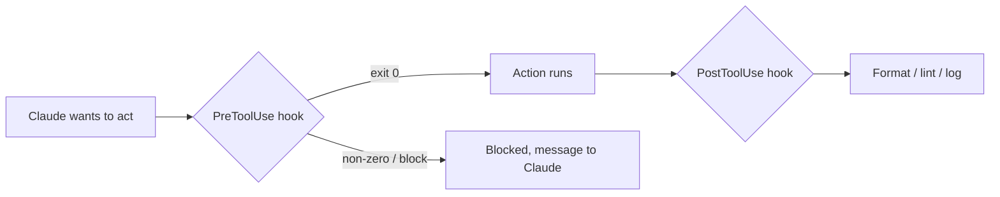

# Hooks: Deterministische Automatisierung

> Source: https://derob98.github.io/ailmanac/de/docs/claude-code/hooks · AILmanac (CC BY 4.0) · last verified 2026-08-22

Befehle bei Lebenszyklus-Ereignissen ausführen, um Formatierung, Gates und Sicherheit zu erzwingen.

<LevelBadge level="advanced" />

<VerifyNote lastVerified="2026-08-22" source="https://code.claude.com/docs/en/hooks">
Claude Code dokumentiert mehr als 30 Hook-Ereignisse, nach Phasen gruppiert — die vollständige Liste, die Matcher-Grammatik pro Ereignis und die universellen JSON-Ausgabefelder stehen in der offiziellen Hooks-Referenz. Namen und Payload-Formen entwickeln sich weiter; prüfe die Quelle, bevor du dich auf ein bestimmtes Ereignis oder Feld festlegst.
</VerifyNote>

Hooks sind **Shell-Befehle, die Claude Code automatisch ausführt** an definierten Punkten seines Lebenszyklus. Während [Berechtigungen](/docs/claude-code/permissions) entscheiden, *ob* eine Aktion erlaubt ist, lassen Hooks *dich* deterministische Logik darum herum ausführen — Formatierung, Validierung, Logging, Gates, Schwärzung. Damit wird ein Verhalten garantiert, statt dass man hofft, Claude „denkt schon daran“.

<Callout type="objectives" items={["Wann du zu einem Hook greifst statt zu einer Anweisung, einer Berechtigung oder einem Skill", "Der vollständige Lebenszyklus: Ereignisse für Sitzung, Prompt, Tool, Subagent, Task, Kompaktierung und Turn-Ende", "Wie ein Hook verdrahtet wird: Ereignis, Matcher und die JSON-Payload auf stdin", "Die zwei Arten, wie ein Hook eine Aktion blockiert — Exit-Code 2 vs. JSON auf stdout", "Die universellen JSON-Ausgabefelder, die ereignisübergreifend gelten: continue, additionalContext, systemMessage, reloadSkills, sessionTitle, suppressOutput, updatedInput", "Die guten Praktiken und häufigen Fehler, die schnelle, sichere Hooks von trägen, stillen unterscheiden"]} />

## Wann du zu einem Hook greifst

Greife zu einem Hook, wenn ein Verhalten *garantiert* sein soll, nicht nur erbeten. Jede übliche Aufgabe entspricht einem Lebenszyklus-Ereignis:

- **Auto-Format / Lint** nach jeder Dateiänderung (`PostToolUse` auf `Edit|Write`).
- Eine Aktion, die gegen eine Regel verstößt, **blockieren**, bevor sie läuft (`PreToolUse`).
- Die Nachricht des Assistenten **schwärzen**, bevor sie im Terminal erscheint (`MessageDisplay`).
- Nach einem `SessionStart` **Skills neu laden** oder einen **Sitzungstitel** setzen.
- **Benachrichtigen oder loggen**, wenn eine Sitzung endet, ein Task fertig wird oder ein Turn fehlschlägt (`Stop`, `StopFailure`, `SessionEnd`).
- **Kontext einspeisen** beim Sitzungsstart oder wenn Anweisungen geladen werden.

## Wie sie funktionieren

Du registrierst Hooks in [`settings.json`](/docs/claude-code/settings) und ordnest sie einem **Ereignis** zu (und oft einem Matcher — meist ein Tool-Name, manchmal ein Subagent-Typ, ein Kompaktierungs-Trigger oder eine Benachrichtigungsart). Wenn das Ereignis eintritt, führt Claude deinen Befehl aus und übergibt eine **JSON-Payload auf stdin** (den Ereignisnamen, die Sitzung und ereignisspezifische Felder wie Tool-Name und Eingaben). Exit-Code und stdout deines Befehls entscheiden, was als Nächstes passiert.

<Steps items={[{title: "Ein Ereignis wählen", body: "Registriere den Hook in settings.json unter dem Lebenszyklus-Ereignis, das dich interessiert — etwa PostToolUse für Automatisierung nach einem Tool oder MessageDisplay für Schwärzung."}, {title: "Mit einem Matcher eingrenzen", body: "Füge einen Matcher hinzu, damit der Hook nur auslöst, wenn es relevant ist, z. B. matcher \"Edit|Write\" für Dateiänderungen oder matcher \"startup|resume\" bei SessionStart."}, {title: "Die Payload von stdin lesen", body: "Wenn das Ereignis eintritt, führt Claude deinen Befehl aus und leitet eine JSON-Payload per Pipe auf stdin — den Ereignisnamen, die Sitzung und ereignisspezifische Felder (tool_name, tool_input, notification usw.)."}, {title: "Entscheiden, was als Nächstes passiert", body: "Exit-Code und Ausgabe deines Befehls bestimmen das Ergebnis: die Aktion durchlassen, deine Logik ausführen, sie blockieren oder strukturiertes JSON zurückgeben, um zu ändern, was Claude sieht."}]} />

```json
{
  "hooks": {
    "PostToolUse": [
      {
        "matcher": "Edit|Write",
        "hooks": [
          { "type": "command", "command": "jq -r '.tool_input.file_path' | xargs npx prettier --write" }
        ]
      }
    ]
  }
}
```

Der Hook oben liest den Pfad der bearbeiteten Datei aus dem JSON auf stdin (`.tool_input.file_path`) und formatiert sie. Nimm nicht an, dass eine Umgebungsvariable den Pfad enthält — **lies ihn von stdin.** Nützliche Pfad-Platzhalter wie `${CLAUDE_PROJECT_DIR}` *sind* verfügbar, um Skripte zu finden.

## Der Lebenszyklus auf einen Blick

Claude-Code-Hooks umfassen die gesamte Sitzung, nicht nur Tool-Aufrufe. Gruppiert nach Phase siehst du, wo du deine Logik einhängen kannst.

| Phase | Ereignisse | Typische Verwendung |
| --- | --- | --- |
| **Sitzung** | `SessionStart`, `SessionEnd`, `Setup`, `InstructionsLoaded`, `ConfigChange`, `CwdChanged`, `DirectoryAdded`, `FileChanged` | Kontext beim Start einspeisen, am Ende einen Snapshot ziehen, auf ein Neuladen von `CLAUDE.md` oder eine `.env`-Änderung auf der Platte reagieren |
| **Prompt** | `UserPromptSubmit`, `UserPromptExpansion` | Den Prompt prüfen oder umschreiben, bevor Claude ihn sieht |
| **Tool** | `PreToolUse`, `PermissionRequest`, `PermissionDenied`, `PostToolUse`, `PostToolUseFailure`, `PostToolBatch` | Eine Aktion erlauben/verweigern, an einen Menschen eskalieren, nach Änderungen formatieren, nach einer Ablehnung im Auto-Modus erneut versuchen |
| **Subagent** | `SubagentStart`, `SubagentStop` | Start/Stopp loggen, einen Subagent am Zurückgeben hindern |
| **Task** | `TaskCreated`, `TaskCompleted` | Einen versehentlichen Task zurückrollen, den Abschluss prüfen |
| **Kompaktierung** | `PreCompact`, `PostCompact` | Vor der Kompaktierung einen Snapshot des Transkripts ziehen, danach verifizieren |
| **Modell** | `PreModelSwitch`, `PostModelSwitch` | Einen Modellwechsel blockieren, bevor er greift; nach dem Wechsel reagieren, auch wenn eine fortgesetzte Sitzung das Modell wiederherstellt |
| **Turn** | `Stop`, `StopFailure`, `Notification`, `MessageDisplay` | Bei Abschluss benachrichtigen, bei API-Fehlern alarmieren, angezeigten Text schwärzen |
| **Team + MCP** | `TeammateIdle`, `Elicitation`, `ElicitationResult`, `WorktreeCreate`, `WorktreeRemove` | Sitzungsübergreifende Koordination, MCP-Elicitations prüfen, Worktree-Operationen umhüllen |

Die genauen stdin-Felder, die Matcher-Grammatik und die Blockierregeln jedes Ereignisses stehen in der [offiziellen Hooks-Referenz](https://code.claude.com/docs/en/hooks). Der Katalog oben ist die Karte; die Referenz ist das Gelände.

## Wie ein Hook blockiert

Zwei Wege, je nach Ereignis:

- **Exit-Code 2** — der Hook lässt die Aktion fehlschlagen, und was er auf **stderr** geschrieben hat, wird zur Nachricht, die Claude sieht. Einfach und für Command-Hooks auf blockierenden Ereignissen möglich (`PreToolUse`, `UserPromptSubmit`, `UserPromptExpansion`, `Stop`, `SubagentStop`, `TeammateIdle`, `TaskCreated`, `TaskCompleted`, `ConfigChange`, `PostToolBatch`, `PreCompact`, `PreModelSwitch`, `Elicitation`, `ElicitationResult`, `WorktreeCreate`, `WorktreeRemove`). Bei `PermissionRequest` wird Exit 2 ignoriert; verweigere stattdessen über das `decision`-Objekt.
- **JSON auf stdout (Exit 0)** — gib eine strukturierte Entscheidung zurück. Bei `PreToolUse` ist das eine `permissionDecision` mit `"allow"`, `"deny"`, `"ask"` (den Aufruf dem Nutzer vorlegen) oder `"defer"` (nur für `-p`-Läufe, die von einer App gesteuert und wieder aufgenommen werden), mit einer `permissionDecisionReason`. Nicht blockierende Ereignisse (`PostToolUse`, `Notification`, `MessageDisplay`, `StopFailure`, die meisten Sitzungsereignisse) ignorieren Blockierversuche — ihre JSON-Ausgabe kann aber trotzdem steuern, was Claude als Nächstes sieht.

Das Skript unten ist ein `PreToolUse`-Hook auf dem Bash-Tool. Lies es von oben nach unten: Es zieht den Befehl aus stdin, und wenn er destruktiv aussieht, schreibt es einen Grund nach stderr und beendet sich mit 2, um zu blockieren.

```bash
#!/usr/bin/env bash
# PreToolUse hook on the Bash tool: refuse to delete things.
command=$(jq -r '.tool_input.command' < /dev/stdin)
if [[ "$command" == rm\ * || "$command" == *"rm -rf"* ]]; then
  echo "Blocked: destructive 'rm' is not allowed by policy." >&2
  exit 2
fi
exit 0
```

## Universelle JSON-Ausgabefelder

Die meisten Ereignisse akzeptieren auf stdout ein strukturiertes JSON-Objekt, das steuert, was als Nächstes passiert — getrennt von den ereignisspezifischen Entscheidungsfeldern wie `permissionDecision`. Die nützlichsten:

| Feld | Was es tut | Wo es funktioniert |
| --- | --- | --- |
| **`continue`** | Bei `false` hört Claude komplett auf zu verarbeiten — hat Vorrang vor jeder ereignisspezifischen Entscheidung | Die meisten Ereignisse |
| **`systemMessage`** | Fügt dem Kontext / Transkript von Claude eine Nachricht hinzu, damit es sieht, warum du eingegriffen hast | Die meisten blockierenden Ereignisse |
| **`additionalContext`** | Speist zusätzlichen Kontext ein, den Claude im nächsten Turn lesen und nutzen kann | `SessionStart`, `UserPromptSubmit`, weitere |
| **`reloadSkills`** | Durchsucht die Skill-Verzeichnisse neu, damit eine Sitzung einen frisch geschriebenen Skill erkennt | `SessionStart` (und andere Sitzungsereignisse) |
| **`sessionTitle`** | Setzt den Sitzungstitel in der UI — unter `hookSpecificOutput` bei `SessionStart` | `SessionStart` |
| **`suppressOutput`** | Verbirgt die Ausgabe des Tools vor Claude (nützlich bei lauten Befehlen) | Tool-Ereignisse |
| **`updatedInput`** | Schreibt die Eingabe des Tools um, bevor es läuft (z. B. ein `--dry-run`-Flag hinzufügen) | `PreToolUse` |
| **`terminalSequence`** | Gibt Terminal-Escape-Sequenzen aus — Glocke, Fenstertitel, Benachrichtigungs-Badge | `Notification`, `StopFailure`, weitere |

Ereignisspezifische Entscheidungsfelder — `permissionDecision` (`"allow"`, `"deny"`, `"ask"` oder `"defer"`, plus `permissionDecisionReason`) bei `PreToolUse`, `decision.behavior` (`"allow"` oder `"deny"`) bei `PermissionRequest` und `retry: true` bei `PermissionDenied`, damit Claude den abgelehnten Aufruf erneut versuchen darf — setzen auf diesen universellen auf.

## Das mentale Modell

Ein `PreToolUse`-Hook läuft *vor* der Aktion und kann sie blockieren; ein `PostToolUse`-Hook läuft *nachdem* sie erfolgreich war und reagiert auf das Ergebnis.



<Flashcards title="Hook-Ereignisse auf einen Blick" cards={[{front: "PreToolUse", back: "Löst aus, bevor eine Aktion läuft. Zum Blockieren oder Absichern — z. B. einen destruktiven Befehl ablehnen, bevor er ausgeführt wird. Entscheidungsfeld: permissionDecision."}, {front: "PostToolUse", back: "Löst nach einer passenden Aktion aus. Zum Formatieren, Linten oder Loggen dessen, was sich gerade geändert hat. Nicht blockierend."}, {front: "MessageDisplay", back: "Löst aus, wenn der Nachrichtentext des Assistenten angezeigt wird. Zum Schwärzen von Geheimnissen oder PII im Terminal — nur Anzeige, kann nicht blockieren."}, {front: "SessionStart", back: "Löst zu Beginn (oder bei Fortsetzung) einer Sitzung aus. Zum Einspeisen von Kontext per additionalContext, für reloadSkills, nachdem ein neuer Skill hinzugekommen ist, oder zum Setzen von sessionTitle."}, {front: "Stop / StopFailure", back: "Stop löst aus, wenn Claude einen Turn sauber beendet; StopFailure, wenn der Turn mit einem API-Fehler endete (rate_limit, overloaded, auth usw.). Bei der Fehlervariante benachrichtigen oder automatisch wiederholen."}, {front: "PreCompact / PostCompact", back: "Lösen rund um die Kontext-Kompaktierung aus. PreCompact kann blockieren (Exit 2) oder vorher einen Snapshot des Transkripts ziehen; PostCompact reagiert auf den kompaktierten Zustand."}]} />

## Gute Praktiken

- **Halte Hooks schnell und idempotent** — sie laufen oft. `SessionEnd`-Hooks teilen sich ein einziges Budget von 1,5 Sekunden, also halte die Arbeit am Sitzungsende minimal.
- **Bei echten Problemen laut scheitern**, aber bei kosmetischen nicht blockieren.
- **Behandle Hook-Ausgaben als Feedback an Claude** — eine klare Meldung auf stderr (Exit 2) oder in `systemMessage` (JSON) hilft Claude, sich selbst zu korrigieren.
- **Bevorzuge JSON-Ausgabe gegenüber Exit-Codes**, wenn du mehr sagen willst als „blockiert“ — `permissionDecision: "ask"` bei `PreToolUse` schiebt die Entscheidung an einen Menschen, ohne die Tür zuzuschlagen, und mit `additionalContext` kannst du *lenken*, statt nur abzulehnen.
- Hooks laufen mit den Rechten deiner Shell — prüfe jeden Hook, den du nicht selbst geschrieben hast ([Fremden Code prüfen](/docs/security/reviewing-third-party-code)).

## Häufige Fehler

- **Den Dateipfad aus einer Umgebungsvariable lesen.** Der Pfad steht im stdin-JSON (`.tool_input.file_path`), nicht in `$CLAUDE_FILE_PATH`. Leite stdin per Pipe durch `jq`.
- **Stille Blockaden.** Wenn ein `PreToolUse`-Hook mit 2 endet und nichts auf stderr steht, ist Claude blockiert, weiß aber nicht, *warum*, und kann sich nicht anpassen. Schreibe immer einen klaren Grund (oder nutze `permissionDecisionReason`).
- **Versuchen, ein nicht blockierendes Ereignis zu blockieren.** `PostToolUse` löst aus, *nachdem* das Tool lief — ein Exit 2 legt Claude nur eine Nachricht ins Ohr, die Aktion lässt sich nicht rückgängig machen. Wenn du absichern willst, hänge dich an `PreToolUse`.
- **Langsame Hooks.** Ein `PostToolUse`-Hook läuft nach *jeder* passenden Änderung. Ein Linter mit 3 Sekunden lässt die ganze Sitzung zäh wirken — halte Hooks schnell und reagiere idealerweise nur auf das, was sich geändert hat.
- **Zu breite Matcher.** `matcher: ".*"` löst bei jedem Tool aus. Grenze ein mit einem exakten Namen, einer `Edit|Write`-Liste oder dem `if`-Feld pro Handler (z. B. `"if": "Bash(git push *)"`).
- **Vergessen, dass es Matcher auch für Nicht-Tool-Ereignisse gibt.** `SessionStart` matcht `startup|resume|clear|compact|fork`; `Notification` matcht Arten wie `permission_prompt|idle_prompt|agent_completed`; `PreCompact` matcht `manual|auto`. Ein einzelner Hook, der an der falschen Teilmenge hängt, löst entweder zu oft oder nie aus.
- **Hooks vertrauen, die du nicht geschrieben hast.** Ein Hook führt beliebige Shell-Befehle mit deinen Rechten aus. Prüfe jeden Hook aus einem Plugin oder einer Vorlage zuerst — siehe [Fremden Code prüfen](/docs/security/reviewing-third-party-code).

<Callout type="warning" items={["Ein Hook führt beliebige Shell-Befehle mit deinen Rechten aus — verdrahte nie einen Hook aus einem Plugin oder einer Vorlage, ohne ihn vorher gelesen zu haben."]} />

## Rezepte zum Abschauen

Kopierfertige Starter findest du unter [Hooks- & settings.json-Rezepte](/docs/templates/hooks-settings). Einige wirkungsvolle, die die Form neuerer Ereignisse zeigen:

<PromptCard title="Bearbeitete Dateien automatisch formatieren (PostToolUse auf Edit|Write)">{`{
  "hooks": {
    "PostToolUse": [
      {
        "matcher": "Edit|Write",
        "hooks": [
          { "type": "command", "command": "jq -r '.tool_input.file_path' | xargs npx prettier --write" }
        ]
      }
    ]
  }
}`}</PromptCard>

<PromptCard title="Beim Start einen Sitzungstitel pro Projekt setzen (SessionStart)">{`{
  "hooks": {
    "SessionStart": [
      {
        "matcher": "startup|resume",
        "hooks": [
          {
            "type": "command",
            "command": "jq -nc --arg t \\"$(basename \\"$PWD\\") — $(git rev-parse --abbrev-ref HEAD 2>/dev/null || echo detached)\\" '{hookSpecificOutput:{sessionTitle:$t}}'"
          }
        ]
      }
    ]
  }
}`}</PromptCard>

<PromptCard title="Skills nach einem SessionStart neu laden (erkennt einen frisch geschriebenen Skill)">{`{
  "hooks": {
    "SessionStart": [
      {
        "matcher": "startup|resume",
        "hooks": [
          { "type": "command", "command": "printf '{\\"reloadSkills\\": true}\\n'" }
        ]
      }
    ]
  }
}`}</PromptCard>

<PromptCard title="API-Schlüssel im angezeigten Assistententext schwärzen (MessageDisplay)">{`{
  "hooks": {
    "MessageDisplay": [
      {
        "hooks": [
          {
            "type": "command",
            "command": "jq -r '.message.content' | sed -E 's/(sk-[A-Za-z0-9_-]{20,})/sk-***REDACTED***/g'"
          }
        ]
      }
    ]
  }
}`}</PromptCard>

<PromptCard title="Bei fehlgeschlagenem Turn benachrichtigen (StopFailure — Rate-Limits, Überlastung, Auth)">{`{
  "hooks": {
    "StopFailure": [
      {
        "matcher": "rate_limit|overloaded|authentication_failed|billing_error",
        "hooks": [
          { "type": "command", "command": "osascript -e 'display notification \\"Claude Code turn failed — check the terminal\\" with title \\"Claude Code\\"'" }
        ]
      }
    ]
  }
}`}</PromptCard>

<Quiz title="Teste dich selbst" questions={[{q: "Wo findet ein Hook den Pfad der Datei, die gerade bearbeitet wurde?", options: ["In der Umgebungsvariable $CLAUDE_FILE_PATH", "In der JSON-Payload auf stdin, unter .tool_input.file_path", "In einem Kommandozeilenargument, das Claude übergibt"], answer: 1, explain: "Der Pfad steht im stdin-JSON (.tool_input.file_path), nicht in einer Umgebungsvariable. Leite stdin per Pipe durch jq, um ihn zu lesen."}, {q: "Ein PreToolUse-Hook endet mit Exit-Code 2. Was passiert?", options: ["Die Aktion wird erlaubt und stdout wird geloggt", "Die Aktion wird blockiert, und was der Hook auf stderr geschrieben hat, wird zur Nachricht, die Claude sieht", "Claude ignoriert das Ergebnis, weil Exit 2 reserviert ist"], answer: 1, explain: "Exit-Code 2 lässt die Aktion fehlschlagen; stderr wird zur Nachricht, die Claude sieht. Schreibe immer einen klaren Grund, damit Claude sich anpassen kann."}, {q: "Eine Sitzung soll einen Skill erkennen, den du gerade in .claude/skills/ hinzugefügt hast, ohne Neustart. Welches Ausgabefeld, bei welchem Ereignis?", options: ["reloadSkills: true bei SessionStart", "restart: true bei Stop", "refresh: true bei PostToolUse"], answer: 0, explain: "Wenn ein SessionStart-Hook {\"reloadSkills\": true} ausgibt, werden die Skill-Verzeichnisse neu durchsucht, sodass die aktuelle Sitzung neue oder geänderte Skills erkennt."}, {q: "Du willst Geheimnisse im Text von Claude schwärzen, bevor er auf dem Bildschirm des Nutzers erscheint. Welches Ereignis?", options: ["PreToolUse", "PostToolUse", "MessageDisplay"], answer: 2, explain: "MessageDisplay löst aus, wenn der Nachrichtentext des Assistenten angezeigt wird — der richtige Ort, um Text auf dem Weg ins Terminal umzuwandeln oder zu schwärzen. Es kann nicht blockieren."}]} />

<Callout type="takeaways" items={["Hooks machen Verhalten garantiert statt erbeten — deterministische Logik rund um Aktionen, die Berechtigungen nur erlauben oder verweigern.", "Der Lebenszyklus umfasst mehr als 30 Ereignisse in den Phasen Sitzung, Prompt, Tool, Subagent, Task, Kompaktierung und Turn — wähle die richtige Phase, bevor du das Skript schreibst.", "Registriere in settings.json ein Ereignis plus Matcher; Claude leitet eine JSON-Payload per Pipe auf stdin und liest deinen Exit-Code und deine Ausgabe.", "Lies den Dateipfad von stdin (.tool_input.file_path) — nicht aus einer Umgebungsvariable.", "Blockiere mit Exit-Code 2 (stderr wird zur Nachricht) oder mit strukturiertem JSON auf stdout (permissionDecision bei Tool-Ereignissen, {continue: false}, um alles zu stoppen).", "Universelle Ausgabefelder — additionalContext, systemMessage, reloadSkills, sessionTitle, suppressOutput, updatedInput — lassen dich Claude lenken, statt nur zu erlauben oder abzulehnen.", "Halte Hooks schnell, idempotent und eng gematcht — und prüfe jeden Hook, den du nicht selbst geschrieben hast, denn er läuft mit den Rechten deiner Shell."]} />

## Weiter

- [Mods: Erweiterungen im Prozess](/docs/claude-code/mods) — das In-Process-Geschwister: TypeScript-Middleware, die ein Ereignis *umschreiben* kann, statt es nur zu erlauben oder zu blockieren, und jedes Ereignis dieser Seite als `classic.<Event>` erreicht
- [settings.json](/docs/claude-code/settings) · [Berechtigungen](/docs/claude-code/permissions)
- [Skills](/docs/claude-code/skills) — Expertise vs. Automatisierung
- [Autonome Läufe absichern](/docs/security/hardening-autonomous-runs)
