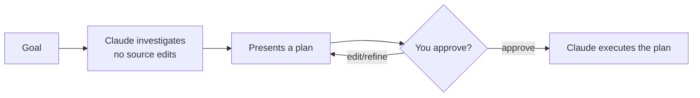

# Plan-Modus

> Source: https://derob98.github.io/ailmanac/de/docs/claude-code/plan-mode · AILmanac (CC BY 4.0) · last verified 2026-10-09

Erst untersuchen und vorschlagen, bevor Änderungen ausgeführt werden — der sicherste Weg für große Änderungen, und die Sperren, die er nicht erzwingt.

<LevelBadge level="beginner" />

<Callout type="objectives" items={["Erklären, was der Plan-Modus blockiert — und was Claude trotzdem ausführen darf", "Den Plan-Modus auf drei verschiedene Arten betreten und verlassen", "Die Schleife aus Untersuchen, Vorschlagen, Freigeben und Ausführen durchgehen", "Plan-Modus und Berechtigungen auseinanderhalten und gemeinsam einsetzen"]} />

<VerifyNote lastVerified="2026-10-09" source="https://code.claude.com/docs/en/permission-modes">
Wie du den Plan-Modus betrittst (Tastenkürzel/Flag) und welche Shell-Befehle Claude beim Planen genau ausführen darf, ändert sich zwischen Releases — prüfe es in der offiziellen Claude-Code-Dokumentation.
</VerifyNote>

## Die Grundidee

Stell dir vor, du gibst einem Handwerker erst deinen Hausschlüssel — oder bittest ihn zuerst, einmal durchs Haus zu gehen und aufzuschreiben, *was* er ändern würde. Der Plan-Modus ist dieser Rundgang.

Der **Plan-Modus** weist Claude an, **zu recherchieren und Änderungen vorzuschlagen, ohne sie vorzunehmen**: Claude liest Dateien, führt Shell-Befehle zur Erkundung aus und schreibt einen Plan — **bearbeitet aber deinen Quellcode nicht**. Änderungen bleiben gesperrt, bis du den Plan freigibst.

<Callout type="tip" items={["Plan-Modus heißt: Claude UNTERSUCHT, ÄNDERT aber deinen Quellcode nicht — er erstellt einen Plan und wartet auf dein Okay."]} />

### Er ist nicht strikt schreibgeschützt

Zum Erkunden braucht es manchmal einen Befehl, daher geht es im Plan-Modus um *nicht bearbeiten*, nicht um *nicht ausführen*. Was mit einem Shell-Befehl während der Planung passiert, hängt von der Sitzung ab — es gilt der erste zutreffende Fall:

<Steps items={[{title: "Interaktive Terminal-Sitzungen mit verfügbaren Bypass-Berechtigungen", body: "Die Sperren des Plan-Modus werden NICHT erzwungen. Claude wird weiterhin angewiesen, ohne Bearbeitung zu planen, aber eine Änderung oder ein Befehl, die es während der Planung versucht, läuft ohne Nachfrage. Überall sonst behält der Plan-Modus seine Sperren — bei headless -p-Läufen, im Agent SDK und im Chat-Panel der VS-Code-Erweiterung."}, {title: "Auto Mode verfügbar und useAutoModeDuringPlan an (Standard)", body: "Der Classifier prüft Shell-Befehle, statt dich zu fragen — mit Ausnahme von Löschungen kritischer Pfade. Freigegebene Befehle laufen, abgelehnte werden blockiert."}, {title: "Auto Mode nicht verfügbar oder useAutoModeDuringPlan aus", body: "Befehle außerhalb des eingebauten Nur-Lese-Satzes fragen dich um Freigabe."}]} />

<Callout type="warning" items={["Wenn du mit --allow-dangerously-skip-permissions gestartet hast, ist der Plan-Modus eine starke Anweisung statt einer harten Leitplanke. Behandle ihn als Planungskonvention, nicht als Sandbox."]} />

## Warum er der sicherste Einstieg ist

Bei allem, was groß, riskant oder unbekannt ist, willst du sehen, *was* Claude vorhat, bevor es dein Repo anfasst. Der Plan-Modus trennt **Denken** von **Tun**:

Der Gewinn: Du erkennst falsche Annahmen, *bevor* sie zu falschem Code werden.

## Wann du ihn nutzt

<Callout type="tip" items={["IMMER bei großen oder dateiübergreifenden Änderungen, Migrationen oder Refactorings", "Wenn du in einer Codebasis arbeitest, die du noch nicht ganz kennst", "Wenn du einen prüfbaren Plan willst, den du mit Kolleg:innen teilen kannst"]} />

Bei winzigen, offensichtlichen Änderungen kannst du ihn überspringen — im Zweifel aber erst planen.

## So läuft es in der Praxis

Folge der Schleife. Jeder Schritt verdient den nächsten — Claude wechselt erst zum Bearbeiten, *nachdem* du freigegeben hast.

<Steps items={[{title: "Plan-Modus betreten und dein Ziel nennen", body: "Drücke Shift+Tab, um durch die Berechtigungsmodi zu schalten, bis die Statusleiste 'plan mode on' zeigt, oder stelle einem einzelnen Prompt /plan voran. Um direkt dort zu starten, starte mit claude --permission-mode plan. Beschreibe dann, was du erreichen willst."}, {title: "Claude untersucht", body: "Es liest die relevanten Dateien, führt Erkundungsbefehle aus und stellt Rückfragen."}, {title: "Claude liefert einen Schritt-für-Schritt-Plan", body: "Zu ändernde Dateien, Vorgehen und wie das Ergebnis geprüft wird. Drücke Strg+G, um den vorgeschlagenen Plan in deinem Editor zu öffnen und direkt zu ändern."}, {title: "Du gibst frei oder verfeinerst", body: "Wähle 'Yes, and use auto mode', 'Yes, manually approve edits' oder 'No, keep planning'. Mit der Freigabe verlässt du den Plan-Modus in den Berechtigungsmodus, den die Option beschreibt, und Claude beginnt zu bearbeiten."}]} />

Um den Plan-Modus zu verlassen, ohne einen Plan freizugeben, drücke erneut `Shift+Tab`. Um ihn für die Terminal-Sitzungen eines Projekts zum Standard zu machen, setze `defaultMode` in `.claude/settings.json` auf `plan` — siehe [Einstellungen](/docs/claude-code/settings).

### Probier es selbst aus

Kopiere das in eine echte Planungssitzung und sieh zu, wie die Schleife abläuft:

<PromptCard title="Eine Planungssitzung starten">{`I want to migrate our auth from sessions to JWT. Stay in Plan Mode: investigate the current setup, ask anything you need, then propose a step-by-step plan with files to change and how to verify — don't edit anything yet.`}</PromptCard>

:::tip[Kombiniere ihn mit CLAUDE.md]
Eine gute [CLAUDE.md](/docs/claude-code/claude-md) macht Pläne präziser — Claude plant bereits mit deinen Konventionen und Leitplanken im Kopf.
:::

## Plan-Modus vs. Berechtigungen

Ein Klassiker der Verwechslung. Sie lösen unterschiedliche Probleme und arbeiten zusammen:

- **Plan-Modus** = „untersuchen und vorschlagen, noch nicht bearbeiten." (Diese Seite.)
- **[Berechtigungen](/docs/claude-code/permissions)** = sobald gehandelt wird: *welche* Aktionen ohne Nachfrage erlaubt sind.

Denk daran als **ob jetzt gehandelt wird** (Plan-Modus) im Gegensatz zu **welche Aktionen beim Handeln erlaubt sind** (Berechtigungen).

<Flashcards cards={[{front: "In welchen Zustand versetzt der Plan-Modus Claude Code?", back: "Recherchieren und Vorschlagen: Es liest Dateien, führt Shell-Befehle zur Erkundung aus und schreibt einen Plan, bearbeitet aber deinen Quellcode nicht. Änderungen bleiben gesperrt, bis du freigibst."}, {front: "Wie betrittst und verlässt du den Plan-Modus?", back: "Betreten mit Shift+Tab, einem /plan-Präfix vor einem Prompt oder claude --permission-mode plan. Ohne Freigabe verlassen mit erneutem Shift+Tab."}, {front: "Was ist die Plan-Modus-Schleife?", back: "Untersuchen → Plan vorlegen → du gibst frei oder verfeinerst → Claude führt aus."}, {front: "Wann solltest du zum Plan-Modus greifen?", back: "Standardmäßig bei großer, riskanter oder unbekannter Arbeit (dateiübergreifende Änderungen, Migrationen, Refactorings, unbekannte Codebasen). Nur winzige, offensichtliche Änderungen überspringen."}, {front: "Plan-Modus vs. Berechtigungen?", back: "Der Plan-Modus regelt, OB jetzt gehandelt wird; Berechtigungen regeln, WELCHE Aktionen beim Handeln erlaubt sind."}]} />

<Callout type="takeaways" items={["Der Plan-Modus ist Recherchieren und Vorschlagen: Claude liest und führt Erkundungsbefehle aus, bearbeitet aber deinen Quellcode erst, wenn du den Plan freigibst", "Er ist nicht strikt schreibgeschützt — Befehle während der Planung werden vom Classifier geprüft, per Nachfrage bestätigt oder (mit verfügbaren Bypass-Berechtigungen in einem interaktiven Terminal) komplett freigegeben", "Betreten mit Shift+Tab, einem /plan-Präfix oder --permission-mode plan; mit der Freigabe wechselt die Sitzung in den Modus, den die gewählte Option nennt", "Standardmäßig bei großer, riskanter oder unbekannter Arbeit nutzen; nur winzige, offensichtliche Änderungen überspringen", "Der Plan-Modus regelt, OB jetzt gehandelt wird; Berechtigungen regeln, WELCHE Aktionen beim Handeln erlaubt sind"]} />

<Quiz title="Teste dich selbst" questions={[{q: "Was kann Claude Code im Plan-Modus tun?", options: ["Dateien bearbeiten und jeden Befehl ausführen", "Dateien lesen und Shell-Befehle zur Erkundung ausführen — aber deinen Quellcode erst nach deiner Freigabe bearbeiten", "Nur Fragen beantworten, ganz ohne Dateizugriff"], answer: 1, explain: "Im Plan-Modus geht es um Nicht-Bearbeiten, nicht um Nicht-Ausführen. Claude liest Dateien und führt Erkundungsbefehle aus (je nach Sitzung vom Classifier geprüft oder per Nachfrage bestätigt), aber Änderungen an deinem Quellcode bleiben gesperrt, bis du den Plan freigibst."}, {q: "Wann solltest du zum Plan-Modus greifen?", options: ["Nur bei Ein-Zeilen-Tippfehlern", "Bei großen oder dateiübergreifenden Änderungen, Migrationen, Refactorings oder unbekannten Codebasen", "Nie — er bremst nur"], answer: 1, explain: "Nutze ihn immer bei großen oder dateiübergreifenden Änderungen, Migrationen oder Refactorings und wenn du in einer Codebasis arbeitest, die du noch nicht ganz kennst. Winzige, offensichtliche Änderungen können ihn überspringen."}, {q: "Wie lautet die richtige Reihenfolge der Plan-Modus-Schleife?", options: ["Ausführen, dann untersuchen, dann freigeben", "Ohne Bearbeitung untersuchen, einen Plan vorlegen, du gibst frei oder verfeinerst, dann führt Claude aus", "Erst freigeben, dann untersucht und bearbeitet Claude"], answer: 1, explain: "Claude untersucht, ohne deinen Quellcode zu bearbeiten, legt einen Plan vor, du gibst frei oder verfeinerst — und erst dann wechselt es zur Ausführung des Plans."}, {q: "Wie unterscheiden sich Plan-Modus und Berechtigungen?", options: ["Es sind zwei Namen für dieselbe Funktion", "Plan-Modus = untersuchen und vorschlagen, noch nicht bearbeiten; Berechtigungen = sobald gehandelt wird, welche Aktionen ohne Nachfrage erlaubt sind", "Berechtigungen entscheiden, ob geplant wird; der Plan-Modus entscheidet, welche Dateien bearbeitet werden"], answer: 1, explain: "Der Plan-Modus trennt Denken von Tun. Berechtigungen steuern, welche Aktionen ohne Nachfrage erlaubt sind, sobald Claude handelt. Beide arbeiten zusammen."}]} />

## Weiter

- [Berechtigungen & Berechtigungsmodi](/docs/claude-code/permissions)
- [Kontext-Management](/docs/claude-code/context-management) — lange Sitzungen wirksam halten
- [Walkthrough: Claude Code für ein echtes Repo anpassen](/docs/walkthroughs/customize-claude-code)
