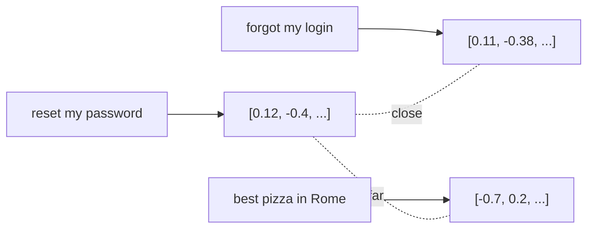

# Embeddings & Vektorsuche

> Source: https://derob98.github.io/ailmanac/de/docs/foundations/embeddings · AILmanac (CC BY 4.0)

Bedeutung als Vektor, und wie semantische Suche funktioniert.

<LevelBadge level="intermediate" />

Ein **Embedding** verwandelt ein Stück Text in eine Liste von Zahlen (einen **Vektor**), die seine *Bedeutung* erfasst. Texte mit ähnlicher Bedeutung erhalten Vektoren, die nah beieinander liegen — selbst wenn sie kein einziges Wort teilen. Das ist der Trick hinter der **semantischen Suche** und [RAG](/docs/foundations/rag).

<Callout type="objectives" items={[
  "Ein Embedding als Punkt in einem Raum begreifen, der so angeordnet ist, dass ähnliche Bedeutungen nahe beieinander liegen",
  "Stichwortsuche von semantischer Suche unterscheiden — und wissen, warum die hybride Suche meist gewinnt",
  "Die vier Schritte einer Vektorsuche nachvollziehen, vom Chunking bis zur Nächste-Nachbarn-Suche",
  "Die drei Fehler vermeiden, die die Retrieval-Qualität unbemerkt ruinieren: ungeeignete Chunk-Größen, vermischte Embedding-Modelle und fehlende Metadaten-Filter",
  "Entscheiden, wann du wirklich eine Vektordatenbank brauchst und wann nicht"
]} />

## Die Intuition

Stell dir vor, jeder Satz wird als Punkt in einem riesigen mehrdimensionalen Raum platziert, so angeordnet, dass **ähnliche Bedeutungen nahe beieinander liegen**. "Wie setze ich mein Passwort zurück?" landet nahe bei "Ich habe meinen Login vergessen", weit entfernt von "beste Pizza in Rom".

## Semantische vs. Stichwortsuche

- **Stichwortsuche** gleicht wörtliche Begriffe ab ("Passwort" findet "Passwort").
- **Semantische Suche** gleicht *Bedeutung* ab — "Ich kann mich nicht anmelden" findet das Passwort-Zurücksetzen-Dokument, auch ohne das Wort "Passwort".

Die besten Ergebnisse **kombinieren** oft beides (hybride Suche).

## Wie eine Vektorsuche funktioniert

<Steps items={[
  {
    "title": "Dokumente embedden und die Vektoren speichern",
    "body": "Teile jedes Dokument zuerst in Chunks auf, embedde dann jeden Chunk und speichere die Vektoren in einer Vektordatenbank. Dieser Schritt wird einmal im Voraus erledigt."
  },
  {
    "title": "Die Anfrage embedden",
    "body": "Schicke die Frage der Nutzerin oder des Nutzers zur Abfragezeit durch dasselbe Embedding-Modell, damit sie im selben Raum landet wie deine Chunks."
  },
  {
    "title": "Die nächstgelegenen Vektoren finden",
    "body": "Vergleiche den Anfragevektor per Kosinus-Ähnlichkeit oder Distanz mit den gespeicherten Vektoren und behalte die nächsten Treffer."
  },
  {
    "title": "Diese Chunks zurückgeben",
    "body": "Typischerweise, um sie in RAG einzuspeisen, wo der abgerufene Text zum Kontext für die Antwort des Modells wird."
  }
]} />

## Praktische Hinweise

- **Chunking ist entscheidend.** Zu groß = verrauschte Treffer; zu klein = verlorener Kontext. Stimme es ab.
- **Verwende konsequent ein einziges Embedding-Modell** — Vektoren aus verschiedenen Modellen sind nicht vergleichbar.
- **Metadaten + Filter** (Datum, Quelle, Typ) machen das Retrieval weitaus präziser.
- Eine Vektor-DB ist nicht immer nötig — für kleine Korpora reicht eine einfache In-Memory-Suche aus.

<Flashcards cards={[
  { "front": "Embedding", "back": "Eine Liste von Zahlen (ein Vektor), die die Bedeutung eines Textstücks darstellt. Ähnliche Bedeutungen erhalten Vektoren, die nah beieinander liegen, selbst wenn die Texte kein Wort teilen." },
  { "front": "Vektor", "back": "Die Liste von Zahlen, die ein Embedding erzeugt — ein Punkt in einem riesigen mehrdimensionalen Raum, in dem Nähe ähnliche Bedeutung heißt." },
  { "front": "Stichwortsuche vs. semantische Suche", "back": "Stichwortsuche gleicht wörtliche Begriffe ab: \"Passwort\" findet \"Passwort\". Semantische Suche gleicht Bedeutung ab: \"Ich kann mich nicht anmelden\" findet das Passwort-Zurücksetzen-Dokument, auch ohne das Wort \"Passwort\"." },
  { "front": "Hybride Suche", "back": "Die Kombination aus Stichwortsuche und semantischer Suche. Die besten Ergebnisse entstehen oft aus beiden zusammen statt aus einer allein." },
  { "front": "Chunk", "back": "Die Einheit, in die ein Dokument vor dem Embedding aufgeteilt wird. Zu groß liefert verrauschte Treffer; zu klein verliert Kontext. Es ist ein Parameter zum Abstimmen, kein Standardwert zum Hinnehmen." },
  { "front": "Vektordatenbank", "back": "Der Ort, an dem die gembeddeten Chunks gespeichert werden, damit du zur Abfragezeit die nächsten Vektoren nachschlagen kannst. Nicht immer nötig — für einen kleinen Korpus reicht eine einfache In-Memory-Suche." },
  { "front": "Kosinus-Ähnlichkeit / Distanz", "back": "Das Maß, mit dem die Vektoren gefunden werden, die deinem Anfragevektor am nächsten liegen — Schritt 3 einer Vektorsuche." },
  { "front": "Warum man Embedding-Modelle nicht mischen darf", "back": "Vektoren aus verschiedenen Modellen sind nicht vergleichbar. Embedde Dokumente und Anfragen konsequent mit demselben Modell." },
  { "front": "Metadaten + Filter", "back": "Attribute wie Datum, Quelle und Typ, die zusammen mit jedem Vektor gespeichert werden. Das Filtern danach macht das Retrieval weitaus präziser als Ähnlichkeit allein." }
]} />

<Quiz questions={[
  {
    "q": "Jemand sucht nach \"Ich kann mich nicht anmelden\" und erhält das Passwort-Zurücksetzen-Dokument, das die Formulierung \"anmelden\" nie verwendet. Was hat das möglich gemacht?",
    "options": [
      "Stichwortsuche, die wörtliche Begriffe abgleicht",
      "Semantische Suche, die Bedeutung statt Wörter abgleicht",
      "Ein Metadaten-Filter auf den Dokumenttyp",
      "Eine größere Chunk-Größe"
    ],
    "answer": 1,
    "explain": "Stichwortsuche gleicht wörtliche Begriffe ab, würde also ein Dokument, das \"anmelden\" nie sagt, nicht finden. Semantische Suche vergleicht Bedeutung: Beide Texte werden zu nahe beieinander liegenden Vektoren. Die besten Ergebnisse kombinieren oft beides — hybride Suche."
  },
  {
    "q": "Du embeddest deine Dokumente mit einem neueren Embedding-Modell neu, lässt den bestehenden Anfragepfad aber unverändert. Was geht kaputt?",
    "options": [
      "Nichts — Embeddings sind ein Standardformat",
      "Nur das Chunking, das neu gemacht werden muss",
      "Die Retrieval-Qualität, weil Vektoren aus verschiedenen Modellen nicht vergleichbar sind",
      "Nur die Metadaten-Filter"
    ],
    "answer": 2,
    "explain": "Vektoren aus verschiedenen Modellen sind nicht vergleichbar — sie leben in verschiedenen Räumen. Dokumente und Anfragen müssen konsequent mit demselben Modell gembeddet werden, was bedeutet, bei einem Modellwechsel beide Seiten neu zu embedden."
  },
  {
    "q": "Deine abgerufenen Chunks passen thematisch, verfehlen aber immer wieder das Detail, das die Antwort brauchte. Welcher Stellhebel ist der erste Verdächtige?",
    "options": [
      "Die Chunk-Größe — zu klein, sodass Kontext verloren ging",
      "Der Anbieter der Vektordatenbank",
      "Die Kosinus-Ähnlichkeit, die durch Stichwortabgleich ersetzt werden sollte",
      "Die Anzahl der Dimensionen des Embeddings"
    ],
    "answer": 0,
    "explain": "Das Chunking ist der Stellhebel: Zu groß liefert verrauschte Treffer, zu klein verliert den umgebenden Kontext, von dem die Antwort abhing. Thematisch richtige, aber unvollständige Ergebnisse deuten auf zu fein zerschnittene Chunks hin."
  }
]} />

<Callout type="takeaways" items={[
  "Ein Embedding ist Bedeutung als Punkt im Raum — Nähe heißt ähnliche Bedeutung, nicht gemeinsame Wörter.",
  "Semantische Suche findet, was die Stichwortsuche übersieht, aber hybride Suche schlägt meist beide Einzelverfahren.",
  "Vier Schritte: Chunks embedden und speichern, die Anfrage embedden, nächste Vektoren finden, die Chunks zurückgeben.",
  "Ein Embedding-Modell, konsequent auf beiden Seiten eingesetzt. Vektoren aus verschiedenen Modellen sind nicht vergleichbar.",
  "Chunk-Größe und Metadaten-Filter tun mehr für die Retrieval-Qualität als die Wahl der Vektordatenbank.",
  "Für einen kleinen Korpus reicht eine einfache In-Memory-Suche — eine Vektor-DB ist keine Voraussetzung."
]} />

## Weiter

- [Retrieval-Augmented Generation (RAG)](/docs/foundations/rag)
- [Fine-Tuning vs. Prompting vs. RAG](/docs/foundations/finetune-vs-prompt-vs-rag)
- [Halluzinationen & wie man sie reduziert](/docs/foundations/hallucinations)
