# Serverseitiger Gesprächszustand im Anbietervergleich

> Source: https://derob98.github.io/ailmanac/de/docs/models/server-side-conversation-state · AILmanac (CC BY 4.0) · last verified 2026-11-03

Anthropic, OpenAI und Google halten dein Gespräch inzwischen alle auf ihren Servern — und haben drei inkompatible Verträge ausgeliefert. Einer ist ein flüchtiger Latenztrick, für den du einen Replay-Pfad programmieren musst; zwei sind dauerhafte Speicher, die standardmäßig AKTIV sind, für 30 und 55 Tage. Die Achse, die dein Design tatsächlich bestimmt.

<LevelBadge level="advanced" />

<Callout type="objectives" items={[
  "Die drei APIs und ihre Fortsetzungsparameter benennen, ohne sie zu verwechseln",
  "Die zwei Produkte trennen, die sich hinter einer Formulierung verstecken: eine flüchtige Latenzoptimierung gegenüber dauerhafter Gesprächsspeicherung",
  "Die Zeile zur Aufbewahrung lesen, bevor du auslieferst — bei zwei der drei Anbieter ist das Speichern von Gesprächen der STANDARD, keine Entscheidung, die du getroffen hast",
  "Aufhören zu erwarten, dass eine davon deine Token-Rechnung senkt, und wissen, welche Funktion es tatsächlich tut",
  "Die eine Entwurfsregel anwenden, die bei allen dreien gilt: Dein Log ist die Quelle der Wahrheit, der Zustand beim Anbieter ist ein Cache",
  "Die drei Stellen erkennen, an denen eine Abstraktion über alle drei Anbieter undicht wird"
]} />

<VerifyNote lastVerified="2026-11-03" source="https://platform.claude.com/docs/en/build-with-claude/message-threads">
Jeder Parametername, jeder Standardwert und jedes Aufbewahrungsfenster auf dieser Seite ist am oben genannten Datum aus der eigenen Dokumentation des Anbieters zitiert. Zwei der drei Funktionen sind jung — die von Anthropic ging am 2026-11-02 in die öffentliche Beta — und gerade Aufbewahrungsrichtlinien sind das, was Anbieter gern überarbeiten. Prüfe jede erneut, bevor du eine Compliance-Aussage machst: [Anthropic](https://platform.claude.com/docs/en/build-with-claude/message-threads) · [OpenAI](https://developers.openai.com/api/docs/guides/conversation-state) · [Google](https://aistudio.google.com/docs/interactions-overview).
</VerifyNote>

Jahrelang war jede Chat-API von Haus aus zustandslos. Du hieltest das Gespräch, du schicktest es in jeder Runde erneut, und das war der ganze Vertrag. Im Lauf von 2026 haben alle drei großen Anbieter ihn gebrochen — und sie sind nicht zusammengekommen.

Anthropic hat [Message Threads](/docs/api/message-threads) ausgeliefert. OpenAI hat `previous_response_id` in der Responses API und darauf aufbauend eine Conversations API ausgeliefert. Google hat die Interactions API ausgeliefert. Alle drei lassen dich nur die neue Runde senden und auf das Vorherige verweisen. Der Pitch liest sich auf allen drei Seiten identisch.

Darunter haben zwei einen **Speicher** gebaut und einer einen **Cache**. Dieser einzige Unterschied entscheidet, ob deine Anwendung eine eigene Kopie des Gesprächs vorhalten muss, wie lange die Nachrichten deiner Nutzer auf fremden Platten liegen und wie dein Fehlerpfad um 3 Uhr nachts aussieht.

## Die drei APIs im Überblick

```mermaid
flowchart TB
  subgraph A["Anthropic — message threads"]
    A1["POST /v1/messages<br/>thread: create / continue"] --> A2["previous_message_id"]
    A2 --> A3["In memory, encrypted<br/>Expires 5 min idle<br/>Deleted ≤ 1 hour"]
    A3 --> A4["No list / read / delete API"]
  end
  subgraph B["OpenAI — Responses + Conversations"]
    B1["POST /responses<br/>store: true by default"] --> B2["previous_response_id"]
    B2 --> B3["Responses kept 30 days"]
    B1 --> B5["POST /conversations<br/>durable container"]
    B5 --> B6["Not subject to the 30-day TTL"]
  end
  subgraph C["Google — Interactions API"]
    C1["POST /v1beta/interactions<br/>store: true by default"] --> C2["previous_interaction_id"]
    C2 --> C3["Paid: 55 days<br/>Free: 1 day"]
    C3 --> C4["delete method<br/>7 / 14 / 28 / 55 day options"]
  end
```

## Die Vergleichstabelle

| | **Anthropic** (Message Threads) | **OpenAI** (Responses / Conversations) | **Google** (Interactions API) |
|---|---|---|---|
| **Status** | Öffentliche Beta seit 2026-11-02, Header `message-threads-2026-08-12` | Allgemein verfügbar | Als neuer Standard für die Entwicklung mit Gemini positioniert |
| **Endpunkt** | `POST /v1/messages` mit einem `thread`-Feld | `POST /responses`; `POST /conversations` für Container | `POST /v1beta/interactions` (`interactions.create`) |
| **Fortsetzungsparameter** | `thread: {"type": "continue", "previous_message_id": …}` | `previous_response_id` | `previous_interaction_id` |
| **Opt-in oder Opt-out?** | **Opt-in.** Kein `thread`-Feld, kein Zustand. | **Opt-out.** `store` ist standardmäßig `true`. | **Opt-out.** `store` ist standardmäßig `true`. |
| **Dauerhaftigkeit** | Best Effort. Im Speicher gehalten, verschlüsselt mit einem serverseitig verwalteten Schlüssel, **nie in dauerhaften Speicher geschrieben**. | Dauerhaft. Responses sind über `id` abrufbar. | Dauerhaft. Interactions sind über `id` abrufbar. |
| **Aufbewahrung** | Läuft **5 Minuten** nach der letzten Anfrage ab; **spätestens 1 Stunde** nach der letzten Nutzung gelöscht. Jede gespeicherte Antwort startet die 5 Minuten neu. | Response-Objekte werden standardmäßig **30 Tage** gespeichert. Conversation-Objekte und ihre Items unterliegen **nicht** der 30-Tage-TTL. | **Bezahlte Stufe: 55 Tage. Kostenlose Stufe: 1 Tag.** In der bezahlten Stufe lassen sich in AI Studio 7 / 14 / 28 / 55 Tage einstellen. |
| **Kannst du es löschen?** | Keine API zum Auflisten, Lesen oder Löschen eines Threads. | `store: false`, um nie zu speichern. | `delete`-Methode, jederzeit. |
| **Was gespeichert wird** | Das an das Modell gesendete Gespräch, `system` und `tools` der Create-Anfrage und ein Fingerabdruck der festen Felder. Dateien **als Referenz**. | Die Response-Objekte in der Kette; Gesprächs-Items in einem Container. | Die vollständige Ausführungshistorie: **Gedanken** des Modells, server- und clientseitige Tool-Aufrufe und -Ergebnisse (`function_call`, `function_result`) und `model_output`. |
| **Token-Abrechnung** | Unverändert. Claude liest weiterhin in jeder Runde das gesamte Gespräch. | Unverändert und ausdrücklich dokumentiert: Alle vorherigen Eingabe-Tokens der Kette werden als Eingabe-Tokens abgerechnet. | Als Abrechnungsregel unverändert; Google beschreibt den zustandsbehafteten Pfad als den, der dem Server Cache-Optimierung erlaubt. |
| **Verzweigen / Bearbeiten / Zusammenfassen an Ort und Stelle** | **Nein.** Nur anhängend, und jede Antwort-`id` kann genau **einmal** fortgesetzt werden. | Nicht verifiziert — siehe Hinweis unten. | Nicht verifiziert — siehe Hinweis unten. |
| **ZDR / HIPAA** | **Nicht ZDR-fähig, nicht HIPAA-fähig.** Nicht verfügbar für Organisationen mit aktivierter HIPAA-Bereitschaft. | Prüfe deine eigene Vereinbarung. | Prüfe deine eigene Vereinbarung. |
| **Fehlerpfad, den du programmieren musst** | 404 → das vollständige Gespräch in einer neuen Create-Anfrage erneut abspielen. Pflicht. | Ablauf der Aufbewahrung; `store: false` macht `previous_response_id` unbrauchbar. | Ablauf der Aufbewahrung; `store=false` deaktiviert sowohl `previous_interaction_id` als auch die Hintergrundausführung. |

:::warning[Was ich nicht verifizieren konnte und nicht behaupten werde]
Anthropic dokumentiert die Einschränkung „nur anhängend, eine Fortsetzung pro `id`“ ausdrücklich, daher ist die Aussage „kein Verzweigen“ für Threads belastbar. Die Dokumentation von OpenAI und Google nennt zum oben angegebenen Verifizierungsdatum auf den zitierten Seiten **keine** vergleichbare Einschränkung — was nicht dasselbe ist wie die Zusicherung der Fähigkeit. Hängt dein Design davon ab, ein Gespräch bei OpenAI oder Google von einem früheren Punkt aus zu verzweigen, teste es gegen die Live-API, statt es aus dieser Tabelle abzuleiten.
:::

## Die Achse, auf die es wirklich ankommt

Vergiss einen Moment die Parameternamen. Es gibt eine Frage, die den ganzen Vergleich neu ordnet:

> **Wenn der Anbieter den Zustand verliert, ist deine Anwendung dann kaputt?**

**Bei Anthropic lautet die Antwort „nein, von Haus aus“.** Ein Thread ist ausdrücklich Best Effort. Anthropics eigene Dokumentation sagt, dass deine Anwendung die Quelle der Wahrheit bleibt, dass keine Antwort — weder Create noch Continue — dir je mitteilt, ob eine Runde gespeichert wurde, und dass du es bei der *nächsten* Anfrage erfährst, wenn sie entweder funktioniert oder 404 liefert. Fünf Minuten Leerlauf genügen, um ihn zu verlieren. Das ist kein Defekt; es ist das Produkt. Anthropic hat einen **Prefill-Cache mit einem gesprächsförmigen Schlüssel** gebaut und ihn mit null bepreist, weil er auch ihnen Arbeit spart.

**Bei OpenAI und Google lautet die Antwort „es kommt darauf an, wie sehr du ihnen vertraut hast“.** Beide geben dir ein dauerhaftes, abrufbares, löschbares Objekt mit einer Aufbewahrungsuhr, die in Wochen gemessen wird. Du *kannst* den Anbieter zur Quelle der Wahrheit machen. Viele Teams werden das tun, weil es weniger Code ist. Die Rechnung für diese Bequemlichkeit kommt auf drei Wegen: Du hast nun eine 30- oder 55-tägige Kopie von Nutzergesprächen in einem Drittsystem, deine Datenlösch-Geschichte läuft über deren API, und der Anbieterwechsel bedeutet, Gespräche zu exportieren, statt eine Basis-URL umzustellen.

Keines ist falsch. Es sind Antworten auf verschiedene Fragen — *„mach meine Agentenschleife schneller“* gegenüber *„halte meine Gespräche für mich vor“*. Der Fehler ist, die Dokumentation eines Anbieters zu lesen, ein mentales Modell zu bilden und es auf den nächsten zu übertragen.

## Der Standard, den niemand gewählt hat

Das ist der Befund, bei dem du heute handeln solltest, und er fehlt in jedem Vergleichsbeitrag, den wir gesichtet haben.

<Callout type="warning" items={[
  "Bei OpenAI ist store standardmäßig true. Bei Googles Interactions API ist store standardmäßig true.",
  "Wenn du eine der beiden APIs aufrufst, ohne darüber nachzudenken, werden Gespräche serverseitig aufbewahrt — standardmäßig 30 Tage bei OpenAI, 55 Tage in Googles bezahlter Stufe, 1 Tag in Googles kostenloser Stufe.",
  "Niemand in deinem Team hat das entschieden. Es ist der Standard, und das zustandslose Verhalten, das du vielleicht zu haben glaubst, ist das Opt-out: store: false.",
  "Bei Google deaktiviert store=false auch previous_interaction_id und die Hintergrundausführung — die datenschutzfreundliche Einstellung kostet dich also zwei Funktionen, nicht null.",
  "Anthropics Standard ist das Gegenteil: kein thread-Feld, kein Zustand. Du entscheidest dich dafür."
]} />

Wenn du eine Datenschutzerklärung, einen AV-Vertrag oder eine Verpflichtung zur Aufbewahrung von Unterlagen hast, die deinen LLM-Verkehr als flüchtig beschreibt, prüfe, unter welchem dieser drei Standards dein Code läuft. Dieses Audit dauert zehn Minuten und ist das Wertvollste auf dieser Seite.

<PromptCard title="Audit-Prompt — richte einen Agenten auf dein eigenes Repo">{`Search this repository for every call to an LLM provider's chat or response API.
For each call site, report:

1. Provider and endpoint (Anthropic /v1/messages, OpenAI /responses, Google /interactions, other).
2. Whether server-side conversation state is in use: a "thread" field,
   "previous_response_id", "previous_interaction_id", or a conversation/thread id.
3. The value of any "store" parameter — and flag it when the parameter is ABSENT,
   because OpenAI and Google both default store to true.
4. Whether we keep our own durable copy of the conversation independent of the provider.

Output a table. Mark as HIGH RISK any call site that relies on provider-held state
with no local copy, and any call site that omits "store" on OpenAI or Google.
Do not change any code.`}</PromptCard>

## Keine davon senkt deine Token-Rechnung

Alle drei Anbieter sind hier ungewöhnlich klar, und bei allen dreien wird es falsch wiedergegeben.

- **Anthropic:** Die Token-Nutzung bleibt gleich, weil Claude weiterhin in jeder Runde das gesamte Gespräch liest. Preise und Ratenlimits sind unverändert. Der veröffentlichte Gewinn ist Latenz — die mediane Zeit bis zum ersten Token sinkt bei Anfragen mit 500k–1M Tokens um etwa 35 %.
- **OpenAI:** Selbst bei Verwendung von `previous_response_id` werden alle vorherigen Eingabe-Tokens der Kette als Eingabe-Tokens abgerechnet.
- **Google:** Der zustandsbehaftete Pfad wird teilweise empfohlen, weil er dem Server erlaubt, das Caching zu optimieren — das ist eine Aussage über Caching, kein Rabatt auf Gesprächs-Tokens.

Was diese Funktionen entfernen, ist der **Upload**: die Bytes auf der Leitung sowie die Validierungs- und Tokenisierungsarbeit, die abgeschlossen sein muss, bevor das erste Token herauskommt. Das ist ein echter und manchmal großer Latenzgewinn. Es ist kein Posten auf der Rechnung.

Was die Rechnung senkt, ist Prompt Caching, bei jedem dieser Anbieter — und bei Anthropic schaltet ein Thread es nicht für dich ein. Siehe [Prompt Caching im Anbietervergleich](/docs/models/prompt-caching-across-providers) für Mechanismus, TTLs und die Break-even-Rechnung sowie [Was KI bei den Anbietern tatsächlich kostet](/docs/models/what-ai-costs-across-providers) für die absoluten Zahlen.

:::tip[Die beiden Funktionen ergänzen sich und werden oft verwechselt]
Serverseitiger Gesprächszustand beantwortet *„was muss ich senden?“* Prompt Caching beantwortet *„wofür muss ich zahlen?“* Du willst beides, und das Einschalten der ersten schaltet die zweite nirgends ein.
:::

## Die portable Entwurfsregel

Eine Regel funktioniert bei allen drei Anbietern, heute und nach der nächsten Änderungsrunde:

<Steps items={[
  {title: "Führe bedingungslos dein eigenes, nur anhängendes Gesprächslog", body: "Jede Nachricht, jeder Tool-Aufruf, jedes Tool-Ergebnis, in deinem eigenen Speicher, bevor du irgendetwas sendest. Bei Anthropic ist das Pflicht — der Replay-Pfad hat keine andere Quelle. Bei OpenAI und Google hält es dich portabel und deine Löschgeschichte in deiner eigenen Hand."},
  {title: "Behandle den Zustand beim Anbieter als Cache, nie als Speicher", body: "Ein Cache ist etwas, das du jederzeit verlieren und aus der Quelle neu aufbauen kannst. Schreibe den Code, der neu aufbaut. Wenn der Verlust der Kopie des Anbieters ein Vorfall statt eines Wiederholungsversuchs ist, hast du daraus einen Speicher gemacht."},
  {title: "Setze den store-Parameter ausdrücklich, bei jedem Anbieter, jedes Mal", body: "Verlasse dich nie auf einen Standard, den du nicht gewählt hast. Bei OpenAI und Google heißt das, store: false zu schreiben, außer du hast einen Grund zu speichern, und den Grund zu dokumentieren, wenn du es tust. Bei Anthropic heißt es, pro Workload zu entscheiden, ob das thread-Feld überhaupt hineinkommt, da Threads nicht ZDR-fähig sind."},
  {title: "Programmiere den Wiederherstellungspfad zuerst, nicht zuletzt", body: "Bei Anthropic: ein 404-Handler, der das vollständige Gespräch in einer neuen Create-Anfrage mit wiederhergestelltem system und tools erneut abspielt. Bei OpenAI und Google: was passiert, wenn die id außerhalb des Aufbewahrungsfensters liegt. Beides ist eine Funktion. Keine von beiden wird geschrieben, wenn du sie auf später verschiebst."},
  {title: "Halte Kosten und Zustand als getrennte Entscheidungen", body: "Füge Prompt Caching bewusst hinzu, mit eigenen Breakpoints und eigener Messung, und überprüfe die Trefferquote anhand der Usage-Felder der Antwort. Lass eine Latenz-Migration nicht stillschweigend als Kostenprojekt ausliefern."}
]} />

## Wo eine Abstraktion über alle drei undicht wird

Wenn du eine anbieterunabhängige Schicht baust — oder ein [Gateway](/docs/models/ai-gateways-litellm-openrouter-portkey) nutzt —, sind das die drei Nahtstellen, für die du planen solltest, statt sie zu entdecken.

**1. Dauerhaftigkeit ist kein Implementierungsdetail.** Eine einzige Schnittstelle `continueConversation(id, messages)` über Anthropic und OpenAI ist eine Lüge: Auf dem einen Backend kann die id in fünf Leerlaufminuten verdampfen, auf dem anderen überlebt sie 30 Tage. Entweder macht deine Schnittstelle jedem Aufrufer klar „das kann weg sein“, oder dein Anthropic-Adapter trägt stillschweigend einen vollständigen Replay-Pfad und eine lokale Gesprächskopie, die dein OpenAI-Adapter nicht hat. Mach es explizit.

**2. Unveränderlichkeit unterscheidet sich.** Anthropics Threads sind nur anhängend, mit einer Fortsetzung pro Antwort-`id` — das Wiederholen eines Continue ist *nicht* idempotent und liefert einen eigenen Fehler. Jeder generische Retry-Wrapper, der „dieselbe Anfrage noch einmal senden“ für sicher hält, beschädigt einen Anthropic-Thread, während er anderswo einwandfrei funktioniert.

**3. Was gespeichert wird, unterscheidet sich, und das ist für Reviews wichtig.** Googles Interactions API speichert die **Gedanken** des Modells neben Tool-Aufrufen und Ausgaben. Anthropics Thread enthält das Gespräch plus `system` und `tools` der Create-Anfrage, mit Dateien als Referenz. „Das Gespräch“ ist bei jedem Anbieter nicht dasselbe Objekt, also hat eine Datenschutzprüfung, die einen freigegeben hat, die anderen nicht freigegeben.

Für das größere Portabilitätsbild siehe [Prompts zwischen Modellen portieren](/docs/models/porting-prompts-across-models) und [Native Multi-Agent-APIs](/docs/models/native-multi-agent-apis).

<Quiz questions={[
  {
    q: "Du portierst einen Agenten von OpenAIs Responses API zu Anthropics Message Threads. Dein aktueller Code speichert das Gespräch nie lokal — er reicht nur previous_response_id weiter. Was geht kaputt?",
    options: [
      "Nichts — previous_message_id ist ein direkter Ersatz für previous_response_id",
      "Nur das Kostenmodell, da Anthropic Gesprächs-Tokens anders abrechnet",
      "Die Wiederherstellung. Ein Anthropic-Thread ist Best Effort und läuft 5 Minuten nach seiner letzten Anfrage ab, und die einzige dokumentierte Wiederherstellung ist, das vollständige Gespräch aus deiner eigenen Kopie erneut abzuspielen — die du nicht hast",
      "Streaming, das Message Threads nicht unterstützen"
    ],
    answer: 2,
    explain: "Anthropics Threads werden im Speicher gehalten, nie in dauerhaften Speicher geschrieben, laufen nach 5 Minuten Inaktivität ab und werden innerhalb einer Stunde gelöscht. Keine Antwort bestätigt das Speichern, und es gibt keine API, um einen Thread zurückzulesen. Das erneute Abspielen aus deiner eigenen Kopie ist der einzige Wiederherstellungspfad, daher lässt sich eine Anwendung ohne lokales Gesprächslog nicht unverändert portieren. Die Token-Abrechnung ist bei beiden Anbietern unverändert, und Threads funktionieren mit Streaming."
  },
  {
    q: "Dein Team glaubt, dein LLM-Verkehr sei zustandslos, weil niemand Code zum Speichern von Gesprächen geschrieben hat. Du rufst OpenAIs Responses API und Googles Interactions API auf. Stimmt diese Annahme?",
    options: [
      "Ja — serverseitiger Zustand erfordert bei beiden ein ausdrückliches Opt-in",
      "Nein — store ist bei beiden standardmäßig true, Gespräche werden also aufbewahrt: standardmäßig 30 Tage bei OpenAI und 55 Tage in Googles bezahlter Stufe bzw. 1 Tag in der kostenlosen",
      "Nur bei Google, wo Speichern der Standard ist",
      "Nur bei OpenAI, wo Responses 30 Tage aufbewahrt werden"
    ],
    answer: 1,
    explain: "Sowohl bei OpenAI als auch bei Google ist store standardmäßig true — Zustandslosigkeit ist das Opt-out, nicht der Standard. OpenAI speichert Response-Objekte standardmäßig 30 Tage (Conversation-Objekte unterliegen dieser TTL gar nicht); Google bewahrt Interactions in der bezahlten Stufe 55 Tage und in der kostenlosen 1 Tag auf, einstellbar auf 7/14/28/55 Tage. Anthropic ist das Gegenteil: kein thread-Feld bedeutet kein Zustand."
  },
  {
    q: "Welche Aussage zur Token-Abrechnung gilt für die serverseitigen Zustandsfunktionen aller drei Anbieter?",
    options: [
      "Alle drei rechnen nur die neuen Nachrichten ab, die du sendest, was der Hauptgrund für ihren Einsatz ist",
      "Keine senkt die Abrechnung der Eingabe-Tokens — das Modell verarbeitet in jeder Runde weiterhin das gesamte Gespräch; Prompt Caching ist die separate Funktion, die die Kosten senkt",
      "Anthropic rechnet das gesamte Gespräch ab, während OpenAI und Google nur das Delta abrechnen",
      "Die Abrechnung hängt vom gewählten Aufbewahrungsfenster ab"
    ],
    answer: 1,
    explain: "Anthropic gibt an, dass die Token-Nutzung gleich bleibt, weil Claude in jeder Runde weiterhin das gesamte Gespräch liest, und dass Preise und Ratenlimits unverändert sind. OpenAI dokumentiert, dass alle vorherigen Eingabe-Tokens der Kette auch mit previous_response_id als Eingabe-Tokens abgerechnet werden. Diese Funktionen entfernen den Upload — Bytes, Validierungs- und Tokenisierungslatenz —, nicht Tokens. Prompt Caching ist der Kostenhebel, und es muss separat konfiguriert werden."
  }
]} />

<Callout type="takeaways" items={[
  "Drei APIs, drei Parameter: Anthropic thread + previous_message_id, OpenAI previous_response_id, Google previous_interaction_id. Der Pitch ist identisch; die Verträge sind es nicht.",
  "Anthropic hat einen flüchtigen Cache gebaut — im Speicher, Ablauf nach 5 Minuten Leerlauf, Löschung innerhalb einer Stunde, keine Lese- oder Lösch-API, nicht ZDR-fähig und ein verpflichtender Replay-Pfad.",
  "OpenAI und Google haben dauerhaften Speicher gebaut — per id abrufbar und löschbar, standardmäßig 30 Tage bei OpenAI und 55 Tage (bezahlt) bzw. 1 Tag (kostenlos) bei Google aufbewahrt.",
  "store ist bei OpenAI und Google standardmäßig true. Wenn du nie darüber nachgedacht hast, bewahrst du Gespräche auf. Prüfe das heute; es dauert zehn Minuten.",
  "Bei Google deaktiviert store=false auch previous_interaction_id und die Hintergrundausführung — die private Einstellung kostet dich Funktionen.",
  "Keine der drei senkt die Token-Abrechnung. Alle drei verringern die Upload-Größe und die Zeit bis zum ersten Token. Prompt Caching ist der Kostenhebel, separat konfiguriert, bei jedem Anbieter.",
  "Die eine portable Regel: Führe dein eigenes, nur anhängendes Gesprächslog, behandle den Anbieterzustand als Cache, den du verlieren kannst, setze store ausdrücklich und schreibe zuerst den Wiederherstellungspfad.",
  "Eine Abstraktion über alle drei wird an genau drei Stellen undicht: Dauerhaftigkeitsgarantien, Idempotenz bei Wiederholungen (Anthropic-Threads sind nur anhängend, ein Continue pro id) und was „das Gespräch“ überhaupt enthält."
]} />

## Quellen & weiterführende Lektüre

- [Anthropic: Message threads](https://platform.claude.com/docs/en/build-with-claude/message-threads) — der `thread`-Parameter, `previous_message_id`, Ablauf nach 5 Minuten und Löschung nach 1 Stunde, die Regeln „nur anhängend“ und „eine Fortsetzung pro `id`“, die fehlende ZDR- und HIPAA-Eignung und die Aussage, dass Preise und Ratenlimits unverändert sind.
- [Anthropic: Make long-running agents faster with message threads](https://claude.com/resources/articles/message-threads) — die Zahl von rund 35 % bei der medianen TTFT für Anfragen mit 500k–1M Tokens und der ausdrückliche Hinweis, dass die Token-Nutzung gleich bleibt.
- [OpenAI: Conversation state](https://developers.openai.com/api/docs/guides/conversation-state) — `previous_response_id`, der `store`-Parameter und sein Standardwert `true`, die 30-tägige Aufbewahrung von Response-Objekten, die Conversations API als dauerhafter Container ohne diese TTL und die Aussage, dass alle vorherigen Eingabe-Tokens einer Kette als Eingabe-Tokens abgerechnet werden.
- [Google: Interactions API overview](https://aistudio.google.com/docs/interactions-overview) — der Endpunkt `/v1beta/interactions`, `previous_interaction_id`, `store` mit Standardwert `true`, was `store=false` deaktiviert, die Aufbewahrung von 55 Tagen (bezahlt) bzw. 1 Tag (kostenlos) mit den Optionen 7/14/28/55 Tage, die `delete`-Methode und die Tatsache, dass gespeicherte Interactions Gedanken des Modells und Tool-Ergebnisse enthalten.
- AILmanac-Begleitseiten: [Message Threads](/docs/api/message-threads) · [Prompt Caching im Anbietervergleich](/docs/models/prompt-caching-across-providers) · [Was KI bei den Anbietern tatsächlich kostet](/docs/models/what-ai-costs-across-providers) · [Datenschutz](/docs/foundations/privacy)

## Weiter

- [Message Threads](/docs/api/message-threads) — die Anthropic-Seite in voller Tiefe: die drei Feldgruppen, die fünf Fehlercodes, das Cache-Budget von 4 Breakpoints und der Replay-Pfad
- [Prompt Caching im Anbietervergleich](/docs/models/prompt-caching-across-providers) — die Funktion, die die Rechnung tatsächlich senkt, und die fünf Fallen, wenn ein gecachter Workload den Anbieter wechselt
- [Native Multi-Agent-APIs](/docs/models/native-multi-agent-apis) — die nächste Ebene darüber, auf der sich die Anbieter auch nicht mehr einig sind, was eine „Sitzung“ ist
