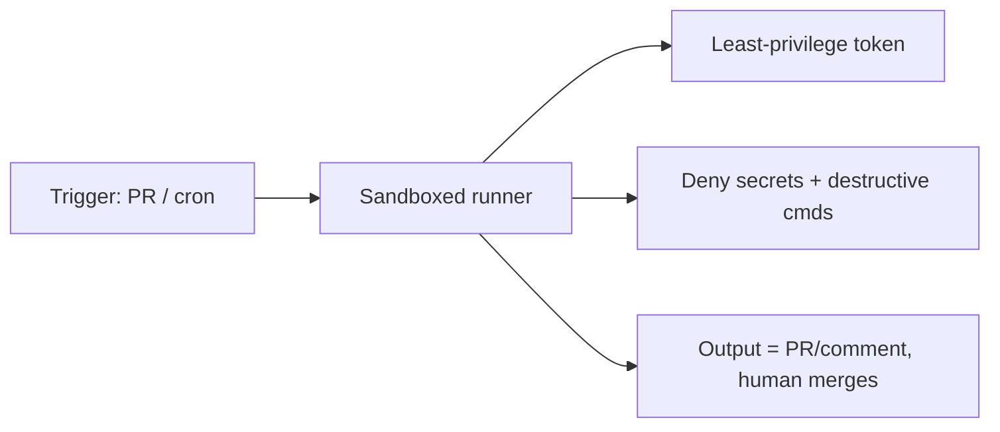

# Autonome Läufe härten

> Source: https://derob98.github.io/ailmanac/de/docs/security/hardening-autonomous-runs · AILmanac (CC BY 4.0)

Headless-/CI-Läufe absichern, damit ein Agent weder Secrets noch Produktion anfassen kann.

<LevelBadge level="advanced" />

<Callout type="objectives" items={[
  "Die drei Risiken, die nur bei einem Lauf ohne menschliche Aufsicht auftreten",
  "Eine Härtungs-Checkliste mit acht Punkten, in der Reihenfolge, in der du sie anwenden solltest",
  "Welches Berechtigungs-Primitiv tatsächlich Fähigkeiten entfernt — und welches sie nur vorab genehmigt",
  "Warum ein Token mit minimalen Rechten wichtiger ist als ein sorgfältiger Prompt",
  "Wie du eine außer Kontrolle geratene Schleife mit einem von der Plattform durchgesetzten Budget statt mit einer hoffnungsvollen Anweisung begrenzt",
  "Warum persistente Anweisungsdateien in einen Ort gediffed werden müssen, in den der Agent nicht schreiben kann"
]} />

Claude [headless](/docs/claude-code/headless-and-agent-sdk) oder nach [Zeitplan](/docs/claude-code/background-tasks) laufen zu lassen — in der CI, in einem Cron-Job, in einem Pre-Commit-Hook — entfernt den Menschen, der eine schlechte Aktion sonst abfangen würde. Genau diese Bequemlichkeit ist der Grund, warum diese Läufe die engsten Leitplanken brauchen.

## Die Risiken unbeaufsichtigter Läufe

- **Niemand, der „Nein“ sagt** zu einem riskanten Tool-Aufruf im entscheidenden Moment.
- **Ambiente Zugangsdaten.** Die CI hat oft mächtige Tokens (Deployment, Paket-Registry, Cloud). Ein Agent dort erbt sie.
- **Nicht vertrauenswürdige Eingaben.** Ein Lauf, der durch einen PR oder ein Issue ausgelöst wird, verarbeitet möglicherweise von Angreifern verfassten Inhalt ([Injection](/docs/security/prompt-injection)).

<Callout type="warning">
Der Fehlermodus, gegen den du entwirfst, ist nicht ein bösartiges Modell. Es ist ein gewöhnliches Modell, das ein Token hält, das es nie hätte bekommen dürfen, und auf Text handelt, den ein Angreifer geschrieben hat. Jeder Punkt unten entfernt eine dieser drei Zutaten.
</Callout>

## Eine Härtungs-Checkliste

<Steps items={[
  {title: "Secrets ausdrücklich verweigern", body: <>Blockiere das Lesen von <code>.env</code>, Schlüsseldateien und Zugangsdaten-Pfaden über <a href="/docs/claude-code/permissions">Deny-Regeln der Berechtigungen</a>. Verlass dich nicht darauf, dass das Modell sie meidet. Deny-Regeln sind das <em>einzige</em> Primitiv, das Fähigkeiten entfernt — siehe <a href="/docs/claude-code/agent-sdk-permissions">die sechsstufige Auswertungsreihenfolge</a>, warum eine Allow-Liste diese Aufgabe nicht leisten kann.</>},
  {title: "Nie den Bypass-/Yolo-Modus auf einer Maschine mit echtem Zugriff verwenden", body: <>Reserviere „alle Rückfragen überspringen“ für Wegwerf-Sandboxes. Und wisse, was er <em>nicht</em> überschreibt: Deny-Regeln, Ask-Regeln und <code>PreToolUse</code>-Hooks laufen alle vor dem Modus.</>},
  {title: "Das Token einschränken", body: <>Gib dem Lauf ein Token mit minimalen Rechten (wo möglich nur lesend), nicht deine Zugangsdaten mit vollem Zugriff. Das ist der wirkungsvollste Einzelpunkt auf der Liste, weil er der ist, um den eine eingeschleuste Anweisung nicht herumargumentieren kann.</>},
  {title: "Sandbox nutzen und kurzlebig halten", body: <>Führe den Lauf in einem Container aus, der danach zerstört wird; kein dauerhafter Zugriff auf Produktion. Kombiniere das mit <a href="/docs/claude-code/sandbox-credential-masking">Credential Masking</a>, damit ein geleakter Wert außerhalb des Laufs wertlos ist.</>},
  {title: "Befehle und Domains per Allowlist freigeben", body: <>Erlaube deine Test-/Lint-/Build-Befehle; verweigere netzwerkfähige oder destruktive. Schränke die Regeln ein — <code>Bash(npm test *)</code>, nicht ein nacktes <code>Bash</code>.</>},
  {title: "Deckeln", body: <>Maximale Iterationen, Zeitbudget, Token-/Kostenbudget — damit eine Schleife oder ein manipulierter Agent nicht davonlaufen kann. Nutze bei der von Anthropic gehosteten Schleife die <a href="/docs/api/managed-agents-session-budgets">Session-Budgets für Managed Agents</a> für eine harte, von der Plattform durchgesetzte USD-Obergrenze, die die Sitzung mit <code>stop_reason: "budget_reached"</code> pausiert.</>},
  {title: "Ausgaben prüfbar machen, nicht automatisch anwenden", body: <>Bevorzuge „einen PR öffnen / einen Kommentar posten“ gegenüber „auf main pushen“. Ein Mensch mergt. Das verwandelt jeden Fehler von einem Vorfall in einen abgelehnten Diff.</>},
  {title: "Persistente Memory-Dateien über Sitzungen hinweg diffen", body: <><code>CLAUDE.md</code>, <code>.cursorrules</code>, <code>SOUL.md</code>, <code>MEMORY.md</code>, Agent-Skill-Dateien — alles, was automatisch als Anweisung eingespeist wird — sollte gediffed und an einen Ort protokolliert werden, in den der Agent nicht schreiben kann. Siehe <a href="/docs/security/mind-viruses-agent-to-agent-propagation">Mind Viruses</a> für den gemessenen Ausbreitungsmechanismus, gegen den das schützt.</>}
]} />

## Deny entfernt, Allow genehmigt nur vorab

Der häufigste Fehler bei einem gehärteten Lauf ist, zum falschen Hebel zu greifen. Eine Allow-Liste sieht aus wie ein Schloss und ist keines: Alles, was du weglässt, steht dem Agenten weiterhin zur Verfügung und fällt lediglich auf den Berechtigungsmodus der Sitzung zurück.

<PromptCard title="Entfernt die Fähigkeit — das Tool ist aus der Anfrage verschwunden">{`claude -p "run the test suite" \\
  --disallowedTools "Bash(curl *)" "Read(//.ssh/**)" "Edit(//etc/**)"`}</PromptCard>

<PromptCard title="Macht eine Vorab-Genehmigungsliste exakt — alles andere wird verweigert, nicht erfragt">{`claude -p "run the test suite" \\
  --permission-mode dontAsk \\
  --allowedTools "Bash(npm test)" "Read"`}</PromptCard>

Die zweite Form ist die, die du für die CI willst: `dontAsk` verwandelt jede Rückfrage in eine Ablehnung, sodass ein Lauf, der auf etwas Unvorhergesehenes stößt, laut fehlschlägt, statt zu hängen oder stillschweigend auf einen großzügigen Standard zurückzufallen.

## Eine Prüfung, die bei jedem Aufruf läuft

Allow- und Deny-Regeln gleichen Muster ab. Brauchst du eine Prüfung, die den *Inhalt* eines Aufrufs untersucht — eine geheimnisartige Zeichenkette in einem Argument, einen unerwarteten Hostnamen —, lege sie in einen `PreToolUse`-[Hook](/docs/claude-code/hooks). Hooks laufen vor jedem anderen Berechtigungsschritt, und eine Hook-Ablehnung gilt selbst im Bypass-Modus.

<PromptCard title="Jeden Tool-Aufruf verweigern, der Geheimmaterial enthält">{`# .claude/settings.json -> hooks.PreToolUse
# Exit code 2 blocks the call and tells Claude why.
jq -e '.tool_input | tostring | test("AKIA|BEGIN PRIVATE KEY|ghp_")' >/dev/null \\
  && { echo "secret material in tool input" >&2; exit 2; } || exit 0`}</PromptCard>

## Beispiel: ein sicherer CI-Reviewer

Ein PR-Review-Bot sollte: den Code nur lesend auschecken, **keinen** Zugriff auf Deployment oder Secrets haben, in einem Container laufen und seine Befunde **kommentieren** — nie geschützte Branches verändern. Siehe die [PR-Review-Anleitung](/docs/walkthroughs/pr-review-action).

<Quiz questions={[
  {
    q: "Dein CI-Lauf nutzt bypassPermissions in einem Container. Was blockiert davon weiterhin einen Tool-Aufruf?",
    options: [
      "Ein allowedTools-Eintrag, den du vergessen hast hinzuzufügen",
      "Eine Deny-Regel, eine Ask-Regel oder ein PreToolUse-Hook",
      "Nichts — Bypass heißt Bypass",
      "Das eigene Urteil des Modells"
    ],
    answer: 1,
    explain: "Deny-Regeln, Ask-Regeln und Hooks werden alle vor dem Berechtigungsmodus ausgewertet und überstehen daher bypassPermissions. allowedTools liegt hinter dem Modus und kann nichts einschränken."
  },
  {
    q: "Welche einzelne Maßnahme begrenzt den Schaden einer erfolgreichen Prompt Injection in einem CI-Lauf am stärksten?",
    options: [
      "Ein längerer, festerer System-Prompt, der den Agenten anweist, Anweisungen im PR-Text zu ignorieren",
      "Ein Token mit minimalen Rechten, zugeschnitten auf das, was der Job tatsächlich braucht",
      "Den Agenten bitten, nicht vertrauenswürdige Eingaben zusammenzufassen, bevor er handelt",
      "Das Iterationslimit anheben, damit er Spielraum zur Selbstkorrektur hat"
    ],
    answer: 1,
    explain: "Verteidigungen auf Prompt-Ebene lassen sich umargumentieren; ein Token, das nicht deployen kann, kann nicht deployen. Schränke die Zugangsdaten ein, und der schlimmste Fall schrumpft, egal wovon der Agent überzeugt wurde."
  },
  {
    q: "Warum sollten CLAUDE.md und Skill-Dateien in einen Ort gediffed werden, in den der Agent nicht schreiben kann?",
    options: [
      "Um die Git-Historie sauber zu halten",
      "Weil sie automatisch als Anweisungen eingespeist werden, sodass eine stille Änderung jeden künftigen Lauf verändert",
      "Um den Token-Verbrauch bei jedem Lauf zu senken",
      "Weil Claude Code sich weigert zu starten, wenn sie sich ändern"
    ],
    answer: 1,
    explain: "Alles, was automatisch als Anweisung eingespeist wird, ist ein Persistenzkanal. Kann der Agent die Datei schreiben und auch das Protokoll führen, kann eine Kompromittierung die Anweisungen ändern und die Spuren löschen — also muss das Protokoll außerhalb seiner Reichweite liegen."
  }
]} />

<Callout type="takeaways" items={[
  "Unbeaufsichtigte Läufe verlieren das menschliche Veto, erben ambiente Zugangsdaten und lesen oft von Angreifern verfassten Text — entferne eine Zutat nach der anderen.",
  "Deny-Regeln und Hooks entfernen Fähigkeiten; Allow-Listen genehmigen nur vorab. Kombiniere allowedTools mit dontAsk, um es exakt zu machen.",
  "Schränke das Token ein, bevor du den Prompt abstimmst. Es ist die Verteidigung, an der eine Injection nicht vorbeireden kann.",
  "Begrenze Kosten und Iterationen mit einem von der Plattform durchgesetzten Budget, nicht mit einer Anweisung.",
  "Liefere Ausgaben als PR oder Kommentar, damit ein menschlicher Merge in der Schleife bleibt.",
  "Diffe automatisch eingespeiste Anweisungsdateien in einen Speicher, in den der Agent nicht schreiben kann."
]} />

## Weiter

- [Agent-SDK-Berechtigungen: die sechsstufige Reihenfolge](/docs/claude-code/agent-sdk-permissions) — welches Primitiv genau gewinnt, und die fünf Wege, auf denen eine Allowlist stillschweigend nichts bewirkt
- [Berechtigungen & Berechtigungsmodi](/docs/claude-code/permissions)
- [Agenten & Tools absichern](/docs/security/securing-agents)
- [Headless-Modus & das Agent SDK](/docs/claude-code/headless-and-agent-sdk)
- [Die claude-CLI: Flags, die Ergebnisse verändern](/docs/claude-code/cli-flags) — der Flag-Satz für begrenzte Läufe, und `--restricted` für eine gemeinsam genutzte Maschine
