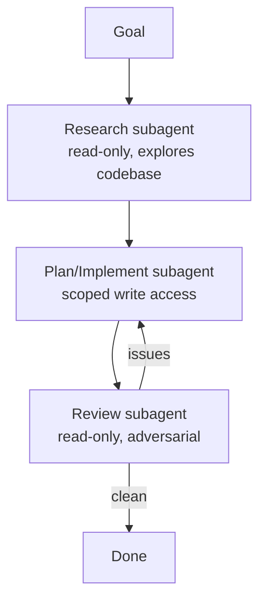

# Einen Multi-Subagent-Workflow entwerfen

> Source: https://derob98.github.io/ailmanac/de/docs/walkthroughs/multi-subagent-workflow · AILmanac (CC BY 4.0)

Recherche-, Implementierungs- und Review-Agenten mit Übergaben und Review-Gates orchestrieren.

<LevelBadge level="advanced" />

<Callout type="objectives" items={[
  "Eine Pipeline aus Recherche, Implementierung und Review aufbauen, in der jede Stufe ihren eigenen Kontext und ihren eigenen Werkzeugsatz hat",
  "Beschreibungen so präzise formulieren, dass der Hauptagent ohne Anweisung an den richtigen Subagenten delegiert",
  "Ein Review-Gate einbauen, das zurückschleift, statt mit einem Abnick-Stempel zu enden",
  "Die drei Fälle erkennen, in denen Multi-Agent-Koordination mehr kostet, als sie spart",
  "Einen fertigen Lauf an vier Signalen prüfen, die zeigen, dass die Aufteilung wirklich funktioniert hat"
]} />

Große Aufgaben gelingen besser, wenn du sie auf fokussierte [Subagenten](/docs/claude-code/subagents) verteilst, statt alles in einen Kontext zu pressen. Entwerfen wir eine Pipeline aus Recherche → Implementierung → Review.

## Die Form

Jeder Subagent hat seinen **eigenen Kontext** und einen **maßgeschneiderten Werkzeugsatz** — und nur das *Ergebnis* fließt zurück in die Hauptsitzung, die dadurch sauber bleibt.

## Schritt 1 — Die Agenten definieren

Definiere über die `/agents`-Oberfläche drei Agenten, jeweils mit einer präzisen `description` (damit der Hauptagent korrekt delegiert) und eingeschränkten Werkzeugen:

<Steps items={[
  {title: "researcher — nur lesen und suchen", body: "Kartiert den relevanten Code und liefert Erkenntnisse zurück. Überhaupt keine Schreibwerkzeuge, und genau das macht es sicher, ihn breit lesen zu lassen. Die aufwendige Erkundung findet hier statt, damit sie nie in deinem Hauptkontext landet."},
  {title: "implementer — darf Dateien bearbeiten und Tests ausführen", body: "Bekommt die Erkenntnisse des Researchers als Eingabe und startet daher mit einer Karte, statt die Codebasis selbst neu zu lesen. Eingeschränkter Schreibzugriff: Je enger die Menge der Dateien, die er anfassen darf, desto weniger kann er dich überraschen."},
  {title: "reviewer — nur lesen, adversarial", body: "Sucht nach Bugs, fehlenden Fällen und Verstößen gegen Konventionen. Absichtlich nur lesend: Ein Reviewer, der reparieren kann, was er findet, hört auf zu berichten und fängt an zu patchen — und du verlierst das Signal."}
]} />

Das Feld `description` ist keine Dokumentation — es ist der Routing-Schlüssel, den der Hauptagent liest, wenn er entscheidet, ob er delegiert. Vage Beschreibungen sind der mit Abstand häufigste Grund, warum ein von dir definierter Subagent nie benutzt wird.

<PromptCard title="Eine Reviewer-Beschreibung, an die tatsächlich delegiert wird">{`Use this agent to review a completed code change adversarially before it ships.
Invoke it after the implementer reports done, and before telling the user the
task is finished. It reads the diff and the surrounding code and reports
problems; it does not fix them.`}</PromptCard>

## Schritt 2 — Mit Übergaben orchestrieren

Die Hauptsitzung reicht die Ausgabe jeder Stufe an die nächste weiter: Recherche → Implementierung (unter Nutzung der Recherche) → Review (der Implementierung). Füge ein **Review-Gate** hinzu: Findet der Reviewer Probleme, geht es zurück zum Implementer, bevor die Aufgabe abgeschlossen wird.

<PromptCard title="Die Übergabe-Anweisung, die das Gate erzeugt">{`Run this as three stages, and do not skip the gate:

1. Delegate the exploration to the researcher. Wait for its findings.
2. Give those findings to the implementer as its starting context.
   Do not ask it to re-explore.
3. Give the implementer's result to the reviewer. If the reviewer reports
   any issue, hand the issues back to the implementer and review again.
   Only report the task complete after a review that found nothing.`}</PromptCard>

## Schritt 3 — Wissen, wann man es NICHT tut

:::warning[Parallel/Multi-Agent ist nicht umsonst]
- **Sequenzielle Abhängigkeiten** (die Implementierung braucht die Recherche) bleiben sequenziell — fächere nicht auf, wo die Reihenfolge zählt.
- **Gemeinsame Schreibzugriffe auf Dateien** können kollidieren — isoliere mit [Git-Worktrees](/docs/claude-code/worktrees) oder serialisiere.
- Bei kleinen Aufgaben übersteigt der Koordinationsaufwand den Nutzen. Setze das bei **umfangreicher, zerlegbarer** Arbeit ein.
:::

## Schritt 4 — Überprüfen

Ein guter Multi-Agent-Lauf zeigt: einen fokussierten Hauptkontext (das viele Lesen fand im Researcher statt), eine Implementierung, die die Recherche widerspiegelt, und ein Review, das tatsächlich etwas gefunden hat (oder glaubwürdig abgenickt hat). Ist der Reviewer ein Abnick-Stempel, mache seinen Prompt **adversarial** („versuche herauszufinden, was falsch ist“).

<Quiz questions={[
  {
    q: "Du hast einen Reviewer-Subagenten definiert, aber über mehrere Läufe delegiert der Hauptagent nie an ihn. Was ist die wahrscheinlichste Ursache?",
    options: [
      "Der Reviewer braucht Schreibwerkzeuge, bevor er aufgerufen werden kann",
      "Seine Beschreibung ist zu vage, um als Routing-Schlüssel zu dienen — der Hauptagent liest die Beschreibung, um zu entscheiden, wann er delegiert",
      "Subagenten können nur vom Nutzer mit einem expliziten Befehl aufgerufen werden",
      "Drei Subagenten sind mehr, als die Pipeline unterstützt"
    ],
    answer: 1,
    explain: "Die Beschreibung ist das, was der Hauptagent liest, wenn er über Delegation entscheidet; eine präzise Beschreibung sorgt dafür, dass ein Subagent benutzt wird. Ein Reviewer sollte nur lesend und adversarial bleiben — gibst du ihm Schreibwerkzeuge, patcht er, statt zu berichten, und du verlierst das Signal."
  },
  {
    q: "Deine Aufgabe ist klein: eine Funktion umbenennen und ihre drei Aufrufstellen aktualisieren. Solltest du die Pipeline aus Recherche, Implementierung und Review einsetzen?",
    options: [
      "Ja — das Review-Gate fängt Fehler bei jeder Aufgabengröße ab",
      "Ja, aber lass die Recherche-Stufe weg",
      "Nein — bei kleinen Aufgaben übersteigt der Koordinationsaufwand den Nutzen; dieses Muster ist für umfangreiche, zerlegbare Arbeit",
      "Nein, weil Subagenten keine Dateien bearbeiten können"
    ],
    answer: 2,
    explain: "Multi-Agent-Koordination ist nicht umsonst. Die Seite nennt drei Fälle, sie zu vermeiden: sequenzielle Abhängigkeiten, die sich nicht auffächern lassen, gemeinsame Schreibzugriffe, die kollidieren können, und kleine Aufgaben, bei denen der Aufwand mehr kostet, als er spart."
  },
  {
    q: "Zwei Subagenten müssen gleichzeitig in dieselben Dateien schreiben. Was ist die Lösung?",
    options: [
      "Beiden den vollen Werkzeugsatz geben, damit sie Konflikte selbst lösen können",
      "Sie mit Git-Worktrees isolieren oder die Schreibvorgänge serialisieren",
      "Die Schreibvorgänge in die Hauptsitzung verlegen",
      "Einen zweiten Reviewer hinzufügen, der den Konflikt nachträglich abfängt"
    ],
    answer: 1,
    explain: "Gemeinsame Schreibzugriffe auf Dateien können kollidieren. Die Abhilfen sind Isolation — ein Git-Worktree pro Agent — oder Serialisierung, sodass immer nur einer schreibt. Aufzufächern, wo die Reihenfolge tatsächlich zählt, ist der Fehler, nicht etwas, das man umgehen müsste."
  }
]} />

<Callout type="takeaways" items={[
  "Teile nach Kontext und Werkzeugsatz auf, nicht nur nach Aufgabenname: Researcher nur lesend, Implementer mit eingeschränktem Schreibzugriff, Reviewer nur lesend und adversarial.",
  "Nur das Ergebnis fließt zurück in die Hauptsitzung, und genau darum geht es — das viele Lesen bleibt im Kontext des Researchers.",
  "Die Beschreibung ist ein Routing-Schlüssel. Eine vage bedeutet, dass der sorgfältig definierte Subagent nie aufgerufen wird.",
  "Ein Review-Gate funktioniert nur, wenn es zurückschleifen kann: Probleme gehen zurück an den Implementer, und die Aufgabe ist erst nach einem Review fertig, das nichts gefunden hat.",
  "Halte den Reviewer nur lesend. Gibst du ihm Schreibzugriff, repariert er, statt zu berichten, und du verlierst das Signal, für das du ihn gebaut hast.",
  "Verzichte auf das Muster bei rein sequenzieller Arbeit, bei kollidierenden gemeinsamen Schreibzugriffen, die du nicht isoliert hast, und bei allem Kleinen."
]} />

## Weiterführend

Dasselbe Muster, programmatisch, ist [Agenten auf der API bauen](/docs/api/building-agents) und Produktoberflächen wie [Cowork & Agent Teams](/docs/api/cowork-and-agent-teams).

## Weiter

- [Subagenten & parallele Agenten](/docs/claude-code/subagents)
- [Git-Worktrees](/docs/claude-code/worktrees)
- [Agenten auf der API bauen](/docs/api/building-agents)
