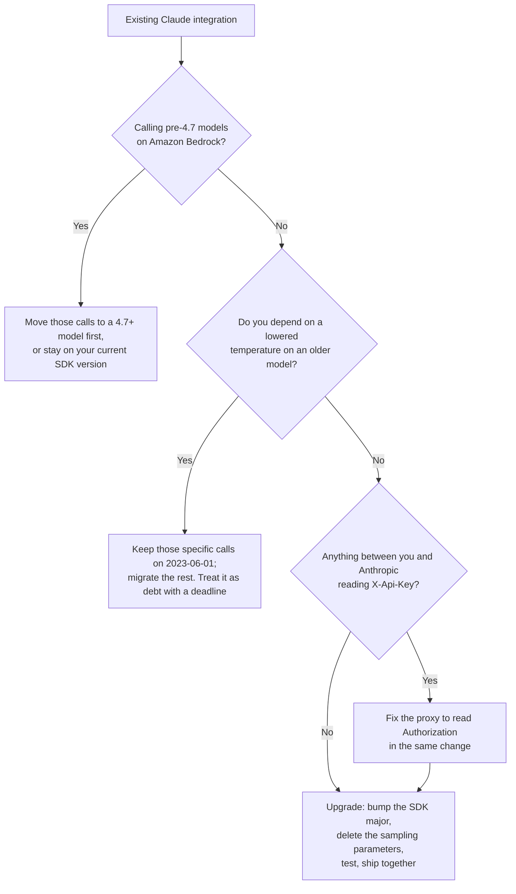

<LevelBadge level="intermediate" />

<VerifyNote lastVerified="2026-10-22" source="https://platform.claude.com/docs/en/api/versioning">
API version `2026-10-21` is listed in Anthropic's official version history alongside `2023-06-01` and `2023-01-01`. Every breaking change, SDK version number, and field rename on this page comes from the [official migration guide](https://platform.claude.com/docs/en/api/migration-2026-10-21). Re-read it before you ship — a migration guide is the one kind of doc that gets *edited* after publication.
</VerifyNote>

For three and a half years there was exactly one answer to "which API version am I on?" — `2023-06-01`. Every SDK sent it, every tutorial pasted it, and nobody thought about it again.

On **21 October 2026** that changed. `anthropic-version: 2026-10-21` is now the recommended version, and it is a genuine breaking release: eleven documented behavior changes, a different authentication header, and a parameter removal that is **stricter than the per-model deprecation you may already have handled**.

Here is the part that catches teams out, and the reason this page exists:

> **You do not opt into this version by editing a header. You opt in by upgrading a dependency.**

Anthropic's SDKs send the API version that was current when their **major** version shipped. Older majors keep sending `2023-06-01` forever. The new majors send `2026-10-21`. So a routine `pip install -U anthropic` or `npm update` that crosses the major boundary flips the API version for your entire application — and brings all eleven breaking changes with it, in one commit, whether or not anyone read a changelog.

<Callout type="objectives" items={["Why your SDK major version — not a header you control — decides when you adopt 2026-10-21","The five-minute triage: which of the eleven breaking changes actually touch your code","Why sampling parameters now 400 even at their default value, and the one escape hatch left","The authentication change from X-Api-Key to Authorization: Bearer, and the proxies it silently breaks","The two footguns that return a wrong result instead of an error (double credentials, suppressed-key headers)","What changes on the wire vs. what changes only in your SDK's types","The upgrade order that keeps a production integration green"]} />

`★ Insight ─────────────────────────────────────`
There are two very different kinds of change bundled in this release, and conflating them wastes a day. **Wire changes** (removed parameters, rejected block placements, renamed response fields) are decided by the `anthropic-version` header, so they hit raw `curl`, every SDK, and your Message Batches alike. **SDK changes** (the `MessageParam` union, removed Text Completions, one-value enums becoming constants) are ordinary major-version refactors that happen to ride along — the JSON on the wire is unchanged. If you call the API over raw HTTP, only the first list applies to you and this migration is small. If you use an SDK, you are doing both migrations at once, which is why it feels larger than it is.
`─────────────────────────────────────────────────`

## First: are you affected?

Run this before reading anything else. Each hit maps to a section below; no hits means your upgrade is a version bump.

<PromptCard title="Audit your codebase for 2026-10-21 breakage">{`# Wire changes — these break regardless of SDK or language
grep -rnE '\\b(temperature|top_p|top_k)\\b' --include='*.{py,ts,tsx,js,go,java,rb,php,cs}' .
grep -rn 'X-Api-Key\\|x-api-key' .            # auth header moved
grep -rnE 'workspace_id|group_type|actor\\.email|\\broles\\b' .   # Admin/Analytics renames

# SDK changes — only if you use an Anthropic SDK or the ant CLI
grep -rn 'MessageParam' .                     # now a union of three role types
grep -rn 'completions' --include='*.{ts,go,java,rb}' .   # Text Completions removed
grep -rn 'compactionControl\\|compaction_control' .       # client-side compaction removed
grep -rn 'models.list\\|models.retrieve' .    # betas moved to client.beta.models
grep -rn -- '--api-key \\|--auth-token ' .      # CLI flags removed`}</PromptCard>

| If you grep-hit… | You're affected by | Severity |
|---|---|---|
| `temperature` / `top_p` / `top_k` | [Sampling parameters removed](#sampling-parameters-are-removed-even-at-their-defaults) | **400 on every request** |
| `X-Api-Key` in a proxy, gateway, or middleware | [Authentication header moved](#authentication-moved-to-authorization-bearer) | **401 on every request** |
| `X-Api-Key` used to *suppress* or *override* a key | [The two silent footguns](#the-two-changes-that-dont-raise) | **Wrong credential sent** |
| Both an API key and an auth token on one client | [One client, one credential](#one-client-holds-one-credential) | Raises at construction |
| `document` blocks in assistant turns | [Document block placement](#two-rejected-block-placements) | 400 |
| `citations` on user-turn text blocks | [Citation placement](#two-rejected-block-placements) | 400 |
| `MessageParam(...)` constructor calls, subclassing, or spread-copies | [MessageParam is a union](#messageparam-is-now-a-union-of-three-role-types) | Type error / runtime |
| `client.completions` | [Text Completions removed](#five-sdk-only-removals) | Method gone |
| `compactionControl` | [Client-side compaction removed](#five-sdk-only-removals) | Option gone |
| `models.list(betas=…)` | [`betas` moved](#five-sdk-only-removals) | Beta header not sent |
| `workspace_id`, `group_type`, `actor.email`, `roles` | [Admin & Analytics renames](#admin-api-and-analytics-api-field-renames) | Field absent |

## The upgrade, in order

<Steps items={[
  {title: "Decide whether you can adopt it at all", body: "On Amazon Bedrock, 2026-10-21 is available only for Claude 4.7 and later models. If you call an older model on Bedrock, you must either move that call to a 4.7+ model first or keep it on the SDK version you run today. Everywhere else — the Claude API, Claude Platform on AWS, Microsoft Foundry, and Google Cloud — it is available now."},
  {title: "Bump the SDK (this is what switches the version)", body: "Install the first major version that sends 2026-10-21 for your language — see the table below. Go and the ant CLI also change their module import paths, so a plain \"go install …@latest\" on the old path keeps giving you v1 with no error or warning. If you call the API over raw HTTP, just set the anthropic-version header to 2026-10-21 instead."},
  {title: "Fix the wire changes first", body: "Delete temperature, top_p and top_k. Move documents out of assistant messages and citations out of user messages. Rename the Admin and Analytics response fields you read. These are the changes that produce 400s, so they are the ones that take production down."},
  {title: "Fix authentication and your proxy", body: "The SDK now sends your key as Authorization: Bearer. If anything between you and Anthropic reads X-Api-Key — a gateway, an observability shim, a company egress proxy — it stops seeing a credential. Change the proxy, or re-add the header yourself."},
  {title: "Fix the SDK-only refactors", body: "MessageParam is now a union, Text Completions is gone, client-side compaction in the tool runner is gone, betas moved off the non-beta Models methods, and one-value enums became constants. Your compiler or type checker finds most of these for you."},
  {title: "Test against 2026-10-21 before you release, then ship both together", body: "Anthropic's own instruction is to release the version bump and the fixes in the same deploy. Shipping the bump alone is what turns a planned migration into an incident."}
]} />

### The SDK versions that send `2026-10-21`

Older majors keep sending `2023-06-01`. These are the first versions on the new API version:

| Language / tool | First version on `2026-10-21` | Also note |
|---|---|---|
| Python | `anthropic` **2.0.0** | — |
| TypeScript | `@anthropic-ai/sdk` **1.0.0** | Platform packages (`bedrock-sdk`, `vertex-sdk`, `foundry-sdk`, `aws-sdk`, `google-cloud-sdk`) must move to **v1** in the same upgrade, or your package manager installs a second, older copy of the core SDK for them |
| Go | **2.0.0**, module path `github.com/anthropics/anthropic-sdk-go/v2` | Every import — including subpackages like `/option` — needs the `/v2` prefix. **Go 1.25+ required** |
| Java | `com.anthropic:anthropic-java` **3.0.0** | — |
| C# | `Anthropic` **13.0.0** | — |
| Ruby | `anthropic` gem **2.0.0** | — |
| PHP | `anthropic-ai/sdk` **1.0.0** | Use `composer require`; `composer update` alone stays inside your current constraint |
| `ant` CLI | **2.0.0** | Go module path is now `github.com/anthropics/anthropic-cli/v2`. **The old `go install` path silently keeps installing the latest v1** |

<Callout type="warning" items={["Two of these upgrades fail quietly rather than loudly: the Go CLI path (installs v1 with no warning) and the TypeScript platform packages (npm happily resolves a second, older @anthropic-ai/sdk for them). In both cases your code compiles, runs, and keeps sending 2023-06-01 — so you conclude the migration is done while nothing has actually changed."]} />

## Sampling parameters are removed — even at their defaults

This is the change most likely to break code that someone already "fixed."

AILmanac has documented the per-model deprecation for a while: on Claude 4.7-generation models and later, a **non-default** `temperature`, `top_p`, or `top_k` returns a 400. Under `2026-10-21` the rule is harder:

> A request that sends `temperature`, `top_p`, or `top_k` returns a 400 error — **even at the parameter's default value**.

So the defensive pattern that used to be safe — pinning `temperature: 1.0` explicitly so nobody could "tune" it later — is now a guaranteed failure on every model, including the older ones that previously accepted any value. The parameters are gone from the SDK types and the CLI flags in the new majors, so in a typed language the compiler catches it; in a dict- or hash-built request body it reaches the API.

```python
# Before — accepted under 2023-06-01 on every model
client.messages.create(model=MODEL, max_tokens=1024, temperature=1.0, messages=msgs)

# After — temperature: 1.0 is a 400 under 2026-10-21
client.messages.create(model=MODEL, max_tokens=1024, messages=msgs)
```

Omitting the parameters samples with exactly the same defaults as a `2023-06-01` request that left them out, `temperature` of 1.0 included. So for current frontier models, which already rejected non-default values, **the output does not change at all** — this is purely a request-shape cleanup.

The real loss is narrower and worth being precise about. On older models that *did* accept other values — Sonnet 4.6, for example — a request that lowered `temperature` for more consistent output loses that effect, and **no other setting replaces it.** Anthropic's documented options are to stop sending the parameter, or to keep that specific request on `2023-06-01`.

<Callout type="tip" items={["Since the new SDK majors removed the three parameters from their types entirely, 'keep that request on 2023-06-01' in practice means keeping those calls on the previous SDK major, or issuing them over raw HTTP with the old header — an inference from two documented facts, not a documented pattern. If you depend on a lowered temperature for determinism, treat that as technical debt with a deadline rather than a supported configuration.", "The durable replacement for temperature on current models is not a parameter. Pin behavior with the system prompt, and spend compute deliberately with the effort setting — see Extended Thinking & Effort and Effort tuning."]} />

## Authentication moved to `Authorization: Bearer`

The SDK and the CLI now send your API key as `Authorization: Bearer <key>` instead of `X-Api-Key: <key>`.

```text
# Before
X-Api-Key: <key>

# After
Authorization: Bearer <key>
```

**The Claude API accepts a key in either header.** So if your program talks to `api.anthropic.com` directly, this change is invisible — nothing to do.

It breaks the layer in between. Anything that reads, sets, rewrites, or logs `X-Api-Key` stops seeing a credential: an LLM gateway, a cost-attribution proxy, a corporate egress filter, a test double that asserts on the header, a custom `fetch` that injects keys per tenant. The symptom is a clean 401 from your own infrastructure, not from Anthropic — which is exactly the kind of error that gets misdiagnosed as a key rotation problem.

Two ways out. Fix the proxy to read `Authorization` (correct), or re-add the old header yourself (expedient):

<PromptCard title="Keep sending X-Api-Key to a proxy that needs it">{`// TypeScript — Authorization: null stops the key going out twice
const client = new Anthropic({
  apiKey,
  defaultHeaders: { "X-Api-Key": apiKey, Authorization: null }
});`}</PromptCard>

Python does it with an `auth` function on the HTTP client (it runs on retries too), Go with `option.WithHeader` plus `option.WithHeaderDel("Authorization")`, Java with `putHeader` instead of `apiKey`, PHP and Ruby with a request middleware. C# uses `ExtraHeaders` and needs **both** `ApiKey` and `AuthToken` set to `null`, or a credential found in the environment goes out anyway.

Three per-language details that are easy to miss:

- **`AnthropicFoundry` / `@anthropic-ai/foundry-sdk` / `FoundryBackend` still send `x-api-key`.** The change does not apply there.
- **The Bedrock Mantle clients already sent a bearer token.** No change.
- **The Ruby SDK drops `Authorization` when it follows a redirect to another origin** — which includes an `http` → `https` redirect on the same host. The key is now dropped there too, where before it travelled in `X-Api-Key`. If you point the SDK at an internal `http://` URL and rely on the redirect, the credential silently stops arriving.
- **In PHP, do not use the client's `extraHeaders` for this.** A request with its own `extraHeaders` *replaces* the client's — and every endpoint under `$client->beta` that needs a beta header has them. Use the middleware.

## The two changes that don't raise

Everything above fails loudly. These two keep working and do the wrong thing, which makes them the ones worth auditing by hand.

**1. A header that used to suppress the key no longer does.** The idiom for sending a request with no credential — or with a *different* credential than the client's — targeted `X-Api-Key`. That header is no longer where the key lives:

```python
# Before — kept the client's key off this one request
client.messages.create(..., extra_headers={"X-Api-Key": omit})

# After — the key still goes out in Authorization. Suppress that instead.
client.messages.create(..., extra_headers={"Authorization": omit})
```

**2. A per-request key override now sends two keys.** Passing another key in `X-Api-Key` used to replace the client's. It no longer does: the override goes out in `X-Api-Key` and the client's own key goes out in `Authorization`, so **both are on the wire.** To send a different key for one request, set `Authorization` instead (Python/TypeScript/PHP/Ruby), or use `option.WithAPIKey(otherKey)` in Go.

If you built per-tenant key routing on a shared client, this is the paragraph to act on: the fallback is no longer "the request fails," it is "the request succeeds under the wrong key."

## One client holds one credential

Because an API key and an authentication token now share a header, an SDK client can hold only one credential. Passing two used to send both, each in its own header. It now raises at construction:

| SDK | What two credentials now do |
|---|---|
| Python | `ValueError` |
| TypeScript | `TypeError` |
| C# | `ArgumentException` |
| Java | `IllegalStateException` from `build()`, naming both |
| PHP | `InvalidArgumentException` |
| Ruby | `ArgumentError` |
| Go | `NewClient` returns no error, so **every request the client makes fails instead** |

Two behavioral rules changed alongside it:

- **A credential you pass in code is the only one.** The client no longer falls back to the environment or to a profile on disk. Previously, an `ANTHROPIC_API_KEY` in the environment could be sent next to — or instead of — the token you passed.
- **With nothing passed, precedence is fixed:** `ANTHROPIC_API_KEY`, then `ANTHROPIC_AUTH_TOKEN`, then the profile named by `ANTHROPIC_PROFILE`, then the workload-identity-federation variables, then the active profile on disk. **This order changed:** several SDKs used to put the on-disk active profile *ahead* of the federation variables. If you authenticate with WIF and also have a profile on disk, you may now be using a different credential than you were yesterday. Set `ANTHROPIC_PROFILE` to pin the old behavior.

When both `ANTHROPIC_API_KEY` and `ANTHROPIC_AUTH_TOKEN` are set, the key wins and the SDK logs a warning once per process. In PHP that means **once per web request** — unset the variable you don't use, or your error log fills up.

The legitimate pattern this breaks is "token for the gateway, key for the API behind it." Rebuild it explicitly: pass the **token** as the client's one credential, set `X-Api-Key` in default headers or middleware, and have the gateway strip its own `Authorization` header before forwarding. The Claude API expects one credential per request.

## Two rejected block placements

Both are 400s under `2026-10-21`, and both apply to the Messages API, to [token counting](/docs/api/tokens-and-pricing), and to **each request inside a [Message Batch](/docs/api/message-batches) created with the new version.**

- **A `document` block directly in an `assistant` message.** Send documents in `user` messages. A document *nested* inside another block — a web-fetch tool result Claude returned, for instance — is still fine, so replaying Claude's own output is safe.
- **A `text` block with a non-empty `citations` array in a `user` message**, including inside a `search_result` block. Strip `citations` from those blocks. Citations on `text` blocks in **assistant** messages are still accepted, and so is `"citations": [brackets with enabled true]` as a setting on documents and search results.

The second one is a specific trap for retrieval pipelines. If you hand Claude search results and echo back the citation metadata you received, that round-trip now 400s — while the superficially similar case of replaying Claude's cited answer keeps working. The asymmetry is the whole bug.

## `MessageParam` is now a union of three role types

The single `MessageParam` type is now `UserMessageParam | AssistantMessageParam | SystemMessageParam`, and `BetaMessageParam` splits the same way. **The JSON the SDK sends is unchanged.**

The good news first: **a message written as a plain dict, hash, array, or object literal that names its role needs no change at all.** `[brackets: role user, content Hello]` still type-checks everywhere. For most codebases this change is a no-op.

Four patterns do break:

```python
# 1. Calling the type as a constructor now raises TypeError
message = MessageParam(role="user", content="Hello")      # before
message: MessageParam = {"role": "user", "content": "Hello"}   # after
```

```typescript
// 2. Spread-copying a message of unknown role — system messages differ
const copy: Anthropic.MessageParam = { ...message, content: blocks };          // before
const copy: Anthropic.MessageParam =
  message.role === "system" ? message : { ...message, content: blocks };       // after
```

```typescript
// 3. Extending or implementing the type — you cannot extend a union
interface StoredMessage extends Anthropic.MessageParam { id: string }   // before
type StoredMessage = Anthropic.MessageParam & { id: string }            // after
```

```go
// 4. Struct/builder literals name the role's type and drop Role
anthropic.MessageParam{Role: anthropic.MessageParamRoleAssistant, Content: blocks}        // before
anthropic.MessageParam{OfAssistant: &anthropic.AssistantMessageParam{Content: blocks}}    // after
```

A fifth is subtler: a dict whose `role` comes from a **variable** that can hold more than one role matches no member of the union, so a generic `to_message(role, text)` helper has to branch per role. And in beta, `clear_at` and `output_config` now live on `BetaSystemMessageParam` only, while its `content` is optional — so `message["content"]` can be undefined.

Go has one genuine behavior change hiding in the refactor: **a copy of a `MessageParam` points at the same underlying message.** Setting `duplicate.OfUser.Content` mutates both, where in v1 setting `duplicate.Content` changed only the copy. If you build conversation variants by copying, that's a real aliasing bug rather than a compile error.

## Five SDK-only removals

The wire doesn't change for any of these — only your code.

| Removed | Affects | Replacement |
|---|---|---|
| **Text Completions API** (`client.completions`, `HUMAN_PROMPT`/`AI_PROMPT`, `ant completions create`) | TypeScript, Go, Java, Ruby, CLI | The Messages API. Reply text moves from `completion` to `content[0].text` — in the CLI, `--transform completion` becomes `--transform content.0.text` |
| **Client-side compaction in the tool runner** (`compactionControl`, `compaction_control`) | TypeScript, Ruby | Server-side [compaction](/docs/api/compaction): beta `compact-2026-01-12` with a `compact_20260112` edit, threshold **≥ 50,000 tokens**. It had already stopped working in TS v0.129.0 / Ruby v1.74.0 |
| **`betas` on the non-beta Models methods** (`--beta` on `ant models`) | All SDKs, CLI | Call `client.beta.models` / `ant beta:models`. **In Ruby, passing `betas:` to `client.models` does not raise — it just stops setting the header** |
| **One-value enums** (a required field that could hold only one value) | C#, Go, Java, PHP, Ruby, one CLI flag | Delete the field; it's a constant now. Read it by comparing the string: `event.Type == "agent.message"` |
| **`--api-key` / `--auth-token` CLI flags** | `ant` CLI | `ANTHROPIC_API_KEY` / `ANTHROPIC_AUTH_TOKEN`, `--api-key-stdin` / `--auth-token-stdin`, or `ant auth login`. A command still passing them stops with `flag provided but not defined` |

The CLI flag removal is a security fix worth calling out: a key on the command line is visible in shell history and in process listings. The flags had been printing a deprecation warning since v1.27.0. Note that `--api-key-stdin` reads **all** of standard input, so a command that uses it must take its request body from flags.

<PromptCard title="Pass a key to the ant CLI without putting it in argv">{`# From the environment
export ANTHROPIC_API_KEY="$KEY"
ant models list

# Straight from a secret manager
op read op://vault/anthropic/api-key | ant --api-key-stdin models list`}</PromptCard>

Two more one-SDK notes: **Go** requires **1.25+** and drops `vertex.DefaultVersion` / `bedrock.DefaultVersion` (Ruby drops the equivalent `DEFAULT_VERSION` constants). **Java** now adds the default `anthropic-version` header *before* interceptors run, so an interceptor that sets its own version must call `replaceHeaders` — `putHeader` now adds a second value.

## Admin API and Analytics API field renames

Response field renames. The old names are simply absent under `2026-10-21`, so code that reads them gets `undefined`/`nil` rather than an error — these break dashboards, not request paths. See [The Admin API](/docs/api/admin-api) for the endpoints themselves.

| Endpoint group | Old name | New name |
|---|---|---|
| RBAC groups (create, list, retrieve, update) | `roles` | `role_ids` |
| RBAC group members (list, add, remove response) | `group_id` | `rbac_group_id` |
| RBAC roles (list, retrieve) | `name` | `display_name` |
| Org & workspace rate limits | `group_type` | `group.type` |
| API keys (list, retrieve, update) | `workspace_id` | `scope` — **semantics also change, see below** |
| Analytics: per-user usage & cost reports | `actor.email` | `actor.email_address` |
| Analytics: activity summaries | `summaries` | `data` |

The `group_type` **query parameter** on the rate-limit endpoints and the `workspace_id` **filter** on the API-key list endpoint are unchanged. Only the response fields moved.

**`workspace_id` on API keys is not a rename — it's a semantic fix.** Under `2023-06-01`, a `null` `workspace_id` was ambiguous: it meant *either* "bound to the Default Workspace" *or* "not bound to one workspace at all" (an all-workspaces key). You could not tell those apart. Under `2026-10-21`:

- a key bound to a workspace, **including the Default Workspace**, has `scope.workspace_id` set to that workspace's real ID;
- an all-workspaces key has `scope` of `[type: organization]` and **no** `workspace_id` at all.

The ambiguity is gone, which is strictly better — but any code that read `workspace_id === null` as "Default Workspace" is now wrong. Fetch your Default Workspace's real ID once (call List Workspaces with `include_default=true` and take the one named `"Default"`) and compare against `scope.workspace_id`.

## Should you upgrade now?



The honest answer for most teams is **upgrade deliberately and soon, but not accidentally.** `2023-06-01` is not announced as retiring, and Anthropic's compatibility promise for a given version still holds — existing input and output parameters are preserved. There is no deadline pressure. The risk is not that the old version stops working; it is that somebody runs an unpinned dependency update and adopts all eleven changes without noticing.

<Callout type="warning" items={["If you take one action from this page: pin your Anthropic SDK to a major version in your lockfile and manifest. That turns this migration from something that can happen to you into something you schedule."]} />

## Common mistakes

- **Bumping the SDK and fixing the breakage in two deploys.** The window between them is a full outage for any code path that sends a sampling parameter. Anthropic's own guidance is to release both together.
- **Assuming the sampling rule is the one you already handled.** The per-model deprecation rejected *non-default* values. This version rejects the parameters *at all*. Code that explicitly pins `temperature: 1.0` was previously correct and is now a 400.
- **Treating the auth change as "nothing, since the API accepts both headers."** True for your application, false for your infrastructure. The API accepting both is exactly why the failure appears to come from your own proxy.
- **Migrating `X-Api-Key` overrides by renaming the header.** If you used `X-Api-Key` to suppress or override a credential, renaming it isn't enough — you have to understand which of the two behaviors you relied on, because one now sends two keys and the other now sends one it shouldn't.
- **`go install …@latest` on the old module path.** It installs the newest **v1** and tells you nothing. Same class of trap as leaving a TypeScript platform package on v0 and letting npm resolve a second core SDK beneath it.
- **Letting a Go client hold two credentials.** It doesn't throw at construction — `NewClient` returns no error — so you find out when every single request fails.
- **Forgetting Message Batches.** The block-placement and sampling-parameter rules apply to each request *inside* a batch created with `2026-10-21`, not just to the batch call itself.

<Flashcards title="The numbers worth remembering" cards={[
  {front: "Which SDK majors first send 2026-10-21?", back: "Python 2.0.0 · TypeScript 1.0.0 · Go 2.0.0 (module path /v2) · Java 3.0.0 · C# 13.0.0 · Ruby 2.0.0 · PHP 1.0.0 · ant CLI 2.0.0"},
  {front: "What does sending temperature do under 2026-10-21?", back: "Returns a 400 — even at the parameter's default value, and on every model. Omitting it samples with the same defaults as before."},
  {front: "Which header carries your API key now?", back: "Authorization: Bearer <key>, sent by the SDK and CLI. The Claude API still accepts X-Api-Key, so only proxies and middleware break."},
  {front: "Where is 2026-10-21 NOT fully available?", back: "On Amazon Bedrock it covers only Claude 4.7 and later models. Claude API, Claude Platform on AWS, Microsoft Foundry and Google Cloud have it for everything."},
  {front: "What happens if a client holds both an API key and an auth token?", back: "It raises at construction in most SDKs (ValueError / TypeError / ArgumentException / IllegalStateException / InvalidArgumentException / ArgumentError). In Go it raises nothing and every request fails instead."},
  {front: "What changed about the SDK license?", back: "The new majors are Apache 2.0. Earlier versions stay MIT. No code change needed, but dependency-license inventories need updating."}
]} />

<Quiz title="Check yourself" questions={[
  {q: "How do you end up on API version 2026-10-21?", options: ["By setting a feature flag in the Anthropic Console", "By upgrading to an SDK major version that sends it, or by setting the header yourself on raw HTTP", "Automatically on a fixed date for all accounts", "By opting in per model"], answer: 1, explain: "SDKs send the API version that was current when their major version shipped. Older majors keep sending 2023-06-01 indefinitely; the new majors send 2026-10-21. On raw HTTP you set the anthropic-version header yourself."},
  {q: "Under 2026-10-21, what does a request with temperature set to its default value of 1.0 return?", options: ["200, since the value is the default", "200 with a deprecation warning", "A 400 error, because the parameter is removed regardless of value", "It depends on the model"], answer: 2, explain: "The parameters are removed, not merely restricted. A request that sends temperature, top_p, or top_k returns a 400 even at the default value, on every model — which is stricter than the earlier per-model deprecation of non-default values."},
  {q: "Your application calls api.anthropic.com through a company gateway that authenticates requests by reading the X-Api-Key header. You upgrade the SDK. What happens?", options: ["Nothing — the Claude API accepts either header", "Anthropic returns 400 on the removed header", "The gateway stops seeing a credential, because the SDK now sends Authorization: Bearer", "The SDK sends both headers for backward compatibility"], answer: 2, explain: "The Claude API accepts a key in either header, so a direct caller is unaffected. The breakage is in the middle: the SDK now sends Authorization: Bearer, so anything reading X-Api-Key sees no credential. Fix the proxy to read Authorization, or re-add the header from the client."},
  {q: "Which of these breaking changes does NOT apply if you call the API over raw HTTP with no SDK?", options: ["The sampling parameters returning 400", "A document block in an assistant message returning 400", "MessageParam becoming a union of three role types", "The Admin API workspace_id field being replaced by scope"], answer: 2, explain: "The MessageParam split is an SDK type refactor — the JSON on the wire is identical. The other three are wire changes governed by the anthropic-version header and apply to raw HTTP callers too."}
]} />

<Callout type="takeaways" items={["2026-10-21 is the first new anthropic-version since 2023-06-01, and you adopt it by upgrading an SDK major version — not by changing a header. Pin your SDK major so this is a decision, not an accident.","Separate wire changes from SDK changes. Raw-HTTP callers only have to handle the first group, which makes their migration small.","temperature, top_p and top_k now 400 even at their default values, on every model. The only documented escape for a genuinely-needed lowered temperature is keeping that request on 2023-06-01.","Authentication moved to Authorization: Bearer. Your application won't notice; your proxy will.","Two changes fail silently rather than loudly — a key-suppressing header that no longer suppresses, and a key override that now puts two keys on the wire. Audit those by hand.","Block-placement and sampling rules also apply to each request inside a Message Batch created with the new version.","On Amazon Bedrock the new version covers Claude 4.7 and later models only; everywhere else it is fully available."]} />

## Next

- Send a request on the new version → [Your First API Call](/docs/api/first-call)
- What else is being retired, and when → [Deprecations & Migrations](/docs/whats-new/deprecations)
- The replacement for temperature on current models → [Extended Thinking & Effort](/docs/api/thinking-and-effort) · [Effort tuning](/docs/api/effort-tuning)
- Automate the org endpoints whose fields were renamed → [The Admin API](/docs/api/admin-api)
