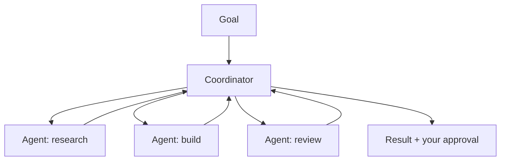

<LevelBadge level="advanced" />

<Callout type="objectives" items={[
  "What Cowork is — an agentic desktop workspace where you direct the goals and the loop is provided for you",
  "What Agent Teams is — multiple agents dividing one goal, each with a role and tools",
  "How both relate to the three things you can build yourself: subagents, the Agent SDK, and Managed Agents",
  "Why more autonomy means more supervision, not less",
]} />

<VerifyNote lastVerified="2026-07-23" source="https://platform.claude.com/docs">
Cowork and Agent Teams are fast-moving 2026 surfaces — names, availability, and capabilities change often. Confirm current details in the official Anthropic docs/announcements.
</VerifyNote>

Beyond a single agent, Anthropic has been shipping **product-level** surfaces for letting agents do sustained, collaborative work: **Cowork** (an agentic desktop workspace) and **Agent Teams** (multiple agents collaborating). This page is a high-level map — verify specifics against the official docs, since these evolve quickly.

## Claude Cowork

Think of it as a **workspace where an agent does real, multi-step work** alongside you — operating over files and tools on a longer horizon than a single chat turn, with you supervising. It's the consumer/pro-facing cousin of building an agent on the API: the loop is provided, you direct the goals.

## Agent Teams

Where one agent isn't enough, **multiple agents collaborate** — dividing a goal, each with a role and tools, coordinating toward a result. Conceptually it mirrors Claude Code's [subagents](/docs/claude-code/subagents), but as a product surface for sustained, multi-agent collaboration rather than a single delegated subtask.

## How this relates to the rest of the site

- Building it yourself, programmatically → [Building Agents](/docs/api/building-agents) + the [Agent SDK](/docs/claude-code/headless-and-agent-sdk).
- Delegation inside a coding session → [Subagents](/docs/claude-code/subagents).
- Hosted loop/state/scheduling → [Managed Agents](/docs/api/managed-agents).

<Flashcards title="Four ways agents get work done" cards={[
  {front: "Cowork", back: "An agentic desktop workspace. The loop is provided; you direct the goals and supervise while the agent works over files and tools on a longer horizon than a single chat turn."},
  {front: "Agent Teams", back: "A product surface where multiple agents collaborate — dividing a goal, each with a role and tools, coordinating toward a result you approve."},
  {front: "Subagents", back: "Delegation inside a Claude Code session. The same idea as Agent Teams, but scoped to a single delegated subtask rather than sustained collaboration."},
  {front: "Managed Agents", back: "Anthropic hosts the loop, the state and the scheduling for you — the API-side option when you don't want to run the agent loop yourself."},
  {front: "Agent SDK", back: "You build the loop programmatically. Maximum control, and you own the orchestration, state and error handling."},
]} />

## Quiz

<Quiz questions={[
  {
    q: "You want an agent loop you don't have to run or schedule yourself, called from your own backend. Which option does this page point you to?",
    options: [
      "Cowork",
      "Managed Agents",
      "Subagents",
      "Agent Teams"
    ],
    answer: 1,
    explain: "Managed Agents is the hosted loop/state/scheduling option. Cowork and Agent Teams are product surfaces you work inside rather than call; subagents are delegation within a Claude Code session; the Agent SDK is the build-it-yourself path."
  },
  {
    q: "What is the relationship between Agent Teams and Claude Code's subagents, as described here?",
    options: [
      "They are the same feature under two names",
      "Agent Teams replaces subagents, which are deprecated",
      "Conceptually the same idea, but Agent Teams is a product surface for sustained multi-agent collaboration rather than a single delegated subtask",
      "Subagents run in the cloud; Agent Teams runs locally"
    ],
    answer: 2,
    explain: "The page frames Agent Teams as conceptually mirroring subagents, but as a product surface for sustained, multi-agent collaboration — where subagents handle a single delegated subtask inside a coding session."
  },
  {
    q: "Why does this page treat supervision as the constant across both surfaces?",
    options: [
      "Because multi-agent, long-horizon work amplifies both value and risk",
      "Because agents cannot be given tool access at all",
      "Because Anthropic requires manual approval for every tool call",
      "Because the surfaces are research previews with no safety training"
    ],
    answer: 0,
    explain: "More autonomy over a longer horizon amplifies value and risk together. The practical response is keeping humans in the loop on consequential actions, scoping tool access tightly, and verifying outputs."
  }
]} />

## The constant: supervision

:::warning[More autonomy, more care]
Multi-agent, long-horizon work amplifies both value *and* risk. Keep humans in the loop on consequential actions, scope tool access tightly, and verify outputs — see [Responsible Use](/docs/security/responsible-use) and [Securing Agents](/docs/security/securing-agents).
:::

<Callout type="takeaways" items={[
  "Cowork and Agent Teams are product surfaces: the agent loop is provided, and your job is directing goals and supervising.",
  "They are the product-level cousins of what you can build yourself — subagents for in-session delegation, the Agent SDK for full control, Managed Agents for a hosted loop.",
  "These surfaces move fast. Treat this page as a map and confirm specifics against the official docs.",
  "Supervision is the constant: human approval on consequential actions, tight tool scopes, verified outputs.",
]} />

## Next

- [Cowork Scheduled Tasks: Agents That Run With No Device On](/docs/claude-app/cowork-scheduled-tasks) — the July 2026 web + mobile launch in practice, with the capability-by-surface matrix and the four gotchas that break silent runs
- [Subagents & Parallel Agents](/docs/claude-code/subagents)
- [Managed Agents](/docs/api/managed-agents)
- [Native Multi-Agent APIs](/docs/models/native-multi-agent-apis) — how OpenAI's Responses multi-agent beta compares, and where the primitive gap on the Anthropic side sits
- [Responsible Use, Ethics & Verification](/docs/security/responsible-use)
