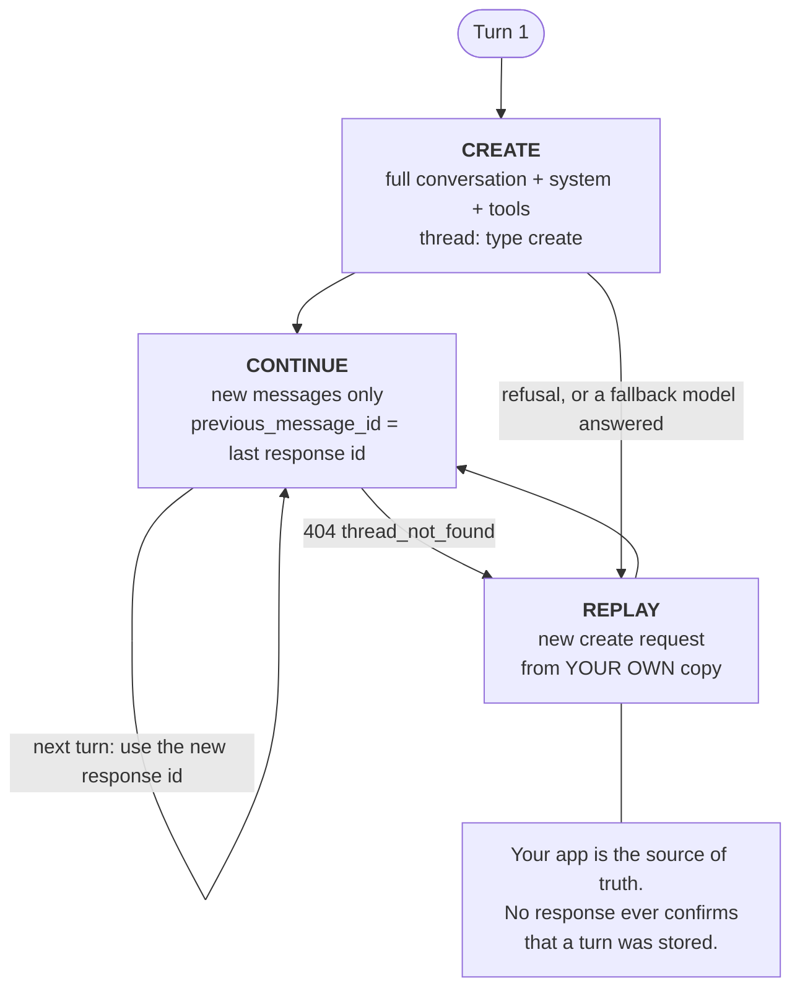

# Message Threads — Send Only the New Turn

> Source: https://derob98.github.io/ailmanac/docs/api/message-threads · AILmanac (CC BY 4.0) · last verified 2026-11-03

The Messages API can keep your conversation on the server and let each turn send only the new messages. What it actually saves (bytes and latency, not tokens), the replay path you must build before you ship, the three field groups, and the 4-breakpoint cache limit.

<LevelBadge level="advanced" />

<Callout type="objectives" items={[
  "Say exactly what a thread saves — request bytes and time to first token — and what it does not save: tokens, and therefore money",
  "Run the three-state lifecycle: create, continue, replay — and build the replay path before you ship, not after",
  "Sort every parameter into create-only, fixed, or free, and recognize a thread_fingerprint_mismatch on sight",
  "Keep prompt caching working on a thread inside the 4-breakpoint budget",
  "Continue a streamed turn safely, and know why continuing before message_stop returns a 404",
  "Handle the five thread errors, plus the two cases where you must start a brand-new thread instead of recovering",
  "Decide whether your workload is one that threads actually help"
]} />

<VerifyNote lastVerified="2026-11-03" source="https://platform.claude.com/docs/en/build-with-claude/message-threads">
Message threads entered **public beta on November 2, 2026** behind the `anthropic-beta: message-threads-2026-08-12` header. Field names, error codes, expiry windows and the unsupported-feature list are quoted from the official reference and can move while the feature is in beta — re-verify before you ship. Availability at the time of writing: Claude API, Claude Platform on AWS, Claude Models on Google Cloud (Anthropic managed), and Claude in Microsoft Foundry. **Not** available on Amazon Bedrock. Model support is broad — see [the official supported-model list](https://platform.claude.com/docs/en/build-with-claude/message-threads) and [Models & pricing](/docs/whats-new/models-and-pricing).
</VerifyNote>

A long agent loop has a quiet tax that has nothing to do with the model. On turn 40, your request is the entire conversation again: every file you read, every screenshot you took, every tool result. The API has to receive all of it, validate all of it, and tokenize all of it before the model can emit a single token. The conversation stopped being the *input* and became the *upload*.

A **message thread** removes the upload. You send the full conversation once. After that, each request carries only the new messages plus the `id` of the previous response, and the API rebuilds the conversation on its side before it calls the model.

## What a thread actually saves

Read this section before you plan a migration, because almost every secondhand writeup of this feature gets it wrong.

<Callout type="warning" items={[
  "Threads do NOT reduce your token bill. Anthropic is explicit: Claude still reads the full conversation on every turn, so token usage stays the same. Pricing and rate limits are unchanged.",
  "The dramatic numbers you may have seen quoted — hundreds of kilobytes down to a couple of kilobytes — are request payload sizes, not tokens. A smaller upload is a real win for latency. It is not a smaller invoice.",
  "The cost lever is still prompt caching, and a thread does not turn caching on for you. See 'Prompt caching on a thread' below."
]} />

What you get is latency and bandwidth. The measured figure Anthropic publishes: for requests in the **500k–1M token** range, median time to first token drops by **about 35%**.

<VerifyNote lastVerified="2026-11-03" source="https://claude.com/resources/articles/message-threads">
The ~35% median TTFT figure applies specifically to requests of 500k–1M tokens; Anthropic's framing is that the more context an agent carries, the more threads help. Short conversations gain little — there was not much upload to remove. The same source states plainly that token usage stays the same because Claude still reads the full conversation each turn.
</VerifyNote>

So the honest decision rule:

| Your workload | Threads worth it? |
|---|---|
| Long coding agent — each tool result and file edit grows the conversation | **Yes.** This is the designed-for case. |
| Computer-use agent uploading a screenshot every turn | **Yes.** Screenshots stay with the thread instead of being re-uploaded. |
| Document- or image-heavy multi-turn workflow | **Yes.** Largest payload reduction. |
| Chat with a few short turns | **No.** Nothing meaningful to remove, and you inherit the replay complexity. |
| Batch jobs, token counting, compaction on demand | **Not possible.** See [Features threads don't support](#features-threads-dont-support). |
| You need zero data retention on this traffic | **No.** Threads are not ZDR eligible. See [Data retention](#data-retention). |

:::tip[Threads and sessions are different features]
Message threads live on the Messages API. **Session threads** are a separate concept inside [Claude Managed Agents](/docs/api/managed-agents). Same word, different layer — don't let a search result for one send you to the other.
:::

## The three-state lifecycle

<Steps items={[
  {title: "Create", body: "Send your first request exactly as you do today — full conversation, system, tools — and add the thread parameter with type 'create'. The API stores the conversation plus Claude's reply under the response id. Send the message-threads-2026-08-12 beta header on this and every later request of the thread."},
  {title: "Continue", body: "Send only the messages since the previous response, with thread type 'continue' and previous_message_id set to that response's id. Leave system and tools OUT — the thread keeps the values from the create request, and sending either one again, even as null, is a 400 error. Use each new response id for the next turn."},
  {title: "Replay", body: "A thread is best-effort. It expires 5 minutes after its last request and is deleted no more than 1 hour after its last use; every stored response restarts the 5 minutes. When the API can no longer continue, a continue request returns 404 thread_not_found. Send the full conversation again in a new create request and continue from that response's id."}
]} />

### Create, then continue

<PromptCard title="curl — create a thread, then send only the new turn">{`# Turn 1 — full conversation, system, tools, and thread: create
curl https://api.anthropic.com/v1/messages \\
  -H "x-api-key: $ANTHROPIC_API_KEY" \\
  -H "anthropic-version: 2023-06-01" \\
  -H "anthropic-beta: message-threads-2026-08-12" \\
  -H "content-type: application/json" \\
  -d '{
    "model": "claude-opus-5-5",
    "max_tokens": 1024,
    "cache_control": {"type": "ephemeral"},
    "system": "You are a support agent for Acme. Keep replies short.",
    "messages": [{"role": "user", "content": "Hi! I have a question about an order."}],
    "thread": {"type": "create"}
  }'

# Turn 2 — only the new message. No system, no tools.
# message_id is the id from the turn-1 response.
curl https://api.anthropic.com/v1/messages \\
  -H "x-api-key: $ANTHROPIC_API_KEY" \\
  -H "anthropic-version: 2023-06-01" \\
  -H "anthropic-beta: message-threads-2026-08-12" \\
  -H "content-type: application/json" \\
  -d '{
    "model": "claude-opus-5-5",
    "max_tokens": 1024,
    "cache_control": {"type": "ephemeral"},
    "messages": [{"role": "user", "content": "How long does standard shipping usually take?"}],
    "thread": {"type": "continue", "previous_message_id": "'"$message_id"'"}
  }'`}</PromptCard>

The official SDKs ship a **thread helper** that builds these requests for you — it adds the beta header, creates on the first turn, continues after that, omits `system` and `tools`, and replays once on a 404. It is the right default. The raw form above is what you need when you drive the API from a language without a helper, from a gateway, or from `curl`.

## The three field groups

This is the table to pin above your desk. Every parameter on a thread request belongs to exactly one group, and the group decides whether you may send it, must send it, or may change it.

| Group | Fields | Rule |
|---|---|---|
| **Create-only** | `system`, `tools` | Send on the **create request only**, with any `cache_control` breakpoints on them. Sending either on a continue request — even as `null` — returns a 400. |
| **Fixed** | `model`, `tool_choice`, `thinking`, `mcp_servers` (except each server's authorization token), `context_management`, `output_config`, the `skills` inside `container`, the top-level `cache_control`, and the set of `anthropic-beta` values | Send on **every** request, with the **same value** as on the create request. A different value returns 400 `thread_fingerprint_mismatch`, and the error message names the fields that differ. |
| **Free** | `max_tokens`, `stop_sequences`, `stream`, `metadata`, `service_tier`, and anything not named above | Change freely from turn to turn. |

Two carve-outs worth remembering:

- **MCP server URLs, MCP authorization tokens, and the container `id` are not stored.** Send `mcp_servers` and `container` on every request that uses them. The authorization token is allowed to change between requests.
- **`fallbacks` is all-or-nothing.** If you use [server-side fallback](/docs/api/server-side-fallbacks), send `fallbacks` on every request of the thread or on none. Adding or dropping it mid-thread is a `thread_fingerprint_mismatch`. Its *value* may change.

To change a create-only or fixed field, you don't modify the thread — you start a new one with a create request carrying the new values.

:::warning[Changing `system` or `tools` can invalidate preserved thinking]
On Claude Fable 5.1, Mythos 5.1, Opus 5.5, Sonnet 5.5 and Haiku 5.5, starting a fresh thread with a different `system` or `tools` makes the `thinking` and `redacted_thinking` blocks already in your conversation invalid, and the create request can return a 400. The fix: strip every `thinking` and `redacted_thinking` block out of the conversation you send. The model then answers without that earlier reasoning. See [Thinking & effort](/docs/api/thinking-and-effort).
:::

## The replay path is not optional

<Callout type="warning" items={[
  "Your application stays the source of truth. Keep your own copy of every message.",
  "No response — not a create, not a continue — tells you whether the API stored that turn. You find out on the NEXT continue request, when it either works or 404s.",
  "The SDK thread helper holds its copy in memory for as long as the helper object lives, and saves it nowhere else. If the conversation must outlive your process, persist it yourself.",
  "Build replay on day one. A thread that has never expired in dev will expire in production during the first slow tool call."
]} />

A 404 with `error.details.error_code` set to `thread_not_found` means "I can't continue this," and the response deliberately does not say why. The documented causes:

- The thread expired (5 minutes of inactivity).
- The API served the previous turn but **did not store it** — for example, a response that ends in a tool call cut off by `max_tokens`.
- A **fallback model** wrote the previous response.
- The previous response is **still generating**.
- The request came from a different organization, workspace, user, or service account. A thread created with a workspace key stays with that key.
- The new messages add something the stored conversation can't accept — the classic example being the **first image** in a conversation that had none.

:::tip[Check the error code before you replay]
A request for a model that does not exist also returns 404. Branch on `error.details.error_code`, never on the status alone.
:::

To recover: send the full conversation from your own copy in a **new create request**, with `system` and `tools`, then continue from the new response's `id`. Strip `cache_control` breakpoints off the earlier messages first (see the 4-breakpoint budget below) — the SDK helper does this for you.

**If a replayed create succeeds but the very next continue 404s again**, the API may be unable to store that conversation at all — a very large one, for instance. Stop using `thread` for it and send plain requests. The SDK helper automates exactly this when you construct it with `unsupported_request_behavior` set to `continue_unthreaded`; without that setting it will replay on every single turn, which is strictly worse than not using a thread.

### Append-only, and one continue per `id`

A thread only ever grows. Each response `id` can be continued **exactly once**, and you always continue from the **latest** `id`. That has three consequences:

- **No editing, no branching.** To change an earlier message or explore an alternative, start a new thread.
- **No summarize-in-place.** A thread cannot have its early turns swapped for a summary. To compact, write the summary in your own code and send it as an ordinary message in a **new** create request. [Compaction on demand](/docs/api/compaction) is not available with threads at all.
- **Retrying a continue is not idempotent.** Fire the same continue twice and the second one gets `thread_already_continued` or `thread_continue_in_flight`.

The API does **not** deduplicate the messages you send on a continue. Re-send a message and it can appear twice in the conversation, or error. A continue request that begins with the previous *response* errors outright.

### The `pause_turn` special case

When a response stops with `stop_reason: "pause_turn"`, resume it with a continue request from that response's `id` and an **empty** `messages` list:

<PromptCard title="Resume a paused turn — empty messages, same thread">{`{
  "model": "claude-opus-5-5",
  "max_tokens": 1024,
  "cache_control": {"type": "ephemeral"},
  "messages": [],
  "thread": {"type": "continue", "previous_message_id": "msg_01..."}
}`}</PromptCard>

Do **not** send a new user message while the turn is paused — the API rejects it. If that resume returns 404, replay the full conversation *including the paused response* in a new create request. With the SDK helper, call `send()` with no messages.

### After a refusal, start over

When a response has `stop_reason: "refusal"`, **do not continue the thread.** The API may already hold the refused turn, and a continue cannot remove it. Start a new thread with a create request that omits or rephrases the turn that triggered the refusal. See [Refusals & safety](/docs/api/refusals-and-safety). The SDK helper handles this: it drops the refused turn and its next call starts a new thread.

## Prompt caching on a thread

A thread and a cache are orthogonal. **A thread does not cache your prompt for you** — [prompt caching](/docs/api/prompt-caching) behaves exactly as it does without one, and you still decide where the breakpoints go. Skip this and you get a thread that is faster to upload and just as expensive as before.

The simple recipe: send a **top-level `cache_control`** on every request of the thread. The API applies it to the last cacheable block of that request's `messages`, so each turn reads the earlier conversation from cache and writes the new turn into it. Remember that the top-level `cache_control` is a **fixed** field — the same value on every request, or you get a fingerprint mismatch.

If you place breakpoints on blocks yourself, four rules govern them:

1. Breakpoints sent on the create request keep working on later turns when they sit on `tools`, on `system`, or on a message block that isn't the last one. A breakpoint on the **last** block of a request writes the cache on *that* request — so to cache each new turn, send one on each request.
2. You **cannot move or remove** a breakpoint after sending it, because a continue request can never re-send an earlier message.
3. **The budget is 4 breakpoints per thread request.** The top-level `cache_control` counts as one. Breakpoints on the create request's `system` and `tools` count **again on every continue request**. Breakpoints on earlier *stored* messages do not count. Exceed it and you get 400 `thread_unsupported_request` with `unsupported: ["cache_control"]`.
4. When you replay, strip the breakpoints off earlier messages and keep one on the last block — otherwise the replay itself blows the budget.

:::tip[Do the arithmetic once]
Top-level `cache_control` (1) + a breakpoint on `system` (2) + one on `tools` (3) leaves you exactly **one** spare on every continue request. That is a budget you can design around, but not one you can be careless with.
:::

For the cross-provider version of this trade-off, see [Prompt caching across providers](/docs/models/prompt-caching-across-providers).

## Streaming

Threads work with [streaming](/docs/api/streaming), with one timing rule that is easy to get wrong.

The response `id` arrives early, in the `message_start` event. **Do not continue from it until you have received `message_stop`.** A continue sent before then can return 404, because the previous response is still generating.

If the stream of a continue request drops before `message_stop`, re-send the identical continue request. If *that* returns `thread_already_continued` or `thread_continue_in_flight`, replay the full conversation in a new create request. The ambiguity is inherent: your connection may have died before the server saved the response, or after. Replaying is always safe; retrying sometimes isn't.

The SDK helper does **not** retry a continue after a dropped stream. It keeps the finished blocks and whatever text arrived, and its next turn replays the full conversation. To re-send the interrupted turn instead, call `send()` with no messages. And read every stream to its end — the helper records the response at `message_stop`, so abandoning a stream early leaves the thread occupied until you close it (leave the `with` block in Python, `abort()` in TypeScript, `Close`/`close()` elsewhere).

## Errors

All five of these are returned **before the model runs**: the request consumes no tokens, and neither the thread nor its expiry time changes.

| Status | `error_code` | Meaning | Do this |
|---|---|---|---|
| 404 | `thread_not_found` | The API can't continue the thread. | Replay: full conversation in a new create request. |
| 400 | `thread_fingerprint_mismatch` | A fixed field differs from the stored value. The message names which. | Keep fixed fields identical, or start a new thread to change one. |
| 400 | `thread_already_continued` | That response `id` was already continued. | Continue from the latest `id`. If your client never saw that response, replay. |
| 400 | `thread_continue_in_flight` | Another continue from this `id` is still running — usually your own retry. | Let it finish and continue from its response, or replay. |
| 400 | `thread_unsupported_request` | The request uses a feature or org setting threads don't support. `error.details.unsupported` names it when present. | Remove the feature, or send the request without `thread`. |

`error.type` is `invalid_request_error` for the 400s and `not_found_error` for the 404. Some 400s on thread requests carry **no** `error_code` at all — a continue without `previous_message_id`, or one that includes `system` or `tools`.

<PromptCard title="A thread error body — note where error_code actually lives">{`{
  "type": "error",
  "error": {
    "type": "invalid_request_error",
    "message": "thread: a maximum of 4 blocks with cache_control may be provided when \`thread\` is set. Found 5.",
    "details": {
      "error_code": "thread_unsupported_request",
      "unsupported": ["cache_control"]
    }
  },
  "request_id": "req_011CSHoEeqs5C35K2UUqR7Fy"
}`}</PromptCard>

The documented values of `error.details.unsupported` are `context_management`, `cache_control`, `fallbacks`, `hipaa` and `inference_hooks`. Anthropic can add to that list — so treat an unrecognized value as "send this one without `thread`" rather than as a bug in your client. A request that trips several conditions is told about only one.

## Features threads don't support

- **[Message Batches](/docs/api/message-batches).** A batch item containing `thread` fails with an `invalid_request_error` in the results.
- **Token counting.** A token-counting request with `thread` is a 400. Count the full conversation instead, with `system` and `tools`. See [Tokens & pricing](/docs/api/tokens-and-pricing).
- **[Compaction](/docs/api/compaction).** Compaction on demand is unavailable with threads.
- **[Context editing](/docs/api/memory-and-context-editing)** — with one exception: `clear_thinking_20251015` with `keep: "all"`.
- **Organizations with HIPAA readiness enabled.**
- **Organizations with [Inference hooks](/docs/api/inference-hooks) turned on.** Worth flagging to whoever runs your org: a platform-level setting someone else enabled can make threads unusable for your whole team.

Two more hard limits: **there is no API to list, read, or delete a thread**, and threads are unavailable on Amazon Bedrock.

## Data retention

Message threads are **not ZDR eligible**. Using them does not affect your use of other ZDR-eligible features — the scope is this traffic, not your account.

What the thread holds: the conversation sent to the model, the `system` and `tools` from the create request, and a fingerprint of the fixed fields. It is held **in memory, encrypted under a server-managed key, never written to durable storage, and deleted no more than 1 hour after the thread's last use.** Files are held **by reference**, so every file the conversation uses must stay available for as long as you use the thread.

If your compliance posture requires ZDR on a workload, that workload cannot use threads. See [Privacy](/docs/foundations/privacy).

## Common mistakes

| Mistake | Symptom | Fix |
|---|---|---|
| Expecting a smaller bill | Invoice unchanged | Threads cut bytes and TTFT, not tokens. Add [prompt caching](/docs/api/prompt-caching) for cost. |
| Re-sending `system` on a continue | 400, no `error_code` | Create-only. Omit it — even `null` fails. |
| Nudging `thinking` or `tool_choice` mid-thread | `thread_fingerprint_mismatch` | Fixed fields. Start a new thread to change one. |
| Treating the response as proof of storage | Surprise 404 later | Nothing confirms storage. Build replay. |
| Continuing from `message_start` | Intermittent 404 under load | Wait for `message_stop`. |
| Blind retry of a dropped continue | `thread_already_continued` | Retry once, then replay. Replay is always safe. |
| Continuing after a refusal | Poisoned conversation | Start a new thread without that turn. |
| Breakpoints on `system` + `tools` + top-level + per-turn | `thread_unsupported_request` | Budget is 4, and `system`/`tools` breakpoints recount every turn. |
| Sending a new user message during `pause_turn` | Rejected | Continue with `"messages": []`. |
| Helper replaying every single turn | Latency *worse* than no thread | Set `unsupported_request_behavior` to `continue_unthreaded`. |

<Quiz questions={[
  {
    q: "You move a 40-turn coding agent onto message threads and request payloads drop from ~600 KB to ~2 KB. What happens to your monthly API bill?",
    options: [
      "It drops roughly proportionally, since you send far less data",
      "It stays the same — Claude still reads the full conversation every turn, so token usage is unchanged",
      "It drops by about 35%, matching the TTFT improvement",
      "It rises, because the API charges for thread storage"
    ],
    answer: 1,
    explain: "Anthropic states it directly: Claude still reads the full conversation on every turn, so token usage stays the same, and threads do not change pricing or rate limits. The kilobyte figures are request payload sizes. The ~35% number is median time to first token on 500k–1M token requests, not a cost figure. Prompt caching is still the cost lever — and a thread does not enable it for you."
  },
  {
    q: "Turn 12 of a thread returns 404 with error_code thread_not_found. What is the correct recovery?",
    options: [
      "Retry the same continue request — it is a transient error",
      "Continue from the response id two turns back instead",
      "Send the full conversation from your own copy in a new create request, with system and tools, then continue from the new response id",
      "Call the thread delete endpoint and create a fresh thread"
    ],
    answer: 2,
    explain: "A thread is best-effort and the 404 never says why — it could be expiry, an unstored turn, a fallback model, a different API key, or new content the stored conversation cannot accept. The only recovery is replay from your own copy in a new create request, with system and tools restored, stripping cache_control breakpoints off the earlier messages. There is no API to list, read or delete a thread."
  },
  {
    q: "Your create request puts a cache_control breakpoint on system, one on tools, and sends a top-level cache_control. How many breakpoints remain available on each continue request?",
    options: [
      "Three — only the top-level one carries over",
      "One — the limit is 4, the top-level counts as one, and the system and tools breakpoints count again every turn",
      "Four — breakpoints on create-only fields do not count on continue requests",
      "Zero — system and tools breakpoints consume the whole budget"
    ],
    answer: 1,
    explain: "A thread request allows at most 4 cache_control breakpoints. The top-level cache_control counts as one, and breakpoints placed on the create request's system and tools count again on every continue request — 3 used, 1 spare. Only breakpoints on earlier stored messages are free. Going over returns 400 thread_unsupported_request with unsupported: [\"cache_control\"]."
  },
  {
    q: "Which of these can you do on an existing thread?",
    options: [
      "Replace the first twenty turns with a summary using compaction on demand",
      "Branch the conversation by continuing twice from the same response id",
      "Change max_tokens from one turn to the next",
      "Switch the model from Sonnet to Opus for a single hard turn"
    ],
    answer: 2,
    explain: "max_tokens is a free field and may change every turn. model is fixed (a change is thread_fingerprint_mismatch). A thread is append-only and each response id can be continued exactly once, so branching is impossible. Compaction on demand is explicitly unsupported with threads — to compact, write the summary yourself and send it as an ordinary message in a new create request."
  }
]} />

<Callout type="takeaways" items={[
  "A thread trades upload for state: send the conversation once, then only the new messages plus previous_message_id. Beta header message-threads-2026-08-12 on every request.",
  "It buys bytes and latency — about 35% lower median TTFT on 500k–1M token requests — and nothing else. Token usage, pricing and rate limits are unchanged.",
  "Sort every parameter: system and tools are create-only; model, thinking, tool_choice, context_management, output_config and the top-level cache_control are fixed; max_tokens and friends are free.",
  "Your app is the source of truth. No response confirms storage, a thread expires after 5 minutes of inactivity, and the only recovery is replaying the full conversation in a new create request.",
  "Append-only, one continue per response id: no editing, no branching, no in-place compaction. Changing anything fixed means a new thread.",
  "Caching is still your job. Top-level cache_control on every request is the simple recipe, inside a hard budget of 4 breakpoints where system and tools recount each turn.",
  "Streaming: continue only after message_stop. Retry a dropped continue once; after that, replay — replay is always safe.",
  "Not for batches, token counting, compaction, most context editing, HIPAA-enabled orgs, inference-hooks-enabled orgs, Amazon Bedrock, or any workload that needs ZDR."
]} />

## Sources & further reading

- [Anthropic: Message threads](https://platform.claude.com/docs/en/build-with-claude/message-threads) — the authoritative reference: the `thread` parameter, the three field groups, the error table, the SDK helper contract, the unsupported-feature list, and the data-retention statement.
- [Anthropic API release notes](https://platform.claude.com/docs/en/release-notes/api) — the November 2, 2026 public-beta entry, with expiry windows and platform availability.
- [Anthropic: Make long-running agents faster with message threads](https://claude.com/resources/articles/message-threads) — the ~35% median TTFT figure for 500k–1M token requests, the three workloads it helps most, and the statement that token usage stays the same.
- [Anthropic: Prompt caching](https://platform.claude.com/docs/en/build-with-claude/prompt-caching) — the minimum cacheable length a top-level `cache_control` has to clear before it does anything.
- AILmanac companions: [Prompt Caching & Cost Optimization](/docs/api/prompt-caching) · [Conversation Compaction](/docs/api/compaction) · [Streaming](/docs/api/streaming) · [Server-Side Fallbacks](/docs/api/server-side-fallbacks)

## Next

- [Server-side conversation state across providers](/docs/models/server-side-conversation-state) — OpenAI and Google shipped the same idea with completely different durability, retention and billing contracts. Read this before you build an abstraction over all three.
- [Prompt Caching & Cost Optimization](/docs/api/prompt-caching) — the feature that actually lowers the bill, and the one a thread leaves entirely to you
- [Conversation Compaction](/docs/api/compaction) — what to do when the conversation is too big to send at all, which no thread can fix
