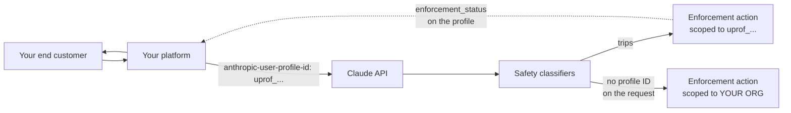

<LevelBadge level="advanced" />

<Callout type="objectives" items={[
  "The blast-radius problem every AI platform has: without attribution, one abusive end customer can get your whole organization restricted",
  "How to register an end customer (POST /v1/user_profiles) and attribute each request (the anthropic-user-profile-id header)",
  "application vs passthrough — which access_type matches how you sell Claude, and why the wrong one weakens attribution",
  "The four enforcement_status values and the exact rule that picks one, including pending (which the narrative docs omit)",
  "The enforcement_actions schema: six reasons, the verify next step, and the forward-compatibility rules Anthropic asks you to code defensively",
  "Why organization webhooks are not yet a substitute for a polling loop — and the exact list query that finds every restricted profile",
  "Where this silently does nothing: Claude Platform on AWS, Bedrock, and Google-managed Google Cloud each behave differently",
]} />

<VerifyNote lastVerified="2026-11-02" source="https://platform.claude.com/docs/en/manage-claude/user-profiles">
User profiles launched **October 20, 2026**; the `enforcement_status` and `enforcement_actions` fields were added **October 21, 2026** alongside [API version 2026-10-21](/docs/api/api-version-2026-10-21). Organization webhooks are **beta** (`webhooks-2026-10-07`) and Anthropic's own documentation states that **event delivery is not live** — you can register endpoints, but no events are sent yet. Field names and enum values are from the [user profiles guide](https://platform.claude.com/docs/en/manage-claude/user-profiles), the [List User Profiles reference](https://platform.claude.com/docs/en/api/user_profiles/list), and the [organization webhooks guide](https://platform.claude.com/docs/en/manage-claude/organization-webhooks). Re-check before you ship a hard dependency.
</VerifyNote>

If you resell Claude, run an AI gateway, or build a product on the Claude API that thousands of strangers sign up for, you have a problem that single-tenant builders don't: **Anthropic's automated safety classifiers run over your API traffic, and every request arrives under your organization.** One end customer doing something that trips a classifier is, from Anthropic's side, indistinguishable from *you* doing it. The enforcement action that follows applies to your whole organization — and takes every other customer down with it.

User profiles are the fix. You tell Anthropic which end customer each request is for, and an enforcement action lands on that profile instead. The rest of your traffic keeps running.

:::tip[This is a blast-radius control, not a billing feature]
Profiles aren't billable and don't change pricing. They don't grant or revoke anything by themselves. Their entire job is to make enforcement *targeted* — which only helps if you've attributed the traffic **before** something goes wrong. There is no retroactive attribution.
:::

## The one-paragraph version

Create one profile per end customer with `POST /v1/user_profiles`, store the returned `uprof_…` ID on your customer record, and send it in the `anthropic-user-profile-id` header on every request you make for that customer. Then run a loop that lists your profiles filtered by `enforcement_status[]=restricted` and `enforcement_status[]=banned`, so you learn about an action before your support inbox does. Requests with **no** profile ID count as your own usage — and if one of them trips a classifier, you're back to organization-wide enforcement.

## The four-step setup

<Steps items={[
  {title: "Separate your own traffic into a different organization", body: "A profile belongs to an organization, not a workspace, so separate workspaces inside one organization are not enough. Keep end-customer traffic in one organization and your internal usage in another. Only the end-customer organization needs profiles."},
  {title: "Register each end customer once, at onboarding", body: "POST /v1/user_profiles returns a profile with a uprof_ ID. The endpoint is NOT idempotent — every call creates a new profile, even when reference_id matches one you already have. Create it in your signup flow and store the ID; never let a service instance create its own on the fly."},
  {title: "Send the ID on every request for that customer", body: "The anthropic-user-profile-id header. The SDKs and the ant CLI expose it as an argument (user_profile_id; userProfileId in Java, UserProfileID in Go/C#, --user-profile-id in the CLI). It works the same on Messages, token counting, Message Batches, and the OpenAI-SDK compatibility layer."},
  {title: "Poll for enforcement actions, and keep profiles current", body: "List profiles by enforcement_status to find restrictions and bans. Update a profile when the customer's details or account status change; delete it when they close their account or ask you to erase their data."},
]} />



The dotted line is the one you have to build. Anthropic sets the enforcement fields; nothing pushes them to you today.

## Decide who gets a profile

What a profile *stands for* depends on how you sell Claude. The `access_type` field records which case applies, and getting it wrong weakens the attribution you set the profile up for.

| Who the traffic is for | What to create | `access_type` |
| --- | --- | --- |
| A signed-up user of your product | One profile per user, created at signup | `application` — **the default**, used when you omit the field |
| A company you resell API access to (gateway, reseller) | One profile per **company**, not per person inside it | `passthrough` — **not** the default, so you must send it |
| Your own organization's usage | Nothing. A request with no profile ID counts as your own usage — keep it in a separate organization | n/a |
| A workspace inside your organization | No separate profile. A profile belongs to the organization and its ID works through any workspace in it | n/a |

<PromptCard title="Register a reseller customer (passthrough)">{`curl https://api.anthropic.com/v1/user_profiles \\
  -H "x-api-key: $ANTHROPIC_API_KEY" \\
  -H "anthropic-version: 2023-06-01" \\
  -H "content-type: application/json" \\
  -d '{
    "name": "Acme Analytics, Inc.",
    "access_type": "passthrough",
    "external_user_details": {
      "reference_id": "cust-8f2a1c",
      "country": "US"
    }
  }'`}</PromptCard>

For an `application` profile, leave `access_type` out and describe one person in `name` and `external_user_details` instead of a company.

:::warning[A passthrough profile identifies a company, not a person]
If a request through a reseller comes from one identifiable human, *also* send an identifier for that human in the Messages request's own `metadata.user_id` field — which is a different object from the profile's `metadata`. Without it, Anthropic can see the company misbehaving but not which of its users, and the action it can take is correspondingly blunt.
:::

### What to tell Anthropic, and what not to

Every field is optional. You can send `name`, `metadata` (up to 16 pairs; keys ≤ 64 chars, values ≤ 512), and seven fields inside `external_user_details`: `entity_type`, `country`, `reference_id`, `onboarded_at`, `account_status`, `name_hash`, `email_hash`. A profile holds **only** what you send plus the statuses Anthropic sets — never conversation content, and Anthropic does not verify any of it.

Four rules worth internalizing before you write the onboarding code:

- **Leave unknowns out, don't send placeholders.** You can replace a value in `external_user_details` later, but you can **never clear** one. The API rejects `null` with a 400. A `"unknown"` string you wrote on day one is permanent.
- **`country` is the *customer's* country**, not yours.
- **`reference_id` is your own identifier** for the customer. It doesn't have to be unique, and it isn't a deduplication key — see the non-idempotency warning above.
- **If you can't share a name or email, send a hash.** `name_hash` and `email_hash` let Anthropic see which of your profiles *share* an identity without ever receiving it. You choose the hash function — but use the same function and the same case/whitespace normalization for every profile, because only identically-computed values match. There is no field for a raw email address at all.

## Attribute each request

<PromptCard title="A Messages call attributed to one end customer">{`curl https://api.anthropic.com/v1/messages \\
  -H "x-api-key: $ANTHROPIC_API_KEY" \\
  -H "anthropic-version: 2023-06-01" \\
  -H "anthropic-user-profile-id: $PROFILE_ID" \\
  -H "content-type: application/json" \\
  -d '{
    "model": "claude-opus-5-5",
    "max_tokens": 1024,
    "messages": [{"role": "user", "content": "Hello, Claude"}]
  }'`}</PromptCard>

Model IDs move — see [Current Models & Pricing](/docs/whats-new/models-and-pricing) for the live lineup.

On the Claude API, Claude Platform on AWS, Anthropic-hosted Microsoft Foundry deployments, and Anthropic-managed Claude on Google Cloud, the ID is **validated on every request**: a malformed ID, or one that belongs to a different organization, returns a `400` `invalid_request_error`. That cross-organization check bites in a specific and surprising way — if you send traffic under two organizations (say one on the Claude API and one on Claude Platform on AWS), a profile created by one is rejected by the other.

**Message Batches is the exception.** Creating a batch checks only the ID's *format*. A well-formed ID that doesn't belong to your organization still lets the batch be created, and then each request inside it fails individually with an `errored` result carrying the same `invalid_request_error`. If you attribute batches, validate the ID yourself before you submit — see [Message Batches](/docs/api/message-batches).

### Where it silently does less

This is the table to read before you assume attribution is working.

| Platform | Create profiles there? | Send the ID in | Enforcement fields work? |
| --- | --- | --- | --- |
| Claude API | Yes | `anthropic-user-profile-id` header | Yes |
| Claude Platform on AWS | Yes | `anthropic-user-profile-id` header | **No** — always `unrestricted` / empty |
| Microsoft Foundry (Anthropic-hosted) | Yes | `anthropic-user-profile-id` header | Yes |
| Claude Models on Google Cloud (Anthropic-managed) | Yes | `anthropic-user-profile-id` header | Yes |
| Claude Models on Google Cloud (Google-managed) | No — create on the Claude API or Claude Platform on AWS | `anthropic-user-profile-id` header | Format-checked only |
| Claude in Amazon Bedrock | No — create on the Claude API or Claude Platform on AWS | `user_profile_id` **field in the request body** | Format-checked only |

Three consequences:

1. **On Claude Platform on AWS, `enforcement_status` is always `unrestricted` and `enforcement_actions` is always empty** — and Anthropic doesn't refuse requests there because of an open action. Don't build a dashboard that reads "all clear" from a platform that cannot report otherwise.
2. **On Bedrock and Google-managed Google Cloud, the ID is format-checked but never looked up.** A `200` response does **not** confirm the ID matches a real profile. A typo'd-but-well-formed ID looks exactly like success while attributing nothing.
3. **On Bedrock the ID is a body field, not a header** — `"user_profile_id": "uprof_…"` at the top level. And it does not work with the legacy Bedrock integration you call via `InvokeModel` or `Converse`.

For Bedrock and Google-managed Google Cloud you must also **link the account** to the Anthropic organization that owns your profiles, in the Verification Portal at `portal.anthropic.com` under **Linked accounts** (admin starts the link → someone with IAM access runs a provided command → admin completes verification). Program approvals attached to a profile apply to that account's requests only once the portal shows it as **Linked**.

## Read the enforcement state

Every response that returns a profile — create, retrieve, update, and each row of a list — includes `enforcement_status` and `enforcement_actions`.

```json
{
  "type": "user_profile",
  "id": "uprof_011CZkZCu8hGbp5mYRQgUmz9",
  "enforcement_status": "restricted",
  "enforcement_actions": [
    {
      "type": "restriction",
      "id": "enac_011CZkZEq4TnWb7xLfRgPm2v",
      "reason": "fraud_or_abuse",
      "action": null,
      "opened_at": "2026-10-02T19:30:00Z",
      "expires_at": null
    }
  ]
}
```

### The four statuses — and the one the guide omits

`enforcement_status` is picked by **the first rule that applies**, in this order:

| Value | Rule |
| --- | --- |
| `banned` | Any open action is a `ban` |
| `pending` | A restriction that an identity check *can* clear is open, the end user has submitted that check, Anthropic's review of it hasn't ended, and no open action's `reason` is `account_compromise` |
| `restricted` | Any action is open |
| `unrestricted` | No action is open |

:::warning[Anthropic's own docs disagree on the number of values]
The [user profiles guide](https://platform.claude.com/docs/en/manage-claude/user-profiles) and the [organization webhooks guide](https://platform.claude.com/docs/en/manage-claude/organization-webhooks) both describe `enforcement_status` as three values — `unrestricted`, `restricted`, `banned`. The [API reference](https://platform.claude.com/docs/en/api/user_profiles/list) documents **four**, adding `pending`, and accepts `pending` in the `enforcement_status[]` list filter. Treat the API reference as authoritative on the enum and handle `pending` explicitly: it is the one state where the end customer is doing something about the problem, and treating it as a generic `restricted` loses that signal. We've reported the discrepancy; this note will go when it's reconciled.
:::

### The action object

`enforcement_actions` lists the **open** actions and is empty when there are none. An action that ends simply leaves the list.

| Field | Meaning |
| --- | --- |
| `type` | `restriction` (Anthropic has limited how it serves the end user; they may still be served in part) or `ban` (Anthropic has stopped serving them and does not plan to again) |
| `id` | The action's ID, prefixed `enac_`, stable while the action is open |
| `reason` | One of `unsupported_region`, `fraud_or_abuse`, `high_harm`, `usage_policy_violation`, `account_compromise`, `unspecified` |
| `action` | The next step: `verify` (the end user can clear it now by passing an identity check) or `null` (nothing they can do right now — **including while Anthropic reviews a check they already submitted**). Always `null` on a ban |
| `opened_at` | When Anthropic opened it (RFC 3339) |
| `expires_at` | When it ends on its own, or `null` when it has no end date. Always `null` on a ban, and always `null` when `reason` is `account_compromise` |

While an action is open, Anthropic refuses some or all inference requests carrying that profile's ID.

Two fields are **read-only**: a create or update request that includes `enforcement_status` or `enforcement_actions` returns a `400`. And don't confuse `enforcement_status` (Anthropic's decision) with `external_user_details.account_status` (`active` / `suspended` / `blocked` — *your* decision about the account). They're independent, and you'll want both: Anthropic restricting a customer you consider active is exactly the alert worth paging on.

### Code the forward-compatibility rules now

Anthropic reserves the right to add enum values, and tells you how to degrade. Write these four lines of defensive mapping on day one rather than shipping a crash later:

| Unrecognized… | Treat as |
| --- | --- |
| `enforcement_status` | `restricted` |
| action `type` | `restriction` |
| `reason` | `unspecified` |
| `action` | `null` |

## You still need a polling loop

The intended real-time path is **organization webhooks** (beta, `webhooks-2026-10-07`), managed under `/v1/organizations/webhooks` with two event types:

| Event | Trigger |
| --- | --- |
| `user_profile.enforcement_action_opened` | Anthropic opens an enforcement action on a profile |
| `user_profile.enforcement_action_resolved` | An action ends — Anthropic resolves it, or its `expires_at` passes |

:::warning[Event delivery is not live]
Anthropic's documentation states plainly that it **does not send these two events**, so an endpoint you register receives nothing. You can register endpoints and build your handler against the documented event format, but as of this page's verification date **polling is the only mechanism that actually tells you about an enforcement action.** Build the loop first and treat the webhook handler as the upgrade path.
:::

<PromptCard title="Find every restricted or banned profile (the loop you actually need)">{`curl --globoff "https://api.anthropic.com/v1/user_profiles?\\
enforcement_status[]=restricted&\\
enforcement_status[]=banned&\\
limit=100" \\
  -H "x-api-key: $ANTHROPIC_API_KEY" \\
  -H "anthropic-version: 2026-10-21"`}</PromptCard>

There is one non-obvious pagination rule here, and skipping it is how you build a monitor that silently misses customers:

:::warning[A short page does not mean the end of the list]
With `enforcement_status[]` set, the service examines a **bounded number of profiles per request**. A page can hold fewer profiles than `limit` — **or none at all** — and still carry a `next_page` cursor. **Only a `null` `next_page` means the listing is complete.** Keep requesting pages until then. The filter can also fail with `overloaded_error` when a profile's actions can't be read for the moment, so retry rather than treating that as "no results."
:::

Two more traps in the same area:

- **Don't watch `updated_at`.** Anthropic says a change to the enforcement fields *doesn't reliably* move it. Diff the field values against what you last stored.
- **Drop the legacy beta header.** Any request whose `anthropic-beta` header carries `user-profiles-2026-09-04` or earlier **omits both enforcement fields entirely** and makes the `enforcement_status[]` filter return a `400`. The symptom — every profile looks `unrestricted` because the field isn't there — reads exactly like good news. Remove the value to get the fields.

### If and when events do start flowing

The event format is already specified, so the handler is worth writing. Events carry **IDs, not state**: `data.id` is the profile ID, `data.enforcement_action_id` is the `enac_` ID.

```json
{
  "type": "event",
  "id": "whe_4f2a9c1e7b3d5a8f0e6c2b9d1a7f3e5c",
  "created_at": "2026-10-15T17:02:41Z",
  "data": {
    "type": "user_profile.enforcement_action_opened",
    "id": "uprof_011CZkZCu8hGbp5mYRQgUmz9",
    "enforcement_action_id": "enac_011CZkZEq4TnWb7xLfRgPm2v",
    "organization_id": "org_011CZkZBj9RsYd3wNcHvKq6t"
  }
}
```

So the handler's job is always: retrieve the profile and read its current state. Never reconstruct state from event ordering — Anthropic warns that events may arrive **late or out of order**, and only guarantees that the profile already reflects the change (or a later one) by the time an event arrives. Deliveries follow the [Standard Webhooks](https://www.standardwebhooks.com/) spec with `webhook-id`, `webhook-timestamp`, and `webhook-signature` headers; verify the signature against the endpoint's `whsec_` secret before trusting anything, **return a 2xx within 5 seconds** and do slow work after, and **deduplicate on the event `id`** (the same value as `webhook-id`) because an endpoint may receive the same event twice. Failed deliveries are retried a few times over the next few minutes and then dropped — so the polling loop is also your catch-up mechanism, permanently.

Endpoint operational limits worth knowing up front: an organization can have up to **32** endpoints (disabled ones still count); the URL must be **HTTPS on port 443 with a public domain name**, not an IP; two *enabled* endpoints can't share a URL; and Anthropic **auto-disables** an endpoint that returns a `3xx`, resolves to a non-public IP, or keeps failing — skipping its events permanently rather than replaying them later. Access is gated: your organization needs organization webhooks turned on by your account team, must not have HIPAA readiness enabled, and must not use a customer-managed encryption key on its default workspace. If you see a `404` on these endpoints, the usual cause is the missing beta header or an organization that hasn't been enabled — not a wrong ID.

Also note: **deleting a profile ends its open actions without emitting a `…_resolved` event**, and an action that opened before you registered your endpoint produces no `…_opened` event either. Both gaps are closed by the same list query.

## Keep profiles current

`POST /v1/user_profiles/[id]` changes only the fields you send, with three different merge semantics you should not mix up:

- `name` and `access_type` — **replace** the stored value.
- Each field inside `external_user_details` — **replaces** the stored value, and cannot be cleared (`null` → `400`).
- `metadata` — **merges key by key**. A key you send overwrites it, **an empty string deletes the key**, and keys you omit are untouched.

<PromptCard title="Suspend an account on your side and drop a metadata key">{`curl "https://api.anthropic.com/v1/user_profiles/$PROFILE_ID" \\
  -H "x-api-key: $ANTHROPIC_API_KEY" \\
  -H "anthropic-version: 2023-06-01" \\
  -H "content-type: application/json" \\
  -d '{
    "external_user_details": {"account_status": "suspended"},
    "metadata": {"trial_cohort": ""}
  }'`}</PromptCard>

`DELETE /v1/user_profiles/[id]` permanently deletes everything **you** supplied — `name`, `external_user_details`, `metadata`. It does **not** remove the trust-and-safety records Anthropic keeps about that profile ID. Three things to get right:

1. **Stop sending the ID before you delete it.** For up to about **10 minutes** after a delete, inference requests carrying the deleted ID can still succeed; after that the platforms that look profiles up reject them with a `400` — and Bedrock and Google-managed Google Cloud, which don't look them up, keep accepting them forever.
2. **An erasure request from a continuing customer means create-then-switch-then-delete** — new profile, repoint your traffic, delete the old one.
3. **A `404` on a delete retry means the first one worked.** Retry server errors; read the `404` as success.

## Common mistakes

| Mistake | What actually happens |
| --- | --- |
| Creating the profile lazily on first request, keyed by `reference_id` | `POST /v1/user_profiles` isn't idempotent. You get a new `uprof_` per call and your traffic is spread across duplicate profiles, so no single one accumulates the signal enforcement is based on |
| Keeping your own internal traffic in the same organization | Unattributed requests count as your usage; if one trips a classifier, the action is organization-wide again — the exact outcome profiles exist to prevent |
| Using separate workspaces instead of separate organizations | A profile is organization-scoped. Its ID works through any workspace, so workspaces give you no isolation here |
| Leaving `user-profiles-2026-09-04` in `anthropic-beta` | Both enforcement fields vanish from every response and the list filter 400s. Every customer looks fine |
| Stopping pagination at the first short page | With `enforcement_status[]`, a short or empty page is normal. Only `next_page: null` ends the list — stop early and you miss banned customers |
| Polling `updated_at` for changes | It doesn't reliably move when enforcement changes. Diff the field values |
| Reading "all clear" from Claude Platform on AWS | It always reports `unrestricted` with no actions. It cannot tell you otherwise |
| Treating a `200` on Bedrock as proof of attribution | Bedrock only format-checks the ID. A well-formed wrong ID attributes nothing and returns success |
| Sending `access_type: application` for a reselling company | Attribution then describes a "user" that is actually a whole company, and per-person signal inside it is lost unless you also send `metadata.user_id` |
| Writing a placeholder into `external_user_details` | Values can be replaced but never cleared. The placeholder is permanent |

## Quiz

<Quiz questions={[
  {
    q: "Your monitor lists profiles with enforcement_status[]=restricted&enforcement_status[]=banned and gets back a page with 0 profiles and a non-null next_page. What should it do?",
    options: [
      "Stop — an empty page means there are no restricted profiles",
      "Keep requesting pages until next_page is null",
      "Retry the same page, since an empty page is always an error",
      "Drop the filter and scan every profile instead"
    ],
    answer: 1,
    explain: "With enforcement_status[] set, the service examines a bounded number of profiles per request, so a page may hold fewer than limit profiles — or none — and still carry a next_page cursor. Only a null next_page means the listing is complete. Stopping at the first short page is how a monitor silently misses banned customers."
  },
  {
    q: "You run an AI gateway that resells API access to companies. Every request carries anthropic-user-profile-id and every profile is enforcement_status: unrestricted — but inference for one customer keeps getting refused. You call the Claude API directly. What's the most likely cause?",
    options: [
      "The profile's external_user_details.account_status is set to blocked",
      "You're sending user-profiles-2026-09-04 (or earlier) in the anthropic-beta header, so the enforcement fields are omitted from every response",
      "passthrough profiles don't report enforcement state",
      "The profile was deleted more than 10 minutes ago"
    ],
    answer: 1,
    explain: "Under user-profiles-2026-09-04 and earlier beta values, responses leave out enforcement_status and enforcement_actions entirely — and the enforcement_status[] filter returns a 400. A missing field deserializes to nothing, which your code reads as 'fine'. Remove the value from anthropic-beta to get the fields. (account_status is your own decision and never causes Anthropic to refuse; access_type doesn't affect reporting; a deleted profile would 404 on retrieve.)"
  },
  {
    q: "A restriction is open on a profile with reason \"fraud_or_abuse\". The end customer has submitted the identity check Anthropic asked for and the review is still running. What does enforcement_status read, and what does the action's `action` field read?",
    options: [
      "restricted, and action is \"verify\"",
      "pending, and action is null",
      "pending, and action is \"verify\"",
      "unrestricted, because a submitted check clears the action"
    ],
    answer: 1,
    explain: "pending is exactly the state where a clearable restriction is open, the check has been submitted, the review hasn't ended, and no open action's reason is account_compromise. And `action` is null while that review runs — null means 'nothing the end user can do right now', which includes waiting on a check they already submitted. Note that the narrative guide pages omit pending altogether; the API reference documents it."
  }
]} />

<Flashcards title="The ID prefixes and headers" cards={[
  {front: "uprof_", back: "A user profile ID. Returned by POST /v1/user_profiles; store it on your customer record."},
  {front: "enac_", back: "An enforcement action ID. Stable while the action is open; leaves enforcement_actions when the action ends."},
  {front: "wep_", back: "An organization webhook endpoint ID. Up to 32 per organization, disabled ones included."},
  {front: "whsec_", back: "An organization webhook endpoint's signing secret. Returned only when you create the endpoint or regenerate the secret — store it securely."},
  {front: "anthropic-user-profile-id", back: "The request header that attributes a call to one end customer. On Claude in Amazon Bedrock it becomes a top-level user_profile_id body field instead."},
  {front: "webhooks-2026-10-07", back: "The anthropic-beta value required on every /v1/organizations/webhooks request. Missing it returns 404, not 400."},
  {front: "access_type: application", back: "The default. One profile per individual end user of your product."},
  {front: "access_type: passthrough", back: "Not the default — you must send it. One profile per company you resell Claude access to."},
  {front: "enforcement_status: pending", back: "A clearable restriction is open, the end user submitted an identity check, the review hasn't ended, and no open action is account_compromise. Documented in the API reference only."},
]} />

<Callout type="takeaways" items={[
  "Attribution is preventive and cannot be applied retroactively — a request sent without a profile ID is permanently your organization's own usage.",
  "Build the polling loop before the webhook handler: Anthropic states event delivery is not live, so listing by enforcement_status[] is the only mechanism that works today.",
  "Paginate until next_page is null. With the enforcement_status[] filter, a short or empty page is expected, not the end of the list.",
  "Drop user-profiles-2026-09-04 and earlier from anthropic-beta, or both enforcement fields silently disappear and every customer looks unrestricted.",
  "Handle pending explicitly, and map unknown enum values to restricted / restriction / unspecified / null as Anthropic asks.",
  "Know your platform: Claude Platform on AWS cannot report enforcement at all, and Bedrock plus Google-managed Google Cloud only format-check the ID — a 200 there is not proof of attribution.",
]} />

## Next

- [The Admin API: automate your Claude org](/docs/api/admin-api) — the organization-level endpoints these profile and webhook calls sit beside, including which credential each one needs.
- [Managed Agents: domain restrictions](/docs/api/managed-agents-domain-restrictions) — the other October 2026 control for narrowing what your agents are allowed to reach.
- [Inference Hooks: inline DLP for Claude Enterprise](/docs/api/inference-hooks) — enforcement you run yourself, before the model sees a prompt, rather than enforcement Anthropic applies after the fact.
- [Responsible Use, Ethics & Verification](/docs/security/responsible-use) — the policy side of the same question.
