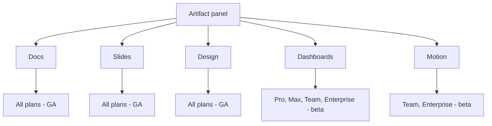

<LevelBadge level="beginner" />

<VerifyNote lastVerified="2026-10-20" source="https://support.claude.com/en/articles/17153992-what-are-artifacts-and-how-do-i-use-them">
Announced **October 8, 2026**. **Claude Dashboards** is in beta on **Pro, Max, Team and Enterprise**; **Claude Motion** is in beta on **Team and Enterprise** only. On the same day **Docs, Slides and Design left beta and became available on every plan, including Free** — on Enterprise they turned on by default on **October 15, 2026**. Both betas are off by default on Enterprise until an owner enables them. Availability and connector lists move quickly — confirm in the Help Center before you build on anything here.
</VerifyNote>

Two new **templates** landed in the artifact panel on October 8, 2026, and they are not variations on the ones already there. **Claude Dashboards** reaches *outside* the conversation into your data warehouse. **Claude Motion** produces something the other templates cannot: a moving image — and it produces it as code, not as video.

The same announcement quietly ended the beta on **Docs, Slides and Design**, which are now on every plan including Free. If you read an AILmanac page (or anyone else's guide) written before October 8 saying those three are "paid, beta," that sentence is now wrong.

<Callout type="objectives" items={[
  "Tell Dashboards and Motion apart from the templates you already have, and from a plain artifact",
  "Know exactly which plan gets which, and what an Enterprise owner has to switch on",
  "Understand the one mechanism behind each: a SQL query per chart, and an animation compiled from editable code",
  "Avoid the sharing trap — who sees what when you share a dashboard, and why a connector-backed artifact can never have a public link",
  "Recognize the three jobs these are the wrong tool for",
  "Act on the December 14, 2026 Claude Design deadline before it passes"
]} />

## The five templates, at a glance

| Template | What it produces | Plans | Status |
| --- | --- | --- | --- |
| **Docs** | A living, multi-tab document | All, incl. Free | GA |
| **Slides** | A presentable deck | All, incl. Free | GA |
| **Design** | Visuals, mockups, prototypes | All, incl. Free | GA |
| **Dashboards** | Charts driven by live queries against your data | Pro, Max, Team, Enterprise | Beta |
| **Motion** | A short animation, exported as MP4 | Team, Enterprise | Beta |

On **Enterprise**, both new templates are **off until an owner turns them on** in organization settings, under Artifacts — and an owner can narrow access to specific groups with custom roles. On **Team**, Motion is **on by default**.

## Claude Dashboards

### The mechanism, in one sentence

You ask a question in plain language; **Claude writes a SQL query for each chart and runs it against your data source.** That is the whole product, and understanding it explains every strength and every limit that follows.

Supported data warehouses: **Amazon Redshift, BigQuery, ClickHouse, Databricks and Snowflake**. It can also read apps you have already connected to Claude, **Salesforce** being the headline one.

### Why the per-chart query matters

Because each chart is backed by a named query rather than a model's recollection, a dashboard is **auditable in a way a chat answer is not**. Every chart shows **its own query** and **when its data was last refreshed**. That turns the usual trust problem inside out: instead of asking "did Claude hallucinate this number," you click the chart and read the SQL that produced it.

This is the single habit worth forming on day one.

<Steps items={[
  {title: "Ask for the decision, not the chart", body: "\"Build a dashboard of this quarter's pipeline by region\" gets you a chart. \"I need to decide where to move two reps next quarter — show me what would tell me that\" gets you a chart plus the comparison that makes it actionable. Anthropic's own guidance is to say what you want to know, not just what to plot."},
  {title: "Name the tables or the app", body: "Say where the data lives. Pointing at a specific warehouse table or connected app is the difference between one query and three guesses."},
  {title: "Open every chart's query before you trust the number", body: "This is the step people skip. Read the SQL: check the date range, the filter, the join, and whether it counts rows or sums a column. A correct-looking number from the wrong filter is the actual failure mode here, not invention."},
  {title: "Refine conversationally", body: "\"Add a filter for region,\" \"split new versus renewal,\" \"use fiscal quarters.\" Claude rewrites the query rather than redrawing a static picture."},
  {title: "Hand off when it gets deep", body: "Anthropic's framing is explicit: dashboards are made for quick, exploratory questions. When a question needs real analysis, send the dashboard onward to a tool built for it."}
]} />

<PromptCard title="A dashboard brief that produces something you can act on">{`Build me a dashboard from our Snowflake warehouse (schema: SALES_PROD).

The decision I'm making: which two regions get the next headcount.

Show me:
  1. Closed-won revenue by region, last 4 fiscal quarters, as a trend
  2. Win rate by region over the same period
  3. Average deal cycle in days by region
  4. Open pipeline by region, split new business vs renewal

Rules:
- Use fiscal quarters, not calendar.
- Exclude deals marked is_test = true.
- For every chart, label the exact table you queried.
- If a field I named doesn't exist, say so and ask — do not substitute
  a similar-sounding column.`}</PromptCard>

That last rule earns its place. The nastiest dashboard error is not a broken chart — it is a plausible chart built on `amount` when you meant `amount_arr`.

### Sending a dashboard somewhere else

A dashboard is a starting point, not a home. Anthropic lists onward destinations including **Amplitude, Grafana, Hex, Mixpanel, Omni, Perplexity, PostHog and Sigma**, with **Databricks Genie, Looker, monday.com and Tableau** named as coming.

Read that list as a statement of intent: Dashboards is positioned as the **fastest way to ask a question**, and explicitly not as a replacement for the BI tool where your governed metrics live.

### The sharing model — read this before you share anything

Dashboards start **private to you**. Sharing one makes it an artifact that calls a connector, and connector-backed artifacts follow rules that surprise nearly everybody:

<Callout type="warning" items={[
  "Queries run as the viewer, not as you. Per Anthropic: \"When someone opens your artifact, it connects to their connectors and data sources.\" Two colleagues can open the same dashboard and legitimately see different numbers.",
  "A viewer without access sees an error, not your data: \"If they don't have access to an underlying data source, that part of the artifact shows an error instead of your data.\" That is the feature working correctly — it is also why your dashboard looks broken to the person you sent it to.",
  "There is no public link. \"There are no external or public links and no per-person recipient selection. Anyone in your organization who has the link can open the artifact.\" Live data and no-login external access are mutually exclusive on the same page.",
  "Connecting apps to an artifact is a web-and-desktop capability on Pro, Max, Team and Enterprise. Don't plan a mobile-first review loop around it."
]} />

The practical consequence: **a dashboard is an internal instrument, not a client deliverable.** If an outside recipient needs the numbers, export the figures into a Doc, a deck, or a generated file and send that.

## Claude Motion

### Not a video model

This is the fact that most coverage gets wrong, so it is worth stating plainly: **Motion does not generate video.** Claude writes **editable code** that animates text, numbers, shapes, images and charts, and the artifact plays like a short video. The direct consequence, in Anthropic's words, is that it **cannot create realistic footage or people**.

That restriction is also the whole advantage. Because the animation *is* a program:

- You can change **one word, one number or one timing value** and everything else stays exactly as it was.
- The same brief, re-rendered after a data correction, is still the same animation — not a new roll of the dice.
- You can direct it in prose ("slow down the second scene") or edit it directly in the editor.

If that mechanism sounds familiar, it is the same idea as the broader [code-driven explainer-video pipeline](/docs/models/ai-explainer-videos-code-driven) — Motion is the first-party, no-setup version of it.

### Using it well

<Steps items={[
  {title: "Choose it over a deck only when motion carries meaning", body: "A sequence, a process, a value changing over time, a walkthrough of steps. If the content is a list, make Slides instead — animating a list is slower to produce and slower to read."},
  {title: "State audience, venue and length up front", body: "\"30 seconds, for an all-hands, playing on a big screen behind me\" and \"90 seconds, for new-customer onboarding email\" produce legitimately different animations. Attach the source report or data instead of retyping it."},
  {title: "Create it from chat, or pick the template", body: "Ask in any conversation, choose Output then Motion in the message box, or start from a Motion template in the Artifacts tab. Pick explicitly when Claude keeps producing a deck."},
  {title: "Iterate on one thing at a time", body: "\"Slow down the second scene,\" \"make the revenue figure land after the chart finishes drawing.\" Single changes land reliably; a list of five rarely does."},
  {title: "Export as MP4 and finish elsewhere if needed", body: "Anthropic names Adobe, Descript, HeyGen, Higgsfield, invideo, Luma AI and Runway as tools you can open the output in, with Canva and Captions listed as coming. Voiceover, captions and music are not documented as Motion features — plan to add them downstream."}
]} />

<PromptCard title="Brief an animation that doesn't need a second attempt">{`Turn the attached Q3 report into a 30-second animated explainer.

Audience: the whole company at an all-hands, on a projector behind
a speaker. It plays once, with no narration from the file itself.

Structure, four scenes:
  1. The one number that matters (revenue, with last quarter for contrast)
  2. Where the growth came from — animate the regional chart drawing in
  3. The one thing that got worse, stated plainly
  4. What we're doing about it next quarter, three short lines

Constraints:
- Readable from the back of a room: large type, high contrast,
  no more than seven words on screen at once.
- No decorative motion. Every movement should mean something changed.
- Use only figures from the attached report. If a number I asked for
  isn't in it, leave the slot empty and tell me.`}</PromptCard>

## When these are the wrong tool

An honest reference says what a feature is bad at. Three cases:

| You want… | Don't use | Use instead |
| --- | --- | --- |
| A governed metric your whole company reports on | Dashboards — it answers questions, it does not define metrics | Your BI layer; send the dashboard there |
| A live data page a client opens without logging in | Dashboards — connector-backed artifacts have no public link | Export the figures into a [Doc or deck](/docs/claude-app/one-claude-docs-and-slides), or a [generated file](/docs/claude-app/generating-files) |
| Footage, a presenter, a talking head | Motion — there is no video model behind it | A video tool; Motion's MP4 can be a component inside it |

And one cost note that applies to both: **there is no separate price.** Dashboards and Motion count toward your plan's usage limits like anything else, and Anthropic flags that longer or more complex animations use more of your allowance. The [plans and billing](/docs/claude-app/plans-and-billing) page has the general shape.

## A deadline worth putting in your calendar

The October 8 changes came with a sunset. **The standalone Claude Design site closes on December 14, 2026**, after which `claude.ai/design` simply takes you to Claude.

If your team ever used it, this is a real to-do with a date on it:

<Steps items={[
  {title: "Migrate design systems from the Artifacts page", body: "Open Artifacts in Claude and click \"Migrate team design systems,\" from the banner or the Claude Design menu. Each migrated design system keeps its owner and the people it was shared with. Anyone who can use Claude Design can start the migration — it is not owner-only."},
  {title: "Know what will not come across", body: "Empty design systems and ones built from a built-in starter theme are not migrated. Neither are your chats with Claude, nor comments on projects and design systems — those stay in the standalone version and are deleted when it closes."},
  {title: "Save anything you need out of chats and comments", body: "This is the irreversible part. Public links to projects in the standalone version also stop working after it closes."},
  {title: "Check one visibility side effect", body: "A published, non-private design system becomes visible organization-wide after migrating. Review which ones that applies to before you click."},
  {title: "Enterprise: confirm the toggles first", body: "Artifacts must be enabled, and on Enterprise design systems are off by default until an administrator turns them on. Do that before the migration, not after."}
]} />

## Terms worth knowing

<Flashcards cards={[
  {front: "Template", back: "A starting shape for an artifact, not a separate app. There are now five: Docs, Slides, Design (all GA, every plan) plus Dashboards and Motion (both beta)."},
  {front: "Claude Dashboards", back: "A beta template on Pro, Max, Team and Enterprise. You ask in plain language; Claude writes a SQL query per chart and runs it against Redshift, BigQuery, ClickHouse, Databricks, Snowflake, or a connected app such as Salesforce."},
  {front: "Per-chart query", back: "Every dashboard chart exposes the SQL that produced it, plus when its data was last refreshed. Reading it is how you verify a number instead of trusting it."},
  {front: "Claude Motion", back: "A beta template on Team and Enterprise that produces a short animation as editable code — not generated video — and exports as MP4. It cannot create realistic footage or people."},
  {front: "Connector-backed artifact", back: "An artifact that calls a connector when viewed. Its queries run with the viewer's own connections, and it can never be given an external or public link."},
  {front: "Quick, exploratory questions", back: "Anthropic's own scoping for Dashboards. It is a fast way to ask, not a replacement for the BI layer where governed metrics live."},
  {front: "December 14, 2026", back: "The date the standalone Claude Design site closes. Migrate design systems from the Artifacts page before then; chats, comments and public project links from the standalone version are deleted."}
]} />

## Quiz

<Quiz questions={[
  {q: "You build a dashboard from your Snowflake warehouse and share it with a teammate who has narrower warehouse permissions than you. What do they see?", options: ["Your numbers, because the dashboard caches the creator's results", "Their own numbers where they have access, and an error on the parts they don't", "Nothing — sharing a connector-backed artifact isn't supported", "A request-access prompt sent to you for approval"], answer: 1, explain: "A shared artifact connects to the viewer's own connectors and data sources, so two people can legitimately see different results. Where a viewer lacks access to an underlying source, that part of the artifact shows an error instead of your data."},
  {q: "A client asks for a link to your live dashboard that they can open without a Claude account. What's the supported path?", options: ["Generate a public link from the Share dialog", "Publish it as a read-only external artifact", "There is no public link for a connector-backed artifact — export the figures into a doc, deck or file and send that", "Downgrade the dashboard to a snapshot, then share publicly"], answer: 2, explain: "Connector-backed artifacts have no external or public links and no per-person recipient selection — anyone in your organization with the link can open it, and nobody outside can. Live data and no-login external access are mutually exclusive on the same page."},
  {q: "Which statement about Claude Motion is true?", options: ["It generates video with a video model, so it can produce realistic presenters", "It writes editable code that animates text, charts and shapes, so it cannot produce realistic footage or people", "It renders Slides into video automatically", "It is available on every plan, including Free"], answer: 1, explain: "Motion writes code rather than calling a video-generation model. That is why it cannot create realistic footage or people — and also why you can change one word, number or timing value without disturbing the rest. It is in beta on Team and Enterprise only."},
  {q: "You're on the Free plan. Which of these can you use today?", options: ["Dashboards, because it left beta on October 8", "Motion, because it's on by default", "Docs, Slides and Design — all three left beta on October 8 and are on every plan including Free", "None of the templates"], answer: 2, explain: "October 8, 2026 moved Docs, Slides and Design out of beta onto every plan including Free (on Enterprise they turned on by default on October 15). Dashboards stayed in beta on paid plans, and Motion is beta on Team and Enterprise only."}
]} />

<Callout type="takeaways" items={[
  "October 8, 2026: Dashboards and Motion arrived in beta; Docs, Slides and Design left beta and reached every plan including Free. Any guide still calling those three 'paid, beta' is out of date.",
  "Dashboards writes a SQL query per chart. Open the query before you trust the number — the real failure mode is a correct-looking figure from the wrong filter or column.",
  "Shared dashboards run as the viewer. Different people see different data, and a viewer without access sees an error — by design.",
  "No connector-backed artifact can have a public link. A dashboard is an internal instrument; for external recipients, export.",
  "Motion is code, not video: endlessly editable and perfectly repeatable, but it can never produce footage or people. No voiceover or captions documented — add those downstream.",
  "Anthropic scopes Dashboards to quick, exploratory questions and names onward destinations like Grafana, Hex and Sigma. Treat it as the fastest way to ask, not as your BI layer.",
  "Calendar item: the standalone Claude Design site closes December 14, 2026. Migrate design systems from the Artifacts page, and save chats and comments first — those are deleted."
]} />

## Sources & further reading

- Anthropic — [Build live dashboards and animate explainers with Claude](https://claude.com/resources/articles/dashboards-and-motion) (announcement, October 8, 2026; connector and onward-destination lists)
- Anthropic Help Center — [What are artifacts and how do I use them?](https://support.claude.com/en/articles/17153992-what-are-artifacts-and-how-do-i-use-them) (the five templates and their exact plan availability)
- Anthropic Help Center — [Get started with Claude Dashboards](https://support.claude.com/en/articles/17454700-get-started-with-claude-dashboards) (creation, per-chart queries, sharing, scope and usage limits)
- Anthropic Help Center — [Get started with Claude Motion](https://support.claude.com/en/articles/17454997-get-started-with-claude-motion) (creation, editing, MP4 export, plan and org settings)
- Anthropic Help Center — [Use live artifacts](https://support.claude.com/en/articles/14729249-use-live-artifacts-in-claude-cowork) (whose connections run on view, and why there is no public link)
- Anthropic Help Center — [Migrate from standalone Claude Design to Claude](https://support.claude.com/en/articles/17440474-migrate-from-standalone-claude-design-to-claude) (the December 14, 2026 closure and what is not migrated)

## Next

- [Artifacts: Live, Runnable Outputs](/docs/claude-app/artifacts) — the panel all five templates render into
- [One Claude: The Merge, Claude Docs & Claude Slides](/docs/claude-app/one-claude-docs-and-slides) — the three GA templates in depth, and their limits
- [Connectors](/docs/claude-app/connectors) — wiring the data sources Dashboards queries
- [Data Analysis playbook](/docs/playbooks/data-analysis) — the analysis work a dashboard hands off to
