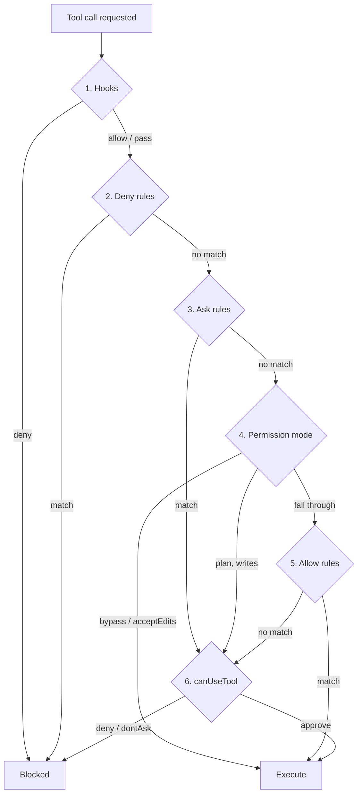

# Agent SDK Permissions: the Six-Step Order

> Source: https://derob98.github.io/ailmanac/docs/claude-code/agent-sdk-permissions · AILmanac (CC BY 4.0) · last verified 2026-10-21

Every permission bug in a headless agent is an order bug. The six steps the Agent SDK evaluates — which ones can only deny, which can only allow, and the five ways allowedTools silently does nothing.

<LevelBadge level="advanced" />

<Callout type="objectives" items={[
  "The six steps the Agent SDK walks for every tool call, in order",
  "Which steps can only deny, which can only allow, and which can do both — the mental model that makes the rest obvious",
  "Why a tool approved early never reaches your canUseTool callback, and what to use instead when a check must run on every call",
  "The five configurations where allowedTools looks like a lock and isn't",
  "How deny rules differ when you name a tool versus scope a pattern inside it",
  "What a subagent inherits — and the one mode it refuses to inherit",
  "The circuit breaker no rule, mode, or hook can override"
]} />

Most people configure an agent's permissions the way they'd configure a firewall: write the rules, assume the most specific one wins. The Claude Agent SDK does not work that way. It walks a **fixed six-step pipeline** for every tool call, and each step has a different *power* — some can only block, some can only approve, and only two can do either.

Get the order wrong and you ship an agent that looks locked down and isn't. This is the most common class of harness bug, and it is almost never a typo in a rule.

<VerifyNote lastVerified="2026-10-21" source="https://code.claude.com/docs/en/agent-sdk/permissions">
The evaluation order, mode behaviors, and version gates below are from Anthropic's Agent SDK permissions reference and the permission-modes reference. Permission surfaces change often and several behaviors are gated on specific Claude Code versions (noted inline) — re-check both pages before relying on a carve-out.
</VerifyNote>

## The six steps

<Steps items={[
  {title: "Hooks", body: <>Your <code>PreToolUse</code> hook runs <strong>first</strong>, before every other check. A hook deny is final — it blocks the call even in <code>bypassPermissions</code> mode. A hook <code>allow</code>, by contrast, is <em>not</em> final: steps 2 and 3 still run.</>},
  {title: "Deny rules", body: <>From <code>disallowedTools</code> and <code>settings.json</code>. A match blocks the call in every mode, <code>bypassPermissions</code> included.</>},
  {title: "Ask rules", body: <>From <code>settings.json</code>. A match does not approve or block — it <em>routes</em> the call down to step 6, your callback, even in <code>bypassPermissions</code> mode.</>},
  {title: "Permission mode", body: <>The active mode gets its say here. <code>bypassPermissions</code> approves what reaches it; <code>acceptEdits</code> approves in-scope file operations; <code>plan</code> forces file-edit and shell-write tools down to your callback regardless of allow rules. Other modes fall through.</>},
  {title: "Allow rules", body: <>From <code>allowedTools</code> and <code>settings.json</code>. A match approves the call. Calls the tool approves on its own resolve here too, with no rule needed — a file read inside your working directories, a read-only Bash command.</>},
  {title: "canUseTool", body: <>Anything still unresolved reaches your callback for a decision. In <code>dontAsk</code> mode this step is skipped and the call is <strong>denied</strong>.</>}
]} />

## The model that makes it make sense

Forget precedence. Ask instead: *what is this step allowed to do?*

| Step | Can deny | Can approve | Can route to your callback |
|---|---|---|---|
| **1. Hooks** | Yes — final, survives `bypassPermissions` | Yes, but steps 2–3 still run | — |
| **2. Deny rules** | Yes — final, survives `bypassPermissions` | No | — |
| **3. Ask rules** | No | No | Yes — survives `bypassPermissions` |
| **4. Permission mode** | No | Yes (`bypassPermissions`, `acceptEdits`) | Yes (`plan`, for writes) |
| **5. Allow rules** | No | Yes | No |
| **6. canUseTool** | Yes | Yes | — |

Three consequences fall straight out of that table, and they explain nearly every surprise:

- **Deny beats everything.** Deny rules and hook denials sit upstream of the mode, so there is no mode that unlocks them. This is the only mechanism you can rely on to *remove* capability.
- **Allow beats nothing.** Allow rules sit at step 5, *below* the mode. They cannot restrict a permissive mode — they only pre-approve work that would otherwise have prompted.
- **Your callback is the last resort, not the gate.** It runs only on calls nothing above it resolved. Every check you put inside it is skipped for anything approved earlier.

<Callout type="warning">
If you are writing security checks inside `canUseTool`, you have put them in the wrong place. A call approved by an allow rule, by `acceptEdits`, or by `bypassPermissions` never reaches the callback — your check does not fail, it simply does not run. Checks that must apply to **every** call belong in a `PreToolUse` hook, which runs at step 1 and whose denial survives even `bypassPermissions`.
</Callout>

## Five ways `allowedTools` isn't a lock

`allowedTools` reads like an allowlist. It is a **pre-approval list**. Anything you leave off it is still available to Claude; it just falls through to the mode and then to your callback. Five specific traps:

### 1. It does not constrain `bypassPermissions`

This is the big one. Unlisted tools match no allow rule, so they fall through to step 4 — where `bypassPermissions` approves them.

<PromptCard title="Looks locked down. Approves Bash, Write, and Edit.">{`// WRONG — bypassPermissions approves everything unlisted
const options = {
  allowedTools: ["Read"],
  permissionMode: "bypassPermissions"
};`}</PromptCard>

If you need `bypassPermissions` but want specific tools gone, the only lever that works is `disallowedTools` — it lands at step 2, upstream of the mode.

### 2. `dontAsk` is the mode that makes an allowlist exact

To get "these tools and nothing else," pair the pre-approval with a mode that denies instead of prompting.

<PromptCard title="A read-only agent, for real">{`const options = {
  allowedTools: ["Read", "Glob", "Grep"],
  permissionMode: "dontAsk"
};`}</PromptCard>

Listed tools run. Anything else that would have prompted is denied, and `canUseTool` is never called. Note what still runs without being listed: read-only Bash commands, file reads inside your working directories, and tools like `Agent` that don't ask before running. To remove one of those from the request entirely, add its bare name to `disallowedTools`.

### 3. A bare name approves the *whole* tool

Coverage depends on the entry's shape, and the difference is large:

| Entry | What it pre-approves |
|---|---|
| `"Read"` | Every `Read` call (except reads from network paths) |
| `"Bash(npm test *)"` | Only matching `Bash` calls. Other `Bash` calls still fall through to your callback |

Scoping is the whole game. `"Bash"` on an allow list is a different security posture from `"Bash(npm test *)"`, and the type system will not tell you.

### 4. Unanchored globs are silently ignored

Allow rules accept tool-name globs **only** after a literal `mcp__<server>__` prefix, and the server segment must be glob-free.

| Entry | Effect |
|---|---|
| `"mcp__puppeteer__*"` | Works — every tool from the `puppeteer` server |
| `"mcp__github__get_*"` | Works — that server's `get_` tools |
| `"*"` or `"mcp__*"` | **Ignored.** Pre-approves nothing |

The last row fails open in the quiet direction — you get more prompts, not fewer permissions — but if you wrote it expecting a blanket approval, you will spend an afternoon on it.

### 5. TypeScript warns you, on a channel you aren't listening to

If you pass a `canUseTool` callback in a configuration where the SDK knows the callback will be shadowed, it emits a one-time Node process warning with the code `CLAUDE_SDK_CAN_USE_TOOL_SHADOWED`. Two configurations trigger it: `permissionMode: "bypassPermissions"`, and each **bare** `allowedTools` entry such as `"Read"`.

<PromptCard title="Surface the shadowing warning in your own logs">{`process.on("warning", (w) => {
  if (w.code === "CLAUDE_SDK_CAN_USE_TOOL_SHADOWED") {
    console.error("[harness] canUseTool will be skipped:", w.message);
  }
});`}</PromptCard>

Scoped entries like `Bash(ls *)` and `acceptEdits` mode don't trigger it, and allow rules coming from settings files are invisible to the check — so a clean run is not proof your callback is reachable.

## Deny rules: naming a tool vs. scoping inside it

Deny entries behave differently depending on their shape, and the difference is about *what Claude can see*, not just what it can do.

| Entry | Effect |
|---|---|
| `disallowedTools: ["Bash"]` | The `Bash` tool definition is **removed from the request**. Claude never sees the tool and cannot attempt it |
| `disallowedTools: ["Bash(rm *)"]` | `Bash` stays available. Calls matching `rm *` *as written* are denied in every mode. Other `Bash` calls — including `/bin/rm` — fall through |
| `disallowedTools: ["*"]` | Every tool definition is removed. Tool-name globs **are** supported in deny rules: `"mcp__*"` matches every MCP tool across all servers |

Two things to internalize. First, the bare form is strictly stronger: removing the tool from context beats denying its calls, because a tool Claude can't see generates no failed attempts and no retries down a different path. Second, `Bash(rm *)` matches **the string as written** — the `/bin/rm` gap is not a bug, it is the documented scope of a textual rule. Treat scoped Bash denials as guardrails against the obvious, never as a security boundary.

### Path rules: four anchors and one dead letter

Scoped `Read` and `Edit` rules take a path pattern, and two details catch everyone:

- **`Edit(path)` governs every built-in tool that writes files** — including `Write` and `NotebookEdit`. A `Write(path)` rule is **never matched** by the file permission checks. If you wrote `Write(//secrets/**)` you wrote nothing.
- **A double slash means the filesystem.** `Edit(//secrets/**)` blocks writes anywhere under `/secrets` on disk. A single leading slash anchors at the rule's *source* instead — for a rule passed through `allowedTools` or `disallowedTools`, that's the session's working directory, so `Edit(/secrets/**)` does **not** protect `/secrets` on disk.

<PromptCard title="Block writes to a real filesystem path">{`// // = absolute filesystem path. One slash anchors at the rule's source.
const options = {
  disallowedTools: ["Edit(//etc/**)", "Edit(//secrets/**)", "Read(//secrets/**)"]
};`}</PromptCard>

## The modes, and what each one actually buys

<Flashcards cards={[
  {front: "default", back: "No mode-based auto-approvals. Calls needing approval that match no allow rule go to canUseTool. Since Claude Code v2.1.302, this is where your app starts unless you set a mode or a settings file provides permissions.defaultMode."},
  {front: "dontAsk", back: "Any call that would prompt is denied — canUseTool is never called. Pre-approved tools and no-approval-needed calls still run. The mode that turns a pre-approval list into an exact allowlist."},
  {front: "acceptEdits", back: "Auto-approves file edits plus mkdir, touch, rm, rmdir, mv, cp, sed — but only inside the working directory or additionalDirectories. Non-filesystem Bash still needs normal permissions."},
  {front: "plan", back: "Read-only tools behave as in default. File edits are never auto-approved — not by an allow rule, not by a PreToolUse allow. They reach canUseTool. Since v2.1.212, file-modifying shell commands do too."},
  {front: "bypassPermissions", back: "Approves what reaches step 4. Hooks, deny rules, and ask rules still run upstream. On Linux and macOS it refuses to start as root or under sudo outside a recognized sandbox."},
  {front: "auto", back: "A classifier model reviews actions such as shell commands and network requests and allows or blocks each one. Requires a supported model; switching to an unsupported one drops the session to default mode."}
]} />

Two behaviors worth pinning down because they bite in production:

**`auto` mode degrades silently-ish.** If you switch to a model `auto` doesn't support via `setModel()` or `applyFlagSettings()`, the session changes to `default` mode. You get a `system` message with subtype `status` and `permissionMode: "default"` — typed as `SDKStatusMessage` in TypeScript — and from then on calls reach your callback. Switching the model back does **not** restore `auto`; you must call `setPermissionMode("auto")` again. (v2.1.299 or later.)

**Subagents inherit, with one refusal.** A subagent runs in the parent's permission mode unless you set `permissionMode` on its `AgentDefinition` *and* the parent is in `default`, `dontAsk`, or `plan`. Even then, Claude Code never applies a `"bypassPermissions"` value from an `AgentDefinition` — a subagent runs in `bypassPermissions` only when the parent session itself does (v2.1.267+). That carve-out exists because subagents often have different system prompts and looser behavior than your main agent, so inheriting bypass would hand full autonomous system access to the least-supervised part of your harness. See [Subagents](/docs/claude-code/subagents).

## The circuit breaker nothing overrides

`rm` and `rmdir` removals targeting a **critical path** are never approved by an allow rule or by a `PreToolUse` hook returning `allow`. Critical paths are the filesystem root, any direct child of the root (`/usr`, `/etc`, `/data`), your home directory, Windows drive roots and their top-level directories, and your working directory and its parents. A matching deny rule still blocks the command outright; the point is that no *approval* path can clear it.

What happens instead depends on the mode:

| Mode | Outcome for a critical-path removal |
|---|---|
| `default`, `acceptEdits`, `bypassPermissions` | Asks for approval |
| `auto` | Asks in the terminal, with a time limit. **Elsewhere — including every Agent SDK session — denies it** |
| `dontAsk` | Denies it |

That middle row is the one that matters for a harness: an Agent SDK session in `auto` mode denies critical-path removals **without calling your callback**, and tells Claude to report what it wanted to delete instead. If your agent suddenly starts narrating deletions it didn't perform, this is why — not a model regression.

The check also reaches inside constructs where an unset variable would expand to a root deletion: `rm -rf "$DIR"/*`, `rm -rf "$1"/*` with nothing binding `$1`, `D=$(pwd); rm -rf "$D"`, and removals nested in subshells, command substitutions, or `bash -c` scripts. The documented fix is to guard the expansion so the shell errors on empty rather than deleting the root.

<PromptCard title="Make a glob removal pass the critical-path check">{`# Flagged: expands to a removal from / when DIR is unset
rm -rf "$DIR"/*

# Passes: :? makes the shell exit with an error instead
rm -rf "\${DIR:?}"/*`}</PromptCard>

## Other things no mode auto-approves

Beyond critical-path removals, these always escape a permissive mode — they reach your callback in most modes, and are **denied** in `dontAsk` because that mode never prompts:

- Tools matched by an explicit **ask rule**
- **`AskUserQuestion`**, and MCP tools whose server sets `_meta["anthropic/requiresUserInteraction"]` (v2.1.199+)
- **Connector tools your organization set to `ask`** — the callback receives the reason `Your organization requires approval for this tool`
- Reads from **network paths**, which no allow rule approves

So "I set `bypassPermissions`, why am I still being asked?" has four answers before you reach for a bug report. And in the TypeScript SDK there is a fifth lever: `permissionPrompts: "none"` (v2.1.259+) stops your callback from being called at step 6 entirely — a `PermissionRequest` hook still gets a chance, and if it declines to decide, the call is denied.

## Two recipes

### A gate that actually runs on every call

When a check must be unconditional — audit logging, a secret-path scanner, a cost ceiling — put it at step 1.

A `PreToolUse` hook has two ways to block, and both are available to a command hook you can also run outside the SDK: **exit code 2**, where whatever you wrote to stderr becomes the reason Claude sees, or **JSON on stdout** with a `permissionDecision` of `"deny"` plus a `permissionDecisionReason`.

<PromptCard title="PreToolUse hook: the only unconditional gate">{`# Runs before deny rules, ask rules, the mode, and allow rules.
# A deny here survives bypassPermissions.
# Wire it to hooks.PreToolUse in settings.json, or pass it in the SDK's hooks option.
jq -e '.tool_input | tostring | test("AKIA|BEGIN PRIVATE KEY|ghp_")' >/dev/null \\
  && { echo "secret material in tool input" >&2; exit 2; } || exit 0`}</PromptCard>

The in-process callback form the TypeScript and Python SDKs accept returns the same decision fields rather than an exit code. Confirm the wrapper shape against the [hooks reference](/docs/claude-code/hooks) for your SDK version before shipping — the evaluation *position* is the stable part, the handler signature less so.

### Tightening as trust builds

Permission mode is not a one-shot decision. In a streaming session you can start restrictive and loosen it after reviewing the agent's first moves, with `set_permission_mode()` in Python or `setPermissionMode()` in TypeScript. The new mode applies immediately to all subsequent tool requests.

<PromptCard title="Start in default, loosen after reviewing the approach">{`const q = query({
  prompt: "Refactor the auth module",
  options: {permissionMode: "default"}
});

// ...review the first turns, then:
await q.setPermissionMode("acceptEdits");`}</PromptCard>

The inverse is the more interesting move for a long run: tighten to `dontAsk` once the agent enters a phase that should need no new capability.

## Where the rules can come from

Allow, deny, and ask rules can also live declaratively in `.claude/settings.json`. The SDK reads them when the `project` setting source is enabled, which it is for default `query()` options — **but if you set `settingSources` explicitly, you must include `"project"` or your settings-file rules silently stop applying.** This is a classic incident: someone adds `settingSources: ["user"]` for reproducibility and quietly deletes the project's entire deny list. See [Settings](/docs/claude-code/settings) for the file precedence, and remember that settings-file allow rules are also invisible to the `CLAUDE_SDK_CAN_USE_TOOL_SHADOWED` check.

<Quiz questions={[
  {
    q: "You set allowedTools: [\"Read\"] and permissionMode: \"bypassPermissions\". Can the agent run Bash?",
    options: [
      "No — only Read is on the allowlist",
      "Yes — Bash matches no allow rule, so it falls through to the mode, which approves it",
      "Only read-only Bash commands",
      "Yes, but canUseTool is called first"
    ],
    answer: 1,
    explain: "Allow rules are step 5, below the mode at step 4. allowedTools pre-approves; it never restricts. To block a tool under bypassPermissions, use disallowedTools, which lands at step 2 — upstream of the mode."
  },
  {
    q: "A security check must run on every single tool call, no exceptions. Where does it belong?",
    options: [
      "In the canUseTool callback",
      "In an ask rule in settings.json",
      "In a PreToolUse hook",
      "In permissionMode: \"dontAsk\""
    ],
    answer: 2,
    explain: "Hooks are step 1 — before deny rules, the mode, and allow rules — and a hook denial survives even bypassPermissions. canUseTool is step 6 and is skipped entirely for anything approved earlier, so checks placed there silently do not run for auto-approved tools."
  },
  {
    q: "Which deny entry stops Claude from even seeing the Bash tool?",
    options: [
      "disallowedTools: [\"Bash(*)\"]",
      "disallowedTools: [\"Bash\"]",
      "allowedTools: [] with permissionMode: \"dontAsk\"",
      "A deny rule in settings.json for Bash(rm *)"
    ],
    answer: 1,
    explain: "A bare-name deny rule removes the tool definition from the request before evaluation begins, so Claude never sees it. A scoped rule like Bash(rm *) leaves Bash available and only denies calls matching that pattern as written — /bin/rm falls through."
  }
]} />

<Callout type="takeaways" items={[
  "Six steps, fixed order: hooks, deny rules, ask rules, permission mode, allow rules, canUseTool.",
  "Deny is upstream of the mode and therefore absolute. Allow is downstream and can only ever pre-approve.",
  "allowedTools is a pre-approval list, not an allowlist — pair it with dontAsk to make it exact.",
  "Checks in canUseTool do not run for auto-approved calls. Unconditional checks go in a PreToolUse hook.",
  "Edit(path) covers Write and NotebookEdit; a Write(path) rule matches nothing. // anchors at the filesystem, a single / at the rule's source.",
  "A subagent inherits the parent's mode but never inherits a bypassPermissions value from its own definition.",
  "Critical-path rm removals are a circuit breaker no allow rule or hook allow can clear — and an Agent SDK session in auto mode denies them without calling you.",
  "Setting settingSources without \"project\" silently drops every rule in .claude/settings.json."
]} />

## Next

- [Permissions & Permission Modes](/docs/claude-code/permissions) — the interactive side of the same system, including why `auto` became the starting mode
- [Hooks](/docs/claude-code/hooks) — step 1, the only unconditional gate in the pipeline
- [Hardening Autonomous Runs](/docs/security/hardening-autonomous-runs) — the checklist this page's primitives implement
- [Headless Mode & the Agent SDK](/docs/claude-code/headless-and-agent-sdk) — getting the loop running in the first place
