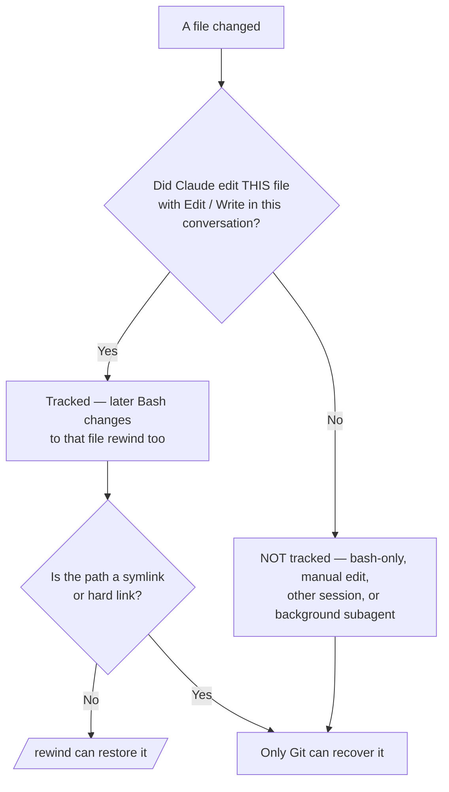

# Checkpoints & Rewind

> Source: https://derob98.github.io/ailmanac/docs/claude-code/checkpoints-and-rewind · AILmanac (CC BY 4.0) · last verified 2026-10-26

Undo Claude's edits, roll back a whole session, and compress context with /rewind — the safety net for ambitious runs.

<LevelBadge level="intermediate" />

<Callout type="objectives" items={["Understand what a checkpoint captures — and what it silently does not", "Open the rewind menu two ways and pick the right restore action every time", "Tell 'restore' (undo state) apart from 'summarize' (compress context)", "Know exactly why checkpoints complement Git but never replace it"]} />

<VerifyNote lastVerified="2026-10-26" source="https://code.claude.com/docs/en/checkpointing">
Checkpoint behavior, the rewind menu actions, the snapshot cap and retention change between releases — confirm in the official docs.
</VerifyNote>

## The big idea

When you turn Claude loose on an ambitious, wide-scale change, the scariest question is "what if it goes wrong three edits deep?" **Checkpointing** is the answer: Claude Code automatically snapshots your code before each turn you start, so you can rewind to any earlier state instead of untangling a half-finished refactor by hand.

Think of it as a **local undo for the whole session** — a safety net that lets you say "yes, try the bold approach" without fear.

## How checkpoints are created

You don't create checkpoints — they happen automatically.

<Steps items={[{title: "Every prompt that starts a turn = a checkpoint", body: "Each prompt that starts a turn captures the state of your code before Claude's file-editing tools run. No command, no config, no ceremony."}, {title: "Only the 100 most recent are kept", body: "Claude Code keeps file snapshots for the 100 most recent checkpoints in a session. Older ones are discarded, so a very long session cannot be rewound all the way back to its start."}, {title: "They persist across sessions", body: "Checkpoints are saved with the conversation, so you can still run /rewind after resuming a session, not just in the live one."}, {title: "They clean themselves up", body: "A session's file snapshots are deleted in the retention sweep, by default about 30 days after the session last saved one. Rewinding to a checkpoint whose snapshots are gone fails with 'No files were restored' — raise cleanupPeriodDays to keep them longer."}]} />

## Opening the rewind menu

There are two ways in:

<Steps items={[{title: "Run /rewind — or its aliases /checkpoint and /undo", body: "Type the slash command from the prompt. Always works. /checkpoint and /undo are aliases for the same command, so reach for whichever name comes to mind."}, {title: "Press Esc twice — but only on an empty input", body: "Double-Esc opens the rewind menu when the prompt box is empty. If there's text in it, double-Esc clears that text instead (the cleared text is saved to input history, so press Up to get it back afterward)."}]} />

<PromptCard title="Open the rewind menu">{`/rewind`}</PromptCard>

<Callout type="warning" items={["The alias names are friendlier than they are literal: /checkpoint does not take a snapshot on demand (snapshots are automatic), and /undo does not undo the last edit by itself. All three names open the same menu, where you still pick the point and the action."]} />

The menu lists **every prompt you sent this session**. Pick the point you want to act on, then choose one action.

## Restore vs. summarize: the key distinction

This is where people get confused. The menu offers two *kinds* of action:

- **Restore** actions change state on disk and/or in the conversation — they undo.
- **Summarize** actions never touch your files — they compress conversation to free up context window space.

<Callout type="warning" items={["Restore = undo (reverts code, conversation, or both). Summarize = compress context (files on disk are untouched).", "Reach for restore when an edit broke something. Reach for summarize when the session is bloated but the code is fine."]} />

### The restore actions

<Steps items={[{title: "Restore code and conversation", body: "Revert both your files and the chat history to the selected point — a clean 'rewind time' to that moment."}, {title: "Restore conversation", body: "Rewind the chat to that message but keep your current code. Useful to re-ask a question without losing edits you want to keep."}, {title: "Restore code", body: "Revert file changes but keep the conversation. Undo the edits, keep the discussion about them."}]} />

The two **code** restore options only appear when the selected checkpoint actually has tracked file changes to revert. If no file edits were captured after that point, the menu offers just **Restore conversation**, the two summarize options, and **Never mind** (which returns to the message list without changing anything).

After restoring the conversation (or choosing "Summarize from here"), the original prompt from the selected message is dropped back into the input field so you can re-send or edit it.

### The summarize actions

Both compress part of the conversation into an AI-generated summary — like a **targeted `/compact`** where you choose which side of the selected message to squeeze.

<Steps items={[{title: "Summarize from here", body: "Messages BEFORE the selected message stay intact. The selected message and everything after it become a summary. Use it to discard a side discussion while keeping early context in full detail."}, {title: "Summarize up to here", body: "Messages BEFORE the selected message become a summary; the selected message and everything after stay intact. You remain at the end of the conversation. Use it to compress early setup chatter while keeping recent work verbatim."}]} />

The original messages stay in the session transcript either way, so Claude can still reference the details, and a **Summarized conversation** marker appears where the compressed messages were. To steer what the summary focuses on, highlight a **Summarize** option with the arrow keys and type instructions where the row reads **add context (optional)**, then press Enter — picking the option with its number key summarizes immediately with no instructions.

For the whole flow, see [Context Management](/docs/claude-code/context-management) — `/rewind`'s summarize actions are a scalpel where `/compact` is a broad brush.

<Callout type="note" items={["Summarize keeps you in the same session. To branch off and try a different approach while leaving the original session intact, use /branch or claude --continue --fork-session instead."]} />

## Rewinding past a `/clear`

If you ran `/clear` earlier in the same Claude Code process, the rewind menu shows an extra entry at the top: `/resume <session-id> (previous session)`. Select it to jump back to the conversation that was active before `/clear`.

<VerifyNote lastVerified="2026-10-26" source="https://code.claude.com/docs/en/checkpointing">
That entry is available only until you exit Claude Code or resume a different session. Once it's gone, run `/resume` and pick the previous session from the list instead.
</VerifyNote>

## Where checkpoints stop — the limits that bite

Checkpoints feel magical until they don't. These gaps matter:

<Steps items={[{title: "Bash changes follow the file, not the command", body: "Tracking is per file, and a file enters it only when Claude edits it with its file-editing tools. Once that has happened, /rewind also undoes what Bash commands do to that same file afterward — a formatter or generator rewriting an already-edited file is rewindable. A file that only Bash ever touched is not tracked and stays as it is, so a file deleted by rm that Claude never edited needs Git. The menu reflects this: under each prompt it counts changes to files Claude had already edited, whatever made them."}, {title: "Most subagent edits are not restored", body: "A subagent edits with the same file tools, but your session usually doesn't capture those edits. The exception is a foreground forked skill (context: fork with background: false), which edits during your own turn and rewinds normally. With any other subagent — including a background forked skill, the default, and a background /code-review --fix run — rewinding restores only the files Claude had already edited in your conversation; the subagent's edits to other files stay, so undo those with Git. See /docs/claude-code/subagents."}, {title: "External and concurrent changes are invisible", body: "Manual edits you make outside Claude Code, and edits from other concurrent sessions, are normally not captured — unless they happen to touch the same files the current session edited."}, {title: "Mid-turn messages get no checkpoint", body: "A message you queue while Claude is working that reaches it within the running turn joins that turn instead of starting a new one, so it gets no checkpoint of its own — the rewind menu marks it 'No code restore'. To undo what followed it, rewind to the prompt that started the turn, which rewinds the whole turn, including work done before your message arrived. Selecting the marked message itself still offers Restore conversation, leaving your files as they are."}, {title: "Symlinks and hard links are skipped", body: "Restore skips any tracked path that is a symlink or hard link and warns 'Restored the code, but skipped N files'; those files keep their current contents. Dotfile-manager symlinks and pnpm hard links both hit this. Run /debug before restoring to get the skipped paths named in the debug log."}, {title: "It is session-level, not history", body: "Checkpoints are quick, local recovery. They are not commits, not branches, and not shareable with your team."}]} />

## Checkpoints vs. Git: use both

They solve different problems, so pair them.

| | Checkpoints (`/rewind`) | Git |
|---|---|---|
| Scope | One session | Whole project history |
| Granularity | Per turn-starting prompt, automatic | Per commit, deliberate |
| Tracks bash-made changes? | Only on files Claude already edited | Yes (once staged/committed) |
| Lifespan | Last 100 checkpoints, swept ~30 days after the session | Permanent |
| Shareable / collaborative | No | Yes |
| Mental model | "Local undo" | "Permanent history" |

<Callout type="tip" items={["Commit working states with Git before a risky, wide-scale run — that's your durable floor.", "Use /rewind for fast in-session recovery between commits without polluting your Git history.", "Lean on Git for files Claude never edits directly — the ones only destructive bash (rm/mv) or a background subagent touches. Rewind covers a file only once Claude has edited it with its own file tools."]} />

## When to reach for it

<Steps items={[{title: "Exploring alternatives", body: "Try a bold implementation, and if you don't like it, restore code and conversation to the fork point and try another."}, {title: "Recovering from a bad edit", body: "An edit introduced a bug three prompts ago? Restore code to just before it instead of debugging the debris."}, {title: "Iterating on a feature", body: "Experiment with variations, always knowing a known-good state is one /rewind away."}, {title: "Freeing context space", body: "A verbose debugging detour ate your context window? Summarize from the midpoint forward and keep your original instructions in full detail."}]} />

<Quiz title="Check yourself" questions={[{q: "Claude never edited `config.old.json` with its file tools, then deleted it with `rm` in a bash command. Can `/rewind` bring it back?", options: ["Yes — every change Claude makes is checkpointed", "No — that file never entered tracking, so only Git can recover it", "Yes, but only if Claude had edited that same file earlier in the conversation"], answer: 1, explain: "Tracking is per file and begins only when Claude edits that file with its file-editing tools. This one never entered tracking, so rewind leaves it gone — that's Git's job. Note the third option states the rule correctly: had Claude edited this file earlier in the conversation, the later `rm` would have been rewindable."}, {q: "Your code is fine, but a long debugging tangent has filled the context window. Which action fits?", options: ["Restore code and conversation to before the tangent", "Restore code", "Summarize from here at the start of the tangent"], answer: 2, explain: "Summarize actions compress conversation without touching files. 'Summarize from here' turns the tangent into a summary while keeping your earlier context intact — freeing context space with zero code changes."}, {q: "How is a checkpoint created?", options: ["By running /checkpoint, which snapshots your code on demand", "Automatically — every prompt that starts a turn makes one", "Only when you commit in Git"], answer: 1, explain: "Checkpointing is automatic: every prompt that starts a turn captures the pre-edit state of your code. There's no manual step — the command /checkpoint exists, but it's just an alias for /rewind and opens the menu rather than taking a snapshot. Note too that a message landing mid-turn joins the running turn and gets no checkpoint of its own."}]} />

<Flashcards title="Checkpoints & rewind vocabulary" cards={[{front: "Checkpoint", back: "An automatic snapshot of your code taken before each turn-starting prompt. Session-scoped, last 100 kept, swept ~30 days after the session."}, {front: "/rewind", back: "Opens the rewind menu listing every prompt this session, so you can restore or summarize from any point. Aliases: /checkpoint and /undo. Also reachable via double-Esc on an empty input."}, {front: "Restore action", back: "Reverts state — code, conversation, or both — to the selected point. This is 'undo'. The code options appear only when that checkpoint has tracked changes."}, {front: "Summarize action", back: "Compresses part of the conversation into an AI summary to free context. Files on disk are never touched."}, {front: "Bash blind spot", back: "Tracking is per file: it begins when Claude edits the file with its file tools, and from then on Bash changes to that file rewind too. A file only Bash ever touched is untracked — use Git."}, {front: "Subagent blind spot", back: "Only a foreground forked skill's edits rewind. Background subagents (including the default background fork) need Git."}]} />

<Callout type="takeaways" items={["Checkpoints are automatic snapshots taken before each turn-starting prompt — a local undo for the session. The last 100 are kept, then swept ~30 days after the session.", "Open the rewind menu with /rewind (aliases: /checkpoint, /undo) or double-Esc on an empty input; it lists every prompt you sent.", "Restore actions undo state (code, conversation, or both); summarize actions compress context and never touch files.", "Tracking is per file and starts when Claude edits it with its file tools — after that, even Bash changes to that file rewind. Files Claude never edited (bash-only, external, concurrent, most subagent) are not tracked, and symlinked or hard-linked paths are skipped on restore.", "Checkpoints complement Git, they don't replace it: think 'local undo' vs. 'permanent, shareable history'."]} />

## Next

- [Context Management](/docs/claude-code/context-management) — `/compact`, `/clear`, and how summarize fits the bigger picture
- [Plan Mode](/docs/claude-code/plan-mode) — investigate and approve a plan before edits run, so you rewind less often
- [Permissions](/docs/claude-code/permissions) — the other half of running ambitious tasks safely
