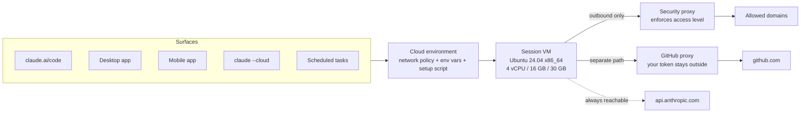

<LevelBadge level="intermediate" />

<Callout type="objectives" items={[
  "Build the right mental model: five surfaces, one saved environment, a fresh throwaway VM per session",
  "Learn the table that trips up everyone: what carries over from your machine into a cloud session, and the five things that silently do not",
  "Pick a network access level — None, Trusted, Full, Custom — and know the four kinds of traffic that bypass your allowlist anyway",
  "Give a session an API key it can use but never read, with a network secret",
  "Choose correctly between a setup script and a SessionStart hook, and stay under the ~5-minute rule that decides whether your environment gets cached",
  "Plan around the real resource and time ceilings: 4 vCPU / 16 GB / 30 GB, a 2-minute default command timeout, and a VM that pauses when you walk away",
  "Run the full round trip: claude --cloud to send work out, claude -p --cloud to steer it, claude --teleport to pull it back",
]} />

<VerifyNote lastVerified="2026-10-26" source="https://code.claude.com/docs/en/cloud-environments">
Verified against the official [Configure cloud environments](https://code.claude.com/docs/en/cloud-environments) and [Use Claude Code in the cloud](https://code.claude.com/docs/en/claude-code-on-the-web) pages. Cloud sessions are available on **Pro, Max, and Team** plans, and to Enterprise users with premium seats or Chat + Claude Code seats; if your organization uses custom roles, you also need a role carrying the cloud sessions permission. Resource ceilings are described by Anthropic as approximate and may change. Pre-installed tool versions move continuously — treat the toolchain table here as a shape, and confirm versions in a live session.
</VerifyNote>

A cloud session is a Claude Code session that runs on someone else's machine instead of yours — Anthropic's by default, or [your own runners](/docs/claude-code/self-hosted-environments) if your organization routes it there. You close the laptop; the work keeps going. There's no separate charge for the VM: a cloud session draws on the same plan usage limits as everything else you do with Claude.

That part is easy to understand. The part that costs people an afternoon is subtler: **a cloud session is not your laptop with a different hostname.** It's a fresh Ubuntu box with your *committed* repository on it and nothing else of yours. Half the configuration you've spent months tuning lives in `~/.claude/` on your machine and does not make the trip. This page is mostly about that boundary.

## The one-paragraph version

You save a **cloud environment** — a named bundle of network policy, environment variables, and a setup script. Every surface that can start a cloud session picks one of your environments. When a session starts, Anthropic provisions an isolated VM (Ubuntu 24.04 on x86_64, regardless of what you run locally), clones your repo from GitHub, runs your setup script, snapshots the filesystem so the next session skips that step, and launches Claude Code. All outbound traffic leaves through a proxy that enforces your access level. GitHub traffic takes a separate path where your real credential never enters the VM. When you stop typing, the VM pauses with its files intact; leave it long enough and it gets reclaimed, and reopening the session builds a new one.

### One environment, five surfaces

The same saved environments apply wherever you start a cloud session: your browser at claude.ai/code, the Desktop app, the Claude mobile app, your terminal via `claude --cloud`, and cloud scheduled tasks. Configure the environment once and every surface inherits it.

Two neighbors are *not* cloud sessions, and conflating them causes real confusion:

- **Remote Control** connects the web and mobile interfaces to a session running on **your own machine**. It uses your files and your network — there's no cloud environment involved.
- **`--remote-control`** is unrelated to `--cloud`, despite the similar names. `--cloud` creates a session on Anthropic's infrastructure; `--remote-control` exposes a local session to your phone.

If you don't have an environment yet, onboarding creates one called **Default**: **Trusted** network access, no variables, no setup script. On Team and Enterprise, web onboarding may instead show you a create-your-first-environment form unless an Owner has enabled **Quick setup**; keeping the form's defaults produces the same thing.

## What carries over from your machine — and what doesn't

This is the section to read twice. A cloud session starts from a **fresh clone of your repository**. The rule that explains every row below: *if it's committed, it's there; if it only exists on your machine, it isn't.*

| Your thing | In a cloud session? | Why |
| :--- | :--- | :--- |
| Repo `CLAUDE.md`, `.claude/rules/` | ✅ Yes | Part of the clone |
| Repo `.claude/skills/`, `.claude/agents/`, `.claude/commands/` | ✅ Yes | Part of the clone |
| Repo `.claude/settings.json` hooks and permission rules | ✅ In a single-repository session | Part of the clone |
| Repo `.mcp.json` MCP servers | ✅ In a single-repository session | Found from the session's working directory |
| Organization server-managed settings | ✅ Yes (not in Claude Tag sessions) | Fetched from Anthropic when the session starts |
| Skills you enabled on claude.ai | ✅ Yes | Loaded from your account, not the repo |
| **Your user `~/.claude/CLAUDE.md`** | ❌ No | Lives on your machine, not in the repo |
| **Your user `~/.claude/skills/`, `agents/`, `commands/`** | ❌ No | Same reason. Commit them to the repo's `.claude/` instead |
| **Plugins and marketplaces** | ❌ No | A cloud session installs neither `enabledPlugins` nor the marketplaces under `extraKnownMarketplaces` — from the repo or from your user settings |
| **MCP servers added at local or user scope** | ❌ No | Those write `~/.claude.json`. Re-add with `claude mcp add --scope project` and commit the resulting `.mcp.json` |
| **MDM / managed settings files on your device** | ❌ No | The session runs on an Anthropic-managed VM |
| **Transport variables** like `NODE_EXTRA_CA_CERTS` or mTLS client certs in a repo `env` block | ❌ Ignored | The hosting environment owns the session's API connection; each ignored key is noted in the session's debug log |
| **Interactive auth** like AWS SSO | ❌ No | Requires a browser login that can't run in a cloud session |

Two traps hide in that table:

- **The plugin gap is the most expensive one.** A repository that turns on a plugin in `.claude/settings.json` gets that plugin locally and nothing in the cloud. If a workflow depends on plugin-provided skills or commands, either commit the equivalents into `.claude/` or accept that cloud sessions behave differently. See [plugins and marketplaces](/docs/claude-code/plugins-marketplaces) for what lives where.
- **"Single-repository session" is load-bearing.** In an Anthropic-hosted environment, a session attached to *several* repositories loads hooks and permission rules from **none** of them, and a cloud thread inside a [project](/docs/claude-code/projects-coordinator-threads) loads only the repository root's `CLAUDE.md`, `.claude/CLAUDE.md`, and non-path-specific `.claude/rules/`. If your setup depends on a SessionStart hook, a multi-repo session won't run it — provision with a setup script instead.

### Getting your personal preferences in anyway

You don't have to push personal style rules into a shared repo. A setup script on one of **your own** environments can write the user-level memory file directly:

<PromptCard title="Setup script: personal preferences without touching the repo">{`#!/bin/bash
mkdir -p ~/.claude
cat > ~/.claude/CLAUDE.md <<'EOF'
Use conventional commit messages.
Prefer small, reviewable diffs over one large change.
EOF`}</PromptCard>

Claude Code loads that as user instructions. Confirm it worked by running `/context` in your next cloud session and looking for `/root/.claude/CLAUDE.md` under **Memory files**. Don't do this on a shared environment — it would apply to everyone in the organization.

## Network access: four levels, and the four things that ignore them

Each environment carries exactly one network access level, which governs outbound connections from the session's network.

| Level | What sessions can reach |
| :--- | :--- |
| **None** | Nothing through the session's network |
| **Trusted** (default) | An Anthropic-maintained allowlist: package registries, GitHub/GitLab/Bitbucket, container registries, major cloud SDK endpoints |
| **Full** | Any domain |
| **Custom** | Your own list, one domain per line; a leading `*.` matches every subdomain. A checkbox decides whether the Trusted defaults are included too |

Changing the level on an Anthropic-hosted environment takes effect in **existing** sessions within about a minute. You don't need to start a new one.

Now the part that matters for threat modeling. Four kinds of traffic take a path that never touches your allowlist, **whatever level you pick — including None**:

<Steps items={[
  {title: "GitHub, through its own proxy", body: "All GitHub operations in Anthropic-hosted environments route through a dedicated proxy that keeps your real credential outside the VM. Independent of the access level."},
  {title: "MCP connectors you enable", body: "Connector traffic travels through Anthropic's servers rather than the session's network, so you never add a connector's host to Allowed domains. The flip side: an allowlist does not constrain what an enabled connector can reach. Turn off connectors you don't need."},
  {title: "Hosts listed on your network secrets", body: "Sessions can reach a secret's hosts even when the access level otherwise wouldn't allow them. Adding a secret widens reachability as well as attaching a credential."},
  {title: "api.anthropic.com", body: "Claude Code's own inference requests go out even at None. Anthropic says this plainly in its isolation notes: with network access disabled, Claude Code can still talk to the Anthropic API, which may allow data to exit the VM. None is not an air gap."},
]} />

If you were planning to use **None** as a containment boundary for untrusted code, read that fourth item again, then read [hardening autonomous runs](/docs/security/hardening-autonomous-runs). Network level is a blast-radius reducer, not a sandbox guarantee.

There is also no organization-level allowlist an admin can push onto every member's environment, and no server-managed setting that adds domains to one. The way to standardize a list across a team is an **organization-shared environment** created by an Owner, with **Custom** access and that list.

### The GitHub proxy's sharp edge: no GraphQL

Worth its own heading because it breaks muscle memory. The GitHub proxy **rejects GraphQL entirely** with a 403, which means the `gh` subcommands built on GraphQL fail inside cloud sessions:

- `gh pr ...` and `gh issue ...` → 403, naming the REST fallback
- A `GH_TOKEN` of your own doesn't help — the restriction applies to every request through the proxy regardless of credentials
- APIs that exist *only* in GraphQL, such as Projects v2, are unreachable through the proxy

The workaround is REST, which the built-in GitHub tools and `gh api` both speak:

<PromptCard title="REST instead of the GraphQL-backed gh subcommands">{`gh api repos/OWNER/REPO/pulls --jq '.[] | "\\(.number) \\(.title)"'
gh api repos/OWNER/REPO/issues/42/comments -f body="rerunning the flaky suite"`}</PromptCard>

The proxy enforces three more rules worth knowing: it rejects **branch deletions** and pushes of anything that isn't a branch (a tag, for instance); it serves API requests only for repositories **attached to the session**, returning a 403 containing `is not enabled for this session` otherwise — including for source archives fetched from `codeload.github.com`, even public ones; and it substitutes your real credential server-side, so when the proxy handles auth, `GH_TOKEN` and `GITHUB_TOKEN` read as the literal placeholder `proxy-injected` inside the VM. `gh` works fine with that placeholder. A script of yours that reads `GITHUB_TOKEN` directly and expects a usable token does not.

<PromptCard title="Check which GitHub auth case your session is in">{`echo $GH_TOKEN`}</PromptCard>

## Network secrets: a key the session uses but can't read

Environment variables are the wrong place for credentials, and Anthropic's own UI says so: anyone who can use the environment can read its variables. A **network secret** is the right place. You store an API key on the environment, list the hosts it applies to, and Anthropic's agent proxy attaches it to matching requests **after they leave the VM**. The key itself never enters the session, doesn't appear in `env`, and isn't in any file. You can't read it back after saving either — to change a secret's value or hosts, delete it and add it again.

Set-up notes that save a round trip:

- **Plans**: Pro, Max, Team, and Enterprise. On Pro, Max, and Team you can add secrets to your own environments whatever your role; on Enterprise you need an organization admin role, otherwise ask an Owner to put the secret on a shared environment and run your sessions there. On Team without that role, the **Add secret** form is a shorter one-host variant with no `*.` wildcard.
- **Default secret type** is **Bearer**: the `Authorization` header with a `Bearer` prefix. For a header like `X-Api-Key` that carries the bare value, change the header name and clear the prefix.
- **Hard blockers**: self-hosted environments don't have network secrets at all, the API must accept connections from the internet (requests leave from Anthropic's network, not yours), and organizations using customer-managed encryption keys can't save secrets.

Some requests never get a secret you add, by design: GitHub (the GitHub proxy already authenticates it), `api.anthropic.com` and the public package registries (`registry.npmjs.org`, `jsr.io`, `npm.jsr.io`, `pypi.org`, `files.pythonhosted.org`, `index.crates.io`, `proxy.golang.org`), anything your **setup script** does — it runs before Claude Code connects to the agent proxy — and Claude Code's own telemetry export.

One quiet failure mode: if two secrets have hosts that **overlap without matching exactly**, neither gets a warning marker and the proxy sends only one of them. Keep host lists disjoint.

## Setup scripts vs SessionStart hooks

Both run before you get useful work out of a session, and people reach for the wrong one constantly. The dividing line is simple:

- **Setup script** → provision the **VM**: toolchains and CLI tools that aren't pre-installed. Cloud only.
- **[SessionStart hook](/docs/claude-code/hooks)** → project setup that should happen **everywhere**, cloud and local, like `npm install`.

| | Setup script | SessionStart hook |
| :--- | :--- | :--- |
| Configured in | The environment dialog (plus the admin **Cloud environments** page for shared environments) | A settings file, typically the repo's `.claude/settings.json` |
| When it runs | Before Claude Code launches — **skipped entirely** when a cached environment exists | After Claude Code launches, on every session including resumed ones |
| Where it runs | Cloud sessions only | Local **and** cloud |
| Gets cached | Yes, if it finishes in roughly five minutes | No — it pays its cost on every start and resume |

A setup script is Bash, runs **as root** on Ubuntu 24.04, and has four constraints to write around:

<Steps items={[
  {title: "Exit zero or the session doesn't start", body: "A non-zero exit fails the session, not just the step. Append || true to anything non-critical so one flaky registry doesn't block your work."},
  {title: "Finish in roughly five minutes, or lose caching", body: "Longer than that and Anthropic doesn't snapshot the environment — every session then pays full setup cost. Parallelize independent installs with & and wait; push a single huge download into a background SessionStart hook instead."},
  {title: "Installs need network", body: "Package installs have to reach registries. Trusted covers npm, PyPI, RubyGems, and crates.io. At None, every install in your script fails."},
  {title: "The environment's variables are not set yet", body: "The script runs before the session applies the environment's variables. Anything the script itself needs, set inside the script."},
]} />

<PromptCard title="Setup script: install a tool that isn't pre-installed">{`#!/bin/bash
apt update && apt install -y shellcheck || true`}</PromptCard>

### Environment caching, and when the cache is wrong

When setup completes inside the ~5-minute budget, Anthropic snapshots the filesystem and starts later sessions from it, skipping the script. That's why a slow setup script is worth optimizing once: pulled Docker images, installed packages, and written files all survive.

What the snapshot keeps and loses follows from it being a **filesystem** snapshot:

- ✅ Kept: packages you installed, Docker images you pulled, files you wrote
- ❌ Lost: anything that was merely *running*. A database the script started, a `docker compose up` stack, a dev server — all gone. Start those per session, by asking Claude or from a SessionStart hook.

The cache rebuilds when you change the setup script or the allowed hosts, and when it expires after roughly seven days. It does **not** rebuild when a paused VM is restored — so editing your setup script doesn't reach a session that's merely idle. To apply a change immediately, start a new session.

### Installing dependencies only in the cloud

Since hooks run in both places, scope them with the variable the VM sets. `CLAUDE_CODE_REMOTE` is `true` in a cloud session and never `true` locally:

<PromptCard title="scripts/install_pkgs.sh — cloud-only, and idempotent">{`#!/bin/bash

if [ "$CLAUDE_CODE_REMOTE" != "true" ]; then
  exit 0
fi

cd "$CLAUDE_PROJECT_DIR" || exit 1
hashes=node_modules/.install_pkgs.sha256

if ! sha256sum --check --status "$hashes" 2>/dev/null; then
  # Delete the old hashes first, so a failed install runs again next time
  rm -f "$hashes"
  if npm install; then
    sha256sum scripts/install_pkgs.sh package.json package-lock.json > "$hashes" || rm -f "$hashes"
  fi
fi

exit 0`}</PromptCard>

The hash check is the important half: a SessionStart hook runs on every start *and* every resume, so an unconditional `npm install` is latency you pay forever. If your install reads other inputs — a workspace `package.json`, an `.npmrc`, a `postinstall` script's own files — add them to the `sha256sum` line, or you'll keep stale packages after one of them changes.

## What's in the box, and where the ceilings are

Each Anthropic-hosted session gets a fresh VM with common toolchains pre-installed: Python with pip/poetry/uv/pytest/ruff/mypy/black; Node 20, 21, and 22 with npm/yarn/pnpm/bun; Ruby, PHP with Composer, OpenJDK with Maven and Gradle, Go, Rust, GCC/Clang/cmake/ninja; Docker and Compose; PostgreSQL and Redis; and the usual `git`, `gh`, `jq`, `yq`, `ripgrep`, `tmux`.

Four practical notes on that:

- **It's x86_64 Linux, not your Mac.** When a dependency ships precompiled binaries — native Ruby gems, prebuilt Python wheels — you want the x86_64 Linux build.
- **You don't get a shell.** Claude runs every command for you, so phrase VM work as requests in your prompt. To see versions, ask Claude to run `check-tools` (a shell command on the VM, not a slash command); for tools it doesn't report, ask for `psql --version` and friends.
- **Databases are installed but not running.** Ask Claude to run `service postgresql start` or `service redis-server start`.
- **Bun is installed but has known proxy-compatibility problems** for package fetching, because all outbound traffic goes through the security proxy. Toolchains outside the list — the .NET SDK, for example — need a setup script, even though their registries are on the Trusted allowlist.

**Resource ceilings** (approximate, and subject to change): **4 vCPUs, 16 GB RAM, 30 GB disk**. A memory-hungry build or test suite can get stopped by the VM. Beyond that, the answers are Remote Control onto your own hardware, or a [self-hosted environment](/docs/claude-code/self-hosted-environments) on compute your organization operates.

**Time ceilings** are the ones that surprise people mid-task:

| Limit | Default | How to change it |
| :--- | :--- | :--- |
| Foreground command | 2 minutes (Claude can request up to 10) | `BASH_DEFAULT_TIMEOUT_MS` / `BASH_MAX_TIMEOUT_MS` in the environment's variables, in milliseconds |
| Command moved to background on timeout | Up to 30 more minutes | Raising `BASH_DEFAULT_TIMEOUT_MS` above `1800000` lengthens this too |
| SessionStart `command` hook | Cancelled after 600 seconds | Set `timeout` (seconds) on the hook entry, or run it with `async: true` |
| Setup script | Not cached beyond roughly 5 minutes | Parallelize, or move the long part to a background hook |
| Idle session | VM pauses after a few minutes, files saved | Nothing to configure — your next message restores it |

A timed-out command isn't killed, by the way: Claude Code moves it to the background instead, unless it starts with `sleep`.

### When the VM comes back — or doesn't

After a few minutes of inactivity the VM pauses with its files saved, and your next message restores the same VM. Two consequences follow:

- **Environment variables are re-read** at creation and at every Claude Code start in the VM — which means on idle restore and on rebuild. So after you edit a variable, a running session keeps the old value until its VM next restores. To use a new value right away, ask Claude to set it inline (`LOG_LEVEL=trace npm test`) or start a new session.
- **A paused VM can later be reclaimed.** Reopening the session then provisions a *fresh* VM: your conversation history is restored, but background work isn't. Shell commands that were still running, subagents that were mid-flight, and session-scoped scheduled tasks or a waiting `/loop` do not carry over. Claude Code does tell Claude which commands and subagents stopped — and which subagents can be resumed rather than restarted — so "continue what got cut off" is a reasonable next prompt.

Two environment variables behave specially. `OTEL_*` values are reserved for Claude Code's own telemetry export and are not passed to the commands Claude runs. And cloud sessions set `CLAUDE_AUTOCOMPACT_PCT_OVERRIDE` themselves, so compaction fires partway through the auto-compact window rather than when it fills — setting that key yourself has no effect. If you want to move the window, set `CLAUDE_CODE_AUTO_COMPACT_WINDOW` instead. ([Context management](/docs/claude-code/context-management) covers the window itself.)

## The round trip: send it out, steer it, pull it back

<Steps items={[
  {title: "Send work out with claude --cloud", body: "Creates a new cloud session for your current repository. The VM clones your current directory's GitHub remote at your current branch — not your local checkout. Push first."},
  {title: "Steer it from anywhere with claude -p --cloud <session-id>", body: "Posts one message into a running session and exits. It sends no local state and authenticates with your account, so it works from any machine you're logged into — including a CI script."},
  {title: "Pull it back with claude --teleport", body: "Fetches the session's branch, checks it out, and loads the full conversation into your terminal. From the CLI this handoff is one-way: you can pull a cloud session down, but you can't push an existing terminal session up."},
]} />

<PromptCard title="Start a cloud session from your terminal">{`claude --cloud "Fix the authentication bug in src/auth/login.ts"`}</PromptCard>

Each `--cloud` invocation is its own independent session, which makes fan-out trivial — and makes rate limits the thing to watch, since parallel sessions consume them proportionately:

<PromptCard title="Fan out three independent tasks">{`claude --cloud "Fix the flaky test in auth.spec.ts"
claude --cloud "Update the API documentation"
claude --cloud "Refactor the logger to use structured output"`}</PromptCard>

The highest-leverage pattern here is **plan locally, execute in the cloud**. Thinking is cheap and interactive on your machine; execution is what you want to offload:

<PromptCard title="Plan locally, then hand the plan to a cloud session">{`claude --permission-mode plan
# collaborate on the approach, save the plan to the repo, commit, push
claude --cloud "Execute the migration plan in docs/migration-plan.md"`}</PromptCard>

<PromptCard title="Steer a running session from any logged-in machine">{`claude -p "add a test for the empty-list case" --cloud <session-id>

# machine-readable result: {ok, session_id, url}
claude -p "status?" --cloud <session-id> --output-format json`}</PromptCard>

<PromptCard title="Pull a cloud session into your terminal">{`claude --teleport              # interactive picker
claude --teleport <session-id>  # straight to one session`}</PromptCard>

Inside a running CLI session, `/teleport` (or `/tp`) opens the same picker without a restart; `/tasks` lists background sessions and `t` teleports into the selected one. Teleport checks four things before it resumes: **clean git state** (it offers to stash), the **same repository** (a fork won't do), the session's **branch pushed** to the remote, and the **same claude.ai account**. It also never waits for input — if git or ssh would prompt for a passphrase or an unknown-host confirmation, the fetch fails, so load your key into `ssh-agent` and run one manual `git fetch` first.

A detail worth internalizing: **the teleported session is a copy.** Work you do locally afterward stays local and does not appear back in the cloud session on claude.ai or your phone. To keep steering from your phone after teleporting, start `/remote-control` in the local session. And `--teleport` is not `--resume`: `--resume` reopens a conversation from this machine's local history and doesn't list cloud sessions at all.

### Linking output back to the session

Every cloud session has a transcript URL, and the session can read its own ID from `CLAUDE_CODE_REMOTE_SESSION_ID`. Commits Claude creates in a cloud session already carry a `Claude-Session:` git trailer and PR bodies include the link (set `attribution.sessionUrl` to `false` to suppress both). For anything else — a generated report, a Slack post — build the URL yourself. Note the prefix swap, which is the one thing people get wrong:

<PromptCard title="Turn the session ID into a transcript URL">{`echo "https://claude.ai/code/\${CLAUDE_CODE_REMOTE_SESSION_ID/#cse_/session_}"`}</PromptCard>

## Eight gotchas

1. **`--cloud` clones your remote, not your working tree.** The VM checks out your current branch *from GitHub*. Local commits you haven't pushed and uncommitted changes aren't there. If you see a line starting with `Branch <name> is not on GitHub`, the session still starts — just from a pushed ancestor or the default branch instead. Push and start again.
2. **No remote, or no GitHub App? Claude Code uploads your repo instead.** From a repository with no git remote, or a github.com repository the Claude GitHub App isn't installed on, Claude Code bundles the local repository and uploads it — history across branches plus uncommitted changes to tracked files. Force it with `CCR_FORCE_BUNDLE=1`. Limits: a git repo with at least one commit, under 100 MB, and **untracked files are excluded** (so `git add` anything the session needs to see).
3. **Credential-file protection is platform-dependent.** On macOS, Linux, and WSL, the bundle upload leaves out uncommitted changes to credential-shaped files — `.env`, Terraform `*.tfvars`, `id_rsa`, `*.pem` — and prints a `Left on this machine:` notice. **On native Windows it does not**: uncommitted changes to tracked files upload as they are, whatever the filename. Stash first.
4. **IP allowlisting kills every Anthropic-hosted cloud session.** Cloud sessions call the Anthropic API from Anthropic's infrastructure, not your network. If your organization has IP allowlisting on, each one fails with an authentication error — and so do [Code Review](/docs/playbooks/ci-for-agent-written-code) runs and cloud scheduled tasks on hosted environments. The fix is an Anthropic support exemption, or routing to a self-hosted environment, which calls the API from your own network.
5. **ZDR, HIPAA, and CMEK are hard blocks.** Organizations with Zero Data Retention or the HIPAA configuration can't use `/web-setup` or other cloud session features; organizations using customer-managed encryption keys can't start cloud sessions at all.
6. **Cloud sessions need a claude.ai sign-in, not an API key.** `--cloud` and `--teleport` are unavailable when Claude Code is configured for Amazon Bedrock, Google Cloud's Agent Platform, or another third-party provider — the error names your provider. An LLM gateway configured only through `ANTHROPIC_BASE_URL` doesn't trip that check, but you still need `claude auth login`. Your organization's `allow_remote_sessions` policy must also be on.
7. **Archive environments; you can't delete them.** Anthropic-hosted environments have no delete option — only **Archive**, which affects new sessions, not running ones. Delete any network secrets you no longer want *before* archiving: they stay attached in sessions that are still running. If the archived environment was your saved CLI default, new CLI sessions fall back to another environment in your list.
8. **Some slash commands behave differently.** Commands that open a terminal picker take an argument instead — `/model sonnet`, `/effort`, `/rename`. Terminal-only commands like `/plugin` and `/resume` aren't available. `/config` in the browser opens your settings rather than setting a value; to change a setting for a cloud session, set an environment variable or commit the key to the repo's `.claude/settings.json`. [Agent teams](/docs/api/cowork-and-agent-teams) are off by default and need `CLAUDE_CODE_EXPERIMENTAL_AGENT_TEAMS=1` in the environment's variables.

## Standardizing this for a team

On Team and Enterprise plans, an Owner can create **organization-shared environments** from the **Cloud environments** admin page. They appear in every member's selector under an **Organization** heading, below that member's **Personal** environments, and open read-only for everyone — Owners included — from the selector; edits happen on the admin page. An Owner can also share one of their own personal environments from its **Who can use it** row, which keeps the environment's ID, so sessions and scheduled tasks already pointing at it are unaffected.

Two things to get right when you do this:

- **Put credentials in network secrets, not variables.** Every member's sessions can read a shared environment's variables.
- **Set the organization default separately**, in the Claude Code admin settings. Members who haven't chosen an environment get it. Claude Tag channel sessions, where Claude acts as the organization rather than as a member, can *only* use organization-level environments — shared or self-hosted — so a channel that needs a non-default toolchain needs a shared environment with a setup script that installs it.

From the CLI, `/remote-env` picks your default environment for `claude --cloud` and saves it to `remote.defaultEnvironmentId` in your [user settings](/docs/claude-code/settings), so it applies in every project on your machine until you change it — unless a higher-precedence settings layer, like a repo's project settings, sets the same key. `/remote-env` only sets the default: it doesn't start a session and can't create or edit environments.

<Quiz title="Check your understanding" questions={[
  {q: "Your laptop's ~/.claude/skills/ has a skill you rely on daily. You start a cloud session. Is the skill available?", options: ["Yes — user settings sync to your account", "No — it lives on your machine, not in the repo; commit it to the repo's .claude/skills/ instead", "Only if the repo has a CLAUDE.md"], answer: 1, explain: "User-level skills, agents, and commands live in ~/.claude/ on your machine and don't make the trip. The repo's .claude/ directory does, because it's part of the clone. Skills you enable on claude.ai are the one exception that loads from your account."},
  {q: "You set an environment's network access to None to contain a risky dependency audit. What can the session still reach?", options: ["Nothing at all — None is an air gap", "api.anthropic.com, GitHub via its proxy, any MCP connectors you enabled, and the hosts on your network secrets", "Only the Trusted allowlist"], answer: 1, explain: "Four kinds of traffic bypass the session's allowlist at every level, including None: Claude Code's own Anthropic API requests, GitHub through its dedicated proxy, MCP connector traffic routed via Anthropic's servers, and the hosts listed on the environment's network secrets. None reduces blast radius; it is not a sandbox guarantee."},
  {q: "Your setup script installs a large toolchain and takes about seven minutes. What happens?", options: ["Nothing — it just runs once and gets cached", "The session fails to start", "The environment isn't cached, so every new session pays the full seven minutes again"], answer: 2, explain: "Caching requires the script to finish in roughly five minutes. Past that, Anthropic doesn't snapshot the filesystem and each session re-runs setup. Parallelize independent installs with & and wait, or move a single long download into a background SessionStart hook."},
  {q: "Claude needs to list open pull requests in a cloud session. Which command works?", options: ["gh pr list", "gh api repos/OWNER/REPO/pulls", "Neither — GitHub is unreachable from cloud sessions"], answer: 1, explain: "The GitHub proxy rejects GraphQL with a 403, and gh pr / gh issue are GraphQL-backed. REST works: the built-in GitHub tools and gh api both use it. Supplying your own GH_TOKEN doesn't lift the restriction."},
  {q: "You commit local work, run claude --cloud \"run the test suite\", and the session tests the wrong code. Most likely cause?", options: ["The setup script failed silently", "You committed but didn't push — the VM clones your branch from GitHub, not your local checkout", "The environment cache was stale"], answer: 1, explain: "--cloud clones your current directory's GitHub remote at your current branch. Commits that exist only locally aren't in the session. If the branch was never pushed, Claude Code prints a line starting with \"Branch <name> is not on GitHub\" and starts from a pushed ancestor or the default branch instead."},
]} />

<Callout type="takeaways" items={[
  "A cloud session is a fresh Ubuntu 24.04 x86_64 VM with your COMMITTED repository on it. Anything that lives only in ~/.claude/ — user memory, skills, agents, commands, local-scope MCP servers — does not make the trip. Plugins never do, from either the repo or your user settings.",
  "One saved cloud environment (network policy + variables + setup script) serves all five surfaces: browser, Desktop, mobile, claude --cloud, and scheduled tasks.",
  "Four network levels: None, Trusted (default), Full, Custom. Four kinds of traffic bypass all of them — api.anthropic.com, the GitHub proxy, MCP connectors, and network-secret hosts. None is not an air gap.",
  "Credentials belong in network secrets, never environment variables: the agent proxy attaches the key after the request leaves the VM, so the session can use it but never read it. Variables are readable by anyone who can use the environment.",
  "Setup script = provision the VM, cloud only, cached if it finishes in ~5 minutes. SessionStart hook = project setup, runs everywhere, never cached. Scope a hook to the cloud with CLAUDE_CODE_REMOTE=true.",
  "The cache is a filesystem snapshot: installed packages and pulled images survive, running processes don't. Start databases and compose stacks per session.",
  "Ceilings to plan around: ~4 vCPU / 16 GB / 30 GB, a 2-minute default command timeout (30 more minutes once backgrounded), and a VM that pauses when idle and can be reclaimed — losing in-flight commands and subagents, though not your history.",
  "claude --cloud clones your GitHub remote, not your working tree. Push first. The CLI handoff is one-way: --teleport pulls a session down as a local copy, and nothing pushes a terminal session up.",
]} />

## Next

- Run these same sessions on hardware you own → [Self-Hosted Environments](/docs/claude-code/self-hosted-environments)
- The three ways work outlives a prompt, compared → [Background Tasks, Loops, and Scheduled Runs](/docs/claude-code/background-tasks)
- One conversation that coordinates many cloud sessions → [Projects and Coordinator Threads](/docs/claude-code/projects-coordinator-threads)
- Put a cloud session on a clock → [Cowork Scheduled Tasks](/docs/claude-app/cowork-scheduled-tasks)
