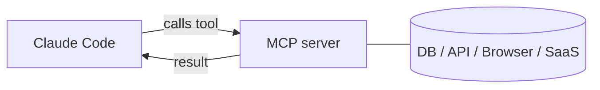

<LevelBadge level="advanced" />

<VerifyNote lastVerified="2026-11-10" source="https://code.claude.com/docs/en/mcp">
The `claude mcp` commands, configuration scopes, and transports evolve — confirm in the official Claude Code MCP docs and at modelcontextprotocol.io. The four transports, the scope storage paths, SSE's deprecation and the project-approval behavior below are all from that page.
</VerifyNote>

The **Model Context Protocol (MCP)** is an open standard for connecting AI to external tools and data. An **MCP server** exposes capabilities (query a database, open a GitHub PR, drive a browser); Claude Code connects to it and can **call those tools** during a session. It's how you extend Claude beyond your filesystem and shell.

<Callout type="objectives" items={["Explain what an MCP server is and how Claude Code calls its tools", "Tell apart the two transports: local stdio vs remote HTTP/SSE", "Add a server with claude mcp add and read the JSON it writes", "Choose the right scope (local, project, user) for who sees a server", "Connect a real database to Claude end-to-end", "Avoid the security and configuration traps that bite most people"]} />

## The shape of it



You declare servers Claude may use; each server publishes a set of tools with schemas; Claude picks and calls them like any other tool.

<Flashcards title="MCP vocabulary" cards={[{front: "Model Context Protocol (MCP)", back: "An open standard for connecting AI to external tools and data."}, {front: "MCP server", back: "A program that exposes capabilities — query a database, open a GitHub PR, drive a browser — as callable tools."}, {front: "Tool", back: "A capability an MCP server publishes with a schema; Claude picks and calls it like any other tool."}, {front: "Transport", back: "How Claude reaches a server: stdio (local process), HTTP (hosted, often OAuth), SSE (deprecated — HTTP falls back to it automatically), or WebSocket ws/wss (persistent, push, header-auth only, no --transport flag)."}, {front: "Scope", back: "Who sees a server: local (you, this project), project (the committed team), or user (you, everywhere)."}]} />

## Transports

There are four ways Claude reaches a server. Pick by where the server runs and how it talks.

- **stdio** — a local process Claude launches (great for local tools/CLIs). This is what a JSON entry with no `type` means.
- **HTTP** — a hosted server, often with OAuth. The default choice for anything remote.
- **SSE** — **deprecated**; use HTTP where you can. Some services still expose only an SSE endpoint, and from Claude Code v2.1.265 `--transport http` tries HTTP first and switches to SSE by itself, so you rarely need `--transport sse` explicitly.
- **WebSocket** (`ws` / `wss`) — a persistent bidirectional connection, for a server that pushes events unprompted. `--transport` does *not* accept `ws`: add it with `claude mcp add-json '{"type":"ws","url":"wss://…"}'` or write it into `.mcp.json`. No OAuth — authentication is header-only.

<Callout type="warning" items={["A JSON entry with a url but no type is a configuration error, not a sensible default: Claude Code reads a type-less entry as a stdio server, skips it, and reports that it has a \"url\" but no \"type\". Always set \"type\": \"http\" (or \"sse\" / \"ws\") on a remote server you write by hand."]} />

## Configuring servers

The fastest path is the `claude mcp add` command — it writes the config for you. Follow this sequence to go from zero to a connected server.

<Steps items={[{title: "Add a local stdio server", body: "Run claude mcp add — everything after the -- is the launch command Claude runs for you."}, {title: "Or add a remote HTTP server", body: "Pass --transport http and a scope, then the server URL. Remote servers are often hosted and use OAuth."}, {title: "See what's connected", body: "Run claude mcp list to view configured servers and their connection status."}, {title: "Inspect and authenticate", body: "Use /mcp inside a session to inspect a server's tools and authenticate remote servers."}]} />

<PromptCard title="Add a local stdio server">{`# A local stdio server (everything after -- is the launch command)
claude mcp add filesystem -- npx -y @modelcontextprotocol/server-filesystem ~/code/myproject`}</PromptCard>

<PromptCard title="Add a remote HTTP server (shared with the project)">{`# A remote HTTP server, shared with everyone on the project
claude mcp add --transport http --scope project github https://api.githubcopilot.com/mcp/`}</PromptCard>

Under the hood that's just JSON. A **project**-scoped server lands in a `.mcp.json` at the repo root — check it in and your teammates get the same tools once they trust the workspace:

```json
{
  "mcpServers": {
    "github": { "type": "http", "url": "https://api.githubcopilot.com/mcp/" }
  }
}
```

<Callout type="warning" items={["Don't reach for the @modelcontextprotocol/server-github, -postgres, -slack or -puppeteer packages you'll find in old tutorials. They are archived and carry an npm deprecation notice reading \"Archived and unmaintained; no security guarantees\". Use the vendor's own server where there is one — GitHub's is the HTTP endpoint above, and browser control moved to @playwright/mcp. Among the TypeScript reference servers only filesystem, memory, everything and sequential-thinking are still maintained."]} />

### Scope decides who sees the server

| Scope | Stored in | Loads in | Use it for |
|---|---|---|---|
| `local` (default) | `~/.claude.json`, under this project's path | this project only | personal experiments, secrets |
| `project` | `.mcp.json` in the repo (committed) | this project only, shared with the team | tools the whole team should share |
| `user` | `~/.claude.json` | all your projects | servers you want everywhere |

<Callout type="warning" items={["MCP \"local scope\" is not the same thing as local settings. A local-scoped MCP server lives in ~/.claude.json in your home directory — NOT in the project's .claude/settings.local.json. Looking for it in the project folder is a dead end."]} />

Run `claude mcp list` to see what's connected and `/mcp` inside a session to inspect tools and authenticate remote servers. See [MCP Config & Server Scaffolds](/docs/templates/mcp-config) for copy-paste starters.

## Worked example: give Claude your database

Say you want Claude to answer questions against a local Postgres instead of you pasting query results. Add the server at project scope, so teammates get it too.

Databases are where the archived-server problem bites hardest: the old `@modelcontextprotocol/server-postgres` is unmaintained and there is no official replacement, so the package name here is the one decision you have to make yourself. Pick a maintained community server, [review it](/docs/security/reviewing-third-party-code), then wire it in — the shape is the same whichever you choose:

<PromptCard title="Add a Postgres server at project scope">{`# Replace the package with a maintained Postgres MCP server you have reviewed.
# The connection string is read-only on purpose — see below.
claude mcp add --scope project db -- npx -y <postgres-mcp-server> "postgresql://readonly@localhost/app"`}</PromptCard>

Now in a session you can ask the question in plain language and let Claude do the query loop for you:

<PromptCard title="Ask a question against the database">{`How many users signed up last week? Check the DB.`}</PromptCard>

Claude calls whichever query tool the server publishes, gets rows back, and answers — no copy-paste loop. Keep the connection string read-only unless Claude genuinely needs to write. And if all you ever wanted was one query, note that `psql -c '…'` through Bash costs a fraction of the tokens; [The MCP Token Tax](/docs/claude-code/mcp-token-cost) covers when each one wins.

Because it's project-scoped, a teammate who pulls the repo gets the same capability — but **not silently, and not instantly**. A committed `.mcp.json` server sits at `⏸ Pending approval` until they run `claude` in the folder and accept the workspace-trust dialog. A cloned repo cannot pre-approve its own servers: `enableAllProjectMcpServers` or `enabledMcpjsonServers` committed to the project's `.claude/settings.json` is *ignored* in an untrusted folder. Approvals from a user-level `~/.claude/settings.json`, from managed settings, or passed with `--settings` do apply there. That's the usual answer to "why can't my teammate see the server?"

## Trust & security

<Callout type="warning" items={["An MCP server runs code and can read data and take actions — only connect servers you trust.", "Give each server the least privilege it needs.", "Any external content a server returns can carry prompt injection.", "Review third-party servers before connecting them."]} />

:::warning[Treat MCP servers like installing software]
An MCP server runs code and can read data and take actions. Only connect servers you trust, give them the **least privilege** needed, and remember that any external content they return can carry [prompt injection](/docs/security/prompt-injection). Review third-party servers first — see [Reviewing Third-Party Code](/docs/security/reviewing-third-party-code).
:::

## MCP in the apps too

MCP also powers **Connectors** in the Claude apps — same standard, different surface. See [Connectors (MCP) in the Apps](/docs/claude-app/connectors) and, for the API, [MCP & Connecting to Tools](/docs/api/mcp).

## Common mistakes

- **Wrong scope.** A server added at `local` scope won't appear for teammates; one you only wanted for yourself shouldn't be committed at `project` scope. Pick deliberately.
- **Too many servers, too many tools.** Tool search is on by default, so a connected server normally costs you its tool *names* and server instructions each turn rather than its full schemas — but that is still a per-turn tax, and the schemas land in context the moment Claude searches for them. Connect what the task needs, not your whole catalog. See [The MCP Token Tax](/docs/claude-code/mcp-token-cost) for the real numbers, the `ENABLE_TOOL_SEARCH` modes, and how code execution cuts the second cost.
- **Over-privileged connections.** Give a database server a read-only role unless Claude genuinely needs to write. MCP makes capabilities real — scope them down.
- **Forgetting the injection risk.** Anything a server returns (a web page, an issue body, a row) is untrusted text that can carry [prompt injection](/docs/security/prompt-injection). Don't wire a powerful write-capable server next to an untrusted read-capable one without thinking it through.

<Quiz title="Check yourself" questions={[{q: "Which transport is a local process that Claude launches itself?", options: ["Remote HTTP/SSE", "stdio", "OAuth"], answer: 1, explain: "stdio is a local process Claude launches — ideal for local tools and CLIs. The other three are remote: HTTP (often OAuth), the deprecated SSE, and WebSocket."}, {q: "Where does a project-scoped server get written, and what does a teammate have to do?", options: ["Your user settings; only you see it", "A .mcp.json at the repo root; after they pull it, they still have to trust the workspace before it leaves Pending approval", "A hidden global cache; nobody can edit it"], answer: 1, explain: "Project scope lands in a committed .mcp.json at the repo root. But a cloned repo can't approve its own servers — a committed enableAllProjectMcpServers is ignored in an untrusted folder, so the server waits at Pending approval until the teammate accepts the workspace-trust dialog."}, {q: "Why keep a database connection read-only when Claude only needs to read?", options: ["It makes queries run faster", "Least privilege — MCP makes capabilities real, so don't grant write access unless it's genuinely needed", "Read-only is required by the protocol"], answer: 1, explain: "Give servers the least privilege they need. MCP makes capabilities real, so a read-only role avoids unintended writes."}]} />

<Callout type="takeaways" items={["MCP is an open standard; an MCP server exposes tools that Claude Code calls like any other tool.", "Four transports: stdio (a process Claude launches), HTTP (the default for remote), SSE (deprecated — HTTP switches to it on its own), and WebSocket ws/wss (push, header-auth, add-json only).", "claude mcp add writes the config for you; under the hood it's JSON. Project scope lives in a committed .mcp.json, and a teammate's copy stays at Pending approval until they trust the workspace.", "Scope controls visibility: local (you, this project), project (committed for the team), user (you, everywhere).", "Treat servers like installing software: trust, least privilege, and watch for prompt injection in anything they return."]} />

## Next

- [Build & Wire Your First MCP Server (walkthrough)](/docs/walkthroughs/first-mcp-server)
- [MCP Config & Server Scaffolds](/docs/templates/mcp-config)
- [Securing Agents & Tools](/docs/security/securing-agents)
