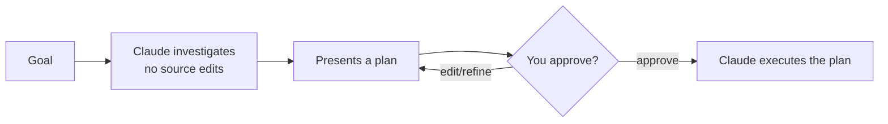

<LevelBadge level="beginner" />

<Callout type="objectives" items={["Explain what Plan Mode blocks — and what it still lets Claude run", "Enter and leave Plan Mode three different ways", "Walk through the investigate-propose-approve-execute loop", "Tell Plan Mode and Permissions apart and use them together"]} />

<VerifyNote lastVerified="2026-10-09" source="https://code.claude.com/docs/en/permission-modes">
How you enter Plan Mode (shortcut/flag), and exactly which shell commands it lets Claude run while planning, change between releases — check the official Claude Code docs.
</VerifyNote>

## The big idea

Imagine handing a contractor your house keys versus first asking them to walk through and write up *what* they'd change. Plan Mode is the walkthrough.

**Plan Mode** tells Claude to **research and propose changes without making them**: it reads files, runs shell commands to explore, and writes a plan — but it does **not edit your source**. Edits stay blocked until you approve the plan.

<Callout type="tip" items={["Plan Mode means Claude INVESTIGATES but does not CHANGE your source — it produces a plan and waits for your go."]} />

### It is not strictly read-only

Exploring sometimes needs a command, so Plan Mode is about *not editing*, not about *not executing*. What happens to a shell command during planning depends on the session — the first case that matches wins:

<Steps items={[{title: "Interactive terminal sessions with bypass permissions available", body: "Plan Mode's blocks are NOT enforced. Claude is still instructed to plan without editing, but an edit or command it attempts during planning runs without prompting. Plan Mode keeps its blocks everywhere else — headless -p runs, the Agent SDK, and the VS Code extension's chat panel."}, {title: "Auto mode available and useAutoModeDuringPlan on (the default)", body: "The classifier reviews shell commands instead of prompting you, apart from critical-path removals. Approved commands run; rejected ones are blocked."}, {title: "Auto mode unavailable, or useAutoModeDuringPlan off", body: "Commands outside the built-in read-only set prompt you for approval."}]} />

<Callout type="warning" items={["If you launched with --allow-dangerously-skip-permissions, Plan Mode is a strong instruction rather than a hard guardrail. Treat it as a planning convention, not a sandbox."]} />

## Why it's the safest way to start

For anything big, risky, or unfamiliar, you want to see *what* Claude intends before it touches your repo. Plan Mode separates **thinking** from **doing**:

The payoff: you catch wrong assumptions *before* they become wrong code.

## When to use it

<Callout type="tip" items={["ALWAYS for large or multi-file changes, migrations, or refactors", "When working in a codebase you don't fully know yet", "When you want a reviewable plan to share with a teammate"]} />

For tiny, obvious edits you can skip it — but when in doubt, plan first.

## How it works in practice

Follow the loop. Each step earns the next — Claude only switches to editing *after* you approve.

<Steps items={[{title: "Enter Plan Mode and state your goal", body: "Press Shift+Tab to cycle permission modes until the status bar reads 'plan mode on', or prefix a single prompt with /plan. To start there, launch with claude --permission-mode plan. Then describe what you want to achieve."}, {title: "Claude investigates", body: "It reads the relevant files, runs exploratory commands, and asks clarifying questions."}, {title: "Claude returns a step-by-step plan", body: "Files to change, the approach, and how to verify the result. Press Ctrl+G to open the proposed plan in your editor and change it directly."}, {title: "You approve or refine", body: "Choose 'Yes, and use auto mode', 'Yes, manually approve edits', or 'No, keep planning'. Approving exits Plan Mode into the permission mode that option describes, and Claude starts editing."}]} />

To leave Plan Mode without approving a plan, press `Shift+Tab` again. To make it the default for a project's terminal sessions, set `defaultMode` to `plan` in `.claude/settings.json` — see [Settings](/docs/claude-code/settings).

### Try it yourself

Copy this into a real planning session and watch the loop play out:

<PromptCard title="Kick off a planning session">{`I want to migrate our auth from sessions to JWT. Stay in Plan Mode: investigate the current setup, ask anything you need, then propose a step-by-step plan with files to change and how to verify — don't edit anything yet.`}</PromptCard>

:::tip[Pair it with CLAUDE.md]
A good [CLAUDE.md](/docs/claude-code/claude-md) makes plans sharper — Claude plans with your conventions and guardrails already in mind.
:::

## Plan Mode vs Permissions

A classic mix-up. They solve different problems and work together:

- **Plan Mode** = "investigate and propose, don't edit yet." (This page.)
- **[Permissions](/docs/claude-code/permissions)** = once acting, *which* actions are allowed without asking.

Think of it as **whether to act now** (Plan Mode) versus **which actions are allowed once acting** (Permissions).

<Flashcards cards={[{front: "What state does Plan Mode put Claude Code in?", back: "Research-and-propose: it reads files, runs shell commands to explore, and writes a plan, but does not edit your source. Edits stay blocked until you approve."}, {front: "How do you enter and leave Plan Mode?", back: "Enter with Shift+Tab, a /plan prefix on one prompt, or claude --permission-mode plan. Leave without approving with Shift+Tab again."}, {front: "What is the Plan Mode loop?", back: "Investigate → present a plan → you approve or refine → Claude executes."}, {front: "When should you reach for Plan Mode?", back: "By default for big, risky, or unfamiliar work (multi-file changes, migrations, refactors, unknown codebases). Skip only tiny, obvious edits."}, {front: "Plan Mode vs Permissions?", back: "Plan Mode governs WHETHER to act now; Permissions govern WHICH actions are allowed once acting."}]} />

<Callout type="takeaways" items={["Plan Mode is research-and-propose: Claude reads and runs exploratory commands but does not edit your source until you approve the plan", "It is not strictly read-only — commands during planning are classifier-reviewed, prompted, or (with bypass permissions available in an interactive terminal) unblocked entirely", "Enter with Shift+Tab, a /plan prefix, or --permission-mode plan; approving switches the session into the mode that approve option names", "Use it by default for big, risky, or unfamiliar work; skip only tiny obvious edits", "Plan Mode governs WHETHER to act now; Permissions govern WHICH actions are allowed once acting"]} />

<Quiz title="Check yourself" questions={[{q: "What can Claude Code do while in Plan Mode?", options: ["Edit files and run any command", "Read files and run shell commands to explore — but not edit your source until you approve", "Only answer questions, with no file access at all"], answer: 1, explain: "Plan Mode is about not editing, not about not executing. Claude reads files and runs exploratory commands (classifier-reviewed or prompted, depending on the session), but edits to your source stay blocked until you approve the plan."}, {q: "When should you reach for Plan Mode?", options: ["Only for one-line typo fixes", "For large or multi-file changes, migrations, refactors, or unfamiliar codebases", "Never — it just slows you down"], answer: 1, explain: "Use it always for large or multi-file changes, migrations, or refactors, and when working in a codebase you don't fully know yet. Tiny obvious edits can skip it."}, {q: "What is the correct order of the Plan Mode loop?", options: ["Execute, then investigate, then approve", "Investigate without editing, present a plan, you approve or refine, then Claude executes", "Approve first, then Claude investigates and edits"], answer: 1, explain: "Claude investigates without editing your source, presents a plan, you approve or refine, and only then does it switch to executing the plan."}, {q: "How do Plan Mode and Permissions differ?", options: ["They are two names for the same feature", "Plan Mode = investigate and propose, don't edit yet; Permissions = once acting, which actions are allowed without asking", "Permissions decide whether to plan; Plan Mode decides which files to edit"], answer: 1, explain: "Plan Mode separates thinking from doing. Permissions control which actions are allowed without asking once Claude is acting. They work together."}]} />

## Next

- [Permissions & Permission Modes](/docs/claude-code/permissions)
- [Context Management](/docs/claude-code/context-management) — keep long sessions effective
- [Walkthrough: Customize Claude Code for a real repo](/docs/walkthroughs/customize-claude-code)
