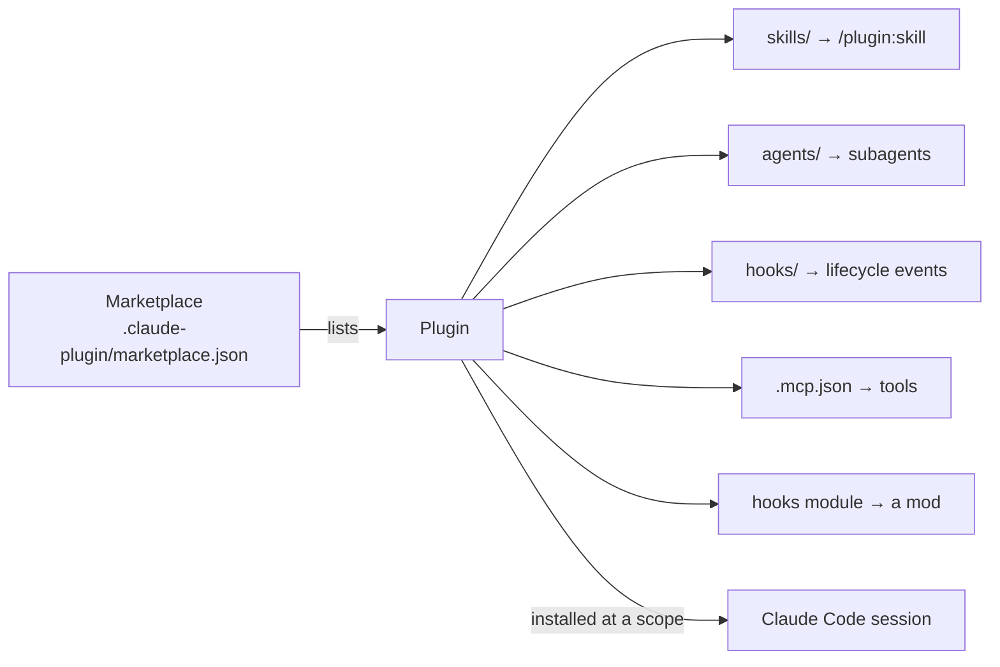

# Plugins & Marketplaces

> Source: https://derob98.github.io/ailmanac/docs/claude-code/plugins-marketplaces · AILmanac (CC BY 4.0) · last verified 2026-10-26

Bundle skills, agents, commands, hooks and MCP into one installable unit — and install other people's. The three install scopes and their precedence, the three marketplace trust tiers, the always-on context cost every enabled plugin charges you, and the eight commands that cover the whole lifecycle.

<LevelBadge level="intermediate" />

<Callout type="objectives" items={[
  "Decide whether you actually need a plugin, or whether a standalone skill, hook, or MCP server is enough",
  "Install your first plugin and know, from the install summary, whether it's usable in this session or needs a reload",
  "Pick the right one of three install scopes — user, project, local — and know which overrides which",
  "Read a marketplace's trust tier before you trust it, and understand why the official and community names can't be faked",
  "Budget the always-on context cost every enabled plugin charges on every turn, and find the plugins you stopped using",
  "Run the whole lifecycle from your shell: add a marketplace, install, enable, disable, update, uninstall, prune",
  "Develop your own plugin without publishing anything, using --plugin-dir",
]} />

<VerifyNote lastVerified="2026-10-26" source="https://code.claude.com/docs/en/plugins">
Verified against the official [Plugins overview](https://code.claude.com/docs/en/plugins) and [Install and manage plugins](https://code.claude.com/docs/en/plugins/install) pages. Two of the commands here have version floors: `/plugin install <plugin> --marketplace <source>` needs Claude Code v2.1.275+, and the shell equivalent needs v2.1.292+. Plugin structure and marketplace mechanics are still moving quickly — confirm specifics against the official docs before you build distribution around them.
</VerifyNote>

A **plugin** bundles several customizations — [skills](/docs/claude-code/skills), [subagents](/docs/claude-code/subagents), [slash commands](/docs/claude-code/slash-commands), [hooks](/docs/claude-code/hooks), [MCP servers](/docs/claude-code/mcp), and a [**mod**](/docs/claude-code/mods) (hooks written as JavaScript, which can also draw panes and add commands) — into a single, versioned, installable unit. A **marketplace** is a catalog that lists plugins and where to fetch each one. It's a catalog, not a hosted store: the plugins live wherever their authors put them.

## Do you even need a plugin?

Start here, because the answer is often no. Skills, subagents, hooks, and MCP servers all work perfectly well on their own — a `SKILL.md` in `~/.claude/skills/` is available in every project on your machine with zero packaging.

Reach for a plugin when **one of these three is true**:

- You want several components packaged as **one unit** with one install step and one version number.
- You want **someone else's** setup, with updates from their marketplace.
- You want to **give** your setup to teammates, install it across many projects, or publish versioned releases.

Everything else is a skill or a hook, and should stay one.

## The part nobody warns you about: an enabled plugin is always on

This is the single most important thing to internalize before you install five plugins because they looked useful.

**An enabled plugin is part of every session, not only the sessions where you use it.** For each skill, agent, and command Claude can invoke on its own, the *name and description* sit in Claude's context on **every turn**, so Claude knows the thing exists. Those tokens count toward your usage and shrink the [context window](/docs/claude-code/context-management) even in sessions where nothing from the plugin ever fires. Only the full text loads on use.

Its MCP servers also run alongside every session where it's enabled, and its hooks fire at their events. And everything it runs, it runs **as you**.

So budget it. There are three moments to check the footprint:

<Steps items={[
  {title: "Before you install", body: "Open the plugin by naming its marketplace — /plugin install <plugin>@<marketplace>, or the Marketplaces tab. Plugins in Anthropic's official marketplace show a Context cost estimate there, split into Every turn and When invoked. The details pane you reach from the Discover list does not show those numbers."},
  {title: "After you install", body: "Run claude plugin details <name> in your shell. The Always-on line is the token count the plugin adds to every session where it's enabled, and per-component rows show which skill or agent is the expensive one."},
  {title: "Periodically, to prune", body: "The Installed tab in /plugin groups plugins you haven't used recently under a Not used recently header, and each plugin's details carry a Last used line. Those are still charging you context on every turn. Disable or uninstall them."},
]} />

Keep each plugin **coherent** for the same reason — a "team conventions" plugin, a "Python toolkit" plugin — rather than a grab-bag whose description list you pay for constantly. The matching read is [MCP token cost](/docs/claude-code/mcp-token-cost), which is the same arithmetic applied to tool definitions.

## Install one

Anthropic's official marketplace, `claude-plugins-official`, is added for you the first time you start an interactive terminal session (unless a managed policy blocks it). So installing from it skips the add-a-marketplace step entirely.

<PromptCard title="Open a plugin's details to review it">{`/plugin install commit-commands@claude-plugins-official`}</PromptCard>

Inside a session this command **doesn't install right away** — it opens the `/plugin` panel on that plugin's details so you can read what it adds and choose a scope first. Running bare `/plugin` opens the **Discover** tab instead, which lists plugins from all your marketplaces and lets you type to search.

The details pane is the review step. Read the **Will install** list — the commands, agents, skills, hooks, and MCP and LSP servers you're about to turn on. Plugins from a local or custom marketplace may show `Components will be discovered at installation` instead, which means you're accepting the contents sight unseen.

Then pick a scope, and read the last sentence of the install summary, because it's the one that tells you whether anything happened:

| Summary ends with | What it means |
| :--- | :--- |
| `Plugin is now active.` | Usable right now. No reload. |
| `Plugin is now active.` + `Its bundled MCP server needs configuration before it can start` | Select the plugin on the **Installed** tab and choose **Configure** to set the server's options. |
| `Run /reload-plugins to apply.` | Claude Code runs the reload for you — unless it would invalidate the prompt cache, in which case it warns and leaves the plugin pending. `/reload-plugins --force` activates it anyway, at the cost of one uncached request. |
| `The plugin couldn't be loaded` | Open the **Errors** tab in `/plugin` for the reason. |

Confirm it worked by typing `/` and looking for the plugin's skills namespaced under its name: `/commit-commands:commit`. Or run `claude plugin list` in your shell, which prints every plugin with `Version`, `Scope`, and `Status`.

### The three scopes, and which one wins

Scope decides **who** gets the plugin and **which settings file** records it as enabled. Getting this wrong is how a plugin ends up enabled for your whole team by accident.

| Scope | Who gets it | Written to |
| :--- | :--- | :--- |
| **User** | You, in every project on this machine | `enabledPlugins` in `~/.claude/settings.json` |
| **Project** | Everyone who works in this repository | `.claude/settings.json` — which you commit |
| **Local** | You, in this repository only | `.claude/settings.local.json` |

**Precedence when the same plugin is set at several scopes: local overrides project, project overrides user.**

The project-scope gotcha is worth stating plainly: **committing the entry turns the plugin on for your collaborators but doesn't download it to their machines.** Each collaborator still runs the install once themselves:

<PromptCard title="A collaborator picking up a project-scoped plugin">{`claude plugin install formatter@your-org --scope project`}</PromptCard>

Two related behaviors: some plugins ship with `defaultEnabled` set to off by their author, so they install but stay dark until you run `claude plugin enable <name>`. And when you **uninstall** a plugin that the repository's `.claude/settings.json` enables, Claude Code asks which you meant — **y** writes `false` for you in `.claude/settings.local.json` and leaves it installed for everyone else; **u** removes it from the shared settings for the whole team.

The terminal, the desktop app's local sessions, and the VS Code extension on one machine read the same settings files, so a user-scope install in any of them shows up in the other two.

### Where plugins don't go

Two blind spots that cause real confusion:

- **[Cloud sessions](/docs/claude-code/cloud-sessions) load none of this.** A cloud session, including claude.ai/code, has no plugin browser and loads neither the plugins on your machine nor the ones your repository's `.claude/settings.json` turns on. Only plugins your organization distributes through managed settings arrive. If a workflow depends on plugin-provided commands, it behaves differently in the cloud.
- **`claude -p` and other non-interactive runs** can't open `/plugin` — Claude replies `/plugin isn't available in this environment.` Plugins you already installed do load. Manage them from your shell instead.

## Trust: the three marketplace tiers

A marketplace is a repository or directory containing a `.claude-plugin/marketplace.json` file. Anyone can publish one. A plugin you install can run code with your user privileges, whatever its source.

A marketplace's **name** places it in one of three tiers, and the first two can't be faked: **Claude Code accepts Anthropic's official and community names only for marketplaces sourced from `github.com/anthropics/` repositories.**

| Tier | Examples | What it tells you |
| :--- | :--- | :--- |
| **Official** | `claude-plugins-official`, the demo marketplace `claude-code-plugins` | Name is reserved to Anthropic-sourced repos. Auto-update on by default (with two exceptions). |
| **Community** | `claude-community` and the other Anthropic community names | Also name-reserved to Anthropic-sourced repos, but community-contributed content. Auto-update **off** by default. |
| **Third-party** | Everything else — including your coworker's and your own organization's | No name guarantee. Auto-update off by default. |

:::warning[Plugins can ship executable code]
Hooks and MCP servers in a plugin run with your privileges, in every session where the plugin is enabled. Install from sources you trust, and read the **Will install** pane before you accept. See [Reviewing Third-Party Code](/docs/security/reviewing-third-party-code) and [Vetting Agent Skills](/docs/security/vetting-agent-skills).
:::

Also note what a plugin marketplace *isn't*: [claude.com/marketplace](https://claude.com/marketplace) is a website for browsing plugins, connectors, and partners. It isn't something you add with `/plugin marketplace add`.

### Adding a marketplace

You add a marketplace once; afterward its plugins appear on **Discover** and install by name. Four source forms:

| Source | What you type |
| :--- | :--- |
| GitHub repository | `owner/repo`, optionally `owner/repo#ref` to pin a branch or tag |
| Any git host | The full clone URL, optionally with `#ref` |
| Local directory or file | A path to a directory holding `.claude-plugin/marketplace.json`, or to the JSON itself — **start relative paths with `./`** |
| Hosted JSON | An `https://` URL to a `marketplace.json` |

<PromptCard title="Add a marketplace, four ways">{`/plugin marketplace add anthropics/claude-code
/plugin marketplace add your-org/plugins#v1.2.0
/plugin marketplace add ./my-marketplace
/plugin marketplace add https://example.com/marketplace.json`}</PromptCard>

Two parsing traps live in that table. A bare path like `name/name` is read as **GitHub `owner/repo` shorthand**, so a local path must start with `./` or `../`. And a bare `gitlab.example.com/group/repo.git` is read the same way and rejected — include the `https://` prefix, or use the `git@host:path` SSH form. (`/plugin market` is a valid shorthand for `/plugin marketplace`.)

For a plugin from a marketplace you haven't added yet, do both in one command — note that the plugin name goes **without** an `@marketplace` suffix:

<PromptCard title="Add the marketplace and install in one step">{`# in a session (v2.1.275+); asks you to confirm the resolved source
/plugin install deploy-helper --marketplace your-org/plugins

# from your shell (v2.1.292+); no confirmation step
claude plugin install deploy-helper --marketplace your-org/plugins`}</PromptCard>

**Private marketplaces** work with the same command, cloned using the git credentials already on your machine — and Claude Code **never prompts**. That makes the requirements strict: over HTTPS your credential helpers must already work (`gh auth login`, the macOS Keychain, `git-credential-store`), because git's prompts and askpass programs are disabled; over SSH the host must already be in `known_hosts` and the key must not need a passphrase. Set `CLAUDE_CODE_PLUGIN_PREFER_HTTPS=1` to skip the SSH probe on GitHub shorthand and always clone over HTTPS.

One removal behavior to know before you run it: **removing a marketplace uninstalls every plugin you installed from it** and strips their `enabledPlugins` entries from your settings. The **Marketplaces** tab names them before asking you to confirm.

## The whole lifecycle from your shell

Everything the `/plugin` panel does, `claude plugin` does non-interactively — which is what you want in a setup script or a dotfiles repo. The default scopes differ by verb: `enable` and `disable` act on the **most specific scope that already lists the plugin**, while `install` and `uninstall` default to **user** scope.

<PromptCard title="The eight commands that cover everything">{`claude plugin marketplace add anthropics/claude-plugins-official
claude plugin install formatter@your-org --scope project
claude plugin list
claude plugin details formatter@your-org     # always-on token cost
claude plugin disable formatter@your-org
claude plugin enable formatter@your-org
claude plugin update formatter@your-org
claude plugin uninstall formatter@your-org --scope project`}</PromptCard>

Four notes that save a debugging session:

- **On a fresh machine the official marketplace isn't registered yet**, because nobody has opened an interactive session. A provisioning script must `claude plugin marketplace add anthropics/claude-plugins-official` before installing from it.
- **Some plugins install by running a command** their marketplace names. Claude Code shows it and asks you to accept — a script has nobody to answer, so pass `--yes`.
- **Plugins installed from the shell load on the next start**, or when you run `/reload-plugins` in an open session.
- **There is no "update all" command.** `claude plugin update` takes one plugin. To batch, use the **Marketplaces** tab's **Update marketplace**, which refreshes the listing and updates the plugins you installed from it. `claude plugin marketplace update` with no name refreshes every listing but leaves installed plugins at their current versions.

### Dependencies

A plugin can declare other plugins it depends on, and Claude Code acts on them with you:

- **Install** also installs and enables declared dependencies at the same scope; the success message lists them.
- **Enable** also enables installed-but-disabled dependencies. If one isn't installed at all, the enable fails and tells you to install it first.
- **Disable** is refused when another enabled plugin still needs the one you named — and prints a chained command that disables both in the right order.
- **Uninstall** leaves auto-installed dependencies behind. `claude plugin prune` is what clears them.

## Developing your own, without publishing anything

You don't need a marketplace to work on a plugin. Point Claude Code at the folder:

<PromptCard title="Load a plugin from disk for one session">{`claude --plugin-dir ./my-plugin`}</PromptCard>

The manifest at `.claude-plugin/plugin.json` is **optional**: without one, Claude Code loads whatever it finds in the standard layout, so a folder holding nothing but a `SKILL.md` already loads as a plugin. Write a manifest when you want a name, a version, metadata, a component outside its default directory, or user-configurable `userConfig` options.

Beyond the core components, a plugin can bundle [LSP servers](https://code.claude.com/docs/en/plugins/components) for code intelligence, background monitors, workflows, a `bin/` of executables, and default settings.

The natural progression — and the one worth following deliberately — is: a `CLAUDE.md` → a few [skills](/docs/claude-code/skills) and [commands](/docs/claude-code/slash-commands) → bundle them into a plugin → prove it helps with [`claude plugin eval`](/docs/claude-code/plugin-evals) → publish to a marketplace for your team or the community.

## When a plugin doesn't show up

Three layers have to line up, and the error is almost always in one of them:

<Steps items={[
  {title: "Settings", body: "Your settings list the marketplaces you've added and the plugins that are enabled. Check all three scopes — remember local overrides project overrides user, so a false in .claude/settings.local.json silently wins."},
  {title: "Disk", body: "~/.claude/plugins/ holds what Claude Code actually fetched and installed. Project settings that enable a plugin nobody downloaded is the classic mismatch: the entry is committed, the files aren't there."},
  {title: "Session", body: "Plugins load at startup. A plugin installed mid-session needs /reload-plugins — and if that would invalidate the prompt cache, Claude Code leaves it pending until you run /reload-plugins --force."},
]} />

<Quiz title="Check your understanding" questions={[
  {q: "You install six plugins because each looked useful. You only ever use one. What's the cost of the other five?", options: ["Nothing — they only cost tokens when invoked", "Every enabled plugin puts its invokable skills' and agents' names and descriptions in context on every turn, and runs its MCP servers and hooks in every session", "Only disk space"], answer: 1, explain: "An enabled plugin is part of every session, not just the ones where you use it. Names and descriptions are in context every turn so Claude knows they exist; MCP servers run and hooks fire alongside each session. Use claude plugin details <name> to read the always-on cost, and the Not used recently group in /plugin to find the ones to drop."},
  {q: "You commit a project-scope plugin entry to .claude/settings.json. What does a teammate need to do?", options: ["Nothing — it installs automatically on their next pull", "Run the install once themselves: claude plugin install <name>@<marketplace> --scope project", "Add the marketplace, which installs everything in it"], answer: 1, explain: "Committing the enabledPlugins entry turns the plugin on for collaborators but doesn't download it to their machines. Each one still installs it once. Claude Code reports the mismatch when settings enable a plugin that isn't installed."},
  {q: "A plugin is enabled at user scope, disabled in .claude/settings.local.json, and enabled in the committed .claude/settings.json. Is it on?", options: ["Yes — project settings are authoritative", "Yes — user scope was first", "No — local overrides project, which overrides user"], answer: 2, explain: "Precedence is local > project > user. A false in .claude/settings.local.json wins over both other layers, which is exactly how the \"disable for me\" option works when you uninstall a project-enabled plugin."},
  {q: "Someone sends you a marketplace at ./shared/plugins. You run /plugin marketplace add shared/plugins and it fails. Why?", options: ["Local marketplaces aren't supported", "A bare name/name is read as GitHub owner/repo shorthand — a local path must start with ./ or ../", "You need to add the marketplace.json file directly"], answer: 1, explain: "Claude Code reads a bare name/name as GitHub owner/repo. Start a relative path with ./ or ../. The same parsing trap rejects a bare gitlab.example.com/group/repo.git, which needs its https:// prefix or the git@host:path SSH form."},
  {q: "Your workflow depends on a plugin-provided slash command. You run the same task in a cloud session at claude.ai/code. What happens?", options: ["It works — plugins sync with your account", "The command isn't there: cloud sessions load neither your local plugins nor the ones the repo's .claude/settings.json enables", "It works only if the plugin is project-scoped"], answer: 1, explain: "A cloud session has no plugin browser and loads neither your machine's plugins nor a repository's enabledPlugins. Only plugins distributed through organization managed settings arrive. Commit the equivalent skills and commands into .claude/ if the workflow has to run in the cloud."},
]} />

<Callout type="takeaways" items={[
  "Use a plugin only to package several components as one versioned unit, to consume someone else's setup, or to distribute your own. A lone skill or hook needs no plugin.",
  "An enabled plugin is always on: invokable skills' and agents' names and descriptions sit in context every turn, its MCP servers run, and its hooks fire — in every session, used or not. Measure with claude plugin details, prune with the Not used recently group.",
  "Three scopes, with precedence local > project > user. User writes ~/.claude/settings.json, project writes the committed .claude/settings.json, local writes .claude/settings.local.json. Project scope enables for the team but each teammate still installs once.",
  "Three trust tiers by name. Anthropic's official and community names are only accepted for marketplaces sourced from github.com/anthropics/ repos; everything else is third-party. Any plugin can run code as you — read the Will install pane first.",
  "Two parsing traps when adding a marketplace: a local path must start with ./, and a non-GitHub git host needs its https:// prefix. A bare name/name is always read as GitHub shorthand.",
  "Removing a marketplace uninstalls every plugin you got from it and strips their settings entries. Uninstalling a project-enabled plugin asks whether you meant \"just me\" or \"everyone\".",
  "Cloud sessions load no local or repo-enabled plugins at all — only organization-managed ones. Commit the equivalents into .claude/ if a cloud workflow depends on them.",
  "Develop with claude --plugin-dir ./my-plugin; no marketplace, no manifest required. Prove it earns its context cost with claude plugin eval before you publish.",
]} />

## Next

- [Mods: In-Process Extensions](/docs/claude-code/mods) — the one plugin component that runs *inside* Claude Code and can replace its built-in behavior
- [Plugin Evals](/docs/claude-code/plugin-evals) — prove the plugin helps with `claude plugin eval` before you publish it
- [MCP Token Cost](/docs/claude-code/mcp-token-cost) — the same context arithmetic, applied to tool definitions
- [Skills](/docs/claude-code/skills) · [Subagents](/docs/claude-code/subagents) · [MCP](/docs/claude-code/mcp)
- [Reviewing Third-Party Code](/docs/security/reviewing-third-party-code) · AILmanac's [skill packs](/docs/templates/skills)
