<LevelBadge level="advanced" />

<Callout type="objectives" items={[
  "Name the three APIs and their continuation parameters without mixing them up",
  "Separate the two products hiding behind one phrase: an ephemeral latency optimization vs durable conversation storage",
  "Read the retention row before you ship — on two of the three providers, storing conversations is the DEFAULT, not a choice you made",
  "Stop expecting any of them to cut your token bill, and know which feature actually does",
  "Apply the one design rule that survives all three: your log is the source of truth, provider state is a cache",
  "Spot the three places an abstraction over all three providers leaks"
]} />

<VerifyNote lastVerified="2026-11-03" source="https://platform.claude.com/docs/en/build-with-claude/message-threads">
Every parameter name, default and retention window on this page is quoted from the provider's own documentation on the date above. Two of the three features are young — Anthropic's entered public beta on 2026-11-02 — and retention policies in particular are the kind of thing providers revise. Re-check each before you make a compliance claim: [Anthropic](https://platform.claude.com/docs/en/build-with-claude/message-threads) · [OpenAI](https://developers.openai.com/api/docs/guides/conversation-state) · [Google](https://aistudio.google.com/docs/interactions-overview).
</VerifyNote>

For years, every chat API was stateless by design. You held the conversation, you re-sent it every turn, and that was the whole contract. During 2026 all three major providers broke it — and they did not converge.

Anthropic shipped [message threads](/docs/api/message-threads). OpenAI shipped `previous_response_id` on the Responses API and a Conversations API on top of it. Google shipped the Interactions API. All three let you send only the new turn and point at what came before. The pitch reads identically on all three sites.

Underneath, two of them built **storage** and one built a **cache**. That single difference decides whether your application must keep its own copy of the conversation, how long your users' messages sit on someone else's disk, and what your failure path looks like at 3am.

## The three APIs at a glance

```mermaid
flowchart TB
  subgraph A["Anthropic — message threads"]
    A1["POST /v1/messages<br/>thread: create / continue"] --> A2["previous_message_id"]
    A2 --> A3["In memory, encrypted<br/>Expires 5 min idle<br/>Deleted ≤ 1 hour"]
    A3 --> A4["No list / read / delete API"]
  end
  subgraph B["OpenAI — Responses + Conversations"]
    B1["POST /responses<br/>store: true by default"] --> B2["previous_response_id"]
    B2 --> B3["Responses kept 30 days"]
    B1 --> B5["POST /conversations<br/>durable container"]
    B5 --> B6["Not subject to the 30-day TTL"]
  end
  subgraph C["Google — Interactions API"]
    C1["POST /v1beta/interactions<br/>store: true by default"] --> C2["previous_interaction_id"]
    C2 --> C3["Paid: 55 days<br/>Free: 1 day"]
    C3 --> C4["delete method<br/>7 / 14 / 28 / 55 day options"]
  end
```

## The comparison table

| | **Anthropic** (message threads) | **OpenAI** (Responses / Conversations) | **Google** (Interactions API) |
|---|---|---|---|
| **Status** | Public beta since 2026-11-02, header `message-threads-2026-08-12` | Generally available | Positioned as the new standard for building with Gemini |
| **Endpoint** | `POST /v1/messages` with a `thread` field | `POST /responses`; `POST /conversations` for containers | `POST /v1beta/interactions` (`interactions.create`) |
| **Continuation parameter** | `thread: {"type": "continue", "previous_message_id": …}` | `previous_response_id` | `previous_interaction_id` |
| **Opt in or opt out?** | **Opt in.** No `thread` field, no state. | **Opt out.** `store` defaults to `true`. | **Opt out.** `store` defaults to `true`. |
| **Durability** | Best-effort. Held in memory, encrypted under a server-managed key, **never written to durable storage**. | Durable. Responses retrievable by `id`. | Durable. Interactions retrievable by `id`. |
| **Retention** | Expires **5 minutes** after its last request; deleted **no more than 1 hour** after last use. Every stored response restarts the 5 minutes. | Response objects saved **30 days** by default. Conversation objects and their items are **not** subject to the 30-day TTL. | **Paid tier: 55 days. Free tier: 1 day.** Paid tier can configure 7 / 14 / 28 / 55 days in AI Studio. |
| **Can you delete it?** | No API to list, read, or delete a thread. | `store: false` to never persist. | `delete` method, any time. |
| **What is stored** | The conversation sent to the model, the create request's `system` and `tools`, and a fingerprint of the fixed fields. Files **by reference**. | The response objects in the chain; conversation items in a container. | The full execution history: model **thoughts**, server- and client-side tool calls and results (`function_call`, `function_result`), and `model_output`. |
| **Token billing** | Unchanged. Claude still reads the full conversation every turn. | Unchanged, and documented explicitly: all previous input tokens in the chain are billed as input tokens. | Unchanged as a billing rule; Google frames the stateful path as the one that lets the server optimize caching. |
| **Branch / edit / summarize in place** | **No.** Append-only, and each response `id` can be continued exactly **once**. | Not verified — see the note below. | Not verified — see the note below. |
| **ZDR / HIPAA** | **Not ZDR eligible, not HIPAA eligible.** Unavailable to orgs with HIPAA readiness enabled. | Check your own agreement. | Check your own agreement. |
| **Failure path you must code** | 404 → replay the full conversation in a new create request. Mandatory. | Retention expiry; `store: false` makes `previous_response_id` unusable. | Retention expiry; `store=false` disables both `previous_interaction_id` and background execution. |

:::warning[What I could not verify, and will not assert]
Anthropic documents the append-only, one-continue-per-`id` restriction explicitly, so the "no branching" claim for threads is solid. OpenAI's and Google's docs, as of the verification date above, do **not** state a comparable restriction in the pages cited — which is not the same as granting the capability. If your design depends on forking a conversation from an earlier point on OpenAI or Google, test it against the live API rather than inferring it from this table.
:::

## The axis that actually matters

Forget the parameter names for a moment. There is one question that reorganizes this whole comparison:

> **If the provider loses the state, is your application broken?**

**On Anthropic, the answer is "no, by design."** A thread is explicitly best-effort. Anthropic's own documentation says your application stays the source of truth, that no response — create or continue — ever tells you whether a turn was stored, and that you find out on the *next* request when it either works or returns 404. Five minutes of idle time is enough to lose it. That is not a defect; it is the product. Anthropic built a **prefill cache with a conversation-shaped key**, and priced it at zero because it saves them work too.

**On OpenAI and Google, the answer is "it depends how much you trusted them."** Both give you a durable, retrievable, deletable object with a retention clock measured in weeks. You *can* make the provider your source of truth. Many teams will, because it is less code. The bill for that convenience arrives in three ways: you now have a 30- or 55-day copy of user conversations in a third-party system, your data-deletion story runs through their API, and migrating providers means exporting conversations rather than switching a base URL.

Neither is wrong. They are answers to different questions — *"make my agent loop faster"* versus *"hold my conversations for me."* The mistake is reading one provider's docs, forming a mental model, and carrying it to the next.

## The default nobody chose

This is the finding worth acting on today, and it is absent from every comparison post we surveyed.

<Callout type="warning" items={[
  "On OpenAI, store defaults to true. On Google's Interactions API, store defaults to true.",
  "If you call either API without thinking about it, conversations are being retained server-side — 30 days on OpenAI by default, 55 days on Google's paid tier, 1 day on Google's free tier.",
  "Nobody on your team decided this. It is the default, and the stateless behavior you may believe you have is the opt-out: store: false.",
  "On Google, store=false also disables previous_interaction_id and background execution — so the privacy-safe setting costs you two features, not zero.",
  "Anthropic's default is the opposite: no thread field, no state. You opt in."
]} />

If you have a privacy policy, a DPA, or a records-retention commitment that describes your LLM traffic as transient, go check which of these three defaults your code is running under. That audit takes ten minutes and is the highest-value thing on this page.

<PromptCard title="Audit prompt — point an agent at your own repo">{`Search this repository for every call to an LLM provider's chat or response API.
For each call site, report:

1. Provider and endpoint (Anthropic /v1/messages, OpenAI /responses, Google /interactions, other).
2. Whether server-side conversation state is in use: a "thread" field,
   "previous_response_id", "previous_interaction_id", or a conversation/thread id.
3. The value of any "store" parameter — and flag it when the parameter is ABSENT,
   because OpenAI and Google both default store to true.
4. Whether we keep our own durable copy of the conversation independent of the provider.

Output a table. Mark as HIGH RISK any call site that relies on provider-held state
with no local copy, and any call site that omits "store" on OpenAI or Google.
Do not change any code.`}</PromptCard>

## None of these cut your token bill

All three providers are unusually clear about this, and all three get misreported.

- **Anthropic:** token usage stays the same, because Claude still reads the full conversation on every turn. Pricing and rate limits are unchanged. The published win is latency — median time to first token down about 35% on requests of 500k–1M tokens.
- **OpenAI:** even when using `previous_response_id`, all previous input tokens in the chain are billed as input tokens.
- **Google:** the stateful path is recommended partly because it lets the server optimize caching — which is a statement about caching, not a discount on conversation tokens.

What these features remove is the **upload**: the bytes on the wire, and the validation and tokenization work that has to finish before the first token comes out. That is a real and sometimes large latency win. It is not a line item.

The thing that lowers the bill is prompt caching, on every one of these providers — and on Anthropic a thread does not enable it for you. See [Prompt caching across providers](/docs/models/prompt-caching-across-providers) for the mechanism, the TTLs and the break-even arithmetic, and [What AI actually costs across providers](/docs/models/what-ai-costs-across-providers) for the absolute numbers.

:::tip[The two features compose, and are often confused]
Server-side conversation state answers *"what do I have to send?"* Prompt caching answers *"what do I have to pay for?"* You want both, and turning on the first does not turn on the second anywhere.
:::

## The portable design rule

One rule works on all three providers, today and after the next round of changes:

<Steps items={[
  {title: "Keep your own append-only conversation log, unconditionally", body: "Every message, every tool call, every tool result, in your own storage, before you send anything. On Anthropic this is mandatory — the replay path has no other source. On OpenAI and Google it is what keeps you portable and keeps your deletion story in your own hands."},
  {title: "Treat provider-held state as a cache, never as storage", body: "A cache is something you can lose at any moment and rebuild from the source. Write the code that rebuilds. If losing the provider's copy is an incident rather than a retry, you have made it storage."},
  {title: "Set the store parameter explicitly, on every provider, every time", body: "Never rely on a default you did not choose. On OpenAI and Google that means writing store: false unless you have a reason to persist, and documenting the reason when you do. On Anthropic it means deciding per-workload whether the thread field goes in at all, since threads are not ZDR eligible."},
  {title: "Code the recovery path first, not last", body: "On Anthropic: a 404 handler that replays the full conversation in a new create request with system and tools restored. On OpenAI and Google: what happens when the id falls outside the retention window. Both are one function. Neither gets written if you leave it for later."},
  {title: "Keep cost and state as separate decisions", body: "Add prompt caching deliberately, with its own breakpoints and its own measurement, and verify the hit rate from the response usage fields. Do not let a latency migration quietly ship as a cost project."}
]} />

## Where an abstraction over all three leaks

If you are building a provider-agnostic layer — or using a [gateway](/docs/models/ai-gateways-litellm-openrouter-portkey) — these are the three seams to plan for rather than discover.

**1. Durability is not an implementation detail.** A single `continueConversation(id, messages)` interface over Anthropic and OpenAI is a lie: on one backend the id can evaporate in five idle minutes and on the other it survives 30 days. Either your interface exposes "this may be gone" to every caller, or your Anthropic adapter silently carries a full replay path and a local conversation copy that your OpenAI adapter does not. Make it explicit.

**2. Immutability differs.** Anthropic's threads are append-only with one continuation per response `id` — retrying a continue is *not* idempotent and returns a distinct error. Any generic retry wrapper that treats "same request, send it again" as safe will corrupt an Anthropic thread while working fine elsewhere.

**3. What is stored differs, and it matters for review.** Google's Interactions API stores the model's **thoughts** alongside tool calls and outputs. Anthropic's thread holds the conversation plus the create request's `system` and `tools`, with files by reference. "The conversation" is not the same object on each provider, so a privacy review that cleared one has not cleared the others.

For the broader portability picture, see [Porting prompts across models](/docs/models/porting-prompts-across-models) and [Native multi-agent APIs](/docs/models/native-multi-agent-apis).

<Quiz questions={[
  {
    q: "You are porting an agent from OpenAI's Responses API to Anthropic's message threads. Your current code never persists the conversation locally — it just passes previous_response_id. What breaks?",
    options: [
      "Nothing — previous_message_id is a drop-in equivalent of previous_response_id",
      "Only the cost model, since Anthropic bills conversation tokens differently",
      "Recovery. An Anthropic thread is best-effort and expires 5 minutes after its last request, and the only documented recovery is replaying the full conversation from your own copy — which you do not have",
      "Streaming, which message threads do not support"
    ],
    answer: 2,
    explain: "Anthropic's threads are held in memory, never written to durable storage, expire after 5 minutes of inactivity and are deleted within an hour. No response confirms storage, and there is no API to read a thread back. Replay from your own copy is the only recovery path, so an application with no local conversation log cannot be ported as-is. Token billing is unchanged on both providers, and threads do work with streaming."
  },
  {
    q: "Your team believes your LLM traffic is stateless because nobody wrote any code to store conversations. You call OpenAI's Responses API and Google's Interactions API. Is that belief correct?",
    options: [
      "Yes — server-side state requires explicitly opting in on both",
      "No — store defaults to true on both, so conversations are being retained: 30 days by default on OpenAI, and 55 days on Google's paid tier or 1 day on free",
      "Only on Google, where storage is the default",
      "Only on OpenAI, where responses are retained for 30 days"
    ],
    answer: 1,
    explain: "On both OpenAI and Google, store defaults to true — statelessness is the opt-out, not the default. OpenAI saves response objects for 30 days by default (conversation objects are not subject to that TTL at all); Google retains interactions 55 days on the paid tier and 1 day on free, configurable to 7/14/28/55 days. Anthropic is the inverse: no thread field means no state."
  },
  {
    q: "Which statement about token billing is true across all three providers' server-side state features?",
    options: [
      "All three bill only the new messages you send, which is the main reason to adopt them",
      "None of them reduces input token billing — the model still processes the full conversation each turn; prompt caching is the separate feature that lowers cost",
      "Anthropic bills the full conversation, while OpenAI and Google bill only the delta",
      "Billing depends on the retention window you choose"
    ],
    answer: 1,
    explain: "Anthropic states that token usage stays the same because Claude still reads the full conversation each turn, and that pricing and rate limits are unchanged. OpenAI documents that all previous input tokens in the chain are billed as input tokens even with previous_response_id. These features remove the upload — bytes, validation and tokenization latency — not tokens. Prompt caching is the cost lever, and it has to be configured separately."
  }
]} />

<Callout type="takeaways" items={[
  "Three APIs, three parameters: Anthropic thread + previous_message_id, OpenAI previous_response_id, Google previous_interaction_id. The pitch is identical; the contracts are not.",
  "Anthropic built an ephemeral cache — in memory, 5-minute idle expiry, deleted within an hour, no read or delete API, not ZDR eligible, and a mandatory replay path.",
  "OpenAI and Google built durable storage — retrievable and deletable by id, retained 30 days by default on OpenAI and 55 days (paid) or 1 day (free) on Google.",
  "store defaults to true on OpenAI and Google. If you never thought about it, you are retaining conversations. Audit that today; it takes ten minutes.",
  "On Google, store=false also disables previous_interaction_id and background execution — the private setting costs you features.",
  "None of the three reduces token billing. All three reduce upload size and time to first token. Prompt caching is the cost lever, configured separately, on every provider.",
  "The one portable rule: keep your own append-only conversation log, treat provider state as a cache you can lose, set store explicitly, and write the recovery path first.",
  "An abstraction over all three leaks in exactly three places: durability guarantees, retry idempotency (Anthropic threads are append-only, one continue per id), and what 'the conversation' even contains."
]} />

## Sources & further reading

- [Anthropic: Message threads](https://platform.claude.com/docs/en/build-with-claude/message-threads) — the `thread` parameter, `previous_message_id`, the 5-minute expiry and 1-hour deletion, the append-only and one-continue-per-`id` rules, the ZDR and HIPAA ineligibility, and the statement that pricing and rate limits are unchanged.
- [Anthropic: Make long-running agents faster with message threads](https://claude.com/resources/articles/message-threads) — the ~35% median TTFT figure for 500k–1M token requests, and the explicit note that token usage stays the same.
- [OpenAI: Conversation state](https://developers.openai.com/api/docs/guides/conversation-state) — `previous_response_id`, the `store` parameter and its `true` default, the 30-day retention of response objects, the Conversations API as a durable container exempt from that TTL, and the statement that all previous input tokens in a chain are billed as input tokens.
- [Google: Interactions API overview](https://aistudio.google.com/docs/interactions-overview) — the `/v1beta/interactions` endpoint, `previous_interaction_id`, `store` defaulting to `true`, what `store=false` disables, the 55-day paid and 1-day free retention with 7/14/28/55-day options, the `delete` method, and the fact that stored interactions include model thoughts and tool results.
- AILmanac companions: [Message Threads](/docs/api/message-threads) · [Prompt caching across providers](/docs/models/prompt-caching-across-providers) · [What AI actually costs across providers](/docs/models/what-ai-costs-across-providers) · [Privacy](/docs/foundations/privacy)

## Next

- [Message Threads](/docs/api/message-threads) — the Anthropic side in full depth: the three field groups, the five error codes, the 4-breakpoint cache budget and the replay path
- [Prompt caching across providers](/docs/models/prompt-caching-across-providers) — the feature that does lower the bill, and the five traps when a cached workload changes providers
- [Native multi-agent APIs](/docs/models/native-multi-agent-apis) — the next layer up, where providers also stopped agreeing on what a "session" is
