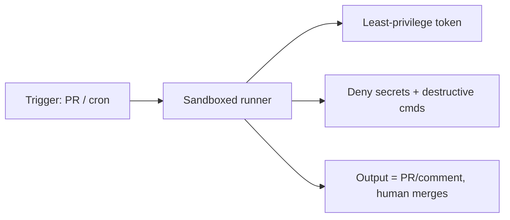

# Hardening Autonomous Runs

> Source: https://derob98.github.io/ailmanac/docs/security/hardening-autonomous-runs · AILmanac (CC BY 4.0)

Lock down headless/CI runs so an agent can't touch secrets or production.

<LevelBadge level="advanced" />

<Callout type="objectives" items={[
  "The three risks that are unique to a run with no human watching",
  "An eight-item hardening checklist, in the order you should apply it",
  "Which permission primitive actually removes capability — and which only pre-approves it",
  "Why a least-privilege token matters more than a careful prompt",
  "How to cap a runaway loop with a platform-enforced budget instead of a hopeful instruction",
  "Why persistent instruction files need to be diffed to a place the agent cannot write"
]} />

Running Claude [headless](/docs/claude-code/headless-and-agent-sdk) or on a [schedule](/docs/claude-code/background-tasks) — in CI, a cron job, a pre-commit hook — removes the human who'd normally catch a bad action. That convenience is exactly why these runs need the tightest guardrails.

## The risks unique to unattended runs

- **No one to say "no"** to a risky tool call in the moment.
- **Ambient credentials.** CI often has powerful tokens (deploy, package registry, cloud). An agent there inherits them.
- **Untrusted inputs.** A run triggered by a PR or an issue may process attacker-authored content ([injection](/docs/security/prompt-injection)).

<Callout type="warning">
The failure mode to design against is not a malicious model. It is an ordinary model, holding a token it should never have been given, acting on text an attacker wrote. Every item below removes one of those three ingredients.
</Callout>

## A hardening checklist

<Steps items={[
  {title: "Deny secrets explicitly", body: <>Block reading <code>.env</code>, key files, and credential paths via <a href="/docs/claude-code/permissions">permission deny rules</a>. Don't rely on the model to avoid them. Deny rules are the <em>only</em> primitive that removes capability — see <a href="/docs/claude-code/agent-sdk-permissions">the six-step evaluation order</a> for why an allow list cannot do this job.</>},
  {title: "Never use bypass/yolo mode on a machine with real access", body: <>Reserve "skip all prompts" for disposable sandboxes. And know what it does <em>not</em> override: deny rules, ask rules, and <code>PreToolUse</code> hooks all run upstream of the mode.</>},
  {title: "Scope the token", body: <>Give the run a least-privilege token (read-only where possible), not your full-access credentials. This is the single highest-leverage item on the list, because it is the one an injected instruction cannot argue its way around.</>},
  {title: "Sandbox and keep it ephemeral", body: <>Run in a container that's destroyed afterwards; no persistent access to production. Pair it with <a href="/docs/claude-code/sandbox-credential-masking">credential masking</a> so a leaked value is useless outside the run.</>},
  {title: "Allowlist commands and domains", body: <>Permit your test/lint/build commands; deny networked or destructive ones. Scope the rules — <code>Bash(npm test *)</code>, not a bare <code>Bash</code>.</>},
  {title: "Cap it", body: <>Max iterations, time budget, token/cost budget — so a loop or a manipulated agent can't run away. On the Anthropic-hosted loop, use <a href="/docs/api/managed-agents-session-budgets">Managed Agents Session Budgets</a> for a hard, platform-enforced USD cap that pauses the session with <code>stop_reason: "budget_reached"</code>.</>},
  {title: "Make outputs reviewable, not auto-applied", body: <>Prefer "open a PR / post a comment" over "push to main." A human merges. This converts every failure from an incident into a rejected diff.</>},
  {title: "Diff persistent memory files across sessions", body: <><code>CLAUDE.md</code>, <code>.cursorrules</code>, <code>SOUL.md</code>, <code>MEMORY.md</code>, agent-skill files — anything auto-injected as instructions — should be diffed and logged to a place the agent cannot write to. See <a href="/docs/security/mind-viruses-agent-to-agent-propagation">Mind Viruses</a> for the measured spread mechanism this defends against.</>}
]} />

## Deny removes, allow only pre-approves

The most common mistake in a hardened run is reaching for the wrong lever. An allow list looks like a lock and isn't: anything you leave off it is still available to the agent and merely falls through to the session's permission mode.

<PromptCard title="Removes the capability — the tool is gone from the request">{`claude -p "run the test suite" \\
  --disallowedTools "Bash(curl *)" "Read(//.ssh/**)" "Edit(//etc/**)"`}</PromptCard>

<PromptCard title="Makes a pre-approval list exact — anything else is denied, not prompted">{`claude -p "run the test suite" \\
  --permission-mode dontAsk \\
  --allowedTools "Bash(npm test)" "Read"`}</PromptCard>

The second form is the one you want for CI: `dontAsk` turns every would-be prompt into a denial, so a run that encounters something unanticipated fails loudly instead of hanging or silently falling back on a permissive default.

## A check that runs on every call

Allow and deny rules match patterns. When you need a check that inspects the *content* of a call — a secret-shaped string in an argument, an unexpected hostname — put it in a `PreToolUse` [hook](/docs/claude-code/hooks). Hooks run before every other permission step, and a hook denial holds even in bypass mode.

<PromptCard title="Refuse any tool call carrying secret material">{`# .claude/settings.json -> hooks.PreToolUse
# Exit code 2 blocks the call and tells Claude why.
jq -e '.tool_input | tostring | test("AKIA|BEGIN PRIVATE KEY|ghp_")' >/dev/null \\
  && { echo "secret material in tool input" >&2; exit 2; } || exit 0`}</PromptCard>

## Example: a safe CI reviewer

A PR-review bot should: check out the code read-only, have **no** deploy/secret access, run in a container, and **comment** its findings — never modify protected branches. See the [PR-review walkthrough](/docs/walkthroughs/pr-review-action).

<Quiz questions={[
  {
    q: "Your CI run uses bypassPermissions inside a container. Which of these still blocks a tool call?",
    options: [
      "An allowedTools entry you forgot to add",
      "A deny rule, an ask rule, or a PreToolUse hook",
      "Nothing — bypass means bypass",
      "The model's own judgment"
    ],
    answer: 1,
    explain: "Deny rules, ask rules, and hooks are all evaluated before the permission mode, so they survive bypassPermissions. allowedTools sits after the mode and cannot restrict anything."
  },
  {
    q: "Which single measure most limits the damage from a successful prompt injection in a CI run?",
    options: [
      "A longer, firmer system prompt telling the agent to ignore instructions in PR text",
      "A least-privilege token scoped to what the job actually needs",
      "Asking the agent to summarize untrusted input before acting on it",
      "Raising the iteration cap so it has room to self-correct"
    ],
    answer: 1,
    explain: "Prompt-level defenses can be argued around; a token that cannot deploy cannot deploy. Scope the credential and the worst case shrinks regardless of what the agent was convinced to try."
  },
  {
    q: "Why should CLAUDE.md and skill files be diffed to a location the agent cannot write to?",
    options: [
      "To keep the git history clean",
      "Because they are auto-injected as instructions, so a silent edit changes every future run",
      "To reduce token usage on each run",
      "Because Claude Code refuses to start if they change"
    ],
    answer: 1,
    explain: "Anything auto-injected as instructions is a persistence channel. If the agent can write the file and also keep the log, a compromise can edit the instructions and erase the evidence — so the log has to live outside its reach."
  }
]} />

<Callout type="takeaways" items={[
  "Unattended runs lose the human veto, inherit ambient credentials, and often read attacker-authored text — remove one ingredient at a time.",
  "Deny rules and hooks remove capability; allow lists only pre-approve. Pair allowedTools with dontAsk to make it exact.",
  "Scope the token before you tune the prompt. It is the defense an injection cannot talk past.",
  "Cap cost and iterations with a platform-enforced budget, not an instruction.",
  "Ship outputs as a PR or a comment so a human merge stays in the loop.",
  "Diff auto-injected instruction files to storage the agent cannot write."
]} />

## Next

- [Agent SDK Permissions: the Six-Step Order](/docs/claude-code/agent-sdk-permissions) — exactly which primitive wins, and the five ways an allowlist silently does nothing
- [Permissions & Permission Modes](/docs/claude-code/permissions)
- [Securing Agents & Tools](/docs/security/securing-agents)
- [Headless Mode & the Agent SDK](/docs/claude-code/headless-and-agent-sdk)
- [The claude CLI: Flags That Change Outcomes](/docs/claude-code/cli-flags) — the bounded-run flag set, and `--restricted` for a shared machine
