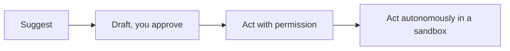

<LevelBadge level="all" />

<Callout type="objectives" items={[
  "Calibrate verification to stakes instead of verifying everything or nothing",
  "Climb the autonomy ladder deliberately — four rungs, each earned",
  "Know which data never belongs in a tool you haven't vetted",
  "Keep a human accountable where output affects people, and stay engaged with the work"
]} />

Getting the most out of AI includes using it *responsibly*. This page is short, practical, and applies to everyone — beginner to builder.

## The verification mindset

The single most important habit: **match your verification to the stakes.**

| Stakes | Example | How much to verify |
|---|---|---|
| Low | Brainstorming, rough drafts | Trust freely, skim |
| Medium | A work email, a summary | Read it, sanity-check facts |
| High | Published stats, code you'll run, legal/medical/financial | Verify every claim against a trusted source |

AI is a fast first draft, never a final authority — see [Hallucinations](/docs/foundations/hallucinations).

## The autonomy ladder

Give AI more independence only as trust is earned:

Start with "propose, I approve" ([Plan Mode](/docs/claude-code/plan-mode)); reserve full autonomy for low-risk, sandboxed, reversible work ([Hardening Autonomous Runs](/docs/security/hardening-autonomous-runs)).

<Steps items={[
  {
    title: "Suggest",
    body: "The model proposes; you do the work. Useful far longer than people expect, because you stay fluent in the thing you're delegating."
  },
  {
    title: "Draft, you approve",
    body: "It produces the artifact and you review before anything lands. This is the right default for most real work — see [Plan Mode](/docs/claude-code/plan-mode)."
  },
  {
    title: "Act with permission",
    body: "It takes actions, pausing at each consequential one. Promote a task to this rung only after watching it succeed at the previous rung repeatedly."
  },
  {
    title: "Act autonomously in a sandbox",
    body: "Reserved for work that is low-risk, reversible, and contained. If you can't cheaply undo it, it does not belong here — see [Hardening Autonomous Runs](/docs/security/hardening-autonomous-runs)."
  }
]} />

:::tip[Promote tasks, not tools]
Autonomy is earned per *task*, not granted per *tool*. The same agent can be fully autonomous on "reformat these files" and stuck at "draft, I approve" on "reply to this customer" — and that's the correct configuration, not an inconsistency.
:::

## Privacy & data

- Don't paste secrets, credentials, or others' personal data into a tool you haven't vetted.
- Know your provider's data-handling and training policy before sharing sensitive material — see [Privacy & Data Handling](/docs/foundations/privacy).
- For regulated or confidential data, use the appropriate enterprise/controlled settings.

## Bias, fairness, and limits

Models reflect patterns in their training data, which can carry **bias**. Be especially careful when AI output influences decisions about people (hiring, lending, moderation). Keep a human accountable for consequential decisions, and treat AI as an aid to judgment, not a replacement for it.

## Don't outsource your thinking

:::tip[Use AI to think better, not less]
The best users stay engaged — they question outputs, learn from them, and own the result. For studying, that means the [teach-back loop](/docs/playbooks/learning), not copy-paste. You are accountable for what you ship with AI's help.
:::

## Security, briefly

If AI ever reads untrusted content (web pages, emails, documents) or takes actions, you inherit a security model. Read [Prompt Injection](/docs/security/prompt-injection) and [Securing Agents](/docs/security/securing-agents).

<Quiz questions={[
  {
    q: "You're using AI to brainstorm names for an internal project. How much should you verify?",
    options: [
      "Every suggestion, against a trademark database",
      "Trust freely and skim — the stakes are low and the work is reversible",
      "Verify nothing ever, since verification is the model's job",
      "The same amount as for published statistics"
    ],
    answer: 1,
    explain: "Verification should be proportional to stakes. Spending high-stakes effort on a brainstorm is how people burn out on verification and then skip it where it actually matters."
  },
  {
    q: "A task has run flawlessly in \"act with permission\" mode for weeks. What justifies promoting it to autonomous?",
    options: [
      "The track record alone — it has earned it",
      "That it's also low-risk, reversible, and contained in a sandbox",
      "Nothing; autonomy is never appropriate",
      "Approval from the model itself"
    ],
    answer: 1,
    explain: "A good track record is necessary but not sufficient. The rung also requires that the worst case be cheap: low-risk, reversible, sandboxed. An irreversible task stays gated no matter how reliable it has been."
  },
  {
    q: "Where should you be most cautious about model bias?",
    options: [
      "Summarizing your own meeting notes",
      "Generating boilerplate code",
      "Anywhere the output influences a decision about a person — hiring, lending, moderation",
      "Translating documentation"
    ],
    answer: 2,
    explain: "Models reflect patterns in their training data. The risk becomes consequential exactly where output shapes outcomes for people, which is where a human must stay accountable."
  }
]} />

<Callout type="takeaways" items={[
  "Match verification to stakes — uniform paranoia and uniform trust both fail",
  "Climb the autonomy ladder per task, and only where the worst case is cheap and reversible",
  "Don't paste secrets or others' personal data into a tool you haven't vetted",
  "Keep a human accountable wherever output affects people; AI aids judgment, it doesn't replace it"
]} />

## Next

- [Prompt Injection Explained](/docs/security/prompt-injection)
- [Hallucinations & How to Reduce Them](/docs/foundations/hallucinations)
- [Privacy & Data Handling](/docs/foundations/privacy)
