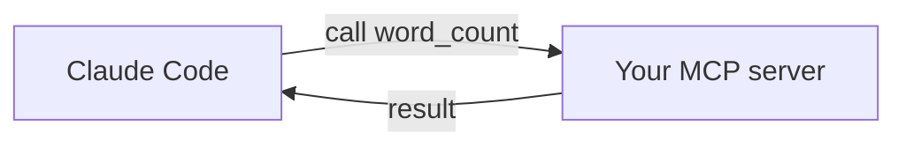

<LevelBadge level="advanced" />

<Callout type="objectives" items={[
  "Write a working MCP server with one tool in about ten lines of Python",
  "Declare it to Claude Code with a project-level .mcp.json",
  "Verify the tool is actually being called — and debug it when it isn't",
  "Swap the toy tool for a real capability without widening your attack surface"
]} />

<VerifyNote lastVerified="2026-07-23" source="https://modelcontextprotocol.io">
MCP SDK APIs and config evolve — confirm against the official MCP docs and the Claude Code MCP docs.
</VerifyNote>

Let's expose a custom tool to Claude by building a tiny [MCP](/docs/claude-code/mcp) server and connecting it. We'll keep it minimal so the *wiring* is clear — then you swap in your real logic.

## What we're building

A stdio server with one tool, `word_count`, that Claude can call. Same pattern scales to "query my DB", "open a ticket", etc.



## Step 1 — The server

`server.py` (Python; a TypeScript version is in [MCP scaffolds](/docs/templates/mcp-config)):

```python
from mcp.server.fastmcp import FastMCP

mcp = FastMCP("text-tools")

@mcp.tool()
def word_count(text: str) -> int:
    """Count the words in a piece of text."""
    return len(text.split())

if __name__ == "__main__":
    mcp.run()  # stdio transport
```

The docstring is not decoration — it's the tool description the model reads to decide whether to call it. Vague docstring, unused tool.

## Step 2 — Declare it

Add to `.mcp.json` at your repo root:

```json
{ "mcpServers": {
  "text-tools": { "command": "python", "args": ["server.py"] }
} }
```

## Step 3 — Connect & test

<Steps items={[
  {
    title: "Start Claude Code in the repo",
    body: "The server is declared at the project root, so the working directory matters — launch from the same place .mcp.json lives."
  },
  {
    title: "Ask for the tool by name",
    body: "Naming the server in your first request removes all ambiguity about whether the model *chose* not to call it versus *couldn't see* it."
  },
  {
    title: "Confirm the call actually happened",
    body: "You want to see the tool invocation, not just a plausible answer. A model can count four words itself — that proves nothing about your wiring."
  },
  {
    title: "If the tool isn't visible, bisect the problem",
    body: "Run the server by itself first: it should start cleanly and stay running. If that works, the fault is in .mcp.json — usually a wrong relative path or the wrong interpreter on PATH."
  }
]} />

<PromptCard title="Verification prompt">
{`Use the text-tools server to count the words in: "the quick brown fox".`}
</PromptCard>

Claude should call `word_count` and report `4`.

## Step 4 — Make it real

Replace `word_count` with your actual capability — a DB query, an internal API call, a file operation. Add input validation and return errors as results.

Returning errors *as results* rather than raising is what lets the model recover: a message like `"no such project: foo"` gets a retry with a corrected argument, while a crashed server just disappears from the session.

## Security checklist

:::warning[A server is code + access]
- **Least privilege** — only the data/actions it needs ([Securing Agents](/docs/security/securing-agents)).
- **Validate inputs** the model sends.
- Untrusted data it returns can carry [prompt injection](/docs/security/prompt-injection).
- **Review** any third-party server before connecting it.
:::

<Quiz questions={[
  {
    q: "Claude answers \"4\" but you never see a tool call. What have you proved?",
    options: [
      "The server works — the answer is correct",
      "Nothing about the wiring; the model can count four words unaided",
      "That stdio transport is misconfigured",
      "That the docstring is too long"
    ],
    answer: 1,
    explain: "A correct answer is not evidence of a tool call. Always verify the invocation itself — that's why the toy tool should be something you can see happen rather than something the model could guess."
  },
  {
    q: "Your tool is declared but Claude can't see it. What do you check first?",
    options: [
      "Rewrite the tool's docstring",
      "Switch transports from stdio to HTTP",
      "Run the server standalone — it should start cleanly and stay running",
      "Move .mcp.json into your home directory"
    ],
    answer: 2,
    explain: "Bisect: if the server runs fine on its own, the fault is in .mcp.json (commonly a relative path or the wrong interpreter). If it doesn't, you have a server bug, not a wiring bug."
  },
  {
    q: "Why return errors as tool results instead of raising an exception?",
    options: [
      "Exceptions are not allowed by the MCP spec",
      "A returned error lets the model read it and retry with corrected arguments",
      "It makes the server faster",
      "It avoids the need for input validation"
    ],
    answer: 1,
    explain: "A result the model can read becomes a recoverable step. A crash removes the server from the session, so the model loses the capability entirely — and usually can't tell you why."
  }
]} />

<Callout type="takeaways" items={[
  "One tool, stdio transport, project-level .mcp.json — that's the whole minimum viable server",
  "The docstring is the model's only signal about when to call your tool; write it like an API contract",
  "Verify the invocation, not the answer, or you'll ship wiring that never actually ran",
  "Errors returned as results are recoverable; exceptions silently remove the capability"
]} />

## Next

- [MCP Servers in Claude Code](/docs/claude-code/mcp)
- [MCP Config & Server Scaffolds](/docs/templates/mcp-config)
- [Tool Use / Function Calling](/docs/api/tool-use)
