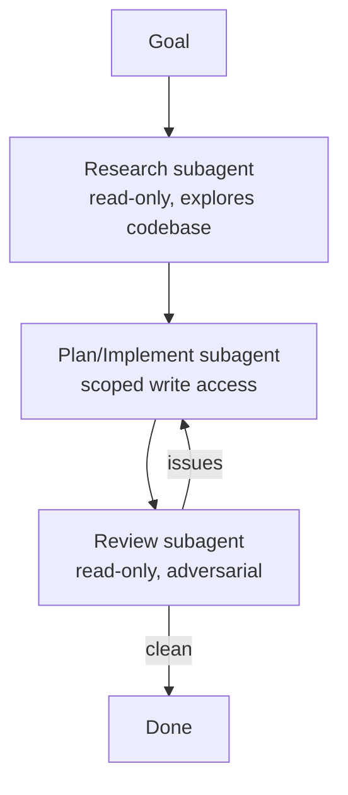

<LevelBadge level="advanced" />

<Callout type="objectives" items={[
  "Lay out a research to implement to review pipeline where each stage has its own context and its own toolset",
  "Write descriptions tight enough that the main agent delegates to the right subagent without being told",
  "Add a review gate that loops back instead of finishing on a rubber stamp",
  "Recognize the three cases where multi-agent coordination costs more than it saves",
  "Check a finished run against four signals that tell you the split actually worked"
]} />

Big tasks go better when you split them across focused [subagents](/docs/claude-code/subagents) instead of cramming everything into one context. Let's design a research → implement → review pipeline.

## The shape

Each subagent has its **own context** and a **tailored toolset** — and only the *result* flows back to the main session, keeping it clean.

## Step 1 — Define the agents

Via the `/agents` interface, define three, each with a tight `description` (so the main agent delegates correctly) and scoped tools:

<Steps items={[
  {title: "researcher — read and search only", body: "Maps the relevant code and returns findings. No write tools at all, which is what makes it safe to let it read widely. The heavy exploration happens here so it never lands in your main context."},
  {title: "implementer — can edit files and run tests", body: "Gets the researcher's findings as input, so it starts from a map instead of re-reading the codebase itself. Scoped write access: the narrower the set of files it can touch, the less it can surprise you."},
  {title: "reviewer — read-only, adversarial", body: "Looks for bugs, missing cases, and convention violations. Read-only on purpose: a reviewer that can fix what it finds stops reporting and starts patching, and you lose the signal."}
]} />

The `description` field is not documentation — it is the routing key the main agent reads when it decides whether to delegate. Vague descriptions are the single most common reason a subagent you defined never gets used.

<PromptCard title="A reviewer description that actually gets delegated to">{`Use this agent to review a completed code change adversarially before it ships.
Invoke it after the implementer reports done, and before telling the user the
task is finished. It reads the diff and the surrounding code and reports
problems; it does not fix them.`}</PromptCard>

## Step 2 — Orchestrate with handoffs

The main session passes each stage's output to the next: research → implement (using the research) → review (of the implementation). Add a **review gate**: if the reviewer finds issues, loop back to the implementer before finishing.

<PromptCard title="The handoff instruction that creates the gate">{`Run this as three stages, and do not skip the gate:

1. Delegate the exploration to the researcher. Wait for its findings.
2. Give those findings to the implementer as its starting context.
   Do not ask it to re-explore.
3. Give the implementer's result to the reviewer. If the reviewer reports
   any issue, hand the issues back to the implementer and review again.
   Only report the task complete after a review that found nothing.`}</PromptCard>

## Step 3 — Know when NOT to do this

:::warning[Parallel/multi-agent isn't free]
- **Sequential dependencies** (implement needs research) stay sequential — don't fan out where order matters.
- **Shared file writes** can conflict — isolate with [git worktrees](/docs/claude-code/worktrees) or serialize.
- For small tasks, the coordination overhead exceeds the benefit. Use this for **sizeable, decomposable** work.
:::

## Step 4 — Verify

A good multi-agent run shows: a focused main context (heavy reading happened in the researcher), an implementation that reflects the research, and a review that actually caught something (or credibly signed off). If the reviewer is a rubber stamp, make its prompt **adversarial** ("try to find what's wrong").

<Quiz questions={[
  {
    q: "You defined a reviewer subagent, but across several runs the main agent never delegates to it. What is the most likely cause?",
    options: [
      "The reviewer needs write tools before it can be invoked",
      "Its description is too vague to act as a routing key — the main agent reads the description to decide when to delegate",
      "Subagents can only be invoked by the user with an explicit command",
      "Three subagents is more than the pipeline supports"
    ],
    answer: 1,
    explain: "The description is what the main agent reads when deciding whether to delegate, so a tight description is what gets a subagent used. A reviewer should stay read-only and adversarial — giving it write tools makes it patch instead of report, which costs you the signal."
  },
  {
    q: "Your task is small: rename one function and update its three call sites. Should you run the research/implement/review pipeline?",
    options: [
      "Yes — the review gate catches mistakes on any size of task",
      "Yes, but drop the researcher stage",
      "No — for small tasks the coordination overhead exceeds the benefit; this pattern is for sizeable, decomposable work",
      "No, because subagents cannot edit files"
    ],
    answer: 2,
    explain: "Multi-agent coordination is not free. The page names three cases to avoid it: sequential dependencies that cannot be fanned out, shared file writes that can conflict, and small tasks where the overhead costs more than it saves."
  },
  {
    q: "Two subagents need to write to the same files at the same time. What is the fix?",
    options: [
      "Give both of them the full toolset so they can resolve conflicts themselves",
      "Isolate them with git worktrees, or serialize the writes",
      "Move the writes into the main session",
      "Add a second reviewer to catch the conflict afterwards"
    ],
    answer: 1,
    explain: "Shared file writes can conflict. The remedies are isolation — a git worktree per agent — or serializing so only one writes at a time. Fanning out where order actually matters is the mistake, not the thing to work around."
  }
]} />

<Callout type="takeaways" items={[
  "Split by context and toolset, not just by task name: researcher read-only, implementer scoped write, reviewer read-only and adversarial.",
  "Only the result flows back to the main session, which is the whole point — the heavy reading stays in the researcher's context.",
  "The description is a routing key. A vague one means the subagent you carefully defined never gets called.",
  "A review gate only works if it can loop: issues go back to the implementer, and the task is done only after a review that found nothing.",
  "Keep the reviewer read-only. Give it write access and it fixes instead of reporting, and you lose the signal you built it for.",
  "Skip the pattern for sequential-only work, for conflicting shared writes you have not isolated, and for anything small."
]} />

## Going further

The same pattern, programmatically, is [Building Agents on the API](/docs/api/building-agents) and product surfaces like [Cowork & Agent Teams](/docs/api/cowork-and-agent-teams).

## Next

- [Subagents & Parallel Agents](/docs/claude-code/subagents)
- [Git Worktrees](/docs/claude-code/worktrees)
- [Building Agents on the API](/docs/api/building-agents)
