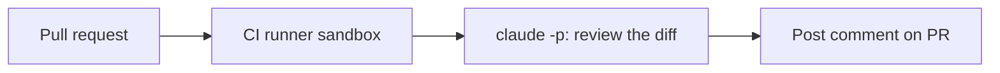

<LevelBadge level="advanced" />

<Callout type="objectives" items={[
  "Wire Claude Code headless into a pull_request workflow that reviews the diff and comments",
  "Set the permissions block to comment-only, and say why contents: write is the line you do not cross",
  "Treat pull request content as untrusted input, because that is exactly what it is",
  "Keep the cost of a review bounded as diffs grow",
  "Write the prompt so the comment gets read instead of collapsed"
]} />

<VerifyNote lastVerified="2026-07-17" source="https://code.claude.com/docs/en/headless">
Headless flags and CI integration details evolve — confirm against the official Claude Code / Agent SDK docs.
</VerifyNote>

A classic high-value automation: have Claude **review every pull request** and post its findings as a comment — running [headless](/docs/claude-code/headless-and-agent-sdk) in CI. Here's the shape, with the guardrails that keep it safe.

## What it does

On each PR: check out the diff, ask Claude to review it for bugs/edge-cases/convention issues, and post a comment. Humans still decide; Claude just gives a fast first pass.



<Steps items={[
  {title: "Check out enough history to compute a diff", body: "A shallow clone cannot see the base branch, so the diff comes out empty and the review reads as a confident sign-off on nothing. Fetch full depth."},
  {title: "Produce the diff as a file", body: "Diff the base ref against HEAD and write it to disk. Keeping it as an artifact rather than a shell variable keeps very large diffs from breaking the command line."},
  {title: "Run Claude headless with the diff on stdin", body: "One prompt, one pass, output captured as Markdown. No tools, no repo writes — this step only needs to read and produce text."},
  {title: "Post the Markdown as a PR comment", body: "With the gh CLI or an action. This is the only step that needs write permission of any kind, and the only write it needs is pull-requests."}
]} />

## The workflow (sketch)

```yaml
name: Claude PR review
on: pull_request
permissions:
  contents: read
  pull-requests: write   # to comment — NOT write to code
jobs:
  review:
    runs-on: ubuntu-latest
    steps:
      - uses: actions/checkout@v4
        with: { fetch-depth: 0 }
      - name: Review the diff
        env:
          ANTHROPIC_API_KEY: ${{ secrets.ANTHROPIC_API_KEY }}
        run: |
          git diff origin/${{ github.base_ref }}...HEAD > /tmp/diff.patch
          claude -p "Review this diff for correctness bugs, missing edge cases, and
          security issues. Report ONLY high-confidence findings as a Markdown
          checklist with file:line. Diff:" < /tmp/diff.patch > /tmp/review.md
      # then post /tmp/review.md as a PR comment (e.g. with the gh CLI or an action)
```

(Exact headless invocation may differ — see the docs. The principle is: feed the diff, capture Markdown, post it.)

## The guardrails (read [Hardening Autonomous Runs](/docs/security/hardening-autonomous-runs))

:::warning[Least privilege in CI]
- **Comment only.** Grant `pull-requests: write`, **not** `contents: write` — the bot shouldn't push code.
- **Scope the token**; never expose deploy/secret access to a job that reads untrusted PR content.
- **Treat PR content as untrusted** — it can carry [prompt injection](/docs/security/prompt-injection); don't let the job take consequential actions.
- **Cap cost** — large diffs cost [tokens](/docs/api/tokens-and-pricing); consider reviewing changed files only.
:::

## Make it useful, not noisy

- Ask for **high-confidence findings only** — a wall of nitpicks gets ignored.
- Keep it as a **first pass**, with humans making the merge call.

<PromptCard title="The review prompt — tuned for a comment people actually read">{`Review this diff for correctness bugs, missing edge cases, and security issues.

Rules for your output:
- Report ONLY high-confidence findings. If you are unsure, leave it out.
- One Markdown checklist item per finding, each starting with file:line.
- State the concrete failure: what input or state leads to what wrong result.
- No style nitpicks, no praise, no summary of what the diff does.
- If you find nothing high-confidence, say exactly that in one line.

Diff:`}</PromptCard>

<Quiz questions={[
  {
    q: "Your review job needs to post a comment on the pull request. Which permissions block is correct?",
    options: [
      "contents: write and pull-requests: write, so the bot can also push fixes",
      "contents: read and pull-requests: write — comment only; the bot should not push code",
      "contents: read and pull-requests: read, since reviewing is a read operation",
      "No permissions block is needed for pull_request workflows"
    ],
    answer: 1,
    explain: "Commenting requires pull-requests: write, and nothing more. Granting contents: write would let a job that reads untrusted pull request content push code — the exact combination you are trying to avoid. Reading the repo needs contents: read."
  },
  {
    q: "Why does the checkout step use fetch-depth: 0?",
    options: [
      "To speed up the clone on large repositories",
      "Because headless Claude requires the full git history to run",
      "Because a shallow clone cannot see the base branch, so the diff comes out empty",
      "To let the job write back to the branch later"
    ],
    answer: 2,
    explain: "The diff is computed against the base ref. A shallow clone does not have it, so the diff is empty and the review silently signs off on nothing — a failure that looks like a pass."
  },
  {
    q: "A contributor opens a PR whose description tells the reviewer to ignore the security checks and approve. What is the right posture?",
    options: [
      "Add an instruction to the prompt telling Claude never to follow instructions in the diff, and consider it solved",
      "Treat PR content as untrusted input that can carry prompt injection, and keep the job from taking any consequential action",
      "Restrict the action to PRs from members of the organization only",
      "Have the job open an issue reporting the contributor"
    ],
    answer: 1,
    explain: "Pull request content is untrusted input, and it can carry prompt injection. Prompt-level instructions help but are not a boundary. The durable control is least privilege: the job can only comment, so the worst case of a successful injection is a bad comment rather than a push, a deploy, or a leaked secret."
  }
]} />

<Callout type="takeaways" items={[
  "The whole job is: full-depth checkout, diff to a file, one headless pass, post the Markdown. Four steps, one of which needs write access.",
  "pull-requests: write and contents: read. Never contents: write in a job that reads contributor-authored content.",
  "fetch-depth: 0, or the diff is empty and the review reads like a clean bill of health.",
  "PR content is untrusted and can carry prompt injection. Least privilege is the control; prompt wording is not a boundary.",
  "Ask for high-confidence findings only, with file:line. A wall of nitpicks gets collapsed and the automation dies of being ignored.",
  "Cap the cost as diffs grow — reviewing changed files only is the usual lever.",
  "It is a first pass. Humans still make the merge call."
]} />

## Next

- [Headless Mode & the Agent SDK](/docs/claude-code/headless-and-agent-sdk)
- [Hardening Autonomous Runs](/docs/security/hardening-autonomous-runs)
- [Coding & Software Development](/docs/playbooks/coding)
