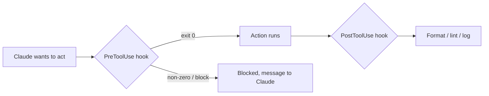

# Hooks: automatización determinista

> Source: https://derob98.github.io/ailmanac/es/docs/claude-code/hooks · AILmanac (CC BY 4.0) · last verified 2026-08-22

Ejecuta comandos en eventos del ciclo de vida para imponer formato, controles y seguridad.

<LevelBadge level="advanced" />

<VerifyNote lastVerified="2026-08-22" source="https://code.claude.com/docs/en/hooks">
Claude Code documenta más de 30 eventos de hook agrupados por fase: la lista completa, la gramática de matchers por evento y los campos JSON de salida universales están en la referencia oficial de hooks. Los nombres y la forma de los payloads evolucionan; confirma en la fuente antes de fijarte en un evento o campo concreto.
</VerifyNote>

Los hooks son **comandos de shell que Claude Code ejecuta automáticamente** en puntos definidos de su ciclo de vida. Donde los [permisos](/docs/claude-code/permissions) deciden *si* una acción está permitida, los hooks te dejan a *ti* ejecutar lógica determinista a su alrededor: formato, validación, registro, controles, ocultación de datos. Son la forma de lograr que un comportamiento esté garantizado en lugar de depender de un «por favor, acuérdate de».

<Callout type="objectives" items={["Cuándo recurrir a un hook en lugar de a una instrucción, un permiso o una skill", "El ciclo de vida completo: eventos de sesión, prompt, herramienta, subagente, tarea, compactación y fin de turno", "Cómo se conecta un hook: evento, matcher y el payload JSON en stdin", "Las dos formas en que un hook bloquea una acción: código de salida 2 frente a JSON en stdout", "Los campos JSON de salida universales compartidos entre eventos: continue, additionalContext, systemMessage, reloadSkills, sessionTitle, suppressOutput, updatedInput", "Las buenas prácticas y los errores comunes que separan los hooks rápidos y seguros de los lentos y silenciosos"]} />

## Cuándo recurrir a un hook

Recurre a un hook cuando quieras que un comportamiento esté *garantizado*, no simplemente solicitado. Cada tarea común se corresponde con un evento del ciclo de vida:

- **Formato / lint automáticos** después de cada edición de archivo (`PostToolUse` en `Edit|Write`).
- **Bloquear** una acción que infringe una regla antes de que se ejecute (`PreToolUse`).
- **Ocultar** el mensaje del asistente antes de que llegue al terminal (`MessageDisplay`).
- **Recargar skills** o fijar un **título de sesión** después de un `SessionStart`.
- **Notificar o registrar** cuando termina una sesión, finaliza una tarea o falla un turno (`Stop`, `StopFailure`, `SessionEnd`).
- **Inyectar contexto** al iniciar la sesión o cuando se cargan las instrucciones.

## Cómo funcionan

Registras los hooks en [`settings.json`](/docs/claude-code/settings), asociándolos a un **evento** (y a menudo a un matcher: normalmente el nombre de una herramienta, a veces un tipo de subagente, un disparador de compactación o un tipo de notificación). Cuando el evento se dispara, Claude ejecuta tu comando y le pasa un **payload JSON por stdin** (el nombre del evento, la sesión y campos propios del evento, como el nombre de la herramienta y sus entradas). El código de salida y la salida estándar de tu comando deciden qué ocurre después.

<Steps items={[{title: "Asocia un evento", body: "Registra el hook en settings.json bajo el evento del ciclo de vida que te interese: por ejemplo PostToolUse para automatizar tras una herramienta, o MessageDisplay para ocultar datos."}, {title: "Acota con un matcher", body: "Añade un matcher para que el hook solo se dispare cuando proceda, p. ej. matcher \"Edit|Write\" para ediciones de archivos, o matcher \"startup|resume\" en SessionStart."}, {title: "Lee el payload desde stdin", body: "Cuando el evento se dispara, Claude ejecuta tu comando y le envía por una tubería un payload JSON en stdin: el nombre del evento, la sesión y campos propios del evento (tool_name, tool_input, notification, etc.)."}, {title: "Decide qué ocurre después", body: "El código de salida y la salida de tu comando determinan el resultado: dejar que la acción siga, ejecutar tu lógica, bloquearla o devolver JSON estructurado para cambiar lo que ve Claude."}]} />

```json
{
  "hooks": {
    "PostToolUse": [
      {
        "matcher": "Edit|Write",
        "hooks": [
          { "type": "command", "command": "jq -r '.tool_input.file_path' | xargs npx prettier --write" }
        ]
      }
    ]
  }
}
```

El hook anterior lee la ruta del archivo editado del JSON de stdin (`.tool_input.file_path`) y le da formato. No des por hecho que una variable de entorno contiene la ruta: **léela de stdin.** Marcadores de ruta útiles como `${CLAUDE_PROJECT_DIR}` *sí* están disponibles para localizar scripts.

## El ciclo de vida de un vistazo

Los hooks de Claude Code abarcan toda la sesión, no solo las llamadas a herramientas. Agrúpalos por fase para saber dónde colgar tu lógica.

| Fase | Eventos | Uso típico |
| --- | --- | --- |
| **Sesión** | `SessionStart`, `SessionEnd`, `Setup`, `InstructionsLoaded`, `ConfigChange`, `CwdChanged`, `DirectoryAdded`, `FileChanged` | Inyectar contexto al inicio, tomar una instantánea al final, reaccionar a una recarga de `CLAUDE.md` o a un cambio de `.env` en disco |
| **Prompt** | `UserPromptSubmit`, `UserPromptExpansion` | Filtrar o reescribir el prompt antes de que Claude lo vea |
| **Herramienta** | `PreToolUse`, `PermissionRequest`, `PermissionDenied`, `PostToolUse`, `PostToolUseFailure`, `PostToolBatch` | Permitir/denegar una acción, escalar a una persona, dar formato tras las ediciones, reintentar tras una denegación en modo auto |
| **Subagente** | `SubagentStart`, `SubagentStop` | Registrar el inicio/la parada, impedir que un subagente devuelva su resultado |
| **Tarea** | `TaskCreated`, `TaskCompleted` | Revertir una tarea accidental, condicionar la finalización |
| **Compactación** | `PreCompact`, `PostCompact` | Tomar una instantánea de la transcripción antes de compactar, verificar después |
| **Modelo** | `PreModelSwitch`, `PostModelSwitch` | Bloquear un cambio de modelo antes de que se aplique; reaccionar después del cambio, incluso cuando una sesión reanudada lo restaura |
| **Turno** | `Stop`, `StopFailure`, `Notification`, `MessageDisplay` | Notificar al terminar, avisar ante un fallo de la API, ocultar el texto mostrado |
| **Equipo + MCP** | `TeammateIdle`, `Elicitation`, `ElicitationResult`, `WorktreeCreate`, `WorktreeRemove` | Coordinación entre sesiones, controlar las elicitations de MCP, envolver operaciones de worktree |

Los campos exactos de stdin de cada evento, la gramática de matchers y las reglas de bloqueo están en la [referencia oficial de hooks](https://code.claude.com/docs/en/hooks). El catálogo de arriba es el mapa; la referencia es el territorio.

## Cómo bloquea un hook

Hay dos formas, según el evento:

- **Código de salida 2**: el hook hace fallar la acción y lo que haya escrito en **stderr** se convierte en el mensaje que ve Claude. Es sencillo y funciona para hooks de tipo command en eventos bloqueantes (`PreToolUse`, `UserPromptSubmit`, `UserPromptExpansion`, `Stop`, `SubagentStop`, `TeammateIdle`, `TaskCreated`, `TaskCompleted`, `ConfigChange`, `PostToolBatch`, `PreCompact`, `PreModelSwitch`, `Elicitation`, `ElicitationResult`, `WorktreeCreate`, `WorktreeRemove`). En `PermissionRequest` el código 2 se ignora; deniega mediante su objeto `decision`.
- **JSON en stdout (código 0)**: devuelve una decisión estructurada. En `PreToolUse` es un `permissionDecision` con valor `"allow"`, `"deny"`, `"ask"` (poner la llamada ante el usuario) o `"defer"` (solo para ejecuciones `-p` dirigidas por una app que las reanuda), con un `permissionDecisionReason`. Los eventos no bloqueantes (`PostToolUse`, `Notification`, `MessageDisplay`, `StopFailure`, la mayoría de los eventos de sesión) ignoran los intentos de bloqueo, pero su salida JSON aún puede orientar lo que Claude ve a continuación.

El script de abajo es un hook `PreToolUse` sobre la herramienta Bash. Léelo de arriba abajo: extrae el comando de stdin y, si parece destructivo, escribe un motivo en stderr y sale con 2 para bloquear.

```bash
#!/usr/bin/env bash
# PreToolUse hook on the Bash tool: refuse to delete things.
command=$(jq -r '.tool_input.command' < /dev/stdin)
if [[ "$command" == rm\ * || "$command" == *"rm -rf"* ]]; then
  echo "Blocked: destructive 'rm' is not allowed by policy." >&2
  exit 2
fi
exit 0
```

## Campos JSON de salida universales

La mayoría de los eventos aceptan en stdout un objeto JSON estructurado que orienta lo que ocurre a continuación, aparte de los campos de decisión propios del evento como `permissionDecision`. Los más útiles:

| Campo | Qué hace | Dónde funciona |
| --- | --- | --- |
| **`continue`** | Si es `false`, Claude deja de procesar por completo; tiene prioridad sobre cualquier decisión propia del evento | La mayoría de los eventos |
| **`systemMessage`** | Añade un mensaje al contexto / la transcripción de Claude para que vea por qué actuaste | La mayoría de los eventos bloqueantes |
| **`additionalContext`** | Inyecta contexto adicional que Claude puede leer y aprovechar en el siguiente turno | `SessionStart`, `UserPromptSubmit`, otros |
| **`reloadSkills`** | Vuelve a explorar los directorios de skills para que la sesión reconozca una skill que acabas de escribir | `SessionStart` (y otros eventos de sesión) |
| **`sessionTitle`** | Fija el título de la sesión en la interfaz; va bajo `hookSpecificOutput` en `SessionStart` | `SessionStart` |
| **`suppressOutput`** | Oculta a Claude la salida de la herramienta (útil para comandos ruidosos) | Eventos de herramienta |
| **`updatedInput`** | Reescribe la entrada de la herramienta antes de que se ejecute (p. ej. añadir un indicador `--dry-run`) | `PreToolUse` |
| **`terminalSequence`** | Emite secuencias de escape del terminal: campana, título de ventana, insignia de notificación | `Notification`, `StopFailure`, otros |

Los campos de decisión propios del evento (`permissionDecision` con `"allow"`, `"deny"`, `"ask"` o `"defer"`, más `permissionDecisionReason`, en `PreToolUse`; `decision.behavior` con `"allow"` o `"deny"` en `PermissionRequest`; y `retry: true` en `PermissionDenied` para que Claude pueda reintentar la llamada denegada) se aplican por encima de estos universales.

## El modelo mental

Un hook `PreToolUse` se ejecuta *antes* de la acción y puede bloquearla; un hook `PostToolUse` se ejecuta *después* de que tenga éxito y reacciona al resultado.



<Flashcards title="Eventos de hook de un vistazo" cards={[{front: "PreToolUse", back: "Se dispara antes de que se ejecute una acción. Úsalo para bloquear o controlar, p. ej. rechazar un comando destructivo antes de que corra. Campo de decisión: permissionDecision."}, {front: "PostToolUse", back: "Se dispara después de una acción coincidente. Úsalo para dar formato, hacer lint o registrar lo que acaba de cambiar. No bloqueante."}, {front: "MessageDisplay", back: "Se dispara cuando se muestra el texto del mensaje del asistente. Úsalo para ocultar secretos o datos personales en el terminal; es solo de visualización y no puede bloquear."}, {front: "SessionStart", back: "Se dispara al comienzo (o al reanudar) de una sesión. Úsalo para inyectar contexto con additionalContext, reloadSkills cuando llega una skill nueva o fijar sessionTitle."}, {front: "Stop / StopFailure", back: "Stop se dispara cuando Claude termina un turno con normalidad; StopFailure cuando el turno acabó con un error de la API (rate_limit, overloaded, auth, etc.). Notifica o reintenta automáticamente con la variante de fallo."}, {front: "PreCompact / PostCompact", back: "Se disparan alrededor de la compactación del contexto. PreCompact puede bloquear (salida 2) o tomar antes una instantánea de la transcripción; PostCompact reacciona al estado ya compactado."}]} />

## Buenas prácticas

- **Mantén los hooks rápidos e idempotentes**: se ejecutan mucho. Los hooks `SessionEnd` comparten un único presupuesto de 1,5 segundos entre todos, así que reduce al mínimo el trabajo de fin de sesión.
- **Falla con ruido ante problemas reales**, pero no bloquees por cuestiones cosméticas.
- **Trata la salida del hook como retroalimentación para Claude**: un mensaje claro en stderr (salida 2) o en `systemMessage` (JSON) le ayuda a corregirse solo.
- **Prefiere la salida JSON a los códigos de salida** cuando quieras decir más que «bloqueado»: `permissionDecision: "ask"` en `PreToolUse` traslada la decisión a una persona sin cerrar la puerta de golpe, y `additionalContext` te permite *orientar* en lugar de solo rechazar.
- Los hooks se ejecutan con los privilegios de tu shell: revisa cualquier hook que no hayas escrito tú ([Revisar código de terceros](/docs/security/reviewing-third-party-code)).

## Errores comunes

- **Leer la ruta del archivo de una variable de entorno.** La ruta está en el JSON de stdin (`.tool_input.file_path`), no en `$CLAUDE_FILE_PATH`. Pasa stdin por `jq`.
- **Bloqueos silenciosos.** Si un hook `PreToolUse` sale con 2 sin escribir nada en stderr, Claude queda bloqueado pero no sabe *por qué* y no puede adaptarse. Escribe siempre un motivo claro (o usa `permissionDecisionReason`).
- **Intentar bloquear un evento no bloqueante.** `PostToolUse` se dispara *después* de que la herramienta se ejecutó: un código 2 solo le susurra un mensaje a Claude, no puede deshacer la acción. Si necesitas controlar, engánchate a `PreToolUse`.
- **Hooks lentos.** Un hook `PostToolUse` se ejecuta tras *cada* edición coincidente. Un linter de 3 segundos hace que toda la sesión se sienta pesada: mantén los hooks rápidos y, idealmente, actúa solo sobre lo que cambió.
- **Matchers demasiado amplios.** `matcher: ".*"` se dispara con todas las herramientas. Acota con un nombre exacto, una lista `Edit|Write` o el campo `if` por manejador (p. ej. `"if": "Bash(git push *)"`).
- **Olvidar que también hay matchers para eventos que no son de herramientas.** `SessionStart` coincide con `startup|resume|clear|compact|fork`; `Notification` coincide con tipos como `permission_prompt|idle_prompt|agent_completed`; `PreCompact` coincide con `manual|auto`. Un hook conectado al subconjunto equivocado se dispara demasiado o nunca.
- **Fiarte de hooks que no escribiste.** Un hook ejecuta shell arbitrario con tus privilegios. Revisa primero cualquier hook de un plugin o de una plantilla; consulta [Revisar código de terceros](/docs/security/reviewing-third-party-code).

<Callout type="warning" items={["Un hook ejecuta shell arbitrario con tus privilegios: nunca conectes un hook de un plugin o una plantilla sin leerlo antes."]} />

## Recetas para copiar

Hay plantillas para copiar y pegar en [Recetas de hooks y settings.json](/docs/templates/hooks-settings). Algunas de alto impacto para ver la forma de los eventos más nuevos:

<PromptCard title="Dar formato automáticamente a los archivos editados (PostToolUse en Edit|Write)">{`{
  "hooks": {
    "PostToolUse": [
      {
        "matcher": "Edit|Write",
        "hooks": [
          { "type": "command", "command": "jq -r '.tool_input.file_path' | xargs npx prettier --write" }
        ]
      }
    ]
  }
}`}</PromptCard>

<PromptCard title="Fijar al inicio un título de sesión por proyecto (SessionStart)">{`{
  "hooks": {
    "SessionStart": [
      {
        "matcher": "startup|resume",
        "hooks": [
          {
            "type": "command",
            "command": "jq -nc --arg t \\"$(basename \\"$PWD\\") — $(git rev-parse --abbrev-ref HEAD 2>/dev/null || echo detached)\\" '{hookSpecificOutput:{sessionTitle:$t}}'"
          }
        ]
      }
    ]
  }
}`}</PromptCard>

<PromptCard title="Recargar skills tras un SessionStart (reconoce una skill que acabas de escribir)">{`{
  "hooks": {
    "SessionStart": [
      {
        "matcher": "startup|resume",
        "hooks": [
          { "type": "command", "command": "printf '{\\"reloadSkills\\": true}\\n'" }
        ]
      }
    ]
  }
}`}</PromptCard>

<PromptCard title="Ocultar claves de API del texto mostrado del asistente (MessageDisplay)">{`{
  "hooks": {
    "MessageDisplay": [
      {
        "hooks": [
          {
            "type": "command",
            "command": "jq -r '.message.content' | sed -E 's/(sk-[A-Za-z0-9_-]{20,})/sk-***REDACTED***/g'"
          }
        ]
      }
    ]
  }
}`}</PromptCard>

<PromptCard title="Notificar cuando falla un turno (StopFailure — límites de uso, sobrecarga, autenticación)">{`{
  "hooks": {
    "StopFailure": [
      {
        "matcher": "rate_limit|overloaded|authentication_failed|billing_error",
        "hooks": [
          { "type": "command", "command": "osascript -e 'display notification \\"Claude Code turn failed — check the terminal\\" with title \\"Claude Code\\"'" }
        ]
      }
    ]
  }
}`}</PromptCard>

<Quiz title="Compruébalo tú mismo" questions={[{q: "¿Dónde encuentra un hook la ruta del archivo que acaba de editarse?", options: ["En la variable de entorno $CLAUDE_FILE_PATH", "En el payload JSON de stdin, en .tool_input.file_path", "En un argumento de línea de comandos que pasa Claude"], answer: 1, explain: "La ruta está en el JSON de stdin (.tool_input.file_path), no en una variable de entorno. Pasa stdin por jq para leerla."}, {q: "Un hook PreToolUse sale con el código 2. ¿Qué ocurre?", options: ["La acción se permite y stdout se registra", "La acción se bloquea, y lo que el hook escribió en stderr se convierte en el mensaje que ve Claude", "Claude ignora el resultado porque el código 2 está reservado"], answer: 1, explain: "El código de salida 2 hace fallar la acción; stderr se convierte en el mensaje que ve Claude. Escribe siempre un motivo claro para que Claude pueda adaptarse."}, {q: "Quieres que una sesión reconozca una skill que acabas de añadir a .claude/skills/ sin reiniciar. ¿Qué campo de salida, en qué evento?", options: ["reloadSkills: true en SessionStart", "restart: true en Stop", "refresh: true en PostToolUse"], answer: 0, explain: "Emitir {\"reloadSkills\": true} desde un hook SessionStart vuelve a explorar los directorios de skills, de modo que la sesión actual reconoce las skills nuevas o editadas."}, {q: "Quieres ocultar secretos del texto de Claude antes de que aparezca en la pantalla del usuario. ¿Qué evento?", options: ["PreToolUse", "PostToolUse", "MessageDisplay"], answer: 2, explain: "MessageDisplay se dispara cuando se muestra el texto del mensaje del asistente: el lugar adecuado para transformar u ocultar texto de camino al terminal. No puede bloquear."}]} />

<Callout type="takeaways" items={["Los hooks hacen que el comportamiento esté garantizado, no solicitado: lógica determinista alrededor de acciones que los permisos solo permiten o deniegan.", "El ciclo de vida abarca más de 30 eventos en las fases de sesión, prompt, herramienta, subagente, tarea, compactación y turno: elige la fase correcta antes de escribir el script.", "Registra en settings.json un evento más un matcher; Claude envía por una tubería un payload JSON en stdin y lee tu código de salida y tu salida.", "Lee la ruta del archivo de stdin (.tool_input.file_path), no de una variable de entorno.", "Bloquea con el código de salida 2 (stderr se convierte en el mensaje) o con JSON estructurado en stdout (permissionDecision en eventos de herramienta, {continue: false} para detenerlo todo).", "Los campos de salida universales (additionalContext, systemMessage, reloadSkills, sessionTitle, suppressOutput, updatedInput) te permiten orientar a Claude en lugar de solo permitir o rechazar.", "Mantén los hooks rápidos, idempotentes y con matchers estrechos, y revisa cualquier hook que no escribiste, porque se ejecuta con los privilegios de tu shell."]} />

## Siguiente

- [Mods: extensiones en proceso](/docs/claude-code/mods): el hermano en proceso, un middleware de TypeScript que puede *reescribir* un evento en lugar de solo permitirlo o bloquearlo, y que llega a todos los eventos de esta página como `classic.<Event>`
- [settings.json](/docs/claude-code/settings) · [Permisos](/docs/claude-code/permissions)
- [Skills](/docs/claude-code/skills): pericia frente a automatización
- [Reforzar las ejecuciones autónomas](/docs/security/hardening-autonomous-runs)
