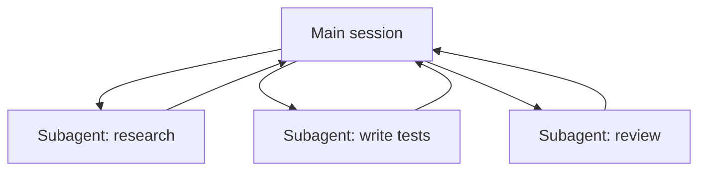

# Subagentes y agentes paralelos

> Source: https://derob98.github.io/ailmanac/es/docs/claude-code/subagents · AILmanac (CC BY 4.0) · last verified 2026-06-23

Delega en agentes de contexto aislado con herramientas acotadas — y cuándo no hacerlo.

<LevelBadge level="advanced" />

<VerifyNote lastVerified="2026-06-23" source="https://code.claude.com/docs/en/sub-agents">
Los campos del frontmatter de los subagentes, el catálogo de agentes integrados y la interfaz de `/agents` cambian con el tiempo — confírmalo en la documentación oficial.
</VerifyNote>

<Callout type="objectives" items={["Qué es un subagente — un Claude aparte con su propia ventana de contexto y un conjunto acotado de herramientas","Las tres razones para delegar: proteger el contexto, especializar y paralelizar","Los agentes integrados a los que Claude ya delega: Explore, Plan, General-purpose","Cómo definir tu propio subagente en .claude/agents/ y por qué description + tools son los dos campos clave","Cuándo NO paralelizar, y cómo esto se conecta con los agentes de la API y los flujos de trabajo a escala de flota"]} />

Un **subagente** es una instancia de Claude independiente con su **propia ventana de contexto** y un **conjunto acotado de herramientas**, a la que tu sesión principal delega una parte del trabajo. Te devuelve un resultado, no toda su transcripción — así la sesión principal se mantiene enfocada y despejada.

## Por qué delegar

Tres tareas, una herramienta. Tenlas presentes cada vez que recurras a un subagente:

- **Protege el contexto principal.** Una inmersión de investigación o un barrido de un archivo grande puede quemar miles de tokens; hazlo en un subagente y solo vuelve la conclusión.
- **Especializa.** Dale a un subagente un system prompt a medida y solo las herramientas que necesita (p. ej. un revisor de solo lectura).
- **Paraleliza.** Ejecuta subtareas independientes a la vez — p. ej. explorar tres módulos simultáneamente.

## Los integrados que ya tienes

Antes de definir los tuyos, ten en cuenta que Claude Code incluye subagentes a los que delega automáticamente:

| Integrado | Qué hace |
| --- | --- |
| **Explore** | Un agente rápido de solo lectura (se ejecuta en un modelo más económico) para buscar y entender una base de código sin tocarla. |
| **Plan** | Reúne contexto durante el modo de planificación para que la investigación no contamine la conversación principal de solo lectura. |
| **General-purpose** | Un agente con todas las herramientas para trabajo complejo de varios pasos que combina exploración y cambios. |

Rara vez los invocas por su nombre; Claude recurre a ellos cuando una tarea encaja. Los subagentes personalizados son para los trabajadores que *tú* sigues recreando con las mismas instrucciones.

## Cómo definir los tuyos

Un subagente es un archivo Markdown con frontmatter YAML (el cuerpo se convierte en su system prompt). Solo `name` y `description` son obligatorios; todo lo demás es opcional. Guárdalo por proyecto en `.claude/agents/` (regístralo en git para que el equipo lo comparta) o por usuario en `~/.claude/agents/`. Crea uno con el comando `/agents` o a mano.

<Steps items={[{title: "Elige una ubicación", body: "Por proyecto en .claude/agents/ (regístralo para que el equipo lo comparta) o por usuario en ~/.claude/agents/."},{title: "Crea el archivo", body: "Usa el comando /agents, o escribe a mano un archivo Markdown con frontmatter YAML."},{title: "Define los campos obligatorios", body: "Solo name y description son obligatorios. Todo lo demás es opcional."},{title: "Escribe el cuerpo como system prompt", body: "El cuerpo Markdown debajo del frontmatter se convierte en el system prompt del subagente."},{title: "Acota las herramientas", body: "Añade una lista de herramientas permitidas para que el subagente solo pueda hacer lo que su tarea requiere."}]} />

Un subagente `code-reviewer` para empezar:

<PromptCard title="Subagente code-reviewer (.claude/agents/code-reviewer.md)">{`---
name: code-reviewer
description: Expert code reviewer. Use proactively after code changes.
tools: Read, Glob, Grep
model: sonnet
---

You are a senior reviewer. Read the changed files, then report only
high-confidence issues: correctness bugs, security risks, and missing
tests. For each, show the file:line, the problem, and a concrete fix.
Do not restate what the code does. Never edit files.`}</PromptCard>

Dos cosas hacen bueno a un subagente:

- **La `description` es la señal de enrutamiento.** Claude la lee para decidir *cuándo* delegar, así que escríbela como un disparador — "Use proactively after code changes" lo activa automáticamente; un vago "helps with code" no lo hará. Esta es la línea de mayor impacto del archivo.
- **Acota las herramientas con rigor.** El campo `tools` es una lista de permitidos (o usa `disallowedTools` como lista de denegados). Un revisor que solo puede usar `Read, Glob, Grep` *no puede* editar tu código por accidente — la restricción es una garantía, no una sugerencia. Omite `tools` y el subagente hereda todo lo que tiene la sesión principal.

## Ejemplo práctico: un fan-out de revisión en paralelo

Acabas de terminar una funcionalidad que toca tres módulos y quieres una verificación rápida e independiente de cada uno. En tu sesión principal:

<PromptCard title="Reparte tres revisores a la vez">{`Review the changes in auth/, billing/, and api/ — use the code-reviewer subagent on each, in parallel.`}</PromptCard>

Claude genera tres instancias de `code-reviewer` a la vez. Cada una lee solo su módulo, quema su propio contexto en el contenido de los archivos y devuelve una lista breve de hallazgos. Tu sesión principal nunca ve los diffs crudos — solo tres informes ordenados — y todo termina aproximadamente en el tiempo de la instancia de revisión más lenta en lugar de la suma de las tres. Como el revisor es de solo lectura, tres agentes trabajando a la vez no pueden colisionar en una escritura.

## Cuándo NO paralelizar

<Callout type="warning" items={["Los pasos dependientes deben ser secuenciales — no repartas trabajo donde el paso B necesita la salida del paso A.","Las escrituras de archivos compartidos pueden entrar en conflicto; aíslalas (consulta Git Worktrees) o serialízalas.","El coste de coordinación puede superar el beneficio en tareas pequeñas. Delega cuando la subtarea sea de tamaño considerable e independiente."]} />

Para aislar escrituras en conflicto, consulta [Git Worktrees](/docs/claude-code/worktrees).

## Subagente frente a los "agentes" de la API/SDK

Esta página trata sobre la delegación integrada de Claude Code. Crear tus *propios* agentes de forma programática es [Crear agentes sobre la API](/docs/api/building-agents). El modelo mental — un objetivo, un bucle de herramientas, contexto aislado — es el mismo.

## Errores comunes

<Flashcards title="Trampas — voltea cada tarjeta para ver la solución" cards={[{front: "Una description vaga", back: "Si no dice CUÁNDO usar el subagente, Claude no delegará en el momento adecuado (o no delegará en absoluto). Empieza con \"Use when…\" / \"Use proactively after…\"."},{front: "Dejar las herramientas abiertas de par en par", back: "Un subagente pensado para revisar no debería poder escribir. Una lista de permitidos convierte la intención en una garantía."},{front: "Esperar memoria compartida", back: "Un subagente recibe su description, su system prompt y la tarea que le entregas — no tu conversación principal. Pásale el contexto que necesita en la delegación."},{front: "Repartir trabajo dependiente", back: "El paralelismo solo ayuda con subtareas independientes; si B necesita la salida de A, ejecútalos en secuencia."}]} />

## Cuándo unos pocos agentes no bastan

Delegar un puñado de subagentes por turno es el pan de cada día de esta página. Cuando una tarea necesita **decenas o cientos** de agentes — un barrido de toda la base de código, una migración de 500 archivos, investigación contrastada entre muchas fuentes — la orquestación supera lo que cabe en una sola ventana de contexto. Para eso están los [Flujos de trabajo dinámicos y ultracode](/docs/claude-code/dynamic-workflows): Claude escribe un script que sostiene el plan, y un runtime reparte los agentes en segundo plano.

<Quiz title="Ponte a prueba" questions={[{q: "¿Qué campo del frontmatter de un subagente es la señal de enrutamiento que Claude lee para decidir CUÁNDO delegar?", options: ["name", "description", "model"], answer: 1, explain: "La description es la línea de mayor impacto — Claude la lee para decidir cuándo delegar. Escríbela como un disparador, p. ej. \"Use proactively after code changes\"."}, {q: "A un subagente revisor se le dan las herramientas: Read, Glob, Grep. ¿Qué garantiza esa lista de permitidos?", options: ["Que se ejecuta en un modelo más económico", "Que no puede editar tu código por accidente", "Que hereda las herramientas de la sesión principal"], answer: 1, explain: "El campo tools es una lista de permitidos, así que un revisor limitado a Read, Glob, Grep no puede escribir — la restricción es una garantía, no una sugerencia. Omitir tools, en cambio, heredaría todo."}, {q: "¿Cuándo NO ayuda paralelizar subagentes?", options: ["Cuando las subtareas son independientes y de tamaño considerable", "Cuando el paso B necesita la salida del paso A", "Cuando cada agente lee un módulo distinto"], answer: 1, explain: "Los pasos dependientes deben ejecutarse en secuencia. El paralelismo solo ayuda con subtareas independientes; si B necesita la salida de A, ejecútalos en secuencia."}]} />

<Callout type="takeaways" items={["Un subagente es un Claude aparte con su propia ventana de contexto y herramientas acotadas; devuelve un resultado, no su transcripción.","Delega para proteger el contexto principal, para especializar o para paralelizar trabajo independiente.","Claude ya incluye los integrados Explore, Plan y General-purpose y recurre a ellos automáticamente.","name y description son los únicos campos obligatorios del frontmatter — y description es la señal de enrutamiento que decide cuándo delega Claude.","Una lista de herramientas permitidas convierte la intención en una garantía; reparte solo subtareas independientes y aísla las escrituras compartidas."]} />

## Siguiente

- [Flujos de trabajo dinámicos y ultracode](/docs/claude-code/dynamic-workflows) — orquesta subagentes a escala de flota
- [Diseña un flujo de trabajo con varios subagentes (tutorial)](/docs/walkthroughs/multi-subagent-workflow)
- [Gestión del contexto](/docs/claude-code/context-management)
- [Git Worktrees](/docs/claude-code/worktrees)
