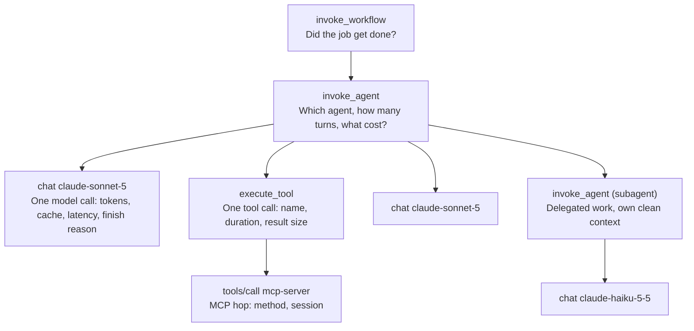

# Observabilité des agents : tracer un agent que vous ne pouvez pas reproduire

> Source: https://derob98.github.io/ailmanac/fr/docs/api/agent-observability · AILmanac (CC BY 4.0) · last verified 2026-10-09

Une exécution d'agent est une trace distribuée non déterministe : on ne la débogue donc pas en la relançant — il faut l'avoir enregistrée. Cette page couvre ce qu'il faut enregistrer : les formes de spans OpenTelemetry GenAI (et pourquoi chaque attribut gen_ai.* est encore « Development »), les noms exacts des métriques et événements de Claude Code, le request-id qui relie votre trace au support d'Anthropic, et les trois pièges de confidentialité de la télémétrie des agents.

<LevelBadge level="advanced" />

La première fois qu'un agent fait quelque chose d'inexplicable en production, vous essaierez de le reproduire. Vous relancerez le même prompt avec les mêmes outils et obtiendrez une réponse différente et parfaitement raisonnable — et le bug aura disparu, non corrigé, en attente.

Ce moment est tout l'argument de cette page. Un service classique est assez déterministe pour que les logs soient un confort : à partir des entrées, on peut redériver le comportement. Une exécution d'agent est une **trace distribuée non déterministe** — échantillonnée jeton par jeton, bifurquant selon des résultats d'outils qui ont changé depuis, répartie entre votre processus, le fournisseur du modèle et autant de serveurs MCP que nécessaire. Vous ne pouvez pas la redériver. Soit vous l'avez enregistrée, soit elle est perdue.

L'observabilité des agents n'est donc pas « un tableau de bord à ajouter plus tard ». C'est ce qui décide si vos incidents sont déboguables ou non. La bonne nouvelle, c'est qu'en 2026 il existe enfin un vocabulaire partagé. La mauvaise — et la raison pour laquelle la première tentative de la plupart des équipes doit être refaite — c'est que ce vocabulaire n'est **pas encore stable**, et que presque personne ne vous le dit avant que vous ayez branché 40 panneaux sur des noms d'attributs explicitement autorisés à changer.

<Callout type="objectives" items={[
  "Connaître les quatre types de spans qu'une exécution d'agent doit produire, et ce que porte chacun",
  "Comprendre pourquoi chaque attribut gen_ai.* porte encore le badge « Development » d'OpenTelemetry — et comment construire des tableaux de bord qui y survivent",
  "Activer l'export OpenTelemetry de Claude Code avec les noms de variables exacts, et lire les métriques et événements qu'il émet",
  "Capturer le request-id, le seul identifiant que le support d'Anthropic peut retrouver",
  "Éviter les trois pièges de confidentialité : l'identité n'est pas masquée, le masquage du contenu se règle par signal, et votre endpoint de collecteur est un canal d'exfiltration",
  "Choisir un budget de cardinalité avant l'arrivée de la facture de vos métriques"
]} />

:::info[Vous n'aurez peut-être plus à écrire cette instrumentation]
Depuis octobre 2026, l'API Claude et le SDK Claude émettent eux-mêmes ces spans, en bêta — y compris des spans pour ce que votre processus ne peut pas voir, comme chaque requête de modèle à l'intérieur d'une requête d'API et chaque outil serveur exécuté par l'API. Cette page reste celle qui explique ce que les noms *signifient* et comment construire sur des noms autorisés à changer. Pour la mise en place, la règle de recouvrement qui garde les comptes de jetons honnêtes et la sémantique de livraison, voir [le traçage OpenTelemetry natif](/docs/api/opentelemetry-tracing).
:::

## Pourquoi relancer n'est pas déboguer

Quatre propriétés d'une exécution d'agent brisent chacune un réflexe de débogage habituel :

| Propriété | Le réflexe qu'elle brise |
| --- | --- |
| **L'échantillonnage est stochastique** | « Relance avec la même entrée. » La même entrée n'est pas la même exécution. |
| **Les résultats d'outils sont en direct** | Même à température 0, un outil qui lit une base de données, une horloge ou le web renvoie quelque chose de nouveau. La trajectoire diverge à l'étape 2. |
| **La décision est dans le contexte, pas dans le code** | Votre stack trace montre `callModel()`. Elle ne montre pas les 180 Ko d'historique accumulé qui ont poussé le modèle à choisir le mauvais outil. |
| **L'échec est souvent silencieux** | Un agent défaillant lève rarement une exception. Il renvoie une réponse fausse et sûre d'elle avec un HTTP 200. Il n'y a aucune exception à attraper. |

La dernière mérite d'être soulignée car elle inverse les priorités habituelles d'instrumentation. Dans un service typique, on instrumente d'abord les erreurs. Dans un agent, **les échecs intéressants sont des succès** — des tours qui se sont terminés, ont coûté de l'argent et ont fait la mauvaise chose. Si vous n'enregistrez que les spans terminés par `error.type`, vous avez enregistré la moitié facile de vos problèmes.

## Les quatre spans d'une exécution d'agent

Les conventions sémantiques GenAI d'OpenTelemetry définissent les formes. Le modèle mental utile comporte quatre niveaux imbriqués, chacun répondant à une question différente.

Les règles de nommage sont spécifiées, et les suivre est ce qui rend vos traces lisibles dans un outil que vous n'avez pas écrit :

- **Span d'inférence** — `gen_ai.operation.name` vaut `chat` (ou `embeddings`, `text_completion`, `generate_content`) ; le nom du span est `{gen_ai.operation.name} {gen_ai.request.model}`, donc `chat claude-sonnet-5`. Type de span `CLIENT`.
- **Spans d'agent** — `create_agent {gen_ai.agent.name}` et `invoke_agent {gen_ai.agent.name}`, avec repli sur un simple `invoke_agent` quand le nom n'est pas disponible. Il existe une variante cliente et une variante interne, ce qui permet de distinguer un agent hébergé de votre propre boucle.
- **Span de workflow** — `invoke_workflow {gen_ai.workflow.name}`, pour l'orchestration multi-agents au-dessus des agents.
- **Span d'outil** — `execute_tool`, pour l'exécution réelle de l'outil.
- **Spans MCP** — une convention distincte : nom de span `{mcp.method.name} {target}` (ou simplement `{mcp.method.name}` quand il n'y a pas de cible à faible cardinalité), avec `mcp.method.name` obligatoire et `mcp.session.id` recommandé. Renseigner aussi `gen_ai.operation.name` sur un span d'appel d'outil MCP est explicitement recommandé, afin que les consommateurs traitent les appels d'outils MCP comme n'importe quel autre appel d'outil.

Les attributs par appel qui valent leurs octets : `gen_ai.provider.name`, `gen_ai.request.model`, `gen_ai.response.model` (ces deux-là diffèrent quand le fournisseur épingle un snapshot), `gen_ai.usage.input_tokens`, `gen_ai.usage.output_tokens`, `gen_ai.usage.cache_read.input_tokens`, `gen_ai.usage.cache_write.input_tokens`, `gen_ai.usage.reasoning.output_tokens`, `gen_ai.response.finish_reasons` et, pour le streaming, `gen_ai.response.time_to_first_chunk`.

Pour Anthropic en particulier, une convention propre au fournisseur prime sur la convention générique : `gen_ai.provider.name` DOIT valoir `"anthropic"`, et DEVRAIT être renseigné **à la création du span** plutôt qu'ajouté à la fin. Ce détail compte plus qu'il n'y paraît — l'échantillonnage en fin de trace et les règles de routage par fournisseur ne peuvent agir que sur des attributs qui existent au démarrage du span.

<VerifyNote lastVerified="2026-10-09" source="https://github.com/open-telemetry/semantic-conventions-genai">
Les noms de spans, d'opérations et d'attributs ci-dessus proviennent du dépôt des conventions sémantiques GenAI d'OpenTelemetry (`docs/gen-ai/gen-ai-spans.md`, `gen-ai-agent-spans.md`, `anthropic.md`, `mcp.md`). Chaque document y est marqué **Status: Development**. Revérifiez avant de vous appuyer sur un nom précis.
</VerifyNote>

## Ce dont personne ne vous avertit : les conventions ne sont pas stables

Voici le fait qui devrait façonner votre conception, et que vous ne trouverez pas sur la page d'accueil d'un fournisseur d'observabilité.

**Chaque attribut, span, métrique et événement `gen_ai.*` est marqué « Development »** — le terme d'OpenTelemetry pour ce qu'on appelait expérimental. Aucun n'est Stable. Et en 2026, les conventions ont physiquement déménagé : le contenu GenAI a quitté le dépôt principal `open-telemetry/semantic-conventions` pour un dépôt dédié `open-telemetry/semantic-conventions-genai`, qui **n'a aucune release taguée** — zéro tag, zéro release, avec des commits qui arrivent tous les jours.

Lisez les tableaux d'attributs de ce dépôt et l'asymétrie est presque drôle. Sur un span d'inférence GenAI, les attributs portant un badge vert **Stable** sont `error.type`, `server.address` et `server.port` — les trois qui n'ont rien à voir avec GenAI. Tout ce qui rend le span *relatif à un LLM* est Development.

Donc : ne lisez pas cela comme « n'utilisez pas les conventions ». Utilisez-les — un vocabulaire partagé susceptible de changer vaut mieux qu'un vocabulaire maison qui, lui, ne voyagera sûrement pas. Lisez-le comme **ne couplez rien de coûteux directement à ces noms.** Trois habitudes rendent cela peu cher :

<Steps items={[
  {
    "title": "Émettre via une couche de correspondance, pas des littéraux en ligne",
    "body": "Un seul module qui possède chaque clé d'attribut que votre application écrit. Quand `gen_ai.usage.reasoning.output_tokens` est renommé, vous changez une constante, pas 60 sites d'appel. C'est un fichier de vingt lignes, et c'est la chose au meilleur rendement de cette page."
  },
  {
    "title": "Enregistrer la version de la convention comme attribut de ressource",
    "body": "Marquez chaque span avec la révision semconv sur laquelle vous avez émis — un SHA de commit convient, puisqu'il n'y a pas de tags à citer. Dans six mois, la seule façon d'interpréter correctement une ancienne trace est de savoir quelle orthographe elle utilisait. Sans cela, un renommage scinde silencieusement une métrique en deux et vous faites la moyenne des deux."
  },
  {
    "title": "Alerter sur des valeurs dérivées, pas sur des noms d'attributs bruts",
    "body": "Définissez `cost_per_completed_task`, `cache_hit_ratio`, `tool_error_rate` une seule fois, dans la couche de requête ou une règle d'enregistrement, et pointez chaque tableau de bord et alerte vers elles. Un renommage casse alors une définition bruyamment au lieu de quarante panneaux discrètement."
  },
  {
    "title": "Garder l'identifiant propre au fournisseur à côté des standards",
    "body": "Les conventions peuvent bouger ; `request-id` non. Voir la section suivante — c'est votre échappatoire quand une trace doit être rapprochée du fournisseur."
  }
]} />

## L'identifiant qui résout vraiment les incidents : `request-id`

Chaque réponse de l'API Claude porte un en-tête de réponse `request-id`, avec une valeur du type `req_018EeWyXxfu5pfWkrYcMdjWG`. La même valeur apparaît dans le champ `request_id` des corps de réponse d'erreur. C'est l'identifiant que réclame le support d'Anthropic, et le seul qui permette à quelqu'un de l'autre côté d'examiner votre appel précis.

Mettez-le sur le span. Il coûte 30 octets et fait la différence entre « l'agent a échoué à 03:12 UTC, voici 900 requêtes candidates » et une seule recherche.

<PromptCard title="Capture the Anthropic request ID onto the current span (Python)">
{`import anthropic
from opentelemetry import trace

client = anthropic.Anthropic()
span = trace.get_current_span()

message = client.messages.create(
    model="claude-sonnet-5",
    max_tokens=1024,
    messages=[{"role": "user", "content": "Hello, Claude"}],
)

# The Python and TypeScript SDKs expose it directly on the response object.
span.set_attribute("anthropic.request_id", message._request_id)
span.set_attribute("gen_ai.usage.input_tokens", message.usage.input_tokens)
span.set_attribute("gen_ai.usage.output_tokens", message.usage.output_tokens)`}
</PromptCard>

Trois subtilités à connaître avant d'en avoir besoin :

- **Python et TypeScript** l'exposent sous `_request_id` sur les objets de réponse de premier niveau. **C#, Go, Java et PHP** l'exposent via leurs accesseurs de réponse brute (`with_raw_response` / `.withResponse()` / `.withRawResponse()` / `WithRawResponse` / `option.WithResponseInto` / `->raw`). **Ruby** nécessite un middleware par requête, car le SDK ne l'expose pas sur l'objet.
- **Les erreurs le portent aussi.** Quand un appel échoue, `request_id` figure dans le corps JSON de l'erreur — la corrélation survit donc exactement dans le cas où vous en avez le plus besoin.
- **Sur Claude Platform on AWS, il y a deux ID, et le principal n'est pas celui d'Anthropic.** `x-amzn-requestid` est l'ID principal et celui indexé dans CloudTrail ; `request-id` est secondaire. Utilisez celui d'AWS pour les recherches CloudTrail et celui d'Anthropic pour les tickets au support d'Anthropic. Enregistrez les deux, étiquetés, ou vous passerez un après-midi à chercher dans le mauvais système.

<VerifyNote lastVerified="2026-10-09" source="https://platform.claude.com/docs/en/api/errors">
L'en-tête `request-id`, le champ `request_id` du corps d'erreur, les accesseurs par SDK et le comportement à double ID sur Claude Platform on AWS sont tous documentés sur la page des erreurs de l'API Claude. Les noms d'en-tête et de champ sont une surface d'API stable ; l'ergonomie par SDK change avec les versions des SDK.
</VerifyNote>

## Claude Code : le seul agent qui exporte déjà tout

Si votre agent *est* Claude Code — qui tourne en CI, dans une flotte ou dans une équipe — vous n'avez rien à instrumenter. Il embarque un exportateur OpenTelemetry. La plupart des équipes qui l'utilisent à grande échelle ne l'ont jamais activé, ce qui est dommage, car il répond directement à « combien ça nous coûte et est-ce que ça marche ».

<PromptCard title="Enable Claude Code telemetry against a local OTLP collector">
{`export CLAUDE_CODE_ENABLE_TELEMETRY=1
export OTEL_METRICS_EXPORTER=otlp
export OTEL_LOGS_EXPORTER=otlp
export OTEL_EXPORTER_OTLP_PROTOCOL=grpc
export OTEL_EXPORTER_OTLP_ENDPOINT=http://localhost:4317
export OTEL_EXPORTER_OTLP_HEADERS="Authorization=Bearer your-token"
claude`}
</PromptCard>

`CLAUDE_CODE_ENABLE_TELEMETRY=1` est l'interrupteur principal — sans lui, rien n'est exporté quoi que vous définissiez d'autre. Choisissez ensuite les exportateurs par signal : `OTEL_METRICS_EXPORTER` accepte `otlp`, `prometheus`, `console` ou `none` ; `OTEL_LOGS_EXPORTER` accepte `otlp`, `console`, `none`. **Les traces sont à part et conditionnées à la bêta** : définissez aussi `CLAUDE_CODE_ENHANCED_TELEMETRY_BETA=1`, puis `OTEL_TRACES_EXPORTER`. Les intervalles d'export valent par défaut 60 000 ms pour les métriques et 5 000 ms pour les logs.

Les métriques sont la partie qui vaut un tableau de bord, car celles de coût sont attribuées assez finement pour répondre à de vraies questions :

| Métrique | À quoi elle répond |
| --- | --- |
| `claude_code.cost.usage` (USD) | Les dépenses, attribuables par modèle et par source de requête — agent principal, sous-agent ou auxiliaire |
| `claude_code.token.usage` (tokens) | La même forme en jetons, qui est ce que vous optimisez réellement |
| `claude_code.session.count` | L'adoption. Des sessions stables avec un coût en hausse, ce n'est pas la même histoire que les deux en hausse. |
| `claude_code.active_time.total` (s) | Le temps réellement actif, par opposition à un terminal laissé ouvert |
| `claude_code.lines_of_code.count` | Le volume de changement — un dénominateur, jamais un objectif |
| `claude_code.code_edit_tool.decision` | **Le signal de qualité.** Accepter/rejeter sur les outils d'édition. Des rejets en hausse signifient que l'agent propose un travail moins bon. |
| `claude_code.commit.count`, `claude_code.pull_request.count` | Les sorties qui ont réellement quitté la machine |

Les événements (exportés comme logs) sont le relevé par action : `claude_code.user_prompt`, `claude_code.assistant_response`, `claude_code.tool_result`, `claude_code.tool_decision`, `claude_code.api_request`, `claude_code.api_error`, `claude_code.api_refusal`, `claude_code.api_retries_exhausted`, `claude_code.permission_mode_changed`, `claude_code.mcp_server_connection`, `claude_code.skill_activated`, `claude_code.plugin_installed`, `claude_code.plugin_loaded`, `claude_code.at_mention`, `claude_code.auth`, `claude_code.hook_registered`, `claude_code.managed_settings_resolved`, `claude_code.internal_error`, plus `claude_code.api_request_body` / `claude_code.api_response_body` pour les charges utiles brutes.

Deux d'entre eux méritent une requête enregistrée dès le premier jour. `claude_code.api_retries_exhausted` est la forme d'une panne qui atteint vos développeurs — il se déclenche après que le backoff du SDK a abandonné. Et `claude_code.permission_mode_changed` est une piste d'audit : c'est ainsi que vous découvrez que la flotte tourne dans un mode plus permissif que votre politique, sans lire la transcription de personne.

<VerifyNote lastVerified="2026-10-09" source="https://code.claude.com/docs/en/monitoring-usage">
Les noms de variables, options d'exportateurs, noms de métriques, noms d'événements et la condition bêta sur les traces proviennent de la documentation de surveillance de Claude Code. Claude Code est livré fréquemment et cette surface s'étend — confirmez les noms sur la page officielle avant de construire des alertes dessus.
</VerifyNote>

### Attribution multi-équipes, à peu de frais

Une seule variable fait le travail de toute une stratégie d'étiquetage. `OTEL_RESOURCE_ATTRIBUTES` est exporté comme labels de métriques (contrôlé par `OTEL_METRICS_INCLUDE_RESOURCE_ATTRIBUTES`, activé par défaut), si bien que l'attribution par centre de coûts tient en une ligne dans ce qui provisionne vos environnements de développement :

<PromptCard title="Attribute agent spend to a team and cost center">
{`export OTEL_RESOURCE_ATTRIBUTES="department=engineering,team.id=platform,cost_center=eng-123"`}
</PromptCard>

## Les trois pièges de confidentialité

C'est là que les déploiements de télémétrie bien intentionnés déraillent, et les trois sont évitables si on les connaît avant que le collecteur soit en service.

**1. Le contenu est masqué par défaut. L'identité ne l'est pas.** Les valeurs par défaut de Claude Code sont vraiment prudentes sur le *contenu* : prompts, réponses de l'assistant, paramètres d'outils et sorties d'outils sont tous masqués sauf opt-in par signal (`OTEL_LOG_USER_PROMPTS`, `OTEL_LOG_ASSISTANT_RESPONSES`, `OTEL_LOG_TOOL_DETAILS`, `OTEL_LOG_TOOL_CONTENT`, `OTEL_LOG_RAW_API_BODIES`), et les noms de plugins tiers s'affichent sous la forme d'un espace réservé `"third-party"` tant que `OTEL_LOG_TOOL_DETAILS=1` n'est pas défini. Mais `user.email` — l'adresse réelle issue de la connexion, ou des identifiants propres à une session cloud — est incluse quand elle est disponible, et `organization.id` est toujours présent quand on est authentifié. La posture par défaut est donc *« on ne sait pas ce qu'ils ont tapé, on sait exactement qui ils sont »*.

C'est la bonne valeur par défaut pour la plupart des entreprises et la mauvaise pour certaines. À distinguer de son voisin : `user.id` est un identifiant anonyme aléatoire généré au premier lancement et conservé dans `~/.claude.json` — il est documenté comme ne contenant aucune information personnelle et comme n'étant pas dérivé de votre compte Claude. `user.account_uuid` et `user.account_id` sont ceux liés au compte, et peuvent être désactivés via `OTEL_METRICS_INCLUDE_ACCOUNT_UUID`. Décidez délibérément lequel de ces trois votre collecteur doit détenir, et dites à vos développeurs lequel c'est.

**2. Activer la capture de contenu déplace vos secrets dans un second système.** `OTEL_LOG_TOOL_CONTENT=1` est une chose raisonnable à vouloir — la sortie des outils est l'endroit où la plupart des bugs d'agent sont visibles. Cela signifie aussi que chaque fichier lu par votre agent, chaque sortie de commande et tout ce qu'un `.env` contenait se retrouve dans votre backend d'observabilité, sous sa politique de rétention et ses contrôles d'accès plutôt que ceux de votre dépôt. Considérez l'activer comme accorder à votre fournisseur d'observabilité la même habilitation qu'à votre gestion de code source, car c'est exactement ce que c'est. Si vous n'en avez besoin que pendant un incident, activez-le pour l'incident.

**3. Votre endpoint de collecteur est un canal d'exfiltration.** C'est le piège qui mord. La télémétrie est configurée par des variables d'environnement, et dans les environnements cloud celles-ci sont lisibles par tous les utilisateurs — un `OTEL_EXPORTER_OTLP_ENDPOINT` défini par un développeur peut donc diriger toute la télémétrie d'une session vers un hôte dont vous n'avez jamais entendu parler. Le conseil de la documentation elle-même est le remède : mettez identifiants et endpoints dans les paramètres gérés côté serveur plutôt que dans des variables d'environnement ambiantes, où les identifiants gérés peuvent supprimer les variables définies par les développeurs précisément pour empêcher l'export vers des collecteurs non autorisés. Si vous avez activé la moindre capture de contenu, ce n'est plus un point d'hygiène mais le contrôle qui compte.

Pour des identifiants rotatifs, il existe un hook d'en-têtes dynamiques plutôt qu'un jeton statique : pointez `otelHeadersHelper` vers un script qui affiche du JSON ; il s'exécute au démarrage puis environ toutes les 29 minutes (réglable via `CLAUDE_CODE_OTEL_HEADERS_HELPER_DEBOUNCE_MS`). Il fonctionne avec `http/protobuf` et `http/json`, pas avec `grpc` — un détail qui vous coûtera sinon une heure, puisque le guide de démarrage utilise grpc.

## Cardinalité : choisir un budget avant la facture

La télémétrie d'agent excelle à générer des labels à forte cardinalité, parce que les identifiants naturels sont par exécution. Un ID de session est unique par session par définition ; attachez-le à une métrique et vous avez fabriqué une série temporelle par session.

Claude Code expose explicitement ce compromis plutôt que de le cacher, et les valeurs par défaut disent comment les concepteurs le pèsent :

| Variable | Défaut | Ajoute |
| --- | --- | --- |
| `OTEL_METRICS_INCLUDE_SESSION_ID` | `true` | `session.id`, `ccr.session.id` — **la plus forte cardinalité du lot** |
| `OTEL_METRICS_INCLUDE_ACCOUNT_UUID` | `true` | `user.account_uuid`, `user.account_id` |
| `OTEL_METRICS_INCLUDE_RESOURCE_ATTRIBUTES` | `true` | tout ce que vous mettez dans `OTEL_RESOURCE_ATTRIBUTES` |
| `OTEL_METRICS_INCLUDE_VERSION` | `false` | `app.version` |
| `OTEL_METRICS_INCLUDE_ENTRYPOINT` | `false` | `app.entrypoint` |
| `OTEL_METRICS_INCLUDE_REPOSITORY` | `false` | attributs de dépôt `vcs.*` |

La règle portable, au-delà de Claude Code : **les identifiants par exécution vont sur les spans et les événements, pas sur les labels de métriques.** Les spans sont déjà un par exécution, donc un ID de session y est gratuit et rend la trace jointe. Sur un compteur ou un histogramme, il multiplie votre nombre de séries par votre trafic. Si un nombre n'a de sens que pour une exécution, ce n'est pas une métrique.

L'ID de session est activé par défaut parce que relier métriques et traces est réellement utile. Si votre backend facture à la série, c'est le premier interrupteur à basculer — et la première chose à vérifier quand la facture vous surprend.

## Un plan d'instrumentation de départ

Pas un modèle de maturité. L'ordre ci-dessous est choisi pour que chaque étape soit utile seule, et pour que vous vous arrêtiez au point qui correspond à ce que vos agents peuvent vous coûter.

<Steps items={[
  {
    "title": "Enregistrer à chaque tour les comptes de jetons, la répartition du cache, le modèle et le request-id",
    "body": "Avant tout tableau de bord. Entrée, sortie, lecture du cache, écriture du cache, jetons de raisonnement, modèle demandé, modèle répondant et ID de requête du fournisseur. Cet enregistrement unique répond à la plupart des questions de coût et rend chaque incident rapprochable du fournisseur. Si vous ne faites rien d'autre de cette page, faites ceci."
  },
  {
    "title": "Spanner la boucle, pas seulement l'appel",
    "body": "Un span par invocation d'agent qui enveloppe un span par appel de modèle et un par appel d'outil. Le bug coûteux d'un agent est presque jamais dans un seul appel — c'est une boucle qui a pris onze tours pour un travail de deux tours, et on ne le voit pas sans le span parent."
  },
  {
    "title": "Ajouter un signal de qualité par surface",
    "body": "Un coût sans dénominateur de qualité optimise vers le fait de faire moins. Sur Claude Code, claude_code.code_edit_tool.decision vous est livré. Sur votre propre agent, choisissez ce que vos utilisateurs acceptent ou rejettent déjà implicitement et enregistrez-le comme attribut de span dès le premier jour."
  },
  {
    "title": "Alerter sur des ratios dérivés, et mettre l'alerte de budget en premier",
    "body": "cost_per_completed_task, cache_hit_ratio, tool_error_rate, turns_per_task. Un agent passé silencieusement de 3 tours à 30 est invisible sur le coût absolu pendant une semaine calme et évident sur un ratio. Associez cela à un vrai plafond de dépenses — la télémétrie vous dit que c'est arrivé, elle ne l'arrête jamais."
  },
  {
    "title": "Décider délibérément de la capture de contenu, et écrire la décision",
    "body": "Désactivée par défaut, activée pour les incidents, documentée dans les deux cas — y compris les attributs d'identité que détient votre collecteur. L'équipe mérite de le savoir ; dans un an, vous aussi."
  }
]} />

## Erreurs courantes

- **Instrumenter l'appel du modèle et pas la boucle.** Les données au niveau de l'appel semblent correctes jusqu'à ce que vous remarquiez que vous payez 30 tours. Sans span parent, il n'y a pas de `turns_per_task` pour le remarquer.
- **Ne garder que les spans en échec.** Les agents échouent avec un HTTP 200. Échantillonnez aussi les succès, sinon votre magasin de traces ne contient que les bugs déjà faciles.
- **Coder en dur les noms `gen_ai.*` dans les tableaux de bord.** Ils sont tous Development, dans un dépôt sans release taguée, avec des commits quotidiens. Un module de correspondance, un attribut de ressource pour la version semconv.
- **Mettre des ID de session ou d'exécution sur des labels de métriques.** Une série par exécution. Mettez-les sur les spans, où ils sont gratuits et plus utiles.
- **Mesurer le coût sans signal de qualité.** Chaque levier qui réduit le coût réduit aussi le travail accompli. Un ratio est une cible ; un coût brut est un piège.
- **Jeter `request-id`.** Il fait 30 octets et c'est le seul identifiant qui franchit la frontière vers les systèmes du fournisseur.
- **Journaliser le contenu des outils « pour l'instant ».** La rétention est immédiate et réelle, et « pour l'instant » n'a pas de date de fin. Décidez, activez pour l'incident, désactivez après.
- **Supposer que le transport du guide de démarrage supporte tout.** Les en-têtes d'authentification dynamiques fonctionnent sur `http/protobuf` et `http/json` — pas sur le `grpc` que vous donne le guide de démarrage.
- **Traiter la télémétrie de coût comme un contrôle.** `claude_code.cost.usage` s'incrémente *après* l'achèvement de chaque requête. C'est une excellente observation et elle n'a jamais rien bloqué.

## Vérification multi-fournisseurs

Les conventions sont neutres vis-à-vis des fournisseurs par conception — `semantic-conventions-genai` contient des documents dédiés pour Anthropic, OpenAI, AWS Bedrock et Azure AI Inference à côté des génériques, ce qui rend un parc mixte envisageable. Deux choses restent à normaliser par vous :

**Le décompte des jetons ne signifie pas la même chose partout.** L'entrée en cache, les jetons de raisonnement et les jetons multimodaux sont tarifés et parfois comptés différemment selon le fournisseur, donc `gen_ai.usage.input_tokens` additionné entre fournisseurs est un nombre sans signification. Convertissez en argent à la périphérie, au tarif propre à chaque fournisseur, et agrégez l'argent. Le coût est la seule unité réellement comparable.

**L'identifiant de requête propre au fournisseur n'a pas d'attribut standard.** Chaque fournisseur en a un, chacun l'appelle autrement, et les conventions n'imposent pas où il atterrit. Choisissez une clé — `provider.request_id` en vaut une autre — et écrivez-y celui de chaque fournisseur, avec `gen_ai.provider.name` déjà sur le span pour lever l'ambiguïté.

<Quiz questions={[
  {
    "q": "Pourquoi « le reproduire en local » n'est-il pas une stratégie de débogage viable pour une exécution d'agent ?",
    "options": [
      "Les machines locales sont trop lentes pour exécuter des modèles de pointe",
      "L'échantillonnage est stochastique et les résultats d'outils sont en direct, donc la trajectoire diverge en quelques étapes même à température 0",
      "Les frameworks d'agents chiffrent leurs traces",
      "Le fournisseur refuse les requêtes identiques répétées"
    ],
    "answer": 1,
    "explain": "Une exécution d'agent est une trace distribuée non déterministe. L'échantillonnage varie, et les outils qui lisent une base de données, une horloge ou le web renvoient quelque chose de nouveau, donc la trajectoire diverge tôt. L'exécution ne peut pas être redérivée de ses entrées — soit elle a été enregistrée, soit elle est perdue."
  },
  {
    "q": "Sur un span d'inférence GenAI, quels attributs portent le badge « Stable » d'OpenTelemetry ?",
    "options": [
      "gen_ai.request.model et gen_ai.usage.input_tokens",
      "gen_ai.provider.name uniquement",
      "error.type, server.address et server.port — les attributs génériques qui ne sont pas propres à GenAI",
      "Tous, depuis semconv v1.42.0"
    ],
    "answer": 2,
    "explain": "Chaque attribut, span, métrique et événement gen_ai.* est marqué Development. Les badges Stable sur un span GenAI appartiennent aux attributs génériques — error.type, server.address, server.port. C'est l'asymétrie autour de laquelle concevoir : faites passer les tableaux de bord coûteux par une couche de correspondance et des métriques dérivées plutôt que par les noms gen_ai.* bruts."
  },
  {
    "q": "Vous activez la télémétrie de Claude Code avec les valeurs par défaut documentées. Que détient votre collecteur ?",
    "options": [
      "Les prompts complets et les sorties d'outils, mais aucune identité",
      "Rien tant que vous ne définissez pas aussi CLAUDE_CODE_ENHANCED_TELEMETRY_BETA=1",
      "Des métriques et événements avec user.email et organization.id, mais prompts, réponses et contenu des outils masqués",
      "Seulement des comptages agrégés sans aucun attribut"
    ],
    "answer": 2,
    "explain": "Le contenu est masqué par défaut — prompts, réponses, détails d'outils et contenu d'outils nécessitent chacun leur propre variable d'opt-in. L'identité ne l'est pas : user.email est inclus quand il est disponible et organization.id est toujours présent quand on est authentifié. La condition bêta s'applique aux traces spécifiquement, pas aux métriques et événements."
  },
  {
    "q": "Où doit aller un identifiant par session ?",
    "options": [
      "Sur les labels de métriques, pour regrouper les dépenses par session",
      "Sur les spans et les événements, jamais sur les labels de métriques",
      "Nulle part — c'est toujours une donnée personnelle",
      "Seulement dans les logs bruts des corps de requêtes d'API"
    ],
    "answer": 1,
    "explain": "Un span représente déjà une exécution, donc un ID de session y est gratuit et rend la trace jointe. Sur un compteur ou un histogramme, il crée une série temporelle par session et multiplie votre nombre de séries par votre trafic. Claude Code met OTEL_METRICS_INCLUDE_SESSION_ID à true par défaut parce que la jointure est utile — c'est le premier interrupteur à basculer si votre backend facture à la série."
  }
]} />

<Flashcards cards={[
  { "front": "Pourquoi les exécutions d'agent s'enregistrent plutôt qu'elles ne se reproduisent", "back": "Échantillonnage stochastique + résultats d'outils en direct + décision logée dans le contexte accumulé + échecs silencieux en HTTP 200. La trajectoire diverge en quelques étapes, donc l'exécution ne peut pas être redérivée de ses entrées." },
  { "front": "Nom d'un span d'inférence GenAI", "back": "{gen_ai.operation.name} {gen_ai.request.model} — par ex. 'chat claude-sonnet-5'. Type de span CLIENT. Les noms d'opérations incluent chat, embeddings, text_completion, generate_content." },
  { "front": "Noms des spans d'agent et de workflow", "back": "create_agent {gen_ai.agent.name} · invoke_agent {gen_ai.agent.name} ('invoke_agent' seul si pas de nom ; variantes cliente et interne) · invoke_workflow {gen_ai.workflow.name} · execute_tool pour l'exécution d'un outil." },
  { "front": "Convention des spans MCP", "back": "Nom de span {mcp.method.name} {target}, ou simplement {mcp.method.name} sans cible à faible cardinalité. mcp.method.name obligatoire, mcp.session.id recommandé. Renseigner aussi gen_ai.operation.name est recommandé pour que les appels d'outils MCP se regroupent avec les autres appels d'outils." },
  { "front": "Convention du fournisseur Anthropic", "back": "gen_ai.provider.name DOIT valoir \"anthropic\" et DEVRAIT être renseigné à la création du span — pas ajouté à la fin, pour que l'échantillonnage et le routage puissent agir dessus." },
  { "front": "Statut de stabilité de gen_ai.* (oct. 2026)", "back": "Tous Development, aucun Stable. Les conventions ont déménagé vers open-telemetry/semantic-conventions-genai, qui n'a aucun tag ni aucune release alors qu'il reçoit des commits quotidiens. Seuls error.type, server.address et server.port sont Stable sur un span GenAI." },
  { "front": "Survivre à des conventions instables", "back": "1) Un module de correspondance possède chaque clé d'attribut. 2) Marquer chaque span avec le commit semconv utilisé à l'émission. 3) Alerter sur des ratios dérivés, pas sur des noms bruts. 4) Garder à côté l'ID de requête propre au fournisseur." },
  { "front": "request-id d'Anthropic", "back": "En-tête de réponse request-id (par ex. req_018EeWyXxfu5pfWkrYcMdjWG) ; même valeur que request_id dans les corps d'erreur. _request_id sur les objets de réponse Python/TS ; accesseurs de réponse brute ailleurs ; middleware en Ruby. Le seul ID que le support d'Anthropic peut retrouver." },
  { "front": "Claude Platform on AWS — deux ID de requête", "back": "x-amzn-requestid est principal et indexé dans CloudTrail ; le request-id d'Anthropic est secondaire. ID AWS pour les recherches CloudTrail, ID Anthropic pour le support d'Anthropic. Enregistrer les deux, étiquetés." },
  { "front": "Interrupteur principal de la télémétrie de Claude Code", "back": "CLAUDE_CODE_ENABLE_TELEMETRY=1, puis OTEL_METRICS_EXPORTER (otlp/prometheus/console/none) et OTEL_LOGS_EXPORTER (otlp/console/none). Les traces exigent aussi CLAUDE_CODE_ENHANCED_TELEMETRY_BETA=1, puis OTEL_TRACES_EXPORTER." },
  { "front": "La métrique de qualité de Claude Code", "back": "claude_code.code_edit_tool.decision — accepter/rejeter sur les outils d'édition. La seule métrique qui donne un dénominateur au coût : des rejets en hausse signifient que l'agent propose un travail moins bon même si les dépenses sont stables." },
  { "front": "Deux événements Claude Code à interroger dès le premier jour", "back": "claude_code.api_retries_exhausted (une panne qui atteint vos développeurs, après abandon du backoff) et claude_code.permission_mode_changed (piste d'audit d'une flotte plus permissive que la politique, sans lire les transcriptions)." },
  { "front": "Valeurs par défaut contenu vs identité", "back": "Contenu masqué par défaut (OTEL_LOG_USER_PROMPTS / _ASSISTANT_RESPONSES / _TOOL_DETAILS / _TOOL_CONTENT / _RAW_API_BODIES, chacun en opt-in). L'identité ne l'est pas : user.email quand disponible, organization.id toujours quand authentifié." },
  { "front": "user.id vs user.account_uuid dans Claude Code", "back": "user.id est un identifiant anonyme aléatoire généré au premier lancement dans ~/.claude.json — documenté comme ne contenant aucune information personnelle et non dérivé du compte. user.account_uuid / user.account_id sont liés au compte et désactivables via OTEL_METRICS_INCLUDE_ACCOUNT_UUID." },
  { "front": "La configuration de télémétrie comme canal d'exfiltration", "back": "Les variables d'environnement des environnements cloud sont lisibles par tous les utilisateurs, donc un OTEL_EXPORTER_OTLP_ENDPOINT défini par un développeur peut rediriger la télémétrie d'une session. Mettre endpoints et identifiants dans les paramètres gérés côté serveur, où les identifiants gérés suppriment les variables définies par les développeurs." },
  { "front": "En-têtes d'authentification OTel dynamiques", "back": "otelHeadersHelper pointe vers un script qui affiche du JSON ; s'exécute au démarrage et ~toutes les 29 minutes (CLAUDE_CODE_OTEL_HEADERS_HELPER_DEBOUNCE_MS). Fonctionne sur http/protobuf et http/json — PAS sur grpc, que le guide de démarrage utilise." },
  { "front": "Règle de cardinalité pour les agents", "back": "Les identifiants par exécution vont sur les spans et les événements, jamais sur les labels de métriques — un ID de session sur un compteur, c'est une série temporelle par session. Si un nombre n'a de sens que pour une exécution, ce n'est pas une métrique." },
  { "front": "Pourquoi les sommes de jetons entre fournisseurs n'ont pas de sens", "back": "L'entrée en cache, les jetons de raisonnement et les jetons multimodaux sont comptés et tarifés différemment selon le fournisseur. Convertir en argent à la périphérie au tarif de chaque fournisseur, puis agréger l'argent — le coût est la seule unité comparable." }
]} />

<Callout type="takeaways" items={[
  "Vous ne pouvez pas reproduire une exécution d'agent : l'observabilité n'est donc pas un outillage optionnel — c'est le seul enregistrement qui existera.",
  "Enregistrez les succès intéressants, pas seulement les erreurs. Les agents échouent avec un HTTP 200 et une réponse fausse pleine d'assurance.",
  "Chaque nom gen_ai.* est « Development », dans un dépôt sans release taguée. Utilisez les conventions ; faites passer les tableaux de bord par une couche de correspondance et des métriques dérivées.",
  "Spannez la boucle, pas seulement l'appel. Le bug coûteux, ce sont onze tours pour un travail de deux tours, et il est invisible au niveau de l'appel.",
  "Mettez request-id sur chaque span. Il fait 30 octets et c'est le seul identifiant qui passe dans les systèmes du fournisseur.",
  "Claude Code exporte déjà tout cela — une variable d'environnement. claude_code.code_edit_tool.decision est le dénominateur de qualité qui manque à la plupart des équipes.",
  "Le contenu est masqué par défaut ; l'identité non. Sachez lequel de user.id, user.email et user.account_uuid détient votre collecteur, et dites-le à votre équipe.",
  "Votre endpoint OTLP est un chemin d'exfiltration. Gérez-le côté serveur, surtout dès qu'une capture de contenu est activée.",
  "Les ID par exécution sur les spans, jamais sur les labels de métriques. La télémétrie de coût observe ; elle n'a jamais bloqué une seule requête."
]} />

## Suite

- [Traçage OpenTelemetry natif](/docs/api/opentelemetry-tracing) — les spans que l'API et le SDK émettent désormais pour vous, et la règle unique qui évite le double comptage de vos jetons
- [Diagnostics du cache](/docs/api/cache-diagnostics) — les champs par requête qui expliquent *pourquoi* une lecture de cache sur laquelle vous comptiez n'a pas eu lieu
- [Plafonds de dépenses stricts](/docs/models/hard-spend-caps) — la couche d'application que cette page se contente d'observer : quels fournisseurs bloquent réellement la requête
- [Évaluer les agents](/docs/playbooks/evaluating-agents) — transformer les signaux de qualité que vous venez de commencer à enregistrer en un jugement reproductible

## Sources et lectures complémentaires

- [OpenTelemetry GenAI semantic conventions](https://github.com/open-telemetry/semantic-conventions-genai) — le dépôt dédié vers lequel les conventions GenAI ont déménagé : documents de spans et de spans d'agent, documents par fournisseur pour Anthropic / OpenAI / Bedrock / Azure, les conventions MCP et les badges de statut Development sur tous
- [Generative AI semantic conventions — OpenTelemetry](https://opentelemetry.io/docs/specs/semconv/gen-ai/) — l'avis de déménagement (« This page has moved and is no longer maintained in this repository »)
- [Monitoring usage — Claude Code](https://code.claude.com/docs/en/monitoring-usage) — les variables de télémétrie, exportateurs, noms de métriques et d'événements, interrupteurs de masquage du contenu et de cardinalité, en-têtes dynamiques et la recommandation de paramètres gérés côté serveur pour les identifiants
- [Claude API errors — Anthropic](https://platform.claude.com/docs/en/api/errors) — l'en-tête `request-id` et le champ d'erreur `request_id`, les accesseurs par SDK et les deux ID de requête sur Claude Platform on AWS
- [Model Context Protocol specification](https://modelcontextprotocol.io/specification/2025-06-18/basic/transports) — la gestion de session, que `mcp.session.id` identifie
- Voir aussi : [Erreurs et limites de débit](/docs/api/errors-and-rate-limits) · [Construire des agents](/docs/api/building-agents) · [Coût en jetons de MCP](/docs/claude-code/mcp-token-cost) · [Harnais d'agents de longue durée](/docs/frontiers/long-running-agent-harnesses) · [Ce que votre agent téléverse](/docs/security/what-your-agent-uploads) · [Passerelles d'IA](/docs/models/ai-gateways-litellm-openrouter-portkey)
