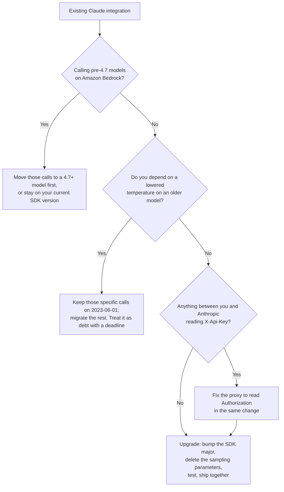

# Version d'API 2026-10-21 — la première version avec ruptures en trois ans

> Source: https://derob98.github.io/ailmanac/fr/docs/api/api-version-2026-10-21 · AILmanac (CC BY 4.0) · last verified 2026-10-22

L'en-tête anthropic-version de Claude a changé pour la première fois depuis 2023. Ce qui casse, pourquoi c'est votre gestionnaire de paquets qui décide du moment où vous l'adoptez, et l'ordre exact de mise à niveau.

<LevelBadge level="intermediate" />

<VerifyNote lastVerified="2026-10-22" source="https://platform.claude.com/docs/en/api/versioning">
La version d'API `2026-10-21` figure dans l'historique officiel des versions d'Anthropic aux côtés de `2023-06-01` et `2023-01-01`. Chaque rupture, chaque numéro de version de SDK et chaque renommage de champ de cette page provient du [guide de migration officiel](https://platform.claude.com/docs/en/api/migration-2026-10-21). Relisez-le avant de livrer — un guide de migration est le seul type de document qui est *modifié* après publication.
</VerifyNote>

Pendant trois ans et demi, il n'y a eu qu'une seule réponse à « sur quelle version d'API suis-je ? » — `2023-06-01`. Chaque SDK l'envoyait, chaque tutoriel la copiait, et plus personne n'y repensait.

Le **21 octobre 2026**, cela a changé. `anthropic-version: 2026-10-21` est désormais la version recommandée, et c'est une vraie version avec ruptures : **quatre changements au niveau du protocole et neuf changements côté SDK/CLI**, un en-tête d'authentification différent, et une suppression de paramètre **plus stricte que la dépréciation par modèle que vous avez peut-être déjà traitée**.

Voici ce qui prend les équipes au dépourvu, et la raison d'être de cette page :

> **On n'adopte pas cette version en modifiant un en-tête. On l'adopte en mettant à niveau une dépendance.**

Les SDK d'Anthropic envoient la version d'API qui était courante lors de la sortie de leur version **majeure**. Les anciennes majeures continuent d'envoyer `2023-06-01` indéfiniment. Les nouvelles majeures envoient `2026-10-21`. Un banal `pip install -U anthropic` ou `npm update` qui franchit la frontière de la majeure fait donc basculer la version d'API de toute votre application — et apporte chaque rupture avec elle, en un seul commit, que quelqu'un ait lu un changelog ou non.

<Callout type="objectives" items={["Pourquoi la version majeure de votre SDK — et non un en-tête que vous contrôlez — décide du moment où vous adoptez 2026-10-21","Le tri en cinq minutes : lesquelles des ruptures touchent réellement votre code","Pourquoi les paramètres d'échantillonnage renvoient désormais 400 même à leur valeur par défaut, et l'unique échappatoire qui reste","Le changement d'authentification de X-Api-Key vers Authorization: Bearer, et les proxys qu'il casse en silence","Les deux pièges qui renvoient un résultat faux au lieu d'une erreur (double identifiant, en-têtes qui suppriment la clé)","Ce qui change sur le réseau et ce qui ne change que dans les types de votre SDK","L'ordre de mise à niveau qui garde une intégration de production au vert"]} />

`★ Insight ─────────────────────────────────────`
Deux types de changements très différents sont regroupés dans cette version, et les confondre fait perdre une journée. Les **changements de protocole** (paramètres supprimés, placements de blocs rejetés, champs de réponse renommés) sont décidés par l'en-tête `anthropic-version`, ils touchent donc le `curl` brut, tous les SDK et vos Message Batches de la même façon. Les **changements de SDK** (l'union `MessageParam`, les Text Completions supprimées, les enums à valeur unique devenues des constantes) sont des refactorisations ordinaires de version majeure qui viennent avec — le JSON sur le réseau est inchangé. Si vous appelez l'API en HTTP brut, seule la première liste vous concerne et cette migration est petite. Si vous utilisez un SDK, vous faites les deux migrations à la fois, ce qui la fait paraître plus grosse qu'elle n'est.
`─────────────────────────────────────────────────`

## D'abord : êtes-vous concerné ?

Exécutez ceci avant de lire quoi que ce soit d'autre. Chaque résultat renvoie à une section ci-dessous ; aucun résultat signifie que votre mise à niveau est un simple changement de version.

<PromptCard title="Audit your codebase for 2026-10-21 breakage">{`# Wire changes — these break regardless of SDK or language
grep -rnE '\\b(temperature|top_p|top_k)\\b' --include='*.{py,ts,tsx,js,go,java,rb,php,cs}' .
grep -rn 'X-Api-Key\\|x-api-key' .            # auth header moved
grep -rnE 'workspace_id|group_type|actor\\.email|\\broles\\b' .   # Admin/Analytics renames

# SDK changes — only if you use an Anthropic SDK or the ant CLI
grep -rn 'MessageParam' .                     # now a union of three role types
grep -rn 'completions' --include='*.{ts,go,java,rb}' .   # Text Completions removed
grep -rn 'compactionControl\\|compaction_control' .       # client-side compaction removed
grep -rn 'models.list\\|models.retrieve' .    # betas moved to client.beta.models
grep -rn -- '--api-key \\|--auth-token ' .      # CLI flags removed`}</PromptCard>

| Si grep trouve… | Vous êtes concerné par | Gravité |
|---|---|---|
| `temperature` / `top_p` / `top_k` | [Paramètres d'échantillonnage supprimés](#suppression-des-paramètres-de-sampling-même-à-leur-valeur-par-défaut) | **400 sur chaque requête** |
| `X-Api-Key` dans un proxy, une passerelle ou un middleware | [En-tête d'authentification déplacé](#authentification-déplacée-vers-authorization-bearer) | **401 sur chaque requête** |
| `X-Api-Key` utilisé pour *supprimer* ou *remplacer* une clé | [Les deux pièges silencieux](#les-deux-changements-qui-ne-lèvent-aucune-erreur) | **Mauvais identifiant envoyé** |
| À la fois une clé d'API et un jeton d'authentification sur un client | [Un client, un seul identifiant](#un-client-un-seul-identifiant) | Erreur à la construction |
| Blocs `document` dans des tours assistant | [Placement des blocs document](#deux-placements-de-blocs-rejetés) | 400 |
| `citations` sur des blocs texte d'un tour utilisateur | [Placement des citations](#deux-placements-de-blocs-rejetés) | 400 |
| Appels du constructeur `MessageParam(...)`, sous-classement ou copies par spread | [MessageParam est une union](#messageparam-devient-une-union-de-trois-types-de-rôle) | Erreur de type / à l'exécution |
| `client.completions` | [Text Completions supprimées](#cinq-suppressions-propres-aux-sdk) | Méthode supprimée |
| `compactionControl` | [Compaction côté client supprimée](#cinq-suppressions-propres-aux-sdk) | Option supprimée |
| `models.list(betas=…)` | [`betas` déplacé](#cinq-suppressions-propres-aux-sdk) | En-tête bêta non envoyé |
| `workspace_id`, `group_type`, `actor.email`, `roles` | [Renommages Admin et Analytics](#renommages-de-champs-des-api-admin-et-analytics) | Champ absent |

## La mise à niveau, dans l'ordre

<Steps items={[
  {title: "Décider si vous pouvez l'adopter", body: "Sur Amazon Bedrock, 2026-10-21 n'est disponible que pour Claude 4.7 et les modèles ultérieurs. Si vous appelez un modèle plus ancien sur Bedrock, vous devez soit déplacer cet appel vers un modèle 4.7+ d'abord, soit le laisser sur la version de SDK que vous utilisez aujourd'hui. Partout ailleurs — l'API Claude, Claude Platform on AWS, Microsoft Foundry et Google Cloud — elle est disponible dès maintenant."},
  {title: "Mettre à jour le SDK (c'est ce qui change la version)", body: "Installez la première version majeure qui envoie 2026-10-21 pour votre langage — voir le tableau ci-dessous. Go et la CLI ant changent aussi leurs chemins d'import de module, donc un simple « go install …@latest » sur l'ancien chemin continue de vous donner la v1 sans erreur ni avertissement. Si vous appelez l'API en HTTP brut, définissez simplement l'en-tête anthropic-version à 2026-10-21."},
  {title: "Corriger d'abord les changements de protocole", body: "Supprimez temperature, top_p et top_k. Sortez les documents des messages assistant et les citations des messages utilisateur. Renommez les champs de réponse Admin et Analytics que vous lisez. Ce sont les changements qui produisent des 400, donc ce sont ceux qui font tomber la production."},
  {title: "Corriger l'authentification et votre proxy", body: "Le SDK envoie désormais votre clé en Authorization: Bearer. Si quelque chose entre vous et Anthropic lit X-Api-Key — une passerelle, un shim d'observabilité, un proxy de sortie d'entreprise — il ne voit plus d'identifiant. Changez le proxy, ou rajoutez vous-même l'en-tête."},
  {title: "Corriger les refactorisations propres au SDK", body: "MessageParam est maintenant une union, les Text Completions ont disparu, la compaction côté client dans le tool runner a disparu, betas a quitté les méthodes Models hors bêta, et les enums à valeur unique sont devenues des constantes. Votre compilateur ou vérificateur de types en trouve la plupart pour vous."},
  {title: "Tester contre 2026-10-21 avant de publier, puis livrer les deux ensemble", body: "La consigne d'Anthropic elle-même est de publier le changement de version et les correctifs dans le même déploiement. Livrer le changement seul est ce qui transforme une migration planifiée en incident."}
]} />

### Les versions de SDK qui envoient `2026-10-21`

Les anciennes majeures continuent d'envoyer `2023-06-01`. Voici les premières versions sur la nouvelle version d'API :

| Langage / outil | Première version sur `2026-10-21` | À noter aussi |
|---|---|---|
| Python | `anthropic` **2.0.0** | — |
| TypeScript | `@anthropic-ai/sdk` **1.0.0** | Les paquets de plateforme (`bedrock-sdk`, `vertex-sdk`, `foundry-sdk`, `aws-sdk`, `google-cloud-sdk`) doivent passer en **v1** dans la même mise à niveau, sinon votre gestionnaire de paquets installe pour eux une seconde copie, plus ancienne, du SDK de base |
| Go | **2.0.0**, chemin de module `github.com/anthropics/anthropic-sdk-go/v2` | Chaque import — y compris les sous-paquets comme `/option` — a besoin du préfixe `/v2`. **Go 1.25+ requis** |
| Java | `com.anthropic:anthropic-java` **3.0.0** | — |
| C# | `Anthropic` **13.0.0** | — |
| Ruby | gem `anthropic` **2.0.0** | — |
| PHP | `anthropic-ai/sdk` **1.0.0** | Utilisez `composer require` ; `composer update` seul reste dans votre contrainte actuelle |
| CLI `ant` | **2.0.0** | Le chemin de module Go est désormais `github.com/anthropics/anthropic-cli/v2`. **L'ancien chemin `go install` continue silencieusement d'installer la dernière v1** |

<Callout type="warning" items={["Deux de ces mises à niveau échouent discrètement plutôt que bruyamment : le chemin de la CLI Go (installe la v1 sans avertissement) et les paquets de plateforme TypeScript (npm résout volontiers un second @anthropic-ai/sdk plus ancien pour eux). Dans les deux cas votre code compile, s'exécute et continue d'envoyer 2023-06-01 — vous en concluez que la migration est faite alors que rien n'a réellement changé."]} />

## Suppression des paramètres de sampling, même à leur valeur par défaut

C'est le changement le plus susceptible de casser du code que quelqu'un a déjà « corrigé ».

AILmanac documente depuis un moment la dépréciation par modèle : sur les modèles de génération Claude 4.7 et ultérieurs, un `temperature`, `top_p` ou `top_k` **non défini par défaut** renvoie un 400. Sous `2026-10-21`, la règle est plus dure :

> Une requête qui envoie `temperature`, `top_p` ou `top_k` renvoie une erreur 400 — **même à la valeur par défaut du paramètre**.

Le schéma défensif qui était sûr — épingler `temperature: 1.0` explicitement pour que personne ne puisse « l'ajuster » plus tard — est donc maintenant un échec garanti sur tous les modèles, y compris les plus anciens qui acceptaient auparavant n'importe quelle valeur. Les paramètres ont disparu des types des SDK et des options de la CLI dans les nouvelles majeures, donc dans un langage typé le compilateur l'attrape ; dans un corps de requête construit par dict ou hash, cela atteint l'API.

```python
# Before — accepted under 2023-06-01 on every model
client.messages.create(model=MODEL, max_tokens=1024, temperature=1.0, messages=msgs)

# After — temperature: 1.0 is a 400 under 2026-10-21
client.messages.create(model=MODEL, max_tokens=1024, messages=msgs)
```

Omettre les paramètres échantillonne avec exactement les mêmes valeurs par défaut qu'une requête `2023-06-01` qui les omettait, `temperature` de 1.0 compris. Donc pour les modèles de pointe actuels, qui rejetaient déjà les valeurs non définies par défaut, **la sortie ne change pas du tout** — c'est purement un nettoyage de la forme de la requête.

La vraie perte est plus étroite et mérite d'être précisée. Sur les anciens modèles qui acceptaient *effectivement* d'autres valeurs — Sonnet 4.6, par exemple — une requête qui abaissait `temperature` pour une sortie plus constante perd cet effet, et **aucun autre réglage ne le remplace.** Les options documentées par Anthropic sont d'arrêter d'envoyer le paramètre, ou de garder cette requête précise sur `2023-06-01`.

<Callout type="tip" items={["Comme les nouvelles majeures de SDK ont entièrement retiré les trois paramètres de leurs types, « garder cette requête sur 2023-06-01 » signifie en pratique garder ces appels sur la majeure de SDK précédente, ou les émettre en HTTP brut avec l'ancien en-tête — une inférence à partir de deux faits documentés, pas un schéma documenté. Si vous dépendez d'une température abaissée pour le déterminisme, traitez cela comme une dette technique avec échéance plutôt que comme une configuration supportée.", "Le remplaçant durable de temperature sur les modèles actuels n'est pas un paramètre. Fixez le comportement avec le prompt système, et dépensez le calcul délibérément avec le réglage d'effort — voir Extended Thinking & Effort et Effort tuning."]} />

## Authentification déplacée vers `Authorization: Bearer`

Le SDK et la CLI envoient désormais votre clé d'API en `Authorization: Bearer <key>` au lieu de `X-Api-Key: <key>`.

```text
# Before
X-Api-Key: <key>

# After
Authorization: Bearer <key>
```

**L'API Claude accepte une clé dans l'un ou l'autre en-tête.** Donc si votre programme parle directement à `api.anthropic.com`, ce changement est invisible — rien à faire.

Il casse la couche intermédiaire. Tout ce qui lit, définit, réécrit ou journalise `X-Api-Key` ne voit plus d'identifiant : une passerelle LLM, un proxy d'attribution des coûts, un filtre de sortie d'entreprise, un double de test qui vérifie l'en-tête, un `fetch` personnalisé qui injecte des clés par locataire. Le symptôme est un 401 net venant de votre propre infrastructure, pas d'Anthropic — exactement le genre d'erreur qu'on diagnostique à tort comme un problème de rotation de clé.

Deux issues. Corriger le proxy pour qu'il lise `Authorization` (correct), ou rajouter vous-même l'ancien en-tête (expédient) :

<PromptCard title="Keep sending X-Api-Key to a proxy that needs it">{`// TypeScript — Authorization: null stops the key going out twice
const client = new Anthropic({
  apiKey,
  defaultHeaders: { "X-Api-Key": apiKey, Authorization: null }
});`}</PromptCard>

Python le fait avec une fonction `auth` sur le client HTTP (elle s'exécute aussi lors des nouvelles tentatives), Go avec `option.WithHeader` plus `option.WithHeaderDel("Authorization")`, Java avec `putHeader` au lieu de `apiKey`, PHP et Ruby avec un middleware de requête. C# utilise `ExtraHeaders` et exige que **à la fois** `ApiKey` et `AuthToken` soient à `null`, sinon un identifiant trouvé dans l'environnement part quand même.

Trois détails par langage faciles à manquer :

- **`AnthropicFoundry` / `@anthropic-ai/foundry-sdk` / `FoundryBackend` envoient toujours `x-api-key`.** Le changement ne s'y applique pas.
- **Les clients Bedrock Mantle envoyaient déjà un jeton bearer.** Aucun changement.
- **Le SDK Ruby abandonne `Authorization` quand il suit une redirection vers une autre origine** — ce qui inclut une redirection `http` → `https` sur le même hôte. La clé est maintenant abandonnée là aussi, alors qu'avant elle voyageait dans `X-Api-Key`. Si vous pointez le SDK vers une URL interne en `http://` et comptez sur la redirection, l'identifiant cesse silencieusement d'arriver.
- **En PHP, n'utilisez pas `extraHeaders` du client pour cela.** Une requête avec ses propres `extraHeaders` *remplace* ceux du client — et chaque endpoint sous `$client->beta` qui a besoin d'un en-tête bêta en a. Utilisez le middleware.

## Les deux changements qui ne lèvent aucune erreur

Tout ce qui précède échoue bruyamment. Ces deux-là continuent de fonctionner et font la mauvaise chose, ce qui en fait ceux qui valent un audit manuel.

**1. Un en-tête qui supprimait la clé ne la supprime plus.** L'idiome pour envoyer une requête sans identifiant — ou avec un identifiant *différent* de celui du client — visait `X-Api-Key`. Cet en-tête n'est plus l'endroit où vit la clé :

```python
# Before — kept the client's key off this one request
client.messages.create(..., extra_headers={"X-Api-Key": omit})

# After — the key still goes out in Authorization. Suppress that instead.
client.messages.create(..., extra_headers={"Authorization": omit})
```

**2. Un remplacement de clé par requête envoie maintenant deux clés.** Passer une autre clé dans `X-Api-Key` remplaçait celle du client. Ce n'est plus le cas : le remplacement part dans `X-Api-Key` et la clé propre au client part dans `Authorization`, donc **les deux sont sur le réseau.** Pour envoyer une clé différente pour une requête, définissez `Authorization` à la place (Python/TypeScript/PHP/Ruby), ou utilisez `option.WithAPIKey(otherKey)` en Go.

Si vous avez construit un routage de clés par locataire sur un client partagé, c'est le paragraphe sur lequel agir : le repli n'est plus « la requête échoue », c'est « la requête réussit sous la mauvaise clé ».

## Un client, un seul identifiant

Comme une clé d'API et un jeton d'authentification partagent désormais un en-tête, un client SDK ne peut détenir qu'un seul identifiant. En passer deux envoyait les deux, chacun dans son propre en-tête. Cela lève maintenant une erreur à la construction :

| SDK | Ce que font maintenant deux identifiants |
|---|---|
| Python | `ValueError` |
| TypeScript | `TypeError` |
| C# | `ArgumentException` |
| Java | `IllegalStateException` depuis `build()`, nommant les deux |
| PHP | `InvalidArgumentException` |
| Ruby | `ArgumentError` |
| Go | `NewClient` ne renvoie aucune erreur, donc **chaque requête du client échoue à la place** |

Deux règles de comportement ont changé en même temps :

- **Un identifiant que vous passez dans le code est le seul.** Le client ne se rabat plus sur l'environnement ou sur un profil sur disque. Avant, un `ANTHROPIC_API_KEY` dans l'environnement pouvait être envoyé à côté du jeton que vous aviez passé — ou à sa place.
- **Sans rien de passé, la priorité est fixe :** `ANTHROPIC_API_KEY`, puis `ANTHROPIC_AUTH_TOKEN`, puis le profil nommé par `ANTHROPIC_PROFILE`, puis les variables de fédération d'identité de charge de travail, puis le profil actif sur disque. **Cet ordre a changé :** plusieurs SDK plaçaient le profil actif sur disque *avant* les variables de fédération. Si vous vous authentifiez avec WIF et avez aussi un profil sur disque, vous utilisez peut-être maintenant un identifiant différent de celui d'hier. Définissez `ANTHROPIC_PROFILE` pour figer l'ancien comportement.

Quand `ANTHROPIC_API_KEY` et `ANTHROPIC_AUTH_TOKEN` sont tous deux définis, la clé l'emporte et le SDK journalise un avertissement une fois par processus. En PHP, cela signifie **une fois par requête web** — désactivez la variable que vous n'utilisez pas, ou votre journal d'erreurs se remplit.

Le schéma légitime que cela casse est « jeton pour la passerelle, clé pour l'API derrière ». Reconstruisez-le explicitement : passez le **jeton** comme unique identifiant du client, définissez `X-Api-Key` dans les en-têtes par défaut ou le middleware, et faites supprimer par la passerelle son propre en-tête `Authorization` avant de transmettre. L'API Claude attend un identifiant par requête.

## Deux placements de blocs rejetés

Les deux sont des 400 sous `2026-10-21`, et les deux s'appliquent à l'API Messages, au [comptage de jetons](/docs/api/tokens-and-pricing) et à **chaque requête à l'intérieur d'un [Message Batch](/docs/api/message-batches) créé avec la nouvelle version.**

- **Un bloc `document` directement dans un message `assistant`.** Envoyez les documents dans des messages `user`. Un document *imbriqué* dans un autre bloc — un résultat d'outil de web-fetch renvoyé par Claude, par exemple — reste accepté, donc rejouer la sortie propre de Claude est sûr.
- **Un bloc `text` avec un tableau `citations` non vide dans un message `user`**, y compris à l'intérieur d'un bloc `search_result`. Retirez `citations` de ces blocs. Les citations sur les blocs `text` des messages **assistant** restent acceptées, tout comme `"citations": [brackets with enabled true]` comme réglage sur les documents et les résultats de recherche.

Le second est un piège précis pour les pipelines de recherche. Si vous donnez des résultats de recherche à Claude et renvoyez les métadonnées de citation reçues, cet aller-retour renvoie maintenant un 400 — tandis que le cas superficiellement similaire du rejeu de la réponse citée de Claude continue de fonctionner. L'asymétrie est tout le bug.

## `MessageParam` devient une union de trois types de rôle

Le type unique `MessageParam` est maintenant `UserMessageParam | AssistantMessageParam | SystemMessageParam`, et `BetaMessageParam` se scinde de la même façon. **Le JSON envoyé par le SDK est inchangé.**

D'abord la bonne nouvelle : **un message écrit comme un simple dict, hash, tableau ou littéral d'objet qui nomme son rôle n'a besoin d'aucun changement.** `[brackets: role user, content Hello]` passe toujours la vérification de types partout. Pour la plupart des codebases, ce changement est un no-op.

Quatre schémas cassent bien :

```python
# 1. Calling the type as a constructor now raises TypeError
message = MessageParam(role="user", content="Hello")      # before
message: MessageParam = {"role": "user", "content": "Hello"}   # after
```

```typescript
// 2. Spread-copying a message of unknown role — system messages differ
const copy: Anthropic.MessageParam = { ...message, content: blocks };          // before
const copy: Anthropic.MessageParam =
  message.role === "system" ? message : { ...message, content: blocks };       // after
```

```typescript
// 3. Extending or implementing the type — you cannot extend a union
interface StoredMessage extends Anthropic.MessageParam { id: string }   // before
type StoredMessage = Anthropic.MessageParam & { id: string }            // after
```

```go
// 4. Struct/builder literals name the role's type and drop Role
anthropic.MessageParam{Role: anthropic.MessageParamRoleAssistant, Content: blocks}        // before
anthropic.MessageParam{OfAssistant: &anthropic.AssistantMessageParam{Content: blocks}}    // after
```

Un cinquième est plus subtil : un dict dont le `role` provient d'une **variable** pouvant contenir plus d'un rôle ne correspond à aucun membre de l'union, donc une fonction utilitaire générique `to_message(role, text)` doit se ramifier par rôle. Et en bêta, `clear_at` et `output_config` vivent maintenant sur `BetaSystemMessageParam` uniquement, tandis que son `content` est optionnel — donc `message["content"]` peut être indéfini.

Go cache un vrai changement de comportement dans la refactorisation : **une copie d'un `MessageParam` pointe vers le même message sous-jacent.** Définir `duplicate.OfUser.Content` modifie les deux, alors qu'en v1 définir `duplicate.Content` ne changeait que la copie. Si vous construisez des variantes de conversation par copie, c'est un vrai bug d'aliasing, pas une erreur de compilation.

## Cinq suppressions propres aux SDK

Le protocole ne change pour aucune d'elles — seulement votre code.

| Supprimé | Concerne | Remplacement |
|---|---|---|
| **API Text Completions** (`client.completions`, `HUMAN_PROMPT`/`AI_PROMPT`, `ant completions create`) | TypeScript, Go, Java, Ruby, CLI | L'API Messages. Le texte de la réponse passe de `completion` à `content[0].text` — dans la CLI, `--transform completion` devient `--transform content.0.text` |
| **Compaction côté client dans le tool runner** (`compactionControl`, `compaction_control`) | TypeScript, Ruby | [Compaction](/docs/api/compaction) côté serveur : bêta `compact-2026-01-12` avec une modification `compact_20260112`, seuil **≥ 50 000 jetons**. Elle avait déjà cessé de fonctionner dans TS v0.129.0 / Ruby v1.74.0 |
| **`betas` sur les méthodes Models hors bêta** (`--beta` sur `ant models`) | Tous les SDK, CLI | Appelez `client.beta.models` / `ant beta:models`. **En Ruby, passer `betas:` à `client.models` ne lève pas d'erreur — cela cesse simplement de définir l'en-tête** |
| **Enums à valeur unique** (un champ requis qui ne pouvait contenir qu'une valeur) | C#, Go, Java, PHP, Ruby, un flag de CLI | Supprimez le champ ; c'est une constante maintenant. Lisez-le en comparant la chaîne : `event.Type == "agent.message"` |
| **Flags CLI `--api-key` / `--auth-token`** | CLI `ant` | `ANTHROPIC_API_KEY` / `ANTHROPIC_AUTH_TOKEN`, `--api-key-stdin` / `--auth-token-stdin`, ou `ant auth login`. Une commande qui les passe encore s'arrête avec `flag provided but not defined` |

La suppression des flags CLI est un correctif de sécurité à souligner : une clé en ligne de commande est visible dans l'historique du shell et dans les listes de processus. Les flags affichaient un avertissement de dépréciation depuis la v1.27.0. Notez que `--api-key-stdin` lit **toute** l'entrée standard, donc une commande qui l'utilise doit prendre le corps de sa requête depuis des flags.

<PromptCard title="Pass a key to the ant CLI without putting it in argv">{`# From the environment
export ANTHROPIC_API_KEY="$KEY"
ant models list

# Straight from a secret manager
op read op://vault/anthropic/api-key | ant --api-key-stdin models list`}</PromptCard>

Deux autres notes propres à un SDK : **Go** exige **1.25+** et supprime `vertex.DefaultVersion` / `bedrock.DefaultVersion` (Ruby supprime les constantes équivalentes `DEFAULT_VERSION`). **Java** ajoute désormais l'en-tête `anthropic-version` par défaut *avant* l'exécution des intercepteurs, donc un intercepteur qui définit sa propre version doit appeler `replaceHeaders` — `putHeader` ajoute maintenant une seconde valeur.

## Renommages de champs des API Admin et Analytics

Renommages de champs de réponse. Les anciens noms sont simplement absents sous `2026-10-21`, donc le code qui les lit obtient `undefined`/`nil` plutôt qu'une erreur — cela casse les tableaux de bord, pas les chemins de requête. Voir [L'API Admin](/docs/api/admin-api) pour les endpoints eux-mêmes.

| Groupe d'endpoints | Ancien nom | Nouveau nom |
|---|---|---|
| Groupes RBAC (création, liste, lecture, mise à jour) | `roles` | `role_ids` |
| Membres de groupes RBAC (réponse de liste, ajout, suppression) | `group_id` | `rbac_group_id` |
| Rôles RBAC (liste, lecture) | `name` | `display_name` |
| Limites de débit d'organisation et d'espace de travail | `group_type` | `group.type` |
| Clés d'API (liste, lecture, mise à jour) | `workspace_id` | `scope` — **la sémantique change aussi, voir ci-dessous** |
| Analytics : rapports d'usage et de coût par utilisateur | `actor.email` | `actor.email_address` |
| Analytics : résumés d'activité | `summaries` | `data` |

Le **paramètre de requête** `group_type` sur les endpoints de limites de débit et le **filtre** `workspace_id` sur l'endpoint de liste des clés d'API sont inchangés. Seuls les champs de réponse ont bougé.

**`workspace_id` sur les clés d'API n'est pas un renommage — c'est une correction sémantique.** Sous `2023-06-01`, un `workspace_id` à `null` était ambigu : il signifiait *soit* « liée à l'espace de travail par défaut » *soit* « non liée à un seul espace de travail » (une clé pour tous les espaces de travail). On ne pouvait pas les distinguer. Sous `2026-10-21` :

- une clé liée à un espace de travail, **y compris l'espace de travail par défaut**, a `scope.workspace_id` défini avec l'ID réel de cet espace de travail ;
- une clé pour tous les espaces de travail a un `scope` de `[type: organization]` et **aucun** `workspace_id`.

L'ambiguïté a disparu, ce qui est strictement mieux — mais tout code qui lisait `workspace_id === null` comme « espace de travail par défaut » est maintenant faux. Récupérez une fois l'ID réel de votre espace de travail par défaut (appelez List Workspaces avec `include_default=true` et prenez celui nommé `"Default"`) et comparez-le à `scope.workspace_id`.

## Faut-il mettre à niveau maintenant ?



La réponse honnête pour la plupart des équipes est **mettre à niveau délibérément et bientôt, mais pas par accident.** `2023-06-01` n'est pas annoncée comme en cours de retrait, et la promesse de compatibilité d'Anthropic pour une version donnée tient toujours — les paramètres d'entrée et de sortie existants sont préservés. Il n'y a pas de pression d'échéance. Le risque n'est pas que l'ancienne version cesse de fonctionner ; c'est que quelqu'un exécute une mise à jour de dépendance non épinglée et adopte tous les changements d'un coup sans s'en apercevoir.

<Callout type="warning" items={["Si vous ne retenez qu'une action de cette page : épinglez votre SDK Anthropic à une version majeure dans votre lockfile et votre manifeste. Cela transforme cette migration d'une chose qui peut vous arriver en une chose que vous planifiez."]} />

## Erreurs courantes

- **Mettre à jour le SDK et corriger les ruptures en deux déploiements.** La fenêtre entre les deux est une panne complète pour tout chemin de code qui envoie un paramètre d'échantillonnage. La consigne d'Anthropic elle-même est de publier les deux ensemble.
- **Supposer que la règle d'échantillonnage est celle que vous avez déjà traitée.** La dépréciation par modèle rejetait les valeurs *non définies par défaut*. Cette version rejette les paramètres *tout court*. Le code qui épingle explicitement `temperature: 1.0` était correct auparavant et renvoie maintenant un 400.
- **Traiter le changement d'authentification comme « rien, puisque l'API accepte les deux en-têtes ».** Vrai pour votre application, faux pour votre infrastructure. Le fait que l'API accepte les deux est précisément la raison pour laquelle l'échec semble venir de votre propre proxy.
- **Migrer les remplacements de `X-Api-Key` en renommant l'en-tête.** Si vous utilisiez `X-Api-Key` pour supprimer ou remplacer un identifiant, le renommer ne suffit pas — il faut comprendre sur lequel des deux comportements vous comptiez, car l'un envoie maintenant deux clés et l'autre en envoie une qu'il ne devrait pas.
- **`go install …@latest` sur l'ancien chemin de module.** Cela installe la dernière **v1** sans rien dire. Même classe de piège que laisser un paquet de plateforme TypeScript en v0 et laisser npm résoudre un second SDK de base en dessous.
- **Laisser un client Go détenir deux identifiants.** Il ne lève rien à la construction — `NewClient` ne renvoie aucune erreur — donc vous le découvrez quand chaque requête échoue.
- **Oublier les Message Batches.** Les règles de placement des blocs et de paramètres d'échantillonnage s'appliquent à chaque requête *à l'intérieur* d'un lot créé avec `2026-10-21`, pas seulement à l'appel du lot lui-même.

<Flashcards title="Les chiffres à retenir" cards={[
  {front: "Quelles majeures de SDK envoient 2026-10-21 en premier ?", back: "Python 2.0.0 · TypeScript 1.0.0 · Go 2.0.0 (chemin de module /v2) · Java 3.0.0 · C# 13.0.0 · Ruby 2.0.0 · PHP 1.0.0 · CLI ant 2.0.0"},
  {front: "Que fait l'envoi de temperature sous 2026-10-21 ?", back: "Renvoie un 400 — même à la valeur par défaut du paramètre, et sur tous les modèles. L'omettre échantillonne avec les mêmes valeurs par défaut qu'avant."},
  {front: "Quel en-tête porte maintenant votre clé d'API ?", back: "Authorization: Bearer <key>, envoyé par le SDK et la CLI. L'API Claude accepte toujours X-Api-Key, donc seuls les proxys et middlewares cassent."},
  {front: "Où 2026-10-21 n'est-elle PAS entièrement disponible ?", back: "Sur Amazon Bedrock, elle ne couvre que Claude 4.7 et les modèles ultérieurs. L'API Claude, Claude Platform on AWS, Microsoft Foundry et Google Cloud l'ont pour tout."},
  {front: "Que se passe-t-il si un client détient à la fois une clé d'API et un jeton d'authentification ?", back: "Cela lève une erreur à la construction dans la plupart des SDK (ValueError / TypeError / ArgumentException / IllegalStateException / InvalidArgumentException / ArgumentError). En Go, rien n'est levé et chaque requête échoue à la place."},
  {front: "Qu'est-ce qui a changé dans la licence du SDK ?", back: "Les nouvelles majeures sont sous Apache 2.0. Les versions antérieures restent sous MIT. Aucun changement de code nécessaire, mais les inventaires de licences de dépendances doivent être mis à jour."}
]} />

<Quiz title="Vérifiez vos acquis" questions={[
  {q: "Comment se retrouve-t-on sur la version d'API 2026-10-21 ?", options: ["En activant un feature flag dans la Console Anthropic", "En passant à une version majeure de SDK qui l'envoie, ou en définissant soi-même l'en-tête en HTTP brut", "Automatiquement à une date fixe pour tous les comptes", "En s'y inscrivant modèle par modèle"], answer: 1, explain: "Les SDK envoient la version d'API qui était courante lors de la sortie de leur version majeure. Les anciennes majeures continuent d'envoyer 2023-06-01 indéfiniment ; les nouvelles envoient 2026-10-21. En HTTP brut, vous définissez vous-même l'en-tête anthropic-version."},
  {q: "Sous 2026-10-21, que renvoie une requête avec temperature à sa valeur par défaut de 1.0 ?", options: ["200, puisque la valeur est celle par défaut", "200 avec un avertissement de dépréciation", "Une erreur 400, car le paramètre est supprimé quelle que soit la valeur", "Cela dépend du modèle"], answer: 2, explain: "Les paramètres sont supprimés, pas seulement restreints. Une requête qui envoie temperature, top_p ou top_k renvoie un 400 même à la valeur par défaut, sur tous les modèles — ce qui est plus strict que la dépréciation précédente par modèle des valeurs non définies par défaut."},
  {q: "Votre application appelle api.anthropic.com via une passerelle d'entreprise qui authentifie les requêtes en lisant l'en-tête X-Api-Key. Vous mettez à niveau le SDK. Que se passe-t-il ?", options: ["Rien — l'API Claude accepte l'un ou l'autre en-tête", "Anthropic renvoie 400 sur l'en-tête supprimé", "La passerelle ne voit plus d'identifiant, car le SDK envoie maintenant Authorization: Bearer", "Le SDK envoie les deux en-têtes pour la rétrocompatibilité"], answer: 2, explain: "L'API Claude accepte une clé dans l'un ou l'autre en-tête, donc un appelant direct n'est pas affecté. La casse est au milieu : le SDK envoie maintenant Authorization: Bearer, donc tout ce qui lit X-Api-Key ne voit aucun identifiant. Corrigez le proxy pour qu'il lise Authorization, ou rajoutez l'en-tête depuis le client."},
  {q: "Lequel de ces changements avec ruptures ne s'applique PAS si vous appelez l'API en HTTP brut sans SDK ?", options: ["Les paramètres d'échantillonnage qui renvoient 400", "Un bloc document dans un message assistant qui renvoie 400", "MessageParam qui devient une union de trois types de rôle", "Le champ workspace_id de l'API Admin remplacé par scope"], answer: 2, explain: "La scission de MessageParam est une refactorisation de types du SDK — le JSON sur le réseau est identique. Les trois autres sont des changements de protocole régis par l'en-tête anthropic-version et s'appliquent aussi aux appelants en HTTP brut."}
]} />

<Callout type="takeaways" items={["2026-10-21 est la première nouvelle version anthropic-version depuis 2023-06-01, et on l'adopte en mettant à niveau une version majeure de SDK — pas en changeant un en-tête. Épinglez votre majeure de SDK pour que ce soit une décision, pas un accident.","Séparez les changements de protocole des changements de SDK. Les appelants en HTTP brut n'ont à traiter que le premier groupe, ce qui rend leur migration petite.","temperature, top_p et top_k renvoient désormais 400 même à leur valeur par défaut, sur tous les modèles. La seule échappatoire documentée pour une température abaissée vraiment nécessaire est de garder cette requête sur 2023-06-01.","L'authentification est passée à Authorization: Bearer. Votre application ne le remarquera pas ; votre proxy, si.","Deux changements échouent silencieusement plutôt que bruyamment — un en-tête qui supprimait la clé et ne la supprime plus, et un remplacement de clé qui met maintenant deux clés sur le réseau. Auditez-les à la main.","Les règles de placement des blocs et d'échantillonnage s'appliquent aussi à chaque requête à l'intérieur d'un Message Batch créé avec la nouvelle version.","Sur Amazon Bedrock, la nouvelle version ne couvre que Claude 4.7 et les modèles ultérieurs ; partout ailleurs elle est entièrement disponible."]} />

## Suite

- Envoyer une requête sur la nouvelle version → [Votre premier appel d'API](/docs/api/first-call)
- Ce qui est retiré d'autre, et quand → [Dépréciations et migrations](/docs/whats-new/deprecations)
- Le remplaçant de temperature sur les modèles actuels → [Extended Thinking & Effort](/docs/api/thinking-and-effort) · [Effort tuning](/docs/api/effort-tuning)
- Automatiser les endpoints d'organisation dont les champs ont été renommés → [L'API Admin](/docs/api/admin-api)
