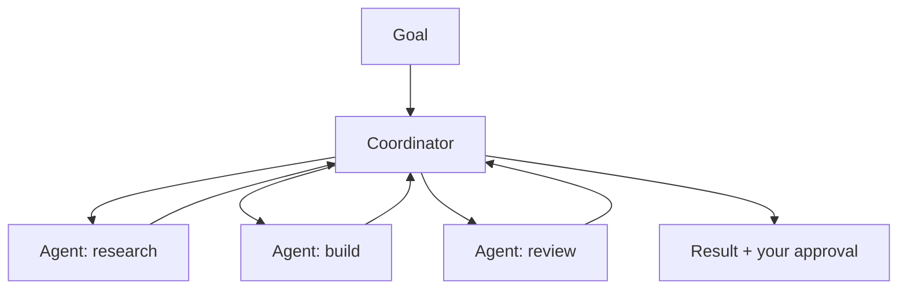

# Cowork et Agent Teams

> Source: https://derob98.github.io/ailmanac/fr/docs/api/cowork-and-agent-teams · AILmanac (CC BY 4.0) · last verified 2026-07-23

L'espace de travail de bureau agentique et la collaboration multi-agents, en tant que produits.

<LevelBadge level="advanced" />

<Callout type="objectives" items={[
  "Ce qu'est Cowork — un espace de travail de bureau agentique où vous fixez les objectifs et où la boucle est fournie pour vous",
  "Ce qu'est Agent Teams — plusieurs agents qui se répartissent un même objectif, chacun avec un rôle et des outils",
  "Comment les deux se rapportent aux trois choses que vous pouvez construire vous-même : les sous-agents, l'Agent SDK et les Managed Agents",
  "Pourquoi plus d'autonomie signifie plus de supervision, pas moins",
]} />

<VerifyNote lastVerified="2026-07-23" source="https://platform.claude.com/docs">
Cowork et Agent Teams sont des surfaces de 2026 qui évoluent vite — les noms, la disponibilité et les capacités changent souvent. Confirmez les détails actuels dans la documentation et les annonces officielles d'Anthropic.
</VerifyNote>

Au-delà d'un agent unique, Anthropic livre des surfaces **au niveau produit** pour laisser les agents mener un travail soutenu et collaboratif : **Cowork** (un espace de travail de bureau agentique) et **Agent Teams** (plusieurs agents qui collaborent). Cette page est une carte de haut niveau — vérifiez les détails dans la documentation officielle, car ces surfaces évoluent rapidement.

## Claude Cowork

Voyez-le comme un **espace de travail où un agent effectue un vrai travail en plusieurs étapes** à vos côtés — il opère sur des fichiers et des outils sur un horizon plus long qu'un seul tour de conversation, sous votre supervision. C'est le cousin grand public/pro de la construction d'un agent via l'API : la boucle est fournie, vous dirigez les objectifs.

## Agent Teams

Quand un seul agent ne suffit pas, **plusieurs agents collaborent** — ils se répartissent un objectif, chacun avec un rôle et des outils, et se coordonnent vers un résultat. Conceptuellement, cela reprend les [sous-agents](/docs/claude-code/subagents) de Claude Code, mais comme surface produit pour une collaboration multi-agents soutenue plutôt que pour une seule sous-tâche déléguée.

## Lien avec le reste du site

- Le construire vous-même, par programmation → [Construire des agents](/docs/api/building-agents) + l'[Agent SDK](/docs/claude-code/headless-and-agent-sdk).
- La délégation au sein d'une session de code → [Sous-agents](/docs/claude-code/subagents).
- Boucle, état et planification hébergés → [Managed Agents](/docs/api/managed-agents).

<Flashcards title="Quatre façons de faire travailler des agents" cards={[
  {front: "Cowork", back: "Un espace de travail de bureau agentique. La boucle est fournie ; vous fixez les objectifs et supervisez pendant que l'agent travaille sur des fichiers et des outils sur un horizon plus long qu'un seul tour de conversation."},
  {front: "Agent Teams", back: "Une surface produit où plusieurs agents collaborent — ils se répartissent un objectif, chacun avec un rôle et des outils, et se coordonnent vers un résultat que vous approuvez."},
  {front: "Sous-agents", back: "La délégation au sein d'une session Claude Code. La même idée qu'Agent Teams, mais limitée à une sous-tâche déléguée plutôt qu'à une collaboration soutenue."},
  {front: "Managed Agents", back: "Anthropic héberge pour vous la boucle, l'état et la planification — l'option côté API quand vous ne voulez pas exécuter vous-même la boucle de l'agent."},
  {front: "Agent SDK", back: "Vous construisez la boucle par programmation. Contrôle maximal, et c'est à vous de gérer l'orchestration, l'état et la gestion des erreurs."},
]} />

## Quiz

<Quiz questions={[
  {
    q: "Vous voulez une boucle d'agent que vous n'avez pas à exécuter ni à planifier vous-même, appelée depuis votre propre backend. Quelle option cette page vous indique-t-elle ?",
    options: [
      "Cowork",
      "Managed Agents",
      "Sous-agents",
      "Agent Teams"
    ],
    answer: 1,
    explain: "Managed Agents est l'option hébergée pour la boucle, l'état et la planification. Cowork et Agent Teams sont des surfaces produit dans lesquelles on travaille plutôt qu'on ne les appelle ; les sous-agents sont de la délégation au sein d'une session Claude Code ; l'Agent SDK est la voie « construisez-le vous-même »."
  },
  {
    q: "Quelle est la relation entre Agent Teams et les sous-agents de Claude Code, telle que décrite ici ?",
    options: [
      "C'est la même fonctionnalité sous deux noms",
      "Agent Teams remplace les sous-agents, qui sont dépréciés",
      "Conceptuellement la même idée, mais Agent Teams est une surface produit pour une collaboration multi-agents soutenue plutôt que pour une seule sous-tâche déléguée",
      "Les sous-agents s'exécutent dans le cloud ; Agent Teams s'exécute en local"
    ],
    answer: 2,
    explain: "La page présente Agent Teams comme reprenant conceptuellement les sous-agents, mais comme surface produit pour une collaboration multi-agents soutenue — là où les sous-agents traitent une seule sous-tâche déléguée au sein d'une session de code."
  },
  {
    q: "Pourquoi cette page traite-t-elle la supervision comme la constante des deux surfaces ?",
    options: [
      "Parce que le travail multi-agents à long horizon amplifie à la fois la valeur et le risque",
      "Parce qu'on ne peut pas du tout donner d'accès à des outils aux agents",
      "Parce qu'Anthropic exige une approbation manuelle pour chaque appel d'outil",
      "Parce que ces surfaces sont des préversions de recherche sans entraînement à la sécurité"
    ],
    answer: 0,
    explain: "Plus d'autonomie sur un horizon plus long amplifie à la fois la valeur et le risque. La réponse pratique consiste à garder des humains dans la boucle pour les actions importantes, à limiter strictement l'accès aux outils et à vérifier les sorties."
  }
]} />

## La constante : la supervision

:::warning[Plus d'autonomie, plus de précaution]
Le travail multi-agents à long horizon amplifie à la fois la valeur *et* le risque. Gardez des humains dans la boucle pour les actions importantes, limitez strictement l'accès aux outils et vérifiez les sorties — voir [Usage responsable](/docs/security/responsible-use) et [Sécuriser les agents](/docs/security/securing-agents).
:::

<Callout type="takeaways" items={[
  "Cowork et Agent Teams sont des surfaces produit : la boucle de l'agent est fournie, et votre rôle est de diriger les objectifs et de superviser.",
  "Ce sont les cousins au niveau produit de ce que vous pouvez construire vous-même — les sous-agents pour la délégation en session, l'Agent SDK pour le contrôle total, les Managed Agents pour une boucle hébergée.",
  "Ces surfaces évoluent vite. Considérez cette page comme une carte et confirmez les détails dans la documentation officielle.",
  "La supervision est la constante : approbation humaine sur les actions importantes, périmètres d'outils étroits, sorties vérifiées.",
]} />

## Suite

- [Tâches planifiées Cowork : des agents qui tournent sans appareil allumé](/docs/claude-app/cowork-scheduled-tasks) — le lancement web + mobile de juillet 2026 en pratique, avec la matrice des capacités par surface et les quatre pièges qui cassent les exécutions silencieuses
- [Sous-agents et agents parallèles](/docs/claude-code/subagents)
- [Managed Agents](/docs/api/managed-agents)
- [API multi-agents natives](/docs/models/native-multi-agent-apis) — comment se compare la bêta multi-agents de l'API Responses d'OpenAI, et où se situe l'écart de primitives côté Anthropic
- [Usage responsable, éthique et vérification](/docs/security/responsible-use)
