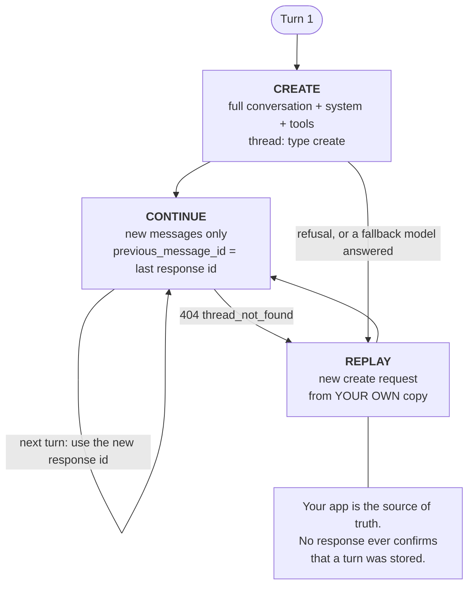

# Message Threads — n'envoyer que le nouveau tour

> Source: https://derob98.github.io/ailmanac/fr/docs/api/message-threads · AILmanac (CC BY 4.0) · last verified 2026-11-03

L'API Messages peut garder votre conversation côté serveur et laisser chaque tour n'envoyer que les nouveaux messages. Ce que cela économise réellement (des octets et de la latence, pas des tokens), le chemin de replay à construire avant la mise en production, les trois groupes de champs et la limite de 4 points d'arrêt du cache.

<LevelBadge level="advanced" />

<Callout type="objectives" items={[
  "Dire exactement ce qu'un thread économise (les octets de la requête et le time to first token) et ce qu'il n'économise pas : les tokens, donc l'argent",
  "Parcourir le cycle de vie à trois états : create, continue, replay, et construire le chemin de replay avant la mise en production, pas après",
  "Classer chaque paramètre comme create-only, fixe ou libre, et reconnaître un thread_fingerprint_mismatch au premier coup d'œil",
  "Faire fonctionner le prompt caching sur un thread dans le budget de 4 points d'arrêt",
  "Continuer un tour en streaming sans risque, et savoir pourquoi continuer avant message_stop renvoie un 404",
  "Gérer les cinq erreurs de thread, plus les deux cas où il faut démarrer un tout nouveau thread au lieu de récupérer",
  "Décider si votre charge de travail est de celles que les threads aident vraiment"
]} />

<VerifyNote lastVerified="2026-11-03" source="https://platform.claude.com/docs/en/build-with-claude/message-threads">
Les message threads sont entrés en **bêta publique le 2 novembre 2026** derrière l'en-tête `anthropic-beta: message-threads-2026-08-12`. Les noms de champs, codes d'erreur, délais d'expiration et la liste des fonctionnalités non prises en charge sont cités d'après la référence officielle et peuvent bouger pendant la bêta : revérifiez avant de livrer. Disponibilité au moment de la rédaction : API Claude, Claude Platform on AWS, Claude Models on Google Cloud (géré par Anthropic) et Claude in Microsoft Foundry. **Non** disponible sur Amazon Bedrock. Le support des modèles est large : voir [la liste officielle des modèles pris en charge](https://platform.claude.com/docs/en/build-with-claude/message-threads) et [Modèles & tarifs](/docs/whats-new/models-and-pricing).
</VerifyNote>

Une longue boucle d'agent paie une taxe discrète qui n'a rien à voir avec le modèle. Au tour 40, votre requête est de nouveau la conversation entière : chaque fichier lu, chaque capture d'écran, chaque résultat d'outil. L'API doit tout recevoir, tout valider et tout tokeniser avant que le modèle puisse émettre le moindre token. La conversation a cessé d'être l'*entrée* pour devenir l'*upload*.

Un **message thread** supprime l'upload. Vous envoyez la conversation complète une fois. Ensuite, chaque requête ne transporte que les nouveaux messages plus l'`id` de la réponse précédente, et l'API reconstruit la conversation de son côté avant d'appeler le modèle.

## Ce qu'un thread économise réellement

Lisez cette section avant de planifier une migration, car presque tous les articles de seconde main sur cette fonctionnalité se trompent.

<Callout type="warning" items={[
  "Les threads ne réduisent PAS votre facture de tokens. Anthropic est explicite : Claude relit toute la conversation à chaque tour, donc la consommation de tokens reste identique. Les tarifs et les limites de débit sont inchangés.",
  "Les chiffres spectaculaires que vous avez peut-être vus cités, des centaines de kilo-octets réduits à quelques kilo-octets, sont des tailles de charge utile de requête, pas des tokens. Un upload plus petit est un vrai gain de latence. Ce n'est pas une facture plus petite.",
  "Le levier de coût reste le prompt caching, et un thread ne l'active pas à votre place. Voir « Prompt caching sur un thread » plus bas."
]} />

Ce que vous obtenez, c'est de la latence et de la bande passante. Le chiffre mesuré publié par Anthropic : pour les requêtes dans la plage **500k–1M tokens**, le time to first token médian baisse d'**environ 35 %**.

<VerifyNote lastVerified="2026-11-03" source="https://claude.com/resources/articles/message-threads">
Le chiffre d'environ 35 % de TTFT médian s'applique spécifiquement aux requêtes de 500k–1M tokens ; selon Anthropic, plus un agent porte de contexte, plus les threads aident. Les conversations courtes y gagnent peu : il n'y avait pas grand-chose à supprimer de l'upload. La même source indique clairement que la consommation de tokens reste identique parce que Claude relit toute la conversation à chaque tour.
</VerifyNote>

Voici donc la règle de décision honnête :

| Votre charge de travail | Les threads valent-ils le coup ? |
|---|---|
| Long agent de code : chaque résultat d'outil et chaque modification de fichier fait grossir la conversation | **Oui.** C'est le cas pour lequel c'est conçu. |
| Agent computer-use qui uploade une capture d'écran à chaque tour | **Oui.** Les captures restent avec le thread au lieu d'être réuploadées. |
| Workflow multi-tours riche en documents ou en images | **Oui.** La plus forte réduction de charge utile. |
| Chat de quelques tours courts | **Non.** Rien de significatif à supprimer, et vous héritez de la complexité du replay. |
| Jobs batch, comptage de tokens, compaction à la demande | **Impossible.** Voir [Fonctionnalités non prises en charge par les threads](#fonctionnalités-non-prises-en-charge-par-les-threads). |
| Vous avez besoin d'une rétention de données nulle sur ce trafic | **Non.** Les threads ne sont pas éligibles ZDR. Voir [Rétention des données](#rétention-des-données). |

:::tip[Threads et sessions sont deux fonctionnalités différentes]
Les message threads vivent sur l'API Messages. Les **session threads** sont un concept distinct à l'intérieur de [Claude Managed Agents](/docs/api/managed-agents). Même mot, couche différente : ne laissez pas un résultat de recherche sur l'un vous envoyer vers l'autre.
:::

## Le cycle de vie à trois états

<Steps items={[
  {title: "Create", body: "Envoyez votre première requête exactement comme aujourd'hui (conversation complète, system, tools) et ajoutez le paramètre thread avec le type 'create'. L'API stocke la conversation plus la réponse de Claude sous l'id de la réponse. Envoyez l'en-tête bêta message-threads-2026-08-12 sur cette requête et sur toutes les suivantes du thread."},
  {title: "Continue", body: "Envoyez uniquement les messages depuis la réponse précédente, avec le type de thread 'continue' et previous_message_id réglé sur l'id de cette réponse. Laissez system et tools DE CÔTÉ : le thread conserve les valeurs de la requête create, et renvoyer l'un des deux, même à null, est une erreur 400. Utilisez chaque nouvel id de réponse pour le tour suivant."},
  {title: "Replay", body: "Un thread est en best-effort. Il expire 5 minutes après sa dernière requête et est supprimé au plus 1 heure après sa dernière utilisation ; chaque réponse stockée relance les 5 minutes. Quand l'API ne peut plus continuer, une requête continue renvoie 404 thread_not_found. Renvoyez la conversation complète dans une nouvelle requête create et continuez à partir de l'id de cette réponse."}
]} />

### Create, puis continue

<PromptCard title="curl — create a thread, then send only the new turn">{`# Turn 1 — full conversation, system, tools, and thread: create
curl https://api.anthropic.com/v1/messages \\
  -H "x-api-key: $ANTHROPIC_API_KEY" \\
  -H "anthropic-version: 2023-06-01" \\
  -H "anthropic-beta: message-threads-2026-08-12" \\
  -H "content-type: application/json" \\
  -d '{
    "model": "claude-opus-5-5",
    "max_tokens": 1024,
    "cache_control": {"type": "ephemeral"},
    "system": "You are a support agent for Acme. Keep replies short.",
    "messages": [{"role": "user", "content": "Hi! I have a question about an order."}],
    "thread": {"type": "create"}
  }'

# Turn 2 — only the new message. No system, no tools.
# message_id is the id from the turn-1 response.
curl https://api.anthropic.com/v1/messages \\
  -H "x-api-key: $ANTHROPIC_API_KEY" \\
  -H "anthropic-version: 2023-06-01" \\
  -H "anthropic-beta: message-threads-2026-08-12" \\
  -H "content-type: application/json" \\
  -d '{
    "model": "claude-opus-5-5",
    "max_tokens": 1024,
    "cache_control": {"type": "ephemeral"},
    "messages": [{"role": "user", "content": "How long does standard shipping usually take?"}],
    "thread": {"type": "continue", "previous_message_id": "'"$message_id"'"}
  }'`}</PromptCard>

Les SDK officiels fournissent un **helper de thread** qui construit ces requêtes pour vous : il ajoute l'en-tête bêta, crée au premier tour, continue ensuite, omet `system` et `tools`, et rejoue une fois sur un 404. C'est le bon choix par défaut. La forme brute ci-dessus est celle qu'il vous faut quand vous pilotez l'API depuis un langage sans helper, depuis une passerelle ou depuis `curl`.

## Les trois groupes de champs

C'est le tableau à épingler au-dessus de votre bureau. Chaque paramètre d'une requête de thread appartient à exactement un groupe, et le groupe décide si vous pouvez l'envoyer, devez l'envoyer ou pouvez le modifier.

| Groupe | Champs | Règle |
|---|---|---|
| **Create-only** | `system`, `tools` | À envoyer **uniquement sur la requête create**, avec les éventuels points d'arrêt `cache_control` qui les accompagnent. En envoyer un sur une requête continue, même à `null`, renvoie un 400. |
| **Fixe** | `model`, `tool_choice`, `thinking`, `mcp_servers` (sauf le jeton d'autorisation de chaque serveur), `context_management`, `output_config`, les `skills` dans `container`, le `cache_control` de premier niveau et l'ensemble des valeurs `anthropic-beta` | À envoyer sur **chaque** requête, avec la **même valeur** que sur la requête create. Une valeur différente renvoie 400 `thread_fingerprint_mismatch`, et le message d'erreur nomme les champs qui diffèrent. |
| **Libre** | `max_tokens`, `stop_sequences`, `stream`, `metadata`, `service_tier` et tout ce qui n'est pas nommé ci-dessus | Modifiable librement d'un tour à l'autre. |

Deux exceptions à retenir :

- **Les URL des serveurs MCP, les jetons d'autorisation MCP et l'`id` du container ne sont pas stockés.** Envoyez `mcp_servers` et `container` à chaque requête qui les utilise. Le jeton d'autorisation peut changer d'une requête à l'autre.
- **`fallbacks` est tout ou rien.** Si vous utilisez le [fallback côté serveur](/docs/api/server-side-fallbacks), envoyez `fallbacks` sur chaque requête du thread ou sur aucune. L'ajouter ou le retirer en cours de thread est un `thread_fingerprint_mismatch`. Sa *valeur* peut changer.

Pour modifier un champ create-only ou fixe, vous ne modifiez pas le thread : vous en démarrez un nouveau avec une requête create portant les nouvelles valeurs.

:::warning[Modifier `system` ou `tools` peut invalider le thinking préservé]
Sur Claude Fable 5.1, Mythos 5.1, Opus 5.5, Sonnet 5.5 et Haiku 5.5, démarrer un nouveau thread avec un `system` ou des `tools` différents rend invalides les blocs `thinking` et `redacted_thinking` déjà présents dans votre conversation, et la requête create peut renvoyer un 400. La solution : retirer tous les blocs `thinking` et `redacted_thinking` de la conversation que vous envoyez. Le modèle répond alors sans ce raisonnement antérieur. Voir [Thinking & effort](/docs/api/thinking-and-effort).
:::

## Le chemin de replay n'est pas optionnel

<Callout type="warning" items={[
  "Votre application reste la source de vérité. Gardez votre propre copie de chaque message.",
  "Aucune réponse, ni un create ni un continue, ne vous dit si l'API a stocké ce tour. Vous le découvrez à la requête continue SUIVANTE, quand elle fonctionne ou renvoie un 404.",
  "Le helper de thread du SDK garde sa copie en mémoire tant que l'objet helper vit, et ne la sauvegarde nulle part ailleurs. Si la conversation doit survivre à votre processus, persistez-la vous-même.",
  "Construisez le replay dès le premier jour. Un thread qui n'a jamais expiré en dev expirera en production pendant le premier appel d'outil lent."
]} />

Un 404 avec `error.details.error_code` égal à `thread_not_found` signifie « je ne peux pas continuer ceci », et la réponse ne dit volontairement pas pourquoi. Les causes documentées :

- Le thread a expiré (5 minutes d'inactivité).
- L'API a servi le tour précédent mais **ne l'a pas stocké** : par exemple, une réponse qui se termine par un appel d'outil coupé par `max_tokens`.
- Un **modèle de fallback** a écrit la réponse précédente.
- La réponse précédente est **encore en cours de génération**.
- La requête vient d'une autre organisation, d'un autre workspace, d'un autre utilisateur ou d'un autre compte de service. Un thread créé avec une clé de workspace reste attaché à cette clé.
- Les nouveaux messages ajoutent quelque chose que la conversation stockée ne peut pas accepter : l'exemple classique est la **première image** d'une conversation qui n'en avait pas.

:::tip[Vérifiez le code d'erreur avant de rejouer]
Une requête vers un modèle qui n'existe pas renvoie aussi un 404. Branchez sur `error.details.error_code`, jamais sur le statut seul.
:::

Pour récupérer : envoyez la conversation complète depuis votre propre copie dans une **nouvelle requête create**, avec `system` et `tools`, puis continuez à partir de l'`id` de la nouvelle réponse. Retirez d'abord les points d'arrêt `cache_control` des messages antérieurs (voir le budget de 4 points d'arrêt plus bas) ; le helper du SDK le fait pour vous.

**Si un create rejoué réussit mais que le continue suivant renvoie de nouveau un 404**, l'API est peut-être incapable de stocker cette conversation, par exemple parce qu'elle est très volumineuse. Cessez d'utiliser `thread` pour elle et envoyez des requêtes ordinaires. Le helper du SDK automatise exactement cela quand vous le construisez avec `unsupported_request_behavior` réglé sur `continue_unthreaded` ; sans ce réglage, il rejouera à chaque tour, ce qui est strictement pire que de ne pas utiliser de thread.

### Append-only, et un seul continue par `id`

Un thread ne fait que grandir. Chaque `id` de réponse ne peut être continué qu'**une seule fois**, et vous continuez toujours à partir du **dernier** `id`. Trois conséquences :

- **Ni édition, ni branches.** Pour modifier un message antérieur ou explorer une alternative, démarrez un nouveau thread.
- **Pas de résumé sur place.** On ne peut pas remplacer les premiers tours d'un thread par un résumé. Pour compacter, écrivez le résumé dans votre propre code et envoyez-le comme message ordinaire dans une **nouvelle** requête create. La [compaction à la demande](/docs/api/compaction) n'est pas disponible du tout avec les threads.
- **Réessayer un continue n'est pas idempotent.** Envoyez deux fois le même continue et le second reçoit `thread_already_continued` ou `thread_continue_in_flight`.

L'API ne **dédoublonne pas** les messages que vous envoyez sur un continue. Renvoyez un message et il peut apparaître deux fois dans la conversation, ou provoquer une erreur. Une requête continue qui commence par la *réponse* précédente provoque une erreur immédiate.

### Le cas particulier de `pause_turn`

Quand une réponse s'arrête avec `stop_reason: "pause_turn"`, reprenez-la avec une requête continue à partir de l'`id` de cette réponse et une liste `messages` **vide** :

<PromptCard title="Resume a paused turn — empty messages, same thread">{`{
  "model": "claude-opus-5-5",
  "max_tokens": 1024,
  "cache_control": {"type": "ephemeral"},
  "messages": [],
  "thread": {"type": "continue", "previous_message_id": "msg_01..."}
}`}</PromptCard>

N'envoyez **pas** de nouveau message utilisateur pendant que le tour est en pause : l'API le rejette. Si cette reprise renvoie un 404, rejouez la conversation complète *y compris la réponse en pause* dans une nouvelle requête create. Avec le helper du SDK, appelez `send()` sans messages.

### Après un refus, repartir de zéro

Quand une réponse a `stop_reason: "refusal"`, **ne continuez pas le thread.** L'API détient peut-être déjà le tour refusé, et un continue ne peut pas le retirer. Démarrez un nouveau thread avec une requête create qui omet ou reformule le tour ayant déclenché le refus. Voir [Refus & sécurité](/docs/api/refusals-and-safety). Le helper du SDK s'en charge : il écarte le tour refusé et son prochain appel démarre un nouveau thread.

## Prompt caching sur un thread

Un thread et un cache sont orthogonaux. **Un thread ne met pas votre prompt en cache à votre place** : le [prompt caching](/docs/api/prompt-caching) se comporte exactement comme sans thread, et c'est vous qui décidez où vont les points d'arrêt. Passez à côté, et vous obtenez un thread plus rapide à uploader et tout aussi cher qu'avant.

La recette simple : envoyez un **`cache_control` de premier niveau** sur chaque requête du thread. L'API l'applique au dernier bloc cacheable des `messages` de cette requête, si bien que chaque tour lit la conversation antérieure depuis le cache et y écrit le nouveau tour. Rappelez-vous que le `cache_control` de premier niveau est un champ **fixe** : la même valeur sur chaque requête, sinon vous obtenez un fingerprint mismatch.

Si vous placez vous-même des points d'arrêt sur des blocs, quatre règles s'appliquent :

1. Les points d'arrêt envoyés sur la requête create continuent de fonctionner aux tours suivants quand ils sont sur `tools`, sur `system` ou sur un bloc de message qui n'est pas le dernier. Un point d'arrêt sur le **dernier** bloc d'une requête écrit le cache sur *cette* requête : pour mettre chaque nouveau tour en cache, envoyez-en un à chaque requête.
2. Vous **ne pouvez ni déplacer ni retirer** un point d'arrêt après l'avoir envoyé, car une requête continue ne peut jamais renvoyer un message antérieur.
3. **Le budget est de 4 points d'arrêt par requête de thread.** Le `cache_control` de premier niveau compte pour un. Les points d'arrêt sur `system` et `tools` de la requête create comptent **de nouveau à chaque requête continue**. Les points d'arrêt sur des messages *stockés* antérieurs ne comptent pas. Dépassez-le et vous obtenez 400 `thread_unsupported_request` avec `unsupported: ["cache_control"]`.
4. Quand vous rejouez, retirez les points d'arrêt des messages antérieurs et gardez-en un sur le dernier bloc ; sinon le replay lui-même fait exploser le budget.

:::tip[Faites le calcul une fois]
`cache_control` de premier niveau (1) + un point d'arrêt sur `system` (2) + un sur `tools` (3) vous laisse exactement **un** point d'arrêt de réserve à chaque requête continue. C'est un budget autour duquel on peut concevoir, mais pas un budget qu'on peut gérer avec négligence.
:::

Pour la version multi-fournisseurs de ce compromis, voir [Prompt caching selon les fournisseurs](/docs/models/prompt-caching-across-providers).

## Streaming

Les threads fonctionnent avec le [streaming](/docs/api/streaming), avec une règle de timing facile à rater.

L'`id` de la réponse arrive tôt, dans l'événement `message_start`. **Ne continuez pas à partir de lui avant d'avoir reçu `message_stop`.** Un continue envoyé avant peut renvoyer un 404, parce que la réponse précédente est encore en cours de génération.

Si le flux d'une requête continue s'interrompt avant `message_stop`, renvoyez la requête continue à l'identique. Si *celle-ci* renvoie `thread_already_continued` ou `thread_continue_in_flight`, rejouez la conversation complète dans une nouvelle requête create. L'ambiguïté est inhérente : votre connexion a pu mourir avant que le serveur n'enregistre la réponse, ou après. Rejouer est toujours sûr ; réessayer ne l'est pas toujours.

Le helper du SDK ne **réessaie pas** un continue après un flux interrompu. Il conserve les blocs terminés et le texte reçu, et son tour suivant rejoue la conversation complète. Pour renvoyer plutôt le tour interrompu, appelez `send()` sans messages. Et lisez chaque flux jusqu'au bout : le helper enregistre la réponse à `message_stop`, donc abandonner un flux trop tôt laisse le thread occupé jusqu'à ce que vous le fermiez (quittez le bloc `with` en Python, `abort()` en TypeScript, `Close`/`close()` ailleurs).

## Erreurs

Ces cinq erreurs sont toutes renvoyées **avant l'exécution du modèle** : la requête ne consomme aucun token, et ni le thread ni son heure d'expiration ne changent.

| Statut | `error_code` | Signification | À faire |
|---|---|---|---|
| 404 | `thread_not_found` | L'API ne peut pas continuer le thread. | Replay : conversation complète dans une nouvelle requête create. |
| 400 | `thread_fingerprint_mismatch` | Un champ fixe diffère de la valeur stockée. Le message dit lequel. | Gardez les champs fixes identiques, ou démarrez un nouveau thread pour en changer un. |
| 400 | `thread_already_continued` | Cet `id` de réponse a déjà été continué. | Continuez à partir du dernier `id`. Si votre client n'a jamais vu cette réponse, rejouez. |
| 400 | `thread_continue_in_flight` | Un autre continue depuis cet `id` est encore en cours, en général votre propre retry. | Laissez-le finir et continuez à partir de sa réponse, ou rejouez. |
| 400 | `thread_unsupported_request` | La requête utilise une fonctionnalité ou un réglage d'organisation que les threads ne prennent pas en charge. `error.details.unsupported` la nomme quand il est présent. | Retirez la fonctionnalité, ou envoyez la requête sans `thread`. |

`error.type` vaut `invalid_request_error` pour les 400 et `not_found_error` pour le 404. Certains 400 sur des requêtes de thread ne portent **aucun** `error_code` : un continue sans `previous_message_id`, ou un qui inclut `system` ou `tools`.

<PromptCard title="A thread error body — note where error_code actually lives">{`{
  "type": "error",
  "error": {
    "type": "invalid_request_error",
    "message": "thread: a maximum of 4 blocks with cache_control may be provided when \`thread\` is set. Found 5.",
    "details": {
      "error_code": "thread_unsupported_request",
      "unsupported": ["cache_control"]
    }
  },
  "request_id": "req_011CSHoEeqs5C35K2UUqR7Fy"
}`}</PromptCard>

Les valeurs documentées de `error.details.unsupported` sont `context_management`, `cache_control`, `fallbacks`, `hipaa` et `inference_hooks`. Anthropic peut compléter cette liste : traitez donc une valeur inconnue comme « envoyer celle-ci sans `thread` » plutôt que comme un bug de votre client. Une requête qui déclenche plusieurs conditions n'en signale qu'une seule.

## Fonctionnalités non prises en charge par les threads

- **[Message Batches](/docs/api/message-batches).** Un élément de batch contenant `thread` échoue avec une `invalid_request_error` dans les résultats.
- **Comptage de tokens.** Une requête de comptage de tokens avec `thread` est un 400. Comptez plutôt la conversation complète, avec `system` et `tools`. Voir [Tokens & tarifs](/docs/api/tokens-and-pricing).
- **[Compaction](/docs/api/compaction).** La compaction à la demande n'est pas disponible avec les threads.
- **[Context editing](/docs/api/memory-and-context-editing)**, avec une exception : `clear_thinking_20251015` avec `keep: "all"`.
- **Les organisations avec HIPAA readiness activée.**
- **Les organisations avec les [Inference hooks](/docs/api/inference-hooks) activés.** À signaler à la personne qui administre votre organisation : un réglage au niveau de la plateforme activé par quelqu'un d'autre peut rendre les threads inutilisables pour toute votre équipe.

Deux limites strictes de plus : **il n'existe aucune API pour lister, lire ou supprimer un thread**, et les threads ne sont pas disponibles sur Amazon Bedrock.

## Rétention des données

Les message threads ne sont **pas éligibles ZDR**. Les utiliser n'affecte pas votre usage des autres fonctionnalités éligibles ZDR : le périmètre est ce trafic, pas votre compte.

Ce que le thread contient : la conversation envoyée au modèle, le `system` et les `tools` de la requête create, et une empreinte des champs fixes. Tout cela est conservé **en mémoire, chiffré sous une clé gérée par le serveur, jamais écrit sur un stockage durable, et supprimé au plus 1 heure après la dernière utilisation du thread.** Les fichiers sont conservés **par référence** : chaque fichier utilisé par la conversation doit donc rester disponible aussi longtemps que vous utilisez le thread.

Si votre posture de conformité exige le ZDR sur une charge de travail, celle-ci ne peut pas utiliser les threads. Voir [Confidentialité](/docs/foundations/privacy).

## Erreurs fréquentes

| Erreur | Symptôme | Correction |
|---|---|---|
| S'attendre à une facture plus petite | Facture inchangée | Les threads réduisent les octets et le TTFT, pas les tokens. Ajoutez le [prompt caching](/docs/api/prompt-caching) pour le coût. |
| Renvoyer `system` sur un continue | 400, sans `error_code` | Create-only. Omettez-le : même `null` échoue. |
| Modifier `thinking` ou `tool_choice` en cours de thread | `thread_fingerprint_mismatch` | Champs fixes. Démarrez un nouveau thread pour en changer un. |
| Prendre la réponse pour une preuve de stockage | 404 surprise plus tard | Rien ne confirme le stockage. Construisez le replay. |
| Continuer depuis `message_start` | 404 intermittents sous charge | Attendez `message_stop`. |
| Retry aveugle d'un continue interrompu | `thread_already_continued` | Réessayez une fois, puis rejouez. Rejouer est toujours sûr. |
| Continuer après un refus | Conversation empoisonnée | Démarrez un nouveau thread sans ce tour. |
| Points d'arrêt sur `system` + `tools` + premier niveau + par tour | `thread_unsupported_request` | Le budget est de 4, et les points d'arrêt de `system`/`tools` sont recomptés à chaque tour. |
| Envoyer un nouveau message utilisateur pendant `pause_turn` | Rejeté | Continuez avec `"messages": []`. |
| Helper qui rejoue à chaque tour | Latence *pire* que sans thread | Réglez `unsupported_request_behavior` sur `continue_unthreaded`. |

<Quiz questions={[
  {
    q: "Vous migrez un agent de code de 40 tours vers les message threads et les charges utiles passent d'environ 600 Ko à environ 2 Ko. Que devient votre facture API mensuelle ?",
    options: [
      "Elle baisse à peu près proportionnellement, puisque vous envoyez beaucoup moins de données",
      "Elle reste la même : Claude relit toute la conversation à chaque tour, donc la consommation de tokens est inchangée",
      "Elle baisse d'environ 35 %, comme l'amélioration du TTFT",
      "Elle augmente, car l'API facture le stockage des threads"
    ],
    answer: 1,
    explain: "Anthropic l'énonce directement : Claude relit toute la conversation à chaque tour, donc la consommation de tokens reste identique, et les threads ne changent ni les tarifs ni les limites de débit. Les chiffres en kilo-octets sont des tailles de charge utile de requête. Le chiffre de 35 % est le time to first token médian sur des requêtes de 500k–1M tokens, pas un chiffre de coût. Le prompt caching reste le levier de coût, et un thread ne l'active pas à votre place."
  },
  {
    q: "Le tour 12 d'un thread renvoie un 404 avec error_code thread_not_found. Quelle est la bonne récupération ?",
    options: [
      "Réessayer la même requête continue : c'est une erreur transitoire",
      "Continuer à la place depuis l'id de réponse d'il y a deux tours",
      "Envoyer la conversation complète depuis votre propre copie dans une nouvelle requête create, avec system et tools, puis continuer depuis le nouvel id de réponse",
      "Appeler l'endpoint de suppression du thread et créer un nouveau thread"
    ],
    answer: 2,
    explain: "Un thread est en best-effort et le 404 ne dit jamais pourquoi : cela peut être une expiration, un tour non stocké, un modèle de fallback, une autre clé API, ou du nouveau contenu que la conversation stockée ne peut pas accepter. La seule récupération est le replay depuis votre propre copie dans une nouvelle requête create, avec system et tools rétablis, en retirant les points d'arrêt cache_control des messages antérieurs. Il n'existe aucune API pour lister, lire ou supprimer un thread."
  },
  {
    q: "Votre requête create place un point d'arrêt cache_control sur system, un sur tools, et envoie un cache_control de premier niveau. Combien de points d'arrêt restent disponibles sur chaque requête continue ?",
    options: [
      "Trois : seul celui de premier niveau est reporté",
      "Un : la limite est de 4, celui de premier niveau compte pour un, et les points d'arrêt de system et tools comptent de nouveau à chaque tour",
      "Quatre : les points d'arrêt sur les champs create-only ne comptent pas sur les requêtes continue",
      "Zéro : les points d'arrêt de system et tools consomment tout le budget"
    ],
    answer: 1,
    explain: "Une requête de thread autorise au plus 4 points d'arrêt cache_control. Le cache_control de premier niveau compte pour un, et les points d'arrêt placés sur system et tools de la requête create comptent de nouveau à chaque requête continue : 3 utilisés, 1 de réserve. Seuls les points d'arrêt sur des messages stockés antérieurs sont gratuits. Le dépassement renvoie 400 thread_unsupported_request avec unsupported: [\"cache_control\"]."
  },
  {
    q: "Laquelle de ces actions pouvez-vous faire sur un thread existant ?",
    options: [
      "Remplacer les vingt premiers tours par un résumé via la compaction à la demande",
      "Créer une branche de la conversation en continuant deux fois depuis le même id de réponse",
      "Modifier max_tokens d'un tour à l'autre",
      "Passer le modèle de Sonnet à Opus pour un seul tour difficile"
    ],
    answer: 2,
    explain: "max_tokens est un champ libre et peut changer à chaque tour. model est fixe (un changement donne thread_fingerprint_mismatch). Un thread est append-only et chaque id de réponse ne peut être continué qu'une seule fois : le branchement est donc impossible. La compaction à la demande n'est explicitement pas prise en charge avec les threads : pour compacter, écrivez le résumé vous-même et envoyez-le comme message ordinaire dans une nouvelle requête create."
  }
]} />

<Callout type="takeaways" items={[
  "Un thread échange l'upload contre de l'état : envoyez la conversation une fois, puis uniquement les nouveaux messages plus previous_message_id. En-tête bêta message-threads-2026-08-12 sur chaque requête.",
  "Il achète des octets et de la latence (environ 35 % de TTFT médian en moins sur les requêtes de 500k–1M tokens) et rien d'autre. Consommation de tokens, tarifs et limites de débit sont inchangés.",
  "Classez chaque paramètre : system et tools sont create-only ; model, thinking, tool_choice, context_management, output_config et le cache_control de premier niveau sont fixes ; max_tokens et consorts sont libres.",
  "Votre application est la source de vérité. Aucune réponse ne confirme le stockage, un thread expire après 5 minutes d'inactivité, et la seule récupération est de rejouer la conversation complète dans une nouvelle requête create.",
  "Append-only, un seul continue par id de réponse : ni édition, ni branches, ni compaction sur place. Changer quoi que ce soit de fixe implique un nouveau thread.",
  "Le caching reste votre affaire. Un cache_control de premier niveau sur chaque requête est la recette simple, dans un budget strict de 4 points d'arrêt où system et tools sont recomptés à chaque tour.",
  "Streaming : ne continuez qu'après message_stop. Réessayez une fois un continue interrompu ; ensuite, rejouez : rejouer est toujours sûr.",
  "Pas pour les batches, le comptage de tokens, la compaction, la plupart du context editing, les organisations HIPAA, les organisations avec inference hooks, Amazon Bedrock, ni toute charge de travail qui exige le ZDR."
]} />

## Sources & pour aller plus loin

- [Anthropic : Message threads](https://platform.claude.com/docs/en/build-with-claude/message-threads) — la référence faisant autorité : le paramètre `thread`, les trois groupes de champs, la table d'erreurs, le contrat du helper de SDK, la liste des fonctionnalités non prises en charge et la déclaration de rétention des données.
- [Notes de version de l'API Anthropic](https://platform.claude.com/docs/en/release-notes/api) — l'entrée de bêta publique du 2 novembre 2026, avec les délais d'expiration et la disponibilité par plateforme.
- [Anthropic : Make long-running agents faster with message threads](https://claude.com/resources/articles/message-threads) — le chiffre d'environ 35 % de TTFT médian pour les requêtes de 500k–1M tokens, les trois charges de travail qui en profitent le plus et la déclaration selon laquelle la consommation de tokens reste identique.
- [Anthropic : Prompt caching](https://platform.claude.com/docs/en/build-with-claude/prompt-caching) — la longueur minimale cacheable qu'un `cache_control` de premier niveau doit franchir avant de servir à quelque chose.
- Compagnons AILmanac : [Prompt Caching & optimisation des coûts](/docs/api/prompt-caching) · [Compaction de conversation](/docs/api/compaction) · [Streaming](/docs/api/streaming) · [Fallbacks côté serveur](/docs/api/server-side-fallbacks)

## Suite

- [État de conversation côté serveur selon les fournisseurs](/docs/models/server-side-conversation-state) — OpenAI et Google ont livré la même idée avec des contrats de durabilité, de rétention et de facturation complètement différents. Lisez ceci avant de construire une abstraction au-dessus des trois.
- [Prompt Caching & optimisation des coûts](/docs/api/prompt-caching) — la fonctionnalité qui réduit réellement la facture, et celle qu'un thread vous laisse entièrement
- [Compaction de conversation](/docs/api/compaction) — que faire quand la conversation est trop grosse pour être envoyée du tout, ce qu'aucun thread ne peut résoudre
