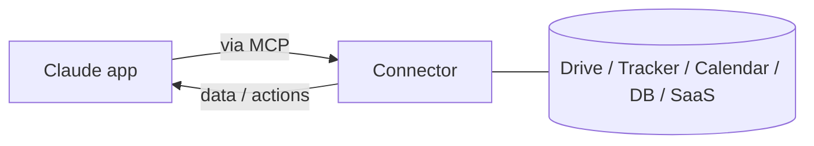

# Connecteurs (MCP) dans les apps

> Source: https://derob98.github.io/ailmanac/fr/docs/claude-app/connectors · AILmanac (CC BY 4.0) · last verified 2026-08-02

Atteindre des outils et des données externes depuis les apps Claude.

<LevelBadge level="intermediate" />

<Callout type="objectives" items={[
  "Comprendre ce qu'un connecteur apporte que le chat seul ne peut pas faire",
  "Voir pourquoi les connecteurs, les serveurs MCP de Claude Code et le MCP de l'API sont le même standard sous trois casquettes",
  "En configurer un avec le moindre privilège, en trois étapes",
  "Connaître les deux risques que vous acceptez : l'accès, et le contenu non fiable qui arrive par ce canal"
]} />

<VerifyNote lastVerified="2026-08-02" source="https://platform.claude.com/docs">
Les connecteurs qui existent, et leur disponibilité selon le forfait, changent fréquemment : confirmez les options actuelles dans l'app ou le centre d'aide.
</VerifyNote>

Les **connecteurs** permettent aux apps Claude d'atteindre **l'extérieur du chat**, c'est-à-dire vos outils et vos données (drives, outils de suivi de tickets, agendas, bases de données et plus encore), afin que Claude puisse répondre à partir de systèmes réels et agir sur eux. Sous le capot, ils reposent sur le **[Model Context Protocol (MCP)](/docs/claude-code/mcp)** ouvert.

## Ce qu'ils font

Sans connecteurs, Claude ne connaît que ce qui se trouve dans la conversation. Avec un connecteur, il peut (avec votre permission) tirer des informations pertinentes d'un service connecté, par exemple trouver un document, lire des tickets récents ou consulter un agenda, et s'en servir dans sa réponse.

## Le même standard, partout

Les connecteurs sont la forme **côté app** de MCP. Exactement le même protocole alimente [MCP dans Claude Code](/docs/claude-code/mcp) et [sur l'API](/docs/api/mcp). Apprenez le concept une fois ; il s'applique sur toutes les surfaces.

## Configurer & utiliser

<Steps items={[
  {
    title: "Connecter le service",
    body: "Autorisez via OAuth, là où c'est pris en charge. C'est l'étape qui crée la relation de confiance : tout ce qui suit hérite de ce que vous accordez ici."
  },
  {
    title: "Accorder le moindre privilège",
    body: "Seulement l'accès dont la tâche a besoin. Un connecteur qui doit seulement trouver des documents n'a pas besoin de droits d'écriture, et une autorisation en lecture seule est le contrôle de sécurité le moins cher dont vous disposez."
  },
  {
    title: "Demander naturellement",
    body: "Vous n'appelez pas le connecteur ; vous décrivez l'objectif. « Trouve mon document de planification du T3 et résume les risques » : Claude décide de l'outil à utiliser."
  }
]} />

<PromptCard title="Interroger un service connecté">
{`Find my Q3 planning doc and summarize the risks.`}
</PromptCard>

## Sécurité

:::warning[Un connecteur, c'est de l'accès + (parfois) des actions]
- N'autorisez que les services et les périmètres (scopes) auxquels vous faites confiance.
- Le contenu tiré de sources externes peut porter une [prompt injection](/docs/security/prompt-injection) : soyez prudent quand un connecteur lit du matériel non fiable.
- Examinez ce qu'un connecteur tiers peut faire avant de l'activer ([Examiner du code tiers](/docs/security/reviewing-third-party-code)).
:::

<Quiz questions={[
  {
    q: "Un connecteur ramène un document partagé écrit par quelqu'un en dehors de votre équipe. Quel est le risque précis que cela crée ?",
    options: [
      "Le document compte dans la limite de stockage de votre forfait",
      "La prompt injection : le contenu non fiable qui arrive par le connecteur peut porter des instructions",
      "Le connecteur obtiendra automatiquement un accès en écriture au document",
      "Claude ne peut pas lire les documents qu'il n'a pas créés"
    ],
    answer: 1,
    explain: "Le contenu tiré de sources externes peut porter une prompt injection. Le connecteur est la voie d'acheminement d'un contenu que vous n'avez pas écrit, ce qui est précisément la raison pour laquelle la note de sécurité met en garde contre le matériel non fiable."
  },
  {
    q: "Vous avez seulement besoin que Claude trouve et lise des documents. Quel périmètre devez-vous accorder ?",
    options: [
      "Un accès complet, pour ne jamais avoir à réautoriser",
      "Seulement l'accès dont la tâche a besoin : le moindre privilège",
      "Ce que le connecteur demande par défaut",
      "Aucun périmètre ; les connecteurs fonctionnent sans autorisation"
    ],
    answer: 1,
    explain: "Le moindre privilège. Un connecteur qui doit seulement trouver des documents n'a pas besoin de droits d'écriture, et l'autorisation que vous donnez à la configuration est héritée par tout ce que le connecteur fait ensuite."
  },
  {
    q: "Quelle est la relation entre les connecteurs des apps, les serveurs MCP de Claude Code et le MCP de l'API ?",
    options: [
      "Trois systèmes d'intégration sans rapport qui partagent par hasard un nom",
      "Trois surfaces du même protocole ouvert : apprenez le concept une fois",
      "Les connecteurs sont un format hérité que MCP a remplacé",
      "Seule la version API est du vrai MCP ; les autres sont simplifiées"
    ],
    answer: 1,
    explain: "Les connecteurs sont la forme côté app de MCP. Le même protocole alimente les serveurs MCP de Claude Code et le MCP de l'API : le concept se transfère donc sur les trois surfaces."
  }
]} />

<Callout type="takeaways" items={[
  "Sans connecteur, Claude ne connaît que ce qui se trouve dans la conversation ; avec un connecteur, il peut lire des systèmes réels et agir dessus, avec votre permission.",
  "Les connecteurs sont MCP avec sa casquette côté app : le même protocole que les serveurs MCP de Claude Code et le MCP de l'API.",
  "La configuration tient en trois étapes : connecter, accorder le moindre privilège, puis simplement décrire l'objectif.",
  "Vous acceptez deux risques : l'accès que vous avez accordé, et le contenu non fiable qui arrive par ce canal. Restreignez le périmètre et traitez le matériel externe comme non fiable."
]} />

## Suite

- [Serveurs MCP dans Claude Code](/docs/claude-code/mcp)
- [MCP & connexion aux outils (API)](/docs/api/mcp)
- [L'IA dans vos outils existants](/docs/claude-app/ai-in-your-tools)
- [Claudeforce : Salesforce dans Claude](/docs/claude-app/claudeforce-salesforce-in-claude) — un plugin concret qui transforme le motif MCP à 4 outils en 37 compétences commerciales
- [Finances personnelles dans Claude](/docs/claude-app/personal-finance) — le connecteur Plaid en pratique, et l'exemple le plus clair de la raison pour laquelle le périmètre d'un connecteur mérite une lecture attentive
