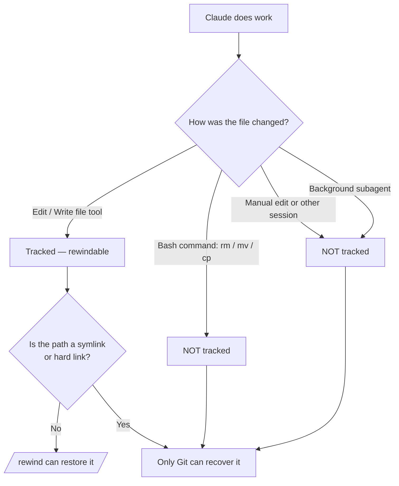

# Points de contrôle et retour arrière

> Source: https://derob98.github.io/ailmanac/fr/docs/claude-code/checkpoints-and-rewind · AILmanac (CC BY 4.0) · last verified 2026-10-20

Annulez les modifications de Claude, revenez en arrière sur toute une session et compressez le contexte avec /rewind — le filet de sécurité des exécutions ambitieuses.

<LevelBadge level="intermediate" />

<Callout type="objectives" items={["Comprendre ce qu'un point de contrôle capture — et ce qu'il ne capture pas, sans le dire", "Ouvrir le menu rewind de deux façons et choisir à chaque fois la bonne action de restauration", "Distinguer « restore » (annuler l'état) de « summarize » (compresser le contexte)", "Savoir exactement pourquoi les points de contrôle complètent Git sans jamais le remplacer"]} />

<VerifyNote lastVerified="2026-10-20" source="https://code.claude.com/docs/en/checkpointing">
Le comportement des points de contrôle, les actions du menu rewind, la limite d'instantanés et la durée de conservation changent d'une version à l'autre — vérifiez dans la documentation officielle.
</VerifyNote>

## L'idée générale

Quand vous lâchez Claude sur une modification ambitieuse et de grande ampleur, la question la plus inquiétante est : « et si ça tourne mal au bout de trois modifications ? » Les **points de contrôle** (checkpointing) sont la réponse : Claude Code prend automatiquement un instantané de votre code avant chaque modification, pour que vous puissiez revenir à n'importe quel état antérieur plutôt que de démêler à la main un refactoring à moitié terminé.

Voyez-y un **annuler local pour toute la session** — un filet de sécurité qui vous permet de dire « oui, essaie l'approche audacieuse » sans crainte.

## Comment les points de contrôle sont créés

Vous ne créez pas de points de contrôle — ils apparaissent automatiquement.

<Steps items={[{title: "Chaque prompt qui démarre un tour = un point de contrôle", body: "Chaque prompt qui démarre un tour capture l'état de votre code avant que les outils de modification de fichiers de Claude ne s'exécutent. Aucune commande, aucune configuration, aucune cérémonie."}, {title: "Seuls les 100 plus récents sont conservés", body: "Claude Code conserve les instantanés de fichiers des 100 points de contrôle les plus récents d'une session. Les plus anciens sont supprimés : une très longue session ne peut donc pas être rembobinée jusqu'à son début."}, {title: "Ils persistent d'une session à l'autre", body: "Les points de contrôle sont enregistrés avec la conversation : vous pouvez donc encore utiliser /rewind après avoir repris une session, pas seulement dans la session en cours."}, {title: "Ils se nettoient tout seuls", body: "Les instantanés de fichiers d'une session sont supprimés lors du nettoyage de conservation, par défaut environ 30 jours après le dernier enregistrement de la session. Revenir à un point de contrôle dont les instantanés ont disparu échoue avec 'No files were restored' — augmentez cleanupPeriodDays pour les conserver plus longtemps."}]} />

## Ouvrir le menu rewind

Il y a deux façons d'y accéder :

<Steps items={[{title: "Exécuter /rewind — ou ses alias /checkpoint et /undo", body: "Tapez la commande slash depuis le prompt. Fonctionne toujours. /checkpoint et /undo sont des alias de la même commande : utilisez le nom qui vous vient à l'esprit."}, {title: "Appuyer deux fois sur Échap — mais seulement sur une saisie vide", body: "Un double Échap ouvre le menu rewind quand la zone de prompt est vide. S'il y a du texte, le double Échap efface ce texte à la place (le texte effacé est enregistré dans l'historique de saisie ; appuyez sur Haut pour le récupérer ensuite)."}]} />

<PromptCard title="Ouvrir le menu rewind">{`/rewind`}</PromptCard>

<Callout type="warning" items={["Les noms d'alias sont plus parlants qu'ils ne sont littéraux : /checkpoint ne prend pas d'instantané à la demande (les instantanés sont automatiques), et /undo n'annule pas à lui seul la dernière modification. Les trois noms ouvrent le même menu, où vous choisissez toujours le point et l'action."]} />

Le menu liste **chaque prompt envoyé durant la session**. Choisissez le point sur lequel agir, puis une action.

## Restore ou summarize : la distinction essentielle

C'est ici que l'on s'y perd. Le menu propose deux *types* d'action :

- Les actions **Restore** modifient l'état sur le disque et/ou dans la conversation — elles annulent.
- Les actions **Summarize** ne touchent jamais à vos fichiers — elles compressent la conversation pour libérer de la place dans la fenêtre de contexte.

<Callout type="warning" items={["Restore = annuler (rétablit le code, la conversation ou les deux). Summarize = compresser le contexte (les fichiers sur disque ne sont pas touchés).", "Utilisez restore quand une modification a cassé quelque chose. Utilisez summarize quand la session est gonflée mais que le code est bon."]} />

### Les actions de restauration

<Steps items={[{title: "Restore code and conversation", body: "Rétablit à la fois vos fichiers et l'historique du chat au point sélectionné — un vrai « retour dans le temps » à ce moment-là."}, {title: "Restore conversation", body: "Rembobine le chat jusqu'à ce message mais conserve votre code actuel. Utile pour reposer une question sans perdre les modifications que vous voulez garder."}, {title: "Restore code", body: "Annule les modifications de fichiers mais conserve la conversation. Annulez les modifications, gardez la discussion à leur sujet."}]} />

Les deux options de restauration du **code** n'apparaissent que si le point de contrôle sélectionné contient réellement des modifications de fichiers suivies à annuler. Si aucune modification de fichier n'a été capturée après ce point, le menu propose seulement **Restore conversation**, les deux options summarize et **Never mind** (qui revient à la liste des messages sans rien changer).

Après avoir restauré la conversation (ou choisi « Summarize from here »), le prompt d'origine du message sélectionné est replacé dans le champ de saisie pour que vous puissiez le renvoyer ou le modifier.

### Les actions de résumé

Les deux compressent une partie de la conversation en un résumé généré par l'IA — comme un **`/compact` ciblé** où vous choisissez de quel côté du message sélectionné comprimer.

<Steps items={[{title: "Summarize from here", body: "Les messages AVANT le message sélectionné restent intacts. Le message sélectionné et tout ce qui suit deviennent un résumé. Utile pour écarter une discussion annexe tout en gardant le contexte initial dans tous ses détails."}, {title: "Summarize up to here", body: "Les messages AVANT le message sélectionné deviennent un résumé ; le message sélectionné et tout ce qui suit restent intacts. Vous restez à la fin de la conversation. Utile pour compresser les échanges de mise en place du début tout en gardant le travail récent mot pour mot."}]} />

Dans les deux cas, les messages d'origine restent dans la transcription de la session, de sorte que Claude peut toujours en consulter les détails, et un repère **Summarized conversation** apparaît à l'endroit des messages compressés. Pour orienter le résumé, mettez en surbrillance une option **Summarize** avec les flèches et saisissez vos instructions là où la ligne indique **add context (optional)**, puis appuyez sur Entrée — choisir l'option avec sa touche numérique résume immédiatement, sans instructions.

Pour tout le déroulé, voir [Gestion du contexte](/docs/claude-code/context-management) — les actions summarize de `/rewind` sont un scalpel, là où `/compact` est un gros pinceau.

<Callout type="note" items={["Summarize vous garde dans la même session. Pour créer une branche et essayer une autre approche en laissant la session d'origine intacte, utilisez plutôt /branch ou claude --continue --fork-session."]} />

## Rembobiner au-delà d'un `/clear`

Si vous avez exécuté `/clear` plus tôt dans le même processus Claude Code, le menu rewind affiche une entrée supplémentaire en haut : `/resume <session-id> (previous session)`. Sélectionnez-la pour revenir à la conversation active avant `/clear`.

<VerifyNote lastVerified="2026-10-20" source="https://code.claude.com/docs/en/checkpointing">
Cette entrée n'est disponible que jusqu'à ce que vous quittiez Claude Code ou repreniez une autre session. Une fois disparue, exécutez `/resume` et choisissez la session précédente dans la liste.
</VerifyNote>

## Là où les points de contrôle s'arrêtent — les limites qui font mal

Les points de contrôle semblent magiques, jusqu'à ce qu'ils ne le soient plus. Ces lacunes comptent :

<Steps items={[{title: "Les changements faits par bash sont invisibles", body: "Les fichiers touchés par les commandes shell que Claude exécute — rm, mv, cp, générateurs de code, formateurs — ne sont PAS suivis. Seules les modifications directes via les outils de modification de fichiers de Claude sont capturées. Un fichier supprimé avec rm est perdu du point de vue de rewind."}, {title: "La plupart des modifications de subagents ne sont pas restaurées", body: "Un subagent modifie avec les mêmes outils de fichiers, mais votre session ne capture généralement pas ces modifications. L'exception est une skill forkée au premier plan (context: fork avec background: false), qui modifie pendant votre propre tour et se rembobine normalement. Tout autre subagent — y compris une skill forkée en arrière-plan, le comportement par défaut — nécessite Git pour annuler. Voir /docs/claude-code/subagents."}, {title: "Les changements externes et concurrents sont invisibles", body: "Les modifications manuelles faites en dehors de Claude Code et celles d'autres sessions simultanées ne sont normalement pas capturées — sauf si elles touchent les mêmes fichiers que ceux modifiés par la session en cours."}, {title: "Les messages en milieu de tour n'ont pas de point de contrôle", body: "Un message que vous mettez en file d'attente pendant que Claude travaille et qui l'atteint au sein du tour en cours rejoint ce tour au lieu d'en démarrer un nouveau ; il n'a donc pas de point de contrôle propre — le menu rewind l'indique par « No code restore ». Pour annuler ce qui l'a suivi, revenez au prompt qui a démarré le tour, ce qui rembobine tout le tour, y compris le travail effectué avant l'arrivée de votre message. Sélectionner le message marqué propose quand même Restore conversation, en laissant vos fichiers tels quels."}, {title: "Les liens symboliques et les liens physiques sont ignorés", body: "Restore ignore tout chemin suivi qui est un lien symbolique ou un lien physique et avertit 'Restored the code, but skipped N files' ; ces fichiers conservent leur contenu actuel. Les liens symboliques des gestionnaires de dotfiles et les liens physiques de pnpm sont tous deux concernés. Exécutez /debug avant de restaurer pour que les chemins ignorés soient nommés dans le journal de débogage."}, {title: "C'est au niveau de la session, pas un historique", body: "Les points de contrôle sont une récupération rapide et locale. Ce ne sont ni des commits, ni des branches, et ils ne sont pas partageables avec votre équipe."}]} />

## Points de contrôle et Git : utilisez les deux

Ils résolvent des problèmes différents, associez-les donc.

| | Points de contrôle (`/rewind`) | Git |
|---|---|---|
| Portée | Une session | Historique complet du projet |
| Granularité | Par prompt démarrant un tour, automatique | Par commit, délibérée |
| Suit les changements faits par bash ? | Non | Oui (une fois indexés/commités) |
| Durée de vie | 100 derniers points de contrôle, nettoyés ~30 jours après la session | Permanent |
| Partageable / collaboratif | Non | Oui |
| Modèle mental | « Annuler local » | « Historique permanent » |

<Callout type="tip" items={["Commitez avec Git les états qui fonctionnent avant une exécution risquée et de grande ampleur — c'est votre plancher durable.", "Utilisez /rewind pour une récupération rapide en cours de session entre deux commits, sans polluer votre historique Git.", "Si Claude doit exécuter du bash destructeur (rm/mv), des générateurs ou des subagents en arrière-plan, appuyez-vous sur Git — rewind ne sauvera pas ces fichiers."]} />

## Quand y recourir

<Steps items={[{title: "Explorer des alternatives", body: "Essayez une implémentation audacieuse et, si elle ne vous plaît pas, restaurez le code et la conversation au point de bifurcation et tentez-en une autre."}, {title: "Se remettre d'une mauvaise modification", body: "Une modification a introduit un bug il y a trois prompts ? Restaurez le code juste avant plutôt que de déboguer les décombres."}, {title: "Itérer sur une fonctionnalité", body: "Expérimentez des variantes en sachant toujours qu'un état valide est à un /rewind de distance."}, {title: "Libérer de l'espace de contexte", body: "Un détour de débogage verbeux a avalé votre fenêtre de contexte ? Faites un summarize du milieu vers l'avant et gardez vos instructions d'origine dans tous leurs détails."}]} />

<Quiz title="Testez-vous" questions={[{q: "Claude a exécuté `rm config.old.json` via une commande bash et vous voulez récupérer le fichier. `/rewind` peut-il le restaurer ?", options: ["Oui — chaque modification de Claude est capturée dans un point de contrôle", "Non — les changements faits par bash ne sont pas suivis ; seules les modifications directes via les outils de fichiers le sont", "Seulement si vous exécutez /rewind dans les 30 secondes"], answer: 1, explain: "Les points de contrôle ne capturent que les modifications faites via les outils de modification de fichiers de Claude. Les fichiers changés par des commandes bash (rm, mv, cp) ne sont pas suivis — c'est précisément à cela que sert Git."}, {q: "Votre code est bon, mais une longue digression de débogage a rempli la fenêtre de contexte. Quelle action convient ?", options: ["Restore code and conversation à avant la digression", "Restore code", "Summarize from here au début de la digression"], answer: 2, explain: "Les actions summarize compressent la conversation sans toucher aux fichiers. « Summarize from here » transforme la digression en résumé tout en gardant intact votre contexte antérieur — l'espace de contexte est libéré sans aucune modification de code."}, {q: "Comment un point de contrôle est-il créé ?", options: ["En exécutant /checkpoint, qui prend un instantané de votre code à la demande", "Automatiquement — chaque prompt qui démarre un tour en crée un", "Seulement quand vous commitez dans Git"], answer: 1, explain: "Les points de contrôle sont automatiques : chaque prompt qui démarre un tour capture l'état du code avant les modifications. Il n'y a aucune étape manuelle — la commande /checkpoint existe, mais ce n'est qu'un alias de /rewind : elle ouvre le menu au lieu de prendre un instantané. Notez aussi qu'un message qui arrive en milieu de tour rejoint le tour en cours et n'a pas de point de contrôle propre."}]} />

<Flashcards title="Vocabulaire des points de contrôle et du rewind" cards={[{front: "Point de contrôle", back: "Un instantané automatique de votre code pris avant chaque prompt démarrant un tour. Limité à la session, les 100 derniers sont conservés, nettoyés ~30 jours après la session."}, {front: "/rewind", back: "Ouvre le menu rewind listant chaque prompt de la session, pour restaurer ou résumer depuis n'importe quel point. Alias : /checkpoint et /undo. Accessible aussi par double Échap sur une saisie vide."}, {front: "Action restore", back: "Rétablit l'état — code, conversation ou les deux — au point sélectionné. C'est l'« annuler ». Les options de code n'apparaissent que si ce point de contrôle a des changements suivis."}, {front: "Action summarize", back: "Compresse une partie de la conversation en un résumé IA pour libérer du contexte. Les fichiers sur disque ne sont jamais touchés."}, {front: "Angle mort de bash", back: "Les fichiers changés par des commandes shell (rm/mv/cp) ne sont PAS capturés — seules les modifications directes via les outils de fichiers le sont. Utilisez Git pour cela."}, {front: "Angle mort des subagents", back: "Seules les modifications d'une skill forkée au premier plan se rembobinent. Les subagents en arrière-plan (y compris le fork en arrière-plan par défaut) nécessitent Git."}]} />

<Callout type="takeaways" items={["Les points de contrôle sont des instantanés automatiques pris avant chaque prompt démarrant un tour — un annuler local pour la session. Les 100 derniers sont conservés, puis nettoyés ~30 jours après la session.", "Ouvrez le menu rewind avec /rewind (alias : /checkpoint, /undo) ou un double Échap sur une saisie vide ; il liste chaque prompt envoyé.", "Les actions restore annulent l'état (code, conversation ou les deux) ; les actions summarize compressent le contexte et ne touchent jamais aux fichiers.", "Les changements faits par bash, externes, concurrents et la plupart de ceux des subagents ne sont PAS suivis — et les chemins avec liens symboliques ou physiques sont ignorés à la restauration.", "Les points de contrôle complètent Git, ils ne le remplacent pas : pensez « annuler local » contre « historique permanent et partageable »."]} />

## Suite

- [Gestion du contexte](/docs/claude-code/context-management) — `/compact`, `/clear` et la place de summarize dans le tableau d'ensemble
- [Plan Mode](/docs/claude-code/plan-mode) — enquêter et approuver un plan avant l'exécution des modifications, pour rembobiner moins souvent
- [Permissions](/docs/claude-code/permissions) — l'autre moitié pour exécuter des tâches ambitieuses en toute sécurité
