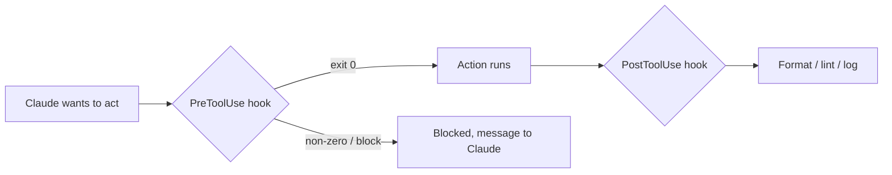

# Hooks : automatisation déterministe

> Source: https://derob98.github.io/ailmanac/fr/docs/claude-code/hooks · AILmanac (CC BY 4.0) · last verified 2026-08-22

Exécutez des commandes lors des événements du cycle de vie pour imposer formatage, garde-fous et sécurité.

<LevelBadge level="advanced" />

<VerifyNote lastVerified="2026-08-22" source="https://code.claude.com/docs/en/hooks">
Claude Code documente plus de 30 événements de hook regroupés par phase — la liste complète, la grammaire des matchers par événement et les champs JSON de sortie universels figurent dans la référence officielle des hooks. Les noms et la forme des charges utiles évoluent ; vérifiez à la source avant de vous appuyer sur un événement ou un champ précis.
</VerifyNote>

Les hooks sont des **commandes shell que Claude Code exécute automatiquement** à des points définis de son cycle de vie. Là où les [permissions](/docs/claude-code/permissions) décident *si* une action est autorisée, les hooks vous permettent d'exécuter une logique déterministe autour d'elle — formatage, validation, journalisation, garde-fous, masquage. C'est ce qui rend un comportement garanti au lieu d'un « pensez bien à… ».

<Callout type="objectives" items={["Quand recourir à un hook plutôt qu'à une instruction, une permission ou une skill", "Le cycle de vie complet : événements de session, de prompt, d'outil, de subagent, de tâche, de compaction et de fin de tour", "Comment un hook est câblé : événement, matcher et charge utile JSON sur stdin", "Les deux façons dont un hook bloque une action — code de sortie 2 vs JSON sur stdout", "Les champs JSON de sortie universels communs aux événements : continue, additionalContext, systemMessage, reloadSkills, sessionTitle, suppressOutput, updatedInput", "Les bonnes pratiques et les erreurs courantes qui distinguent des hooks rapides et sûrs de hooks lents et muets"]} />

## Quand recourir à un hook

Recourez à un hook quand vous voulez qu'un comportement soit *garanti*, et pas simplement demandé. Chaque besoin courant correspond à un événement du cycle de vie :

- **Formatage / lint automatiques** après chaque modification de fichier (`PostToolUse` sur `Edit|Write`).
- **Bloquer** une action qui enfreint une règle avant son exécution (`PreToolUse`).
- **Masquer** le message de l'assistant avant qu'il n'atteigne le terminal (`MessageDisplay`).
- **Recharger les skills** ou définir un **titre de session** après un `SessionStart`.
- **Notifier ou journaliser** quand une session se termine, qu'une tâche s'achève ou qu'un tour échoue (`Stop`, `StopFailure`, `SessionEnd`).
- **Injecter du contexte** au démarrage de la session ou au chargement des instructions.

## Comment ils fonctionnent

Vous enregistrez les hooks dans [`settings.json`](/docs/claude-code/settings), en les associant à un **événement** (et souvent à un matcher — généralement un nom d'outil, parfois un type de subagent, un déclencheur de compaction ou un type de notification). Quand l'événement se produit, Claude exécute votre commande en lui passant une **charge utile JSON sur stdin** (le nom de l'événement, la session et des champs propres à l'événement, comme le nom de l'outil et ses entrées). Le code de sortie et la sortie standard de votre commande décident de la suite.

<Steps items={[{title: "Associer un événement", body: "Enregistrez le hook dans settings.json sous l'événement du cycle de vie qui vous intéresse — par exemple PostToolUse pour l'automatisation après un outil, ou MessageDisplay pour le masquage."}, {title: "Affiner avec un matcher", body: "Ajoutez un matcher pour que le hook ne se déclenche que lorsque c'est pertinent, par ex. matcher \"Edit|Write\" pour les modifications de fichiers, ou matcher \"startup|resume\" sur SessionStart."}, {title: "Lire la charge utile sur stdin", body: "Quand l'événement se produit, Claude exécute votre commande et lui transmet par un tube une charge utile JSON sur stdin — le nom de l'événement, la session et des champs propres à l'événement (tool_name, tool_input, notification, etc.)."}, {title: "Décider de la suite", body: "Le code de sortie et la sortie de votre commande déterminent le résultat : laisser l'action se poursuivre, exécuter votre logique, la bloquer ou renvoyer du JSON structuré pour modifier ce que Claude voit."}]} />

```json
{
  "hooks": {
    "PostToolUse": [
      {
        "matcher": "Edit|Write",
        "hooks": [
          { "type": "command", "command": "jq -r '.tool_input.file_path' | xargs npx prettier --write" }
        ]
      }
    ]
  }
}
```

Le hook ci-dessus lit le chemin du fichier modifié dans le JSON de stdin (`.tool_input.file_path`) et le formate. Ne supposez pas qu'une variable d'environnement contienne le chemin — **lisez-le sur stdin.** Des espaces réservés de chemin utiles comme `${CLAUDE_PROJECT_DIR}` *sont* disponibles pour localiser vos scripts.

## Le cycle de vie en un coup d'œil

Les hooks de Claude Code couvrent toute la session, pas seulement les appels d'outils. Regroupez-les par phase pour savoir où accrocher votre logique.

| Phase | Événements | Usage typique |
| --- | --- | --- |
| **Session** | `SessionStart`, `SessionEnd`, `Setup`, `InstructionsLoaded`, `ConfigChange`, `CwdChanged`, `DirectoryAdded`, `FileChanged` | Injecter du contexte au démarrage, faire un instantané à la fin, réagir au rechargement de `CLAUDE.md` ou à une modification de `.env` sur le disque |
| **Prompt** | `UserPromptSubmit`, `UserPromptExpansion` | Filtrer ou réécrire le prompt avant que Claude ne le voie |
| **Outil** | `PreToolUse`, `PermissionRequest`, `PermissionDenied`, `PostToolUse`, `PostToolUseFailure`, `PostToolBatch` | Autoriser/refuser une action, escalader vers un humain, formater après les modifications, réessayer après un refus en mode auto |
| **Subagent** | `SubagentStart`, `SubagentStop` | Journaliser le démarrage/l'arrêt, empêcher un subagent de rendre son résultat |
| **Tâche** | `TaskCreated`, `TaskCompleted` | Annuler une tâche créée par erreur, conditionner l'achèvement |
| **Compaction** | `PreCompact`, `PostCompact` | Faire un instantané de la transcription avant la compaction, vérifier après |
| **Modèle** | `PreModelSwitch`, `PostModelSwitch` | Bloquer un changement de modèle avant son application ; réagir après le changement, y compris quand une session reprise le restaure |
| **Tour** | `Stop`, `StopFailure`, `Notification`, `MessageDisplay` | Notifier à l'achèvement, alerter en cas d'échec de l'API, masquer le texte affiché |
| **Équipe + MCP** | `TeammateIdle`, `Elicitation`, `ElicitationResult`, `WorktreeCreate`, `WorktreeRemove` | Coordination entre sessions, filtrage des elicitations MCP, encapsulation des opérations de worktree |

Les champs stdin exacts de chaque événement, la grammaire des matchers et les règles de blocage se trouvent dans la [référence officielle des hooks](https://code.claude.com/docs/en/hooks). Le catalogue ci-dessus est la carte ; la référence est le territoire.

## Comment un hook bloque

Deux manières, selon l'événement :

- **Code de sortie 2** — le hook fait échouer l'action, et ce qu'il a écrit sur **stderr** devient le message que Claude voit. Simple, et valable pour les hooks de type command sur les événements bloquants (`PreToolUse`, `UserPromptSubmit`, `UserPromptExpansion`, `Stop`, `SubagentStop`, `TeammateIdle`, `TaskCreated`, `TaskCompleted`, `ConfigChange`, `PostToolBatch`, `PreCompact`, `PreModelSwitch`, `Elicitation`, `ElicitationResult`, `WorktreeCreate`, `WorktreeRemove`). Sur `PermissionRequest`, le code 2 est ignoré ; refusez via son objet `decision`.
- **JSON sur stdout (code 0)** — renvoyez une décision structurée. Pour `PreToolUse`, c'est un `permissionDecision` valant `"allow"`, `"deny"`, `"ask"` (présenter l'appel à l'utilisateur) ou `"defer"` (uniquement pour les exécutions `-p` pilotées par une application qui les reprend), accompagné d'un `permissionDecisionReason`. Les événements non bloquants (`PostToolUse`, `Notification`, `MessageDisplay`, `StopFailure`, la plupart des événements de session) ignorent les tentatives de blocage — mais leur sortie JSON peut tout de même orienter ce que Claude voit ensuite.

Le script ci-dessous est un hook `PreToolUse` sur l'outil Bash. Lisez-le de haut en bas : il extrait la commande de stdin et, si elle semble destructrice, écrit une raison sur stderr et sort avec le code 2 pour bloquer.

```bash
#!/usr/bin/env bash
# PreToolUse hook on the Bash tool: refuse to delete things.
command=$(jq -r '.tool_input.command' < /dev/stdin)
if [[ "$command" == rm\ * || "$command" == *"rm -rf"* ]]; then
  echo "Blocked: destructive 'rm' is not allowed by policy." >&2
  exit 2
fi
exit 0
```

## Champs JSON de sortie universels

La plupart des événements acceptent sur stdout un objet JSON structuré qui oriente la suite — distinct des champs de décision propres à l'événement comme `permissionDecision`. Les plus utiles :

| Champ | Ce qu'il fait | Où il fonctionne |
| --- | --- | --- |
| **`continue`** | Si `false`, Claude cesse tout traitement — prioritaire sur toute décision propre à l'événement | La plupart des événements |
| **`systemMessage`** | Ajoute un message au contexte / à la transcription de Claude pour qu'il voie pourquoi vous êtes intervenu | La plupart des événements bloquants |
| **`additionalContext`** | Injecte du contexte supplémentaire que Claude peut lire et exploiter au tour suivant | `SessionStart`, `UserPromptSubmit`, autres |
| **`reloadSkills`** | Réanalyse les répertoires de skills pour qu'une session prenne en compte une skill que vous venez d'écrire | `SessionStart` (et d'autres événements de session) |
| **`sessionTitle`** | Définit le titre de la session dans l'interface — sous `hookSpecificOutput` sur `SessionStart` | `SessionStart` |
| **`suppressOutput`** | Masque la sortie de l'outil à Claude (utile pour les commandes bavardes) | Événements d'outil |
| **`updatedInput`** | Réécrit l'entrée de l'outil avant son exécution (par ex. ajouter un drapeau `--dry-run`) | `PreToolUse` |
| **`terminalSequence`** | Émet des séquences d'échappement du terminal — sonnerie, titre de fenêtre, badge de notification | `Notification`, `StopFailure`, autres |

Les champs de décision propres à l'événement — `permissionDecision` (`"allow"`, `"deny"`, `"ask"` ou `"defer"`, plus `permissionDecisionReason`) sur `PreToolUse`, `decision.behavior` (`"allow"` ou `"deny"`) sur `PermissionRequest`, et `retry: true` sur `PermissionDenied` pour laisser Claude retenter l'appel refusé — s'ajoutent à ces champs universels.

## Le modèle mental

Un hook `PreToolUse` s'exécute *avant* l'action et peut la bloquer ; un hook `PostToolUse` s'exécute *après* sa réussite et réagit au résultat.



<Flashcards title="Les événements de hook en un coup d'œil" cards={[{front: "PreToolUse", back: "Se déclenche avant l'exécution d'une action. À utiliser pour bloquer ou filtrer — par ex. refuser une commande destructrice avant qu'elle ne s'exécute. Champ de décision : permissionDecision."}, {front: "PostToolUse", back: "Se déclenche après une action correspondante. À utiliser pour formater, linter ou journaliser ce qui vient de changer. Non bloquant."}, {front: "MessageDisplay", back: "Se déclenche à l'affichage du texte du message de l'assistant. À utiliser pour masquer des secrets ou des données personnelles dans le terminal — affichage uniquement, ne peut pas bloquer."}, {front: "SessionStart", back: "Se déclenche au début (ou à la reprise) d'une session. À utiliser pour injecter du contexte via additionalContext, reloadSkills après l'ajout d'une nouvelle skill, ou définir sessionTitle."}, {front: "Stop / StopFailure", back: "Stop se déclenche quand Claude termine un tour proprement ; StopFailure quand le tour s'est terminé sur une erreur d'API (rate_limit, overloaded, auth, etc.). Notifiez ou relancez automatiquement sur la variante d'échec."}, {front: "PreCompact / PostCompact", back: "Se déclenchent autour de la compaction du contexte. PreCompact peut bloquer (code 2) ou faire d'abord un instantané de la transcription ; PostCompact réagit à l'état compacté."}]} />

## Bonnes pratiques

- **Gardez les hooks rapides et idempotents** — ils s'exécutent souvent. Les hooks `SessionEnd` se partagent un unique budget de 1,5 seconde, alors limitez le travail de fin de session au minimum.
- **Échouez bruyamment sur les vrais problèmes**, mais ne bloquez pas pour des questions cosmétiques.
- **Traitez la sortie d'un hook comme un retour adressé à Claude** — un message clair sur stderr (code 2) ou dans `systemMessage` (JSON) l'aide à se corriger.
- **Préférez la sortie JSON aux codes de sortie** quand vous voulez dire plus que « bloqué » — `permissionDecision: "ask"` sur `PreToolUse` renvoie la décision à un humain sans claquer la porte, et `additionalContext` vous permet d'*orienter* plutôt que seulement de refuser.
- Les hooks s'exécutent avec les privilèges de votre shell — examinez tout hook que vous n'avez pas écrit ([Examiner du code tiers](/docs/security/reviewing-third-party-code)).

## Erreurs courantes

- **Lire le chemin du fichier dans une variable d'environnement.** Le chemin se trouve dans le JSON de stdin (`.tool_input.file_path`), pas dans `$CLAUDE_FILE_PATH`. Faites passer stdin par `jq`.
- **Blocages silencieux.** Si un hook `PreToolUse` sort avec le code 2 sans rien écrire sur stderr, Claude est bloqué mais ne sait pas *pourquoi* et ne peut pas s'adapter. Écrivez toujours une raison claire (ou utilisez `permissionDecisionReason`).
- **Tenter de bloquer un événement non bloquant.** `PostToolUse` se déclenche *après* l'exécution de l'outil — un code 2 se contente de glisser un message à l'oreille de Claude, il ne peut pas annuler l'action. Si vous devez filtrer, accrochez-vous à `PreToolUse`.
- **Hooks lents.** Un hook `PostToolUse` s'exécute après *chaque* modification correspondante. Un linter de 3 secondes rend toute la session poussive — gardez les hooks rapides et, idéalement, n'agissez que sur ce qui a changé.
- **Matchers trop larges.** `matcher: ".*"` se déclenche sur chaque outil. Affinez avec un nom exact, une liste `Edit|Write` ou le champ `if` par gestionnaire (par ex. `"if": "Bash(git push *)"`).
- **Oublier que les matchers existent aussi pour les événements hors outils.** `SessionStart` correspond à `startup|resume|clear|compact|fork` ; `Notification` correspond à des types comme `permission_prompt|idle_prompt|agent_completed` ; `PreCompact` correspond à `manual|auto`. Un hook câblé sur le mauvais sous-ensemble se déclenche trop souvent ou jamais.
- **Faire confiance à des hooks que vous n'avez pas écrits.** Un hook exécute du shell arbitraire avec vos privilèges. Examinez d'abord tout hook issu d'un plugin ou d'un modèle — voir [Examiner du code tiers](/docs/security/reviewing-third-party-code).

<Callout type="warning" items={["Un hook exécute du shell arbitraire avec vos privilèges — ne câblez jamais un hook issu d'un plugin ou d'un modèle sans l'avoir lu au préalable."]} />

## Recettes à reprendre

Des modèles à copier-coller se trouvent dans [Recettes de hooks et de settings.json](/docs/templates/hooks-settings). Quelques recettes à fort effet de levier pour voir la forme des événements plus récents :

<PromptCard title="Formater automatiquement les fichiers modifiés (PostToolUse sur Edit|Write)">{`{
  "hooks": {
    "PostToolUse": [
      {
        "matcher": "Edit|Write",
        "hooks": [
          { "type": "command", "command": "jq -r '.tool_input.file_path' | xargs npx prettier --write" }
        ]
      }
    ]
  }
}`}</PromptCard>

<PromptCard title="Définir un titre de session par projet au démarrage (SessionStart)">{`{
  "hooks": {
    "SessionStart": [
      {
        "matcher": "startup|resume",
        "hooks": [
          {
            "type": "command",
            "command": "jq -nc --arg t \\"$(basename \\"$PWD\\") — $(git rev-parse --abbrev-ref HEAD 2>/dev/null || echo detached)\\" '{hookSpecificOutput:{sessionTitle:$t}}'"
          }
        ]
      }
    ]
  }
}`}</PromptCard>

<PromptCard title="Recharger les skills après un SessionStart (prend en compte une skill que vous venez d'écrire)">{`{
  "hooks": {
    "SessionStart": [
      {
        "matcher": "startup|resume",
        "hooks": [
          { "type": "command", "command": "printf '{\\"reloadSkills\\": true}\\n'" }
        ]
      }
    ]
  }
}`}</PromptCard>

<PromptCard title="Masquer les clés d'API dans le texte affiché de l'assistant (MessageDisplay)">{`{
  "hooks": {
    "MessageDisplay": [
      {
        "hooks": [
          {
            "type": "command",
            "command": "jq -r '.message.content' | sed -E 's/(sk-[A-Za-z0-9_-]{20,})/sk-***REDACTED***/g'"
          }
        ]
      }
    ]
  }
}`}</PromptCard>

<PromptCard title="Notifier en cas d'échec d'un tour (StopFailure — limites de débit, surcharge, authentification)">{`{
  "hooks": {
    "StopFailure": [
      {
        "matcher": "rate_limit|overloaded|authentication_failed|billing_error",
        "hooks": [
          { "type": "command", "command": "osascript -e 'display notification \\"Claude Code turn failed — check the terminal\\" with title \\"Claude Code\\"'" }
        ]
      }
    ]
  }
}`}</PromptCard>

<Quiz title="Testez-vous" questions={[{q: "Où un hook trouve-t-il le chemin du fichier qui vient d'être modifié ?", options: ["Dans la variable d'environnement $CLAUDE_FILE_PATH", "Dans la charge utile JSON sur stdin, à .tool_input.file_path", "Dans un argument de ligne de commande transmis par Claude"], answer: 1, explain: "Le chemin se trouve dans le JSON de stdin (.tool_input.file_path), pas dans une variable d'environnement. Faites passer stdin par jq pour le lire."}, {q: "Un hook PreToolUse sort avec le code 2. Que se passe-t-il ?", options: ["L'action est autorisée et stdout est journalisé", "L'action est bloquée, et ce que le hook a écrit sur stderr devient le message que Claude voit", "Claude ignore le résultat car le code 2 est réservé"], answer: 1, explain: "Le code de sortie 2 fait échouer l'action ; stderr devient le message que Claude voit. Écrivez toujours une raison claire pour que Claude puisse s'adapter."}, {q: "Vous voulez qu'une session prenne en compte une skill que vous venez d'ajouter à .claude/skills/ sans redémarrer. Quel champ de sortie, sur quel événement ?", options: ["reloadSkills: true sur SessionStart", "restart: true sur Stop", "refresh: true sur PostToolUse"], answer: 0, explain: "Émettre {\"reloadSkills\": true} depuis un hook SessionStart réanalyse les répertoires de skills, de sorte que la session en cours prend en compte les skills nouvelles ou modifiées."}, {q: "Vous voulez masquer des secrets dans le texte de Claude avant qu'il n'apparaisse à l'écran de l'utilisateur. Quel événement ?", options: ["PreToolUse", "PostToolUse", "MessageDisplay"], answer: 2, explain: "MessageDisplay se déclenche à l'affichage du texte du message de l'assistant — le bon endroit pour transformer ou masquer le texte en route vers le terminal. Il ne peut pas bloquer."}]} />

<Callout type="takeaways" items={["Les hooks rendent un comportement garanti plutôt que demandé — une logique déterministe autour d'actions que les permissions ne font qu'autoriser ou refuser.", "Le cycle de vie couvre plus de 30 événements répartis en phases de session, prompt, outil, subagent, tâche, compaction et tour — choisissez la bonne phase avant d'écrire le script.", "Enregistrez dans settings.json un événement plus un matcher ; Claude transmet une charge utile JSON sur stdin et lit votre code de sortie et votre sortie.", "Lisez le chemin du fichier sur stdin (.tool_input.file_path) — pas dans une variable d'environnement.", "Bloquez avec le code de sortie 2 (stderr devient le message) ou avec du JSON structuré sur stdout (permissionDecision sur les événements d'outil, {continue: false} pour tout arrêter).", "Les champs de sortie universels — additionalContext, systemMessage, reloadSkills, sessionTitle, suppressOutput, updatedInput — vous permettent d'orienter Claude plutôt que seulement d'autoriser ou de refuser.", "Gardez les hooks rapides, idempotents et ciblés par des matchers étroits — et examinez tout hook que vous n'avez pas écrit, car il s'exécute avec les privilèges de votre shell."]} />

## Suite

- [Mods : extensions in-process](/docs/claude-code/mods) — le cousin in-process : un middleware TypeScript qui peut *réécrire* un événement au lieu de seulement l'autoriser ou le bloquer, et qui atteint chaque événement de cette page sous la forme `classic.<Event>`
- [settings.json](/docs/claude-code/settings) · [Permissions](/docs/claude-code/permissions)
- [Skills](/docs/claude-code/skills) — expertise vs automatisation
- [Durcir les exécutions autonomes](/docs/security/hardening-autonomous-runs)
