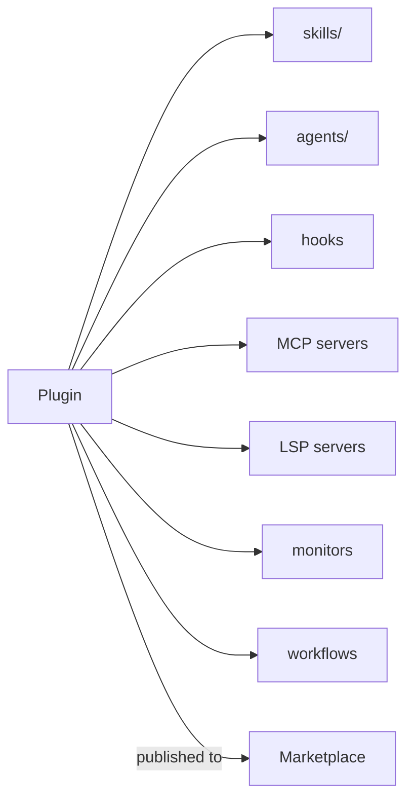

# Plugins et marketplaces

> Source: https://derob98.github.io/ailmanac/fr/docs/claude-code/plugins-marketplaces · AILmanac (CC BY 4.0) · last verified 2026-10-22

Regroupez skills, agents, commandes, hooks et MCP en une seule unité installable.

<LevelBadge level="advanced" />

<VerifyNote lastVerified="2026-10-22" source="https://code.claude.com/docs/en/plugins">
La structure des plugins et le fonctionnement des marketplaces évoluent vite — vérifiez les détails dans la documentation officielle de Claude Code.
</VerifyNote>

Un **plugin** regroupe plusieurs personnalisations — [skills](/docs/claude-code/skills), [sous-agents](/docs/claude-code/subagents), [commandes slash](/docs/claude-code/slash-commands), [hooks](/docs/claude-code/hooks), [serveurs MCP](/docs/claude-code/mcp) et, depuis Claude Code v2.1.287, un [**mod**](/docs/claude-code/mods) — en une seule unité versionnée et installable. Une **marketplace** est un catalogue de plugins que l'on peut découvrir et installer.

## Pourquoi les plugins comptent

- **Livrez la boîte à outils d'une équipe en une étape.** Au lieu de demander à chacun de copier cinq fichiers, publiez un plugin ; vos collègues l'installent et obtiennent les mêmes commandes, hooks, agents et connexions MCP.
- **Versionnage.** Mettez le plugin à jour, et tout le monde récupère la nouvelle version.
- **Distribution.** Une marketplace rend votre boîte à outils (ou celle des autres) facile à découvrir.

## Ce qu'il y a typiquement dedans

Un plugin est un dossier structuré de composants. Le manifeste `.claude-plugin/plugin.json` est **facultatif** : sans lui, Claude Code charge ce qu'il trouve dans la [disposition standard](https://code.claude.com/docs/en/plugins-reference#standard-layout) — un dossier ne contenant qu'un `SKILL.md` se charge donc déjà comme plugin. Écrivez un manifeste quand vous voulez des métadonnées, une version, un composant hors de son répertoire par défaut, ou des valeurs configurables par l'utilisateur.

Au-delà des skills, un plugin peut regrouper des sous-agents, des hooks et des serveurs MCP et — plus récemment — des [serveurs LSP](https://code.claude.com/docs/en/plugins-reference#lspservers) pour l'intelligence du code, des [moniteurs](https://code.claude.com/docs/en/plugins-reference#monitors) en arrière-plan, des [workflows](https://code.claude.com/docs/en/workflows#distribute-a-workflow-in-a-plugin), un dossier `bin/` d'exécutables et des réglages par défaut. Gardez chaque plugin **cohérent** — un plugin « conventions d'équipe », un plugin « boîte à outils Python » — plutôt qu'un fourre-tout.

## La confiance avant l'installation

:::warning Les plugins peuvent embarquer du code exécutable
Les hooks et serveurs MCP d'un plugin s'exécutent avec vos privilèges. N'installez que depuis des sources de confiance et examinez d'abord ce que fait un plugin — voir [Examiner du code tiers](/docs/security/reviewing-third-party-code).
:::

## Un chemin pour faire évoluer votre configuration

La progression naturelle : un `CLAUDE.md` → quelques [skills](/docs/claude-code/skills) et [commandes](/docs/claude-code/slash-commands) → on les regroupe en plugin → on publie sur une marketplace pour votre équipe ou la communauté. Cette dernière étape fait partie de la façon dont AILmanac veut aider l'écosystème à grandir.

## Suite

- [Mods : extensions in-process](/docs/claude-code/mods) — le seul composant de plugin qui s'exécute *à l'intérieur* de Claude Code et peut remplacer son comportement natif
- [Plugin Evals](/docs/claude-code/plugin-evals) — prouvez que le plugin est utile avec `claude plugin eval` avant de le publier
- [Skills](/docs/claude-code/skills) · [Sous-agents](/docs/claude-code/subagents) · [MCP](/docs/claude-code/mcp)
- [Examiner du code tiers](/docs/security/reviewing-third-party-code)
- Les [packs de skills](/docs/templates/skills) d'AILmanac
