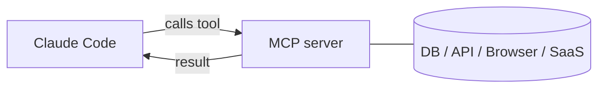

# Claude Code में MCP सर्वर

> Source: https://derob98.github.io/ailmanac/hi/docs/claude-code/mcp · AILmanac (CC BY 4.0) · last verified 2026-06-23

Model Context Protocol के माध्यम से डेटाबेस, GitHub, ब्राउज़र और बहुत कुछ कनेक्ट करें।

<LevelBadge level="advanced" />

<VerifyNote lastVerified="2026-06-23" source="https://code.claude.com/docs/en/mcp">
`claude mcp` कमांड, कॉन्फ़िगरेशन स्कोप, और ट्रांसपोर्ट विकसित होते रहते हैं — आधिकारिक Claude Code MCP डॉक्स और modelcontextprotocol.io पर पुष्टि करें।
</VerifyNote>

**Model Context Protocol (MCP)** AI को बाहरी टूल्स और डेटा से जोड़ने के लिए एक खुला मानक है। एक **MCP सर्वर** क्षमताएँ उजागर करता है (किसी डेटाबेस को क्वेरी करना, एक GitHub PR खोलना, किसी ब्राउज़र को चलाना); Claude Code इससे जुड़ता है और एक सत्र के दौरान **उन टूल्स को कॉल कर सकता है**। यह वह तरीका है जिससे आप Claude को अपने फ़ाइलसिस्टम और शेल से परे विस्तारित करते हैं।

<Callout type="objectives" items={["समझाएँ कि MCP सर्वर क्या है और Claude Code इसके टूल्स को कैसे कॉल करता है", "दो ट्रांसपोर्ट्स में अंतर करें: स्थानीय stdio बनाम रिमोट HTTP/SSE", "claude mcp add के साथ एक सर्वर जोड़ें और उसके द्वारा लिखे गए JSON को पढ़ें", "यह तय करने के लिए सही स्कोप (local, project, user) चुनें कि सर्वर किसे दिखता है", "एक वास्तविक डेटाबेस को Claude से एंड-टू-एंड कनेक्ट करें", "उन सुरक्षा और कॉन्फ़िगरेशन जालों से बचें जो अधिकांश लोगों को परेशान करते हैं"]} />

## इसका स्वरूप



आप उन सर्वरों की घोषणा करते हैं जिन्हें Claude उपयोग कर सकता है; प्रत्येक सर्वर स्कीमा के साथ टूल्स का एक सेट प्रकाशित करता है; Claude उन्हें किसी भी अन्य टूल की तरह चुनता और कॉल करता है।

<Flashcards title="MCP शब्दावली" cards={[{front: "Model Context Protocol (MCP)", back: "AI को बाहरी टूल्स और डेटा से जोड़ने के लिए एक खुला मानक।"}, {front: "MCP सर्वर", back: "एक प्रोग्राम जो क्षमताओं को — किसी डेटाबेस को क्वेरी करना, एक GitHub PR खोलना, किसी ब्राउज़र को चलाना — कॉल करने योग्य टूल्स के रूप में उजागर करता है।"}, {front: "टूल", back: "एक क्षमता जिसे MCP सर्वर एक स्कीमा के साथ प्रकाशित करता है; Claude इसे किसी भी अन्य टूल की तरह चुनता और कॉल करता है।"}, {front: "ट्रांसपोर्ट", back: "Claude किसी सर्वर तक कैसे पहुँचता है: stdio (स्थानीय प्रोसेस) या रिमोट HTTP/SSE (होस्ट किया हुआ, अक्सर OAuth के साथ)।"}, {front: "स्कोप", back: "सर्वर किसे दिखता है: local (आप, यह प्रोजेक्ट), project (कमिट की गई टीम), या user (आप, हर जगह)।"}]} />

## ट्रांसपोर्ट्स

Claude किसी सर्वर तक पहुँचने के दो तरीके हैं। सर्वर कहाँ चलता है उसके आधार पर चुनें।

- **stdio** — एक स्थानीय प्रोसेस जिसे Claude लॉन्च करता है (स्थानीय टूल्स/CLI के लिए बढ़िया)।
- **रिमोट (HTTP/SSE)** — एक होस्ट किया गया सर्वर, अक्सर OAuth के साथ।

## सर्वर कॉन्फ़िगर करना

सबसे तेज़ रास्ता `claude mcp add` कमांड है — यह आपके लिए कॉन्फ़िग लिख देता है। शून्य से एक कनेक्टेड सर्वर तक पहुँचने के लिए इस क्रम का पालन करें।

<Steps items={[{title: "एक स्थानीय stdio सर्वर जोड़ें", body: "claude mcp add चलाएँ — -- के बाद की हर चीज़ वह लॉन्च कमांड है जिसे Claude आपके लिए चलाता है।"}, {title: "या एक रिमोट HTTP सर्वर जोड़ें", body: "--transport http और एक स्कोप पास करें, फिर सर्वर URL। रिमोट सर्वर अक्सर होस्ट किए जाते हैं और OAuth का उपयोग करते हैं।"}, {title: "देखें क्या कनेक्ट है", body: "कॉन्फ़िगर किए गए सर्वरों और उनकी कनेक्शन स्थिति देखने के लिए claude mcp list चलाएँ।"}, {title: "निरीक्षण और प्रमाणन करें", body: "किसी सर्वर के टूल्स का निरीक्षण करने और रिमोट सर्वरों को प्रमाणित करने के लिए किसी सत्र के अंदर /mcp का उपयोग करें।"}]} />

<PromptCard title="एक स्थानीय stdio सर्वर जोड़ें">{`# A local stdio server (everything after -- is the launch command)
claude mcp add github -- npx -y @modelcontextprotocol/server-github`}</PromptCard>

<PromptCard title="एक रिमोट HTTP सर्वर जोड़ें (प्रोजेक्ट के साथ साझा)">{`# A remote HTTP server, shared with everyone on the project
claude mcp add --transport http --scope project linear https://mcp.linear.app/mcp`}</PromptCard>

पर्दे के पीछे वह बस JSON है। एक **project**-स्कोप वाला सर्वर रेपो रूट पर एक `.mcp.json` में आता है — इसे चेक इन करें और आपकी पूरी टीम को समान टूल्स मिल जाते हैं:

```json
{
  "mcpServers": {
    "github": { "command": "npx", "args": ["-y", "@modelcontextprotocol/server-github"] }
  }
}
```

### स्कोप तय करता है कि सर्वर किसे दिखता है

| स्कोप | कहाँ रहता है | किसके लिए उपयोग करें |
|---|---|---|
| `local` (डिफ़ॉल्ट) | आपकी उपयोगकर्ता सेटिंग्स, केवल यह प्रोजेक्ट | व्यक्तिगत प्रयोग, सीक्रेट्स |
| `project` | रेपो में `.mcp.json` (कमिट किया हुआ) | वे टूल्स जिन्हें पूरी टीम को साझा करना चाहिए |
| `user` | आपकी उपयोगकर्ता सेटिंग्स, सभी प्रोजेक्ट्स | वे सर्वर जिन्हें आप हर जगह चाहते हैं |

जो कनेक्ट है उसे देखने के लिए `claude mcp list` चलाएँ और टूल्स का निरीक्षण करने तथा रिमोट सर्वरों को प्रमाणित करने के लिए किसी सत्र के अंदर `/mcp` चलाएँ। कॉपी-पेस्ट स्टार्टर्स के लिए [MCP Config और सर्वर स्कैफ़ोल्ड्स](/docs/templates/mcp-config) देखें।

## व्यावहारिक उदाहरण: Claude को अपना डेटाबेस दें

मान लीजिए आप चाहते हैं कि क्वेरी परिणाम पेस्ट करने के बजाय Claude एक स्थानीय Postgres के विरुद्ध प्रश्नों का उत्तर दे। सर्वर जोड़ें (project स्कोप, ताकि टीम के साथी इसे विरासत में पाएँ):

<PromptCard title="project स्कोप पर एक Postgres सर्वर जोड़ें">{`claude mcp add --scope project db -- npx -y @modelcontextprotocol/server-postgres "postgresql://localhost/app"`}</PromptCard>

अब किसी सत्र में आप प्रश्न को सरल भाषा में पूछ सकते हैं और Claude को आपके लिए क्वेरी लूप करने दे सकते हैं:

<PromptCard title="डेटाबेस के विरुद्ध एक प्रश्न पूछें">{`How many users signed up last week? Check the DB.`}</PromptCard>

Claude सर्वर का `query` टूल कॉल करता है, पंक्तियाँ वापस पाता है, और उत्तर देता है — कोई कॉपी-पेस्ट लूप नहीं। चूँकि यह project-स्कोप वाला है, रेपो खींचने वाले एक टीम साथी को Claude Code खोलते ही वही क्षमता मिल जाती है। यदि आप केवल पठन चाहते हैं तो कनेक्शन स्ट्रिंग को केवल-पठन रखें।

## विश्वास और सुरक्षा

<Callout type="warning" items={["एक MCP सर्वर कोड चलाता है और डेटा पढ़ सकता है तथा कार्रवाइयाँ कर सकता है — केवल उन्हीं सर्वरों से जुड़ें जिन पर आप भरोसा करते हैं।", "प्रत्येक सर्वर को उतना ही न्यूनतम विशेषाधिकार दें जितना उसे चाहिए।", "कोई भी बाहरी सामग्री जो सर्वर लौटाता है, वह प्रॉम्प्ट इंजेक्शन ले जा सकती है।", "तृतीय-पक्ष सर्वरों से जुड़ने से पहले उनकी समीक्षा करें।"]} />

:::warning[MCP सर्वरों को सॉफ़्टवेयर इंस्टॉल करने जैसा मानें]
एक MCP सर्वर कोड चलाता है और डेटा पढ़ सकता है और कार्रवाई कर सकता है। केवल उन्हीं सर्वरों से जुड़ें जिन पर आप भरोसा करते हैं, उन्हें आवश्यक **न्यूनतम विशेषाधिकार** दें, और याद रखें कि वे जो भी बाहरी सामग्री लौटाते हैं वह [प्रॉम्प्ट इंजेक्शन](/docs/security/prompt-injection) ले जा सकती है। तृतीय-पक्ष सर्वरों की पहले समीक्षा करें — देखें [तृतीय-पक्ष कोड की समीक्षा करना](/docs/security/reviewing-third-party-code)।
:::

## ऐप्स में भी MCP

MCP Claude ऐप्स में **Connectors** को भी शक्ति प्रदान करता है — वही मानक, अलग सतह। देखें [ऐप्स में Connectors (MCP)](/docs/claude-app/connectors) और, API के लिए, [MCP और टूल्स से कनेक्ट करना](/docs/api/mcp)।

## आम गलतियाँ

- **गलत स्कोप।** `local` स्कोप पर जोड़ा गया सर्वर टीम के साथियों के लिए नहीं दिखेगा; जो आप केवल अपने लिए चाहते थे उसे `project` स्कोप पर कमिट नहीं किया जाना चाहिए। सोच-समझकर चुनें।
- **बहुत सारे सर्वर, बहुत सारे टूल्स।** प्रत्येक जुड़ा सर्वर अपने टूल स्कीमा को संदर्भ में जोड़ता है। कार्य को जो चाहिए उसे जोड़ें, अपना पूरा कैटलॉग नहीं।
- **अति-विशेषाधिकार प्राप्त कनेक्शन।** किसी डेटाबेस सर्वर को एक केवल-पठन भूमिका दें जब तक कि Claude को सचमुच लिखने की ज़रूरत न हो। MCP क्षमताओं को वास्तविक बनाता है — उन्हें संकीर्ण करें।
- **इंजेक्शन जोखिम को भूलना।** सर्वर जो भी लौटाता है (एक वेब पेज, एक issue बॉडी, एक पंक्ति) वह अविश्वसनीय टेक्स्ट है जो [प्रॉम्प्ट इंजेक्शन](/docs/security/prompt-injection) ले जा सकता है। सोचे-समझे बिना एक शक्तिशाली write-सक्षम सर्वर को किसी अविश्वसनीय read-सक्षम सर्वर के बगल में न जोड़ें।

<Quiz title="स्वयं जाँचें" questions={[{q: "कौन-सा ट्रांसपोर्ट एक स्थानीय प्रोसेस है जिसे Claude स्वयं लॉन्च करता है?", options: ["रिमोट HTTP/SSE", "stdio", "OAuth"], answer: 1, explain: "stdio एक स्थानीय प्रोसेस है जिसे Claude लॉन्च करता है — स्थानीय टूल्स और CLI के लिए आदर्श। रिमोट HTTP/SSE एक होस्ट किया गया सर्वर है, अक्सर OAuth के साथ।"}, {q: "एक project-स्कोप वाला सर्वर कहाँ लिखा जाता है, और इसका क्या लाभ है?", options: ["आपकी उपयोगकर्ता सेटिंग्स; केवल आप इसे देखते हैं", "रेपो रूट पर एक .mcp.json; इसे चेक इन करें और पूरी टीम को समान टूल्स मिल जाते हैं", "एक छिपा हुआ ग्लोबल कैश; कोई इसे संपादित नहीं कर सकता"], answer: 1, explain: "project स्कोप रेपो रूट पर एक कमिट की गई .mcp.json में आता है, इसलिए रेपो खींचने वाले टीम साथी समान टूल्स विरासत में पाते हैं।"}, {q: "जब Claude को केवल पढ़ने की ज़रूरत हो तो डेटाबेस कनेक्शन को केवल-पठन क्यों रखें?", options: ["इससे क्वेरीज़ तेज़ी से चलती हैं", "न्यूनतम विशेषाधिकार — MCP क्षमताओं को वास्तविक बनाता है, इसलिए लेखन पहुँच तब तक न दें जब तक सचमुच ज़रूरत न हो", "प्रोटोकॉल द्वारा केवल-पठन आवश्यक है"], answer: 1, explain: "सर्वरों को उतना ही न्यूनतम विशेषाधिकार दें जितना उन्हें चाहिए। MCP क्षमताओं को वास्तविक बनाता है, इसलिए एक केवल-पठन भूमिका अनपेक्षित लेखन से बचाती है।"}]} />

<Callout type="takeaways" items={["MCP एक खुला मानक है; एक MCP सर्वर टूल्स उजागर करता है जिन्हें Claude Code किसी भी अन्य टूल की तरह कॉल करता है।", "दो ट्रांसपोर्ट: स्थानीय stdio (एक प्रोसेस जिसे Claude लॉन्च करता है) और रिमोट HTTP/SSE (होस्ट किया हुआ, अक्सर OAuth)।", "claude mcp add आपके लिए कॉन्फ़िग लिख देता है; पर्दे के पीछे यह JSON है, और project स्कोप एक कमिट की गई .mcp.json में रहता है।", "स्कोप दृश्यता को नियंत्रित करता है: local (आप, यह प्रोजेक्ट), project (टीम के लिए कमिट किया हुआ), user (आप, हर जगह)।", "सर्वरों को सॉफ़्टवेयर इंस्टॉल करने जैसा मानें: विश्वास, न्यूनतम विशेषाधिकार, और वे जो भी लौटाते हैं उसमें प्रॉम्प्ट इंजेक्शन पर नज़र रखें।"]} />

## आगे

- [अपना पहला MCP सर्वर बनाएँ और जोड़ें (वॉकथ्रू)](/docs/walkthroughs/first-mcp-server)
- [MCP Config और सर्वर स्कैफ़ोल्ड्स](/docs/templates/mcp-config)
- [एजेंट्स और टूल्स को सुरक्षित करना](/docs/security/securing-agents)
