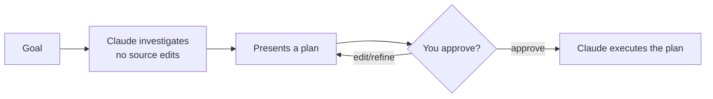

# Plan Mode

> Source: https://derob98.github.io/ailmanac/hi/docs/claude-code/plan-mode · AILmanac (CC BY 4.0) · last verified 2026-10-09

कोई भी edit चलने से पहले जाँच-पड़ताल करें और प्रस्ताव दें — बड़े बदलावों से निपटने का सबसे सुरक्षित तरीका, और वे रोकें जो यह लागू नहीं करता।

<LevelBadge level="beginner" />

<Callout type="objectives" items={["समझाएँ कि Plan Mode क्या रोकता है — और Claude को फिर भी क्या चलाने देता है", "Plan Mode में तीन अलग-अलग तरीकों से जाएँ और बाहर निकलें", "जाँच-प्रस्ताव-स्वीकृति-निष्पादन के चक्र को क़दम-दर-क़दम समझें", "Plan Mode और अनुमतियों (Permissions) का फ़र्क़ समझें और दोनों को साथ इस्तेमाल करें"]} />

<VerifyNote lastVerified="2026-10-09" source="https://code.claude.com/docs/en/permission-modes">
Plan Mode में आप कैसे जाते हैं (शॉर्टकट/फ़्लैग), और योजना बनाते समय यह Claude को ठीक-ठीक कौन-से shell कमांड चलाने देता है, यह रिलीज़ के साथ बदलता है — आधिकारिक Claude Code दस्तावेज़ देखें।
</VerifyNote>

## मूल विचार

सोचिए, आप किसी ठेकेदार को सीधे घर की चाबियाँ थमा दें, बनाम पहले उससे कहें कि वह घर का मुआयना करे और लिखे कि वह *क्या* बदलेगा। Plan Mode वही मुआयना है।

**Plan Mode** Claude से कहता है कि वह **बदलाव किए बिना शोध करे और बदलाव प्रस्तावित करे**: वह फ़ाइलें पढ़ता है, खोजबीन के लिए shell कमांड चलाता है, और एक योजना लिखता है — लेकिन **आपका सोर्स edit नहीं करता**। योजना स्वीकृत होने तक edits रुके रहते हैं।

<Callout type="tip" items={["Plan Mode का मतलब है: Claude जाँच-पड़ताल (INVESTIGATE) करता है, पर आपका सोर्स बदलता (CHANGE) नहीं — वह योजना बनाता है और आपके हरी झंडी का इंतज़ार करता है।"]} />

### यह पूरी तरह read-only नहीं है

खोजबीन में कभी-कभी कमांड चलाना ज़रूरी होता है, इसलिए Plan Mode का मतलब है *edit न करना*, *execute न करना* नहीं। योजना बनाते समय shell कमांड के साथ क्या होगा, यह सत्र (session) पर निर्भर करता है — जो पहला मामला मेल खाए, वही लागू होता है:

<Steps items={[{title: "Interactive टर्मिनल सत्र, जिनमें bypass permissions उपलब्ध हों", body: "Plan Mode की रोकें लागू नहीं की जातीं। Claude को अब भी edit किए बिना योजना बनाने का निर्देश रहता है, लेकिन योजना के दौरान वह जो edit या कमांड आज़माता है, वह बिना पूछे चल जाता है। बाक़ी हर जगह Plan Mode अपनी रोकें बनाए रखता है — headless -p रन, Agent SDK, और VS Code extension का चैट पैनल।"}, {title: "Auto mode उपलब्ध और useAutoModeDuringPlan चालू (डिफ़ॉल्ट)", body: "क्रिटिकल-पाथ हटाने को छोड़कर, classifier आपसे पूछने की जगह shell कमांड की समीक्षा करता है। स्वीकृत कमांड चलते हैं; अस्वीकृत रोक दिए जाते हैं।"}, {title: "Auto mode अनुपलब्ध, या useAutoModeDuringPlan बंद", body: "बिल्ट-इन read-only सेट से बाहर के कमांड आपसे अनुमोदन माँगते हैं।"}]} />

<Callout type="warning" items={["अगर आपने --allow-dangerously-skip-permissions के साथ लॉन्च किया है, तो Plan Mode एक कठोर गार्डरेल नहीं, बल्कि एक मज़बूत निर्देश भर है। इसे योजना बनाने की परिपाटी मानें, sandbox नहीं।"]} />

## यह शुरू करने का सबसे सुरक्षित तरीक़ा क्यों है

किसी भी बड़े, जोखिम भरे या अपरिचित काम में आप चाहते हैं कि Claude के आपके रिपॉज़िटरी को छूने से पहले आप देख सकें कि वह *क्या* करना चाहता है। Plan Mode **सोचने** को **करने** से अलग करता है:

फ़ायदा: आप ग़लत धारणाओं को ग़लत कोड बनने से *पहले* पकड़ लेते हैं।

## कब इस्तेमाल करें

<Callout type="tip" items={["बड़े या कई-फ़ाइल वाले बदलावों, माइग्रेशन या रिफ़ैक्टर के लिए हमेशा", "जब आप ऐसे कोडबेस में काम कर रहे हों जिसे अभी पूरी तरह नहीं जानते", "जब आपको टीम के साथी के साथ साझा करने योग्य, समीक्षा के लायक़ योजना चाहिए"]} />

बहुत छोटे, स्पष्ट edits के लिए इसे छोड़ सकते हैं — पर शक हो तो पहले योजना बनाएँ।

## व्यवहार में यह कैसे काम करता है

चक्र का पालन करें। हर क़दम अगले क़दम का आधार बनता है — Claude आपके स्वीकृत करने के *बाद* ही editing पर जाता है।

<Steps items={[{title: "Plan Mode में जाएँ और अपना लक्ष्य बताएँ", body: "स्टेटस बार में 'plan mode on' दिखने तक Shift+Tab से permission modes बदलते रहें, या किसी एक प्रॉम्प्ट के आगे /plan लगाएँ। शुरू से वहीं रहना हो तो claude --permission-mode plan के साथ लॉन्च करें। फिर बताएँ कि आप क्या हासिल करना चाहते हैं।"}, {title: "Claude जाँच-पड़ताल करता है", body: "वह संबंधित फ़ाइलें पढ़ता है, खोजबीन वाले कमांड चलाता है, और स्पष्टीकरण के सवाल पूछता है।"}, {title: "Claude चरण-दर-चरण योजना लौटाता है", body: "बदली जाने वाली फ़ाइलें, तरीक़ा, और नतीजे को कैसे जाँचा जाए। प्रस्तावित योजना को अपने एडिटर में खोलकर सीधे बदलने के लिए Ctrl+G दबाएँ।"}, {title: "आप स्वीकृत करते हैं या सुधार करवाते हैं", body: "'Yes, and use auto mode', 'Yes, manually approve edits', या 'No, keep planning' चुनें। स्वीकृति देने पर Plan Mode से निकलकर वह permission mode लागू होता है जिसका वह विकल्प वर्णन करता है, और Claude editing शुरू करता है।"}]} />

किसी योजना को स्वीकृत किए बिना Plan Mode से निकलने के लिए दोबारा `Shift+Tab` दबाएँ। किसी प्रोजेक्ट के टर्मिनल सत्रों के लिए इसे डिफ़ॉल्ट बनाने हेतु `.claude/settings.json` में `defaultMode` को `plan` पर सेट करें — देखें [सेटिंग्स](/docs/claude-code/settings)।

### ख़ुद आज़माएँ

इसे किसी असली योजना-सत्र में कॉपी करें और चक्र को चलते देखें:

<PromptCard title="योजना-सत्र शुरू करें">{`I want to migrate our auth from sessions to JWT. Stay in Plan Mode: investigate the current setup, ask anything you need, then propose a step-by-step plan with files to change and how to verify — don't edit anything yet.`}</PromptCard>

:::tip[इसे CLAUDE.md के साथ जोड़ें]
एक अच्छी [CLAUDE.md](/docs/claude-code/claude-md) योजनाओं को ज़्यादा सटीक बनाती है — Claude आपकी परिपाटियों और गार्डरेल को ध्यान में रखकर योजना बनाता है।
:::

## Plan Mode बनाम अनुमतियाँ

यह एक पुरानी उलझन है। ये अलग-अलग समस्याएँ सुलझाते हैं और साथ मिलकर काम करते हैं:

- **Plan Mode** = "जाँचो और प्रस्ताव दो, अभी edit मत करो।" (यही पेज।)
- **[अनुमतियाँ](/docs/claude-code/permissions)** = एक बार काम शुरू होने पर, *कौन-सी* कार्रवाइयाँ बिना पूछे करने की इजाज़त है।

इसे ऐसे समझें: **अभी कार्रवाई करनी है या नहीं** (Plan Mode) बनाम **कार्रवाई करते समय कौन-सी कार्रवाइयाँ मान्य हैं** (अनुमतियाँ)।

<Flashcards cards={[{front: "Plan Mode, Claude Code को किस अवस्था में रखता है?", back: "शोध-और-प्रस्ताव की अवस्था: वह फ़ाइलें पढ़ता है, खोजबीन के लिए shell कमांड चलाता है और योजना लिखता है, पर आपका सोर्स edit नहीं करता। आपके स्वीकृत करने तक edits रुके रहते हैं।"}, {front: "Plan Mode में कैसे जाएँ और कैसे निकलें?", back: "Shift+Tab, किसी एक प्रॉम्प्ट पर /plan उपसर्ग, या claude --permission-mode plan से जाएँ। स्वीकृति के बिना निकलने के लिए दोबारा Shift+Tab।"}, {front: "Plan Mode का चक्र क्या है?", back: "जाँच → योजना प्रस्तुत → आप स्वीकृत करें या सुधारें → Claude निष्पादित करता है।"}, {front: "Plan Mode कब इस्तेमाल करना चाहिए?", back: "बड़े, जोखिम भरे या अपरिचित काम (कई-फ़ाइल बदलाव, माइग्रेशन, रिफ़ैक्टर, अनजान कोडबेस) के लिए डिफ़ॉल्ट रूप से। सिर्फ़ बहुत छोटे, स्पष्ट edits छोड़ें।"}, {front: "Plan Mode बनाम अनुमतियाँ?", back: "Plan Mode तय करता है कि अभी कार्रवाई करनी है या नहीं; अनुमतियाँ तय करती हैं कि कार्रवाई करते समय कौन-सी कार्रवाइयाँ मान्य हैं।"}]} />

<Callout type="takeaways" items={["Plan Mode शोध-और-प्रस्ताव है: Claude पढ़ता है और खोजबीन वाले कमांड चलाता है, पर योजना स्वीकृत होने तक आपका सोर्स edit नहीं करता", "यह पूरी तरह read-only नहीं है — योजना के दौरान कमांड या तो classifier से जाँचे जाते हैं, या आपसे पूछे जाते हैं, या (interactive टर्मिनल में bypass permissions उपलब्ध होने पर) पूरी तरह बेरोक चलते हैं", "Shift+Tab, /plan उपसर्ग या --permission-mode plan से जाएँ; स्वीकृति देने पर सत्र उस मोड में चला जाता है जिसका नाम चुना गया विकल्प बताता है", "बड़े, जोखिम भरे या अपरिचित काम के लिए इसे डिफ़ॉल्ट रूप से इस्तेमाल करें; सिर्फ़ बहुत छोटे, स्पष्ट edits छोड़ें", "Plan Mode तय करता है कि अभी कार्रवाई करनी है या नहीं; अनुमतियाँ तय करती हैं कि कार्रवाई करते समय कौन-सी कार्रवाइयाँ मान्य हैं"]} />

<Quiz title="ख़ुद को परखें" questions={[{q: "Plan Mode में Claude Code क्या कर सकता है?", options: ["फ़ाइलें edit करना और कोई भी कमांड चलाना", "फ़ाइलें पढ़ना और खोजबीन के लिए shell कमांड चलाना — पर आपके स्वीकृत करने तक सोर्स edit नहीं करना", "सिर्फ़ सवालों के जवाब देना, फ़ाइलों तक कोई पहुँच नहीं"], answer: 1, explain: "Plan Mode का मतलब edit न करना है, execute न करना नहीं। Claude फ़ाइलें पढ़ता है और खोजबीन वाले कमांड चलाता है (सत्र के अनुसार classifier से जाँचे हुए या पूछकर), पर आपके सोर्स में edits योजना स्वीकृत होने तक रुके रहते हैं।"}, {q: "Plan Mode कब इस्तेमाल करना चाहिए?", options: ["सिर्फ़ एक-पंक्ति की टाइपो ठीक करने के लिए", "बड़े या कई-फ़ाइल वाले बदलावों, माइग्रेशन, रिफ़ैक्टर या अपरिचित कोडबेस के लिए", "कभी नहीं — यह बस काम धीमा करता है"], answer: 1, explain: "बड़े या कई-फ़ाइल वाले बदलावों, माइग्रेशन या रिफ़ैक्टर के लिए, और ऐसे कोडबेस में काम करते समय जिसे आप पूरी तरह नहीं जानते, इसे हमेशा इस्तेमाल करें। बहुत छोटे, स्पष्ट edits इसे छोड़ सकते हैं।"}, {q: "Plan Mode के चक्र का सही क्रम क्या है?", options: ["निष्पादित करें, फिर जाँचें, फिर स्वीकृत करें", "edit किए बिना जाँच करें, योजना प्रस्तुत करें, आप स्वीकृत करें या सुधारें, फिर Claude निष्पादित करे", "पहले स्वीकृत करें, फिर Claude जाँच और edit करे"], answer: 1, explain: "Claude आपके सोर्स को edit किए बिना जाँच करता है, योजना प्रस्तुत करता है, आप स्वीकृत करते हैं या सुधारते हैं, और तभी वह योजना निष्पादित करने पर आता है।"}, {q: "Plan Mode और अनुमतियों में क्या फ़र्क़ है?", options: ["ये एक ही फ़ीचर के दो नाम हैं", "Plan Mode = जाँचो और प्रस्ताव दो, अभी edit मत करो; अनुमतियाँ = एक बार काम शुरू होने पर, कौन-सी कार्रवाइयाँ बिना पूछे मान्य हैं", "अनुमतियाँ तय करती हैं कि योजना बनानी है या नहीं; Plan Mode तय करता है कि कौन-सी फ़ाइलें edit होंगी"], answer: 1, explain: "Plan Mode सोचने को करने से अलग करता है। अनुमतियाँ नियंत्रित करती हैं कि Claude के कार्रवाई शुरू करने के बाद कौन-सी कार्रवाइयाँ बिना पूछे मान्य हैं। ये दोनों साथ काम करते हैं।"}]} />

## आगे

- [अनुमतियाँ और अनुमति मोड](/docs/claude-code/permissions)
- [संदर्भ प्रबंधन](/docs/claude-code/context-management) — लंबे सत्रों को प्रभावी रखें
- [वॉकथ्रू: असली रिपॉज़िटरी के लिए Claude Code को अनुकूलित करें](/docs/walkthroughs/customize-claude-code)
