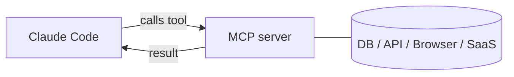

<LevelBadge level="advanced" />

<VerifyNote lastVerified="2026-11-10" source="https://code.claude.com/docs/en/mcp">
أوامر `claude mcp` ونطاقات الإعداد وطرق النقل تتطور مع الوقت — تأكد منها في وثائق MCP الرسمية لـ Claude Code وفي modelcontextprotocol.io. طرق النقل الأربع ومسارات تخزين النطاقات وإيقاف SSE وسلوك الموافقة على المشروع الواردة أدناه كلها مأخوذة من تلك الصفحة.
</VerifyNote>

**Model Context Protocol (MCP)** معيار مفتوح لربط الذكاء الاصطناعي بالأدوات والبيانات الخارجية. يعرض **خادم MCP** قدرات (استعلام قاعدة بيانات، فتح PR على GitHub، التحكم في متصفح)؛ ويتصل به Claude Code ويستطيع **استدعاء تلك الأدوات** أثناء الجلسة. هكذا تُوسّع Claude إلى ما بعد نظام ملفاتك وطرفيتك.

<Callout type="objectives" items={["شرح ما هو خادم MCP وكيف يستدعي Claude Code أدواته", "التمييز بين طريقتي النقل: stdio المحلي وHTTP/SSE البعيد", "إضافة خادم بالأمر claude mcp add وقراءة ملف JSON الذي يكتبه", "اختيار النطاق المناسب (local وproject وuser) بحسب من ينبغي أن يرى الخادم", "ربط قاعدة بيانات حقيقية بـ Claude من البداية إلى النهاية", "تجنّب مزالق الأمان والإعداد التي يقع فيها معظم الناس"]} />

## الصورة العامة



أنت تعلن عن الخوادم التي يجوز لـ Claude استخدامها؛ وينشر كل خادم مجموعة من الأدوات بمخططاتها؛ ويختارها Claude ويستدعيها كأي أداة أخرى.

<Flashcards title="مفردات MCP" cards={[{front: "Model Context Protocol (MCP)", back: "معيار مفتوح لربط الذكاء الاصطناعي بالأدوات والبيانات الخارجية."}, {front: "خادم MCP", back: "برنامج يعرض قدرات — استعلام قاعدة بيانات، فتح PR على GitHub، التحكم في متصفح — على هيئة أدوات قابلة للاستدعاء."}, {front: "الأداة (Tool)", back: "قدرة ينشرها خادم MCP مع مخطط؛ يختارها Claude ويستدعيها كأي أداة أخرى."}, {front: "طريقة النقل (Transport)", back: "كيف يصل Claude إلى الخادم: stdio (عملية محلية)، أو HTTP (مُستضاف، وغالبًا مع OAuth)، أو SSE (متوقف — يعود إليه HTTP تلقائيًا)، أو WebSocket ‏ws/wss (اتصال دائم، مع دفع، مصادقة عبر الترويسات فقط، بلا خيار --transport)."}, {front: "النطاق (Scope)", back: "من يرى الخادم: local (أنت، هذا المشروع)، أو project (الفريق عبر الـ commit)، أو user (أنت، في كل مكان)."}]} />

## طرق النقل

هناك أربع طرق يصل بها Claude إلى خادم. اختر بحسب مكان تشغيل الخادم وطريقة تخاطبه.

- **stdio** — عملية محلية يشغّلها Claude (ممتازة للأدوات وواجهات سطر الأوامر المحلية). هذا هو معنى إدخال JSON بلا `type`.
- **HTTP** — خادم مُستضاف، وغالبًا مع OAuth. الخيار الافتراضي لكل ما هو بعيد.
- **SSE** — **متوقف**؛ استخدم HTTP حيثما أمكن. ما تزال بعض الخدمات تعرض نقطة SSE فقط، ومنذ Claude Code v2.1.265 يجرّب `--transport http` الخيار HTTP أولًا ثم ينتقل إلى SSE من تلقاء نفسه، فنادرًا ما تحتاج إلى كتابة `--transport sse` صراحةً.
- **WebSocket** (`ws` / `wss`) — اتصال دائم ثنائي الاتجاه، لخادم يدفع الأحداث دون طلب. الخيار `--transport` *لا* يقبل `ws`: أضِفه بـ `claude mcp add-json '{"type":"ws","url":"wss://…"}'` أو اكتبه في `.mcp.json`. لا OAuth — المصادقة عبر الترويسات فقط.

<Callout type="warning" items={["إدخال JSON فيه url بلا type خطأ في الإعداد وليس افتراضًا معقولًا: يقرأ Claude Code الإدخال الخالي من type على أنه خادم stdio، فيتخطاه ويبلّغ بأن له «url» لكن بلا «type». اضبط دائمًا \"type\": \"http\" (أو \"sse\" / \"ws\") على أي خادم بعيد تكتبه يدويًا."]} />

## إعداد الخوادم

أسرع طريق هو الأمر `claude mcp add` — فهو يكتب الإعداد عنك. اتبع هذا التسلسل لتنتقل من الصفر إلى خادم متصل.

<Steps items={[{title: "أضف خادم stdio محليًا", body: "شغّل claude mcp add — كل ما يلي -- هو أمر التشغيل الذي ينفّذه Claude عنك."}, {title: "أو أضف خادم HTTP بعيدًا", body: "مرّر --transport http ونطاقًا، ثم عنوان URL للخادم. الخوادم البعيدة غالبًا مُستضافة وتستخدم OAuth."}, {title: "اطّلع على ما هو متصل", body: "شغّل claude mcp list لعرض الخوادم المُعدّة وحالة اتصالها."}, {title: "افحص وصادِق", body: "استخدم /mcp داخل الجلسة لفحص أدوات الخادم ومصادقة الخوادم البعيدة."}]} />

<PromptCard title="إضافة خادم stdio محلي">{`# A local stdio server (everything after -- is the launch command)
claude mcp add filesystem -- npx -y @modelcontextprotocol/server-filesystem ~/code/myproject`}</PromptCard>

<PromptCard title="إضافة خادم HTTP بعيد (مشترك مع المشروع)">{`# A remote HTTP server, shared with everyone on the project
claude mcp add --transport http --scope project github https://api.githubcopilot.com/mcp/`}</PromptCard>

في الأعماق هو مجرد JSON. الخادم ذو النطاق **project** يُكتب في ملف `.mcp.json` في جذر المستودع — أضِفه إلى الـ commit فيحصل زملاؤك على الأدوات نفسها بمجرد أن يثقوا بمساحة العمل:

```json
{
  "mcpServers": {
    "github": { "type": "http", "url": "https://api.githubcopilot.com/mcp/" }
  }
}
```

<Callout type="warning" items={["لا تلجأ إلى حِزم @modelcontextprotocol/server-github و-postgres و-slack و-puppeteer التي تجدها في الدروس القديمة. فهي مؤرشفة وتحمل إشعار إيقاف من npm نصّه \"Archived and unmaintained; no security guarantees\". استخدم خادم المزوّد نفسه حيثما وُجد — خادم GitHub هو نقطة HTTP أعلاه، وانتقل التحكم في المتصفح إلى @playwright/mcp. من بين خوادم TypeScript المرجعية، لا يزال يُصان منها فقط filesystem وmemory وeverything وsequential-thinking."]} />

### النطاق يقرّر من يرى الخادم

| النطاق | يُخزَّن في | يُحمَّل في | استخدمه لـ |
|---|---|---|---|
| `local` (الافتراضي) | `~/.claude.json`، تحت مسار هذا المشروع | هذا المشروع فقط | التجارب الشخصية، الأسرار |
| `project` | `.mcp.json` في المستودع (مُضاف إلى الـ commit) | هذا المشروع فقط، ومشترك مع الفريق | الأدوات التي ينبغي أن يشترك فيها الفريق كله |
| `user` | `~/.claude.json` | كل مشاريعك | الخوادم التي تريدها في كل مكان |

<Callout type="warning" items={["«النطاق local» في MCP ليس هو نفسه الإعدادات المحلية. الخادم ذو النطاق local يعيش في ~/.claude.json في مجلدك الرئيسي — وليس في ملف .claude/settings.local.json الخاص بالمشروع. والبحث عنه في مجلد المشروع طريق مسدود."]} />

شغّل `claude mcp list` لترى ما هو متصل، و`/mcp` داخل الجلسة لفحص الأدوات ومصادقة الخوادم البعيدة. راجع [إعداد MCP وقوالب الخوادم](/docs/templates/mcp-config) لنقاط انطلاق جاهزة للنسخ واللصق.

## مثال عملي: امنح Claude قاعدة بياناتك

لنفترض أنك تريد أن يجيب Claude عن أسئلة تخص قاعدة Postgres محلية بدلًا من أن تلصق أنت نتائج الاستعلامات. أضِف الخادم بنطاق project ليحصل عليه زملاؤك أيضًا.

قواعد البيانات هي المكان الذي تؤلم فيه مشكلة الخوادم المؤرشفة أكثر من غيره: فالحزمة القديمة `@modelcontextprotocol/server-postgres` لم تعد مُصانة ولا يوجد بديل رسمي، فاسم الحزمة هنا هو القرار الوحيد الذي عليك اتخاذه بنفسك. اختر خادمًا مجتمعيًا مُصانًا، و[راجعه](/docs/security/reviewing-third-party-code)، ثم اربطه — الشكل واحد أيًّا كان اختيارك:

<PromptCard title="إضافة خادم Postgres بنطاق project">{`# Replace the package with a maintained Postgres MCP server you have reviewed.
# The connection string is read-only on purpose — see below.
claude mcp add --scope project db -- npx -y <postgres-mcp-server> "postgresql://readonly@localhost/app"`}</PromptCard>

الآن يمكنك في الجلسة أن تطرح السؤال بلغة عادية وتدع Claude يتولى حلقة الاستعلام عنك:

<PromptCard title="طرح سؤال على قاعدة البيانات">{`How many users signed up last week? Check the DB.`}</PromptCard>

يستدعي Claude أداة الاستعلام التي ينشرها الخادم، ويستلم الصفوف ويجيب — بلا حلقة نسخ ولصق. أبقِ سلسلة الاتصال للقراءة فقط ما لم يحتج Claude فعلًا إلى الكتابة. وإن كان كل ما تريده استعلامًا واحدًا، فاعلم أن `psql -c '…'` عبر Bash يكلّف جزءًا يسيرًا من الرموز؛ ويشرح [ضريبة رموز MCP](/docs/claude-code/mcp-token-cost) متى يتفوق كلٌّ منهما.

ولأن النطاق project، فإن الزميل الذي يسحب المستودع يحصل على القدرة نفسها — لكن **ليس بصمت وليس فورًا**. يبقى الخادم الوارد من `.mcp.json` المُضاف إلى الـ commit عند `⏸ Pending approval` إلى أن يشغّل `claude` في المجلد ويقبل نافذة الثقة بمساحة العمل. المستودع المُستنسَخ لا يستطيع الموافقة المسبقة على خوادمه: فالمفتاحان `enableAllProjectMcpServers` أو `enabledMcpjsonServers` المُضافان إلى `.claude/settings.json` الخاص بالمشروع *يُتجاهلان* في مجلد غير موثوق. أما الموافقات الصادرة من `~/.claude/settings.json` على مستوى المستخدم، أو من الإعدادات المُدارة، أو الممرَّرة بـ `--settings` فتسري هناك. وهذا هو الجواب المعتاد عن «لماذا لا يرى زميلي الخادم؟»

## الثقة والأمان

<Callout type="warning" items={["خادم MCP ينفّذ شيفرة ويستطيع قراءة البيانات واتخاذ إجراءات — اربط الخوادم التي تثق بها فقط.", "امنح كل خادم أقل صلاحية يحتاجها.", "أي محتوى خارجي يعيده الخادم قد يحمل حقن أوامر (prompt injection).", "راجع الخوادم الخارجية قبل ربطها."]} />

:::warning[تعامل مع خوادم MCP كما تتعامل مع تثبيت برنامج]
خادم MCP ينفّذ شيفرة ويستطيع قراءة البيانات واتخاذ إجراءات. اربط الخوادم التي تثق بها فقط، وامنحها **أقل صلاحية** لازمة، وتذكّر أن أي محتوى خارجي تعيده قد يحمل [حقن أوامر](/docs/security/prompt-injection). راجع الخوادم الخارجية أولًا — انظر [مراجعة الشيفرة الخارجية](/docs/security/reviewing-third-party-code).
:::

## MCP في التطبيقات أيضًا

يشغّل MCP كذلك **الموصِّلات** في تطبيقات Claude — المعيار نفسه، وواجهة مختلفة. انظر [الموصِّلات (MCP) في التطبيقات](/docs/claude-app/connectors)، وللـ API انظر [MCP والاتصال بالأدوات](/docs/api/mcp).

## أخطاء شائعة

- **نطاق خاطئ.** الخادم المضاف بنطاق `local` لن يظهر لزملائك؛ والخادم الذي أردته لنفسك فقط لا ينبغي إضافته إلى الـ commit بنطاق `project`. اختر عن قصد.
- **خوادم كثيرة وأدوات كثيرة.** البحث عن الأدوات مُفعَّل افتراضيًا، فالخادم المتصل يكلّفك عادةً في كل دورة *أسماء* أدواته وتعليمات الخادم بدل مخططاته الكاملة — لكنها تظل ضريبة على كل دورة، وتدخل المخططات في السياق لحظة يبحث عنها Claude. اربط ما تحتاجه المهمة، لا كتالوجك كله. انظر [ضريبة رموز MCP](/docs/claude-code/mcp-token-cost) للأرقام الحقيقية وأوضاع `ENABLE_TOOL_SEARCH` وكيف يخفض تنفيذ الشيفرة التكلفة الثانية.
- **اتصالات مفرطة الصلاحيات.** امنح خادم قاعدة البيانات دورًا للقراءة فقط ما لم يحتج Claude فعلًا إلى الكتابة. MCP يجعل القدرات حقيقية — فضيّقها.
- **نسيان خطر الحقن.** كل ما يعيده الخادم (صفحة ويب، نص إحدى المشكلات، صف) هو نص غير موثوق قد يحمل [حقن أوامر](/docs/security/prompt-injection). لا تضع خادمًا قويًا قادرًا على الكتابة إلى جانب خادم غير موثوق قادر على القراءة دون أن تفكر في الأمر جيدًا.

<Quiz title="اختبر نفسك" questions={[{q: "أي طريقة نقل هي عملية محلية يشغّلها Claude بنفسه؟", options: ["HTTP/SSE البعيد", "stdio", "OAuth"], answer: 1, explain: "stdio عملية محلية يشغّلها Claude — مثالية للأدوات وواجهات سطر الأوامر المحلية. الثلاث الأخرى بعيدة: HTTP (غالبًا مع OAuth) وSSE المتوقف وWebSocket."}, {q: "أين يُكتب الخادم ذو النطاق project، وماذا على الزميل أن يفعل؟", options: ["في إعدادات المستخدم الخاصة بك؛ أنت وحدك تراه", "في ملف .mcp.json في جذر المستودع؛ وبعد أن يسحبه الزميل ما يزال عليه أن يثق بمساحة العمل ليغادر الخادم حالة Pending approval", "في ذاكرة تخزين مؤقت عامة مخفية؛ لا يستطيع أحد تعديلها"], answer: 1, explain: "النطاق project يُكتب في ملف .mcp.json مُضاف إلى الـ commit في جذر المستودع. لكن المستودع المُستنسَخ لا يستطيع الموافقة على خوادمه — إذ يُتجاهل enableAllProjectMcpServers المُضاف إلى الـ commit في مجلد غير موثوق، فينتظر الخادم عند Pending approval حتى يقبل الزميل نافذة الثقة بمساحة العمل."}, {q: "لماذا نُبقي اتصال قاعدة البيانات للقراءة فقط حين يحتاج Claude إلى القراءة فحسب؟", options: ["لأن الاستعلامات تعمل أسرع", "أقل صلاحية — MCP يجعل القدرات حقيقية، فلا تمنح صلاحية الكتابة ما لم تكن لازمة فعلًا", "لأن البروتوكول يشترط القراءة فقط"], answer: 1, explain: "امنح الخوادم أقل صلاحية تحتاجها. MCP يجعل القدرات حقيقية، فالدور المقتصر على القراءة يتفادى عمليات الكتابة غير المقصودة."}]} />

<Callout type="takeaways" items={["MCP معيار مفتوح؛ وخادم MCP يعرض أدوات يستدعيها Claude Code كأي أداة أخرى.", "أربع طرق نقل: stdio (عملية يشغّلها Claude)، وHTTP (الافتراضي للبعيد)، وSSE (متوقف — يتحول إليه HTTP من تلقاء نفسه)، وWebSocket ‏ws/wss (دفع، ومصادقة عبر الترويسات، وإضافته عبر add-json فقط).", "الأمر claude mcp add يكتب الإعداد عنك؛ وفي الأعماق هو JSON. النطاق project يعيش في ملف .mcp.json مُضاف إلى الـ commit، وتبقى نسخة الزميل عند Pending approval إلى أن يثق بمساحة العمل.", "النطاق يتحكم في الظهور: local (أنت، هذا المشروع)، وproject (مُضاف إلى الـ commit للفريق)، وuser (أنت، في كل مكان).", "تعامل مع الخوادم كما تتعامل مع تثبيت البرامج: الثقة، وأقل صلاحية، والحذر من حقن الأوامر في كل ما تعيده."]} />

## التالي

- [ابنِ أول خادم MCP واربطه (شرح خطوة بخطوة)](/docs/walkthroughs/first-mcp-server)
- [إعداد MCP وقوالب الخوادم](/docs/templates/mcp-config)
- [تأمين الوكلاء والأدوات](/docs/security/securing-agents)
