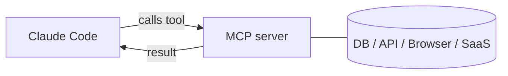

<LevelBadge level="advanced" />

<VerifyNote lastVerified="2026-11-10" source="https://code.claude.com/docs/en/mcp">
أوامر `claude mcp` ونطاقات الإعداد ووسائل النقل تتطور باستمرار — تأكد منها في وثائق MCP الرسمية لـ Claude Code وفي modelcontextprotocol.io. وسائل النقل الأربع ومسارات تخزين النطاقات وإيقاف SSE وسلوك الموافقة على المشروع الموضحة أدناه كلها مأخوذة من تلك الصفحة.
</VerifyNote>

**Model Context Protocol (MCP)** معيار مفتوح لربط الذكاء الاصطناعي بالأدوات والبيانات الخارجية. يعرض **خادم MCP** قدرات (الاستعلام من قاعدة بيانات، فتح PR على GitHub، التحكم في متصفح)؛ ويتصل به Claude Code ويستطيع **استدعاء تلك الأدوات** أثناء الجلسة. بهذه الطريقة توسّع Claude إلى ما وراء نظام ملفاتك وواجهة الأوامر لديك.

<Callout type="objectives" items={["شرح ما هو خادم MCP وكيف يستدعي Claude Code أدواته", "التمييز بين وسيلتَي النقل: stdio المحلي مقابل HTTP/SSE البعيد", "إضافة خادم بالأمر claude mcp add وقراءة ملف JSON الذي يكتبه", "اختيار النطاق المناسب (local وproject وuser) بحسب من يرى الخادم", "ربط قاعدة بيانات حقيقية بـ Claude من البداية إلى النهاية", "تجنّب فخاخ الأمان والإعداد التي يقع فيها معظم الناس"]} />

## الصورة العامة



تُعلن عن الخوادم التي يجوز لـ Claude استخدامها؛ وكل خادم ينشر مجموعة من الأدوات ومعها مخططاتها؛ ويختارها Claude ويستدعيها كأي أداة أخرى.

<Flashcards title="مصطلحات MCP" cards={[{front: "Model Context Protocol (MCP)", back: "معيار مفتوح لربط الذكاء الاصطناعي بالأدوات والبيانات الخارجية."}, {front: "خادم MCP", back: "برنامج يعرض قدرات — الاستعلام من قاعدة بيانات، فتح PR على GitHub، التحكم في متصفح — على هيئة أدوات قابلة للاستدعاء."}, {front: "الأداة (Tool)", back: "قدرة ينشرها خادم MCP مع مخطط؛ يختارها Claude ويستدعيها كأي أداة أخرى."}, {front: "وسيلة النقل (Transport)", back: "الطريقة التي يصل بها Claude إلى الخادم: stdio (عملية محلية)، أو HTTP (مُستضاف، وغالبًا مع OAuth)، أو SSE (متروك — يعود إليه HTTP تلقائيًا)، أو WebSocket ws/wss (اتصال دائم، مع الدفع، بمصادقة عبر الترويسات فقط، ولا يوجد خيار --transport له)."}, {front: "النطاق (Scope)", back: "من يرى الخادم: local (أنت، هذا المشروع)، أو project (الفريق عبر الـ commit)، أو user (أنت، في كل مكان)."}]} />

## وسائل النقل

هناك أربع طرق يصل بها Claude إلى الخادم. اختر بحسب المكان الذي يعمل فيه الخادم وطريقة تواصله.

- **stdio** — عملية محلية يطلقها Claude (ممتازة للأدوات وواجهات CLI المحلية). وهذا ما يعنيه إدخال JSON بلا `type`.
- **HTTP** — خادم مُستضاف، وغالبًا مع OAuth. الخيار الافتراضي لأي شيء بعيد.
- **SSE** — **متروك**؛ استخدم HTTP حيثما أمكن. ما زالت بعض الخدمات تعرض نقطة نهاية SSE فقط، ومنذ Claude Code v2.1.265 يجرّب `--transport http` الأمر HTTP أولًا ثم ينتقل إلى SSE من تلقاء نفسه، لذا نادرًا ما تحتاج إلى `--transport sse` صراحةً.
- **WebSocket** (`ws` / `wss`) — اتصال دائم ثنائي الاتجاه، لخادم يدفع الأحداث دون طلب. الخيار `--transport` *لا* يقبل `ws`: أضِفه بالأمر `claude mcp add-json '{"type":"ws","url":"wss://…"}'` أو اكتبه في `.mcp.json`. لا يوجد OAuth — المصادقة عبر الترويسات فقط.

<Callout type="warning" items={["إدخال JSON فيه url بلا type هو خطأ في الإعداد وليس قيمة افتراضية معقولة: يقرأ Claude Code الإدخال الخالي من type على أنه خادم stdio، ويتخطاه، ويبلّغ بأن فيه \"url\" ولا يوجد فيه \"type\". اضبط دائمًا \"type\": \"http\" (أو \"sse\" / \"ws\") على أي خادم بعيد تكتبه يدويًا."]} />

## إعداد الخوادم

أسرع طريق هو الأمر `claude mcp add` — فهو يكتب الإعداد عنك. اتبع هذا التسلسل للانتقال من الصفر إلى خادم متصل.

<Steps items={[{title: "أضِف خادم stdio محليًا", body: "شغّل claude mcp add — كل ما يلي -- هو أمر التشغيل الذي ينفّذه Claude نيابةً عنك."}, {title: "أو أضِف خادم HTTP بعيدًا", body: "مرّر --transport http ونطاقًا، ثم عنوان URL للخادم. غالبًا ما تكون الخوادم البعيدة مُستضافة وتستخدم OAuth."}, {title: "اطّلع على ما هو متصل", body: "شغّل claude mcp list لعرض الخوادم المُعدّة وحالة اتصالها."}, {title: "افحص وصادِق", body: "استخدم /mcp داخل الجلسة لفحص أدوات الخادم ومصادقة الخوادم البعيدة."}]} />

<PromptCard title="إضافة خادم stdio محلي">{`# A local stdio server (everything after -- is the launch command)
claude mcp add filesystem -- npx -y @modelcontextprotocol/server-filesystem ~/code/myproject`}</PromptCard>

<PromptCard title="إضافة خادم HTTP بعيد (مشترك مع المشروع)">{`# A remote HTTP server, shared with everyone on the project
claude mcp add --transport http --scope project github https://api.githubcopilot.com/mcp/`}</PromptCard>

في الأساس ليس هذا سوى JSON. الخادم ذو نطاق **project** يُكتب في ملف `.mcp.json` في جذر المستودع — أرسِله بـ commit فيحصل زملاؤك على الأدوات نفسها بمجرد أن يثقوا بمساحة العمل:

```json
{
  "mcpServers": {
    "github": { "type": "http", "url": "https://api.githubcopilot.com/mcp/" }
  }
}
```

<Callout type="warning" items={["لا تلجأ إلى حزم @modelcontextprotocol/server-github و-postgres و-slack و-puppeteer التي ستجدها في الشروحات القديمة. فهي مؤرشفة وتحمل إشعار إيقاف من npm نصّه \"Archived and unmaintained; no security guarantees\". استخدم خادم المزوّد نفسه حيث يوجد — خادم GitHub هو نقطة نهاية HTTP أعلاه، وانتقل التحكم في المتصفح إلى @playwright/mcp. ومن بين خوادم TypeScript المرجعية لا يزال filesystem وmemory وeverything وsequential-thinking فقط قيد الصيانة."]} />

### النطاق يحدد من يرى الخادم

| النطاق | مكان التخزين | أين يُحمَّل | الاستخدام |
|---|---|---|---|
| `local` (الافتراضي) | `~/.claude.json`، تحت مسار هذا المشروع | هذا المشروع فقط | التجارب الشخصية والأسرار |
| `project` | `.mcp.json` في المستودع (مُرسَل بـ commit) | هذا المشروع فقط، ومشترك مع الفريق | أدوات ينبغي أن يشترك فيها الفريق كله |
| `user` | `~/.claude.json` | كل مشاريعك | خوادم تريدها في كل مكان |

<Callout type="warning" items={["«النطاق المحلي» في MCP ليس هو نفسه الإعدادات المحلية. خادم MCP ذو النطاق المحلي يعيش في ~/.claude.json في مجلدك الرئيسي — وليس في .claude/settings.local.json الخاص بالمشروع. البحث عنه في مجلد المشروع طريق مسدود."]} />

شغّل `claude mcp list` لترى ما هو متصل، و`/mcp` داخل الجلسة لفحص الأدوات ومصادقة الخوادم البعيدة. راجع [إعداد MCP وقوالب الخوادم](/docs/templates/mcp-config) لنقاط انطلاق جاهزة للنسخ واللصق.

## مثال عملي: امنح Claude قاعدة بياناتك

لنفترض أنك تريد أن يجيب Claude عن أسئلة تخص Postgres محلية بدلًا من أن تلصق أنت نتائج الاستعلامات. أضِف الخادم بنطاق project ليحصل زملاؤك عليه أيضًا.

قواعد البيانات هي الموضع الذي تشتد فيه مشكلة الخوادم المؤرشفة: الحزمة القديمة `@modelcontextprotocol/server-postgres` غير مصانة ولا يوجد بديل رسمي، لذا فاسم الحزمة هو القرار الوحيد الذي عليك اتخاذه بنفسك. اختر خادمًا مجتمعيًا مصانًا، و[راجعه](/docs/security/reviewing-third-party-code)، ثم اربطه — الشكل نفسه أيًّا كان اختيارك:

<PromptCard title="إضافة خادم Postgres بنطاق project">{`# Replace the package with a maintained Postgres MCP server you have reviewed.
# The connection string is read-only on purpose — see below.
claude mcp add --scope project db -- npx -y <postgres-mcp-server> "postgresql://readonly@localhost/app"`}</PromptCard>

الآن في الجلسة تستطيع طرح السؤال بلغة عادية وترك Claude يتولى حلقة الاستعلام عنك:

<PromptCard title="طرح سؤال على قاعدة البيانات">{`How many users signed up last week? Check the DB.`}</PromptCard>

يستدعي Claude أداة الاستعلام التي ينشرها الخادم، ويتلقى الصفوف، ويجيب — بلا حلقة نسخ ولصق. أبقِ سلسلة الاتصال للقراءة فقط ما لم يحتج Claude فعلًا إلى الكتابة. وإن كان كل ما أردته استعلامًا واحدًا، فاعلم أن `psql -c '…'` عبر Bash يكلّف جزءًا يسيرًا من الرموز (tokens)؛ ويشرح [ضريبة رموز MCP](/docs/claude-code/mcp-token-cost) متى يتفوق كلٌّ منهما.

ولأن النطاق project، فإن الزميل الذي يسحب المستودع يحصل على القدرة نفسها — لكن **ليس بصمت ولا فورًا**. يبقى الخادم من ملف `.mcp.json` المُرسَل بـ commit عند `⏸ Pending approval` إلى أن يشغّل `claude` في المجلد ويقبل مربع حوار الثقة بمساحة العمل. المستودع المُستنسَخ لا يستطيع الموافقة المسبقة على خوادمه: فالقيمتان `enableAllProjectMcpServers` أو `enabledMcpjsonServers` المُرسَلتان بـ commit في `.claude/settings.json` الخاص بالمشروع *يُتجاهلان* في مجلد غير موثوق. أما الموافقات الصادرة من `~/.claude/settings.json` على مستوى المستخدم، أو من الإعدادات المُدارة، أو الممرَّرة عبر `--settings`، فتسري هناك. وهذا هو الجواب المعتاد عن سؤال «لماذا لا يرى زميلي الخادم؟»

## الثقة والأمان

<Callout type="warning" items={["يشغّل خادم MCP شيفرة ويستطيع قراءة البيانات واتخاذ إجراءات — لا تربط إلا الخوادم التي تثق بها.", "امنح كل خادم أقل صلاحية يحتاجها.", "أي محتوى خارجي يعيده الخادم قد يحمل حقن توجيهات (prompt injection).", "راجِع الخوادم الخارجية قبل ربطها."]} />

:::warning[تعامل مع خوادم MCP كما تتعامل مع تثبيت البرمجيات]
يشغّل خادم MCP شيفرة ويستطيع قراءة البيانات واتخاذ إجراءات. لا تربط إلا الخوادم التي تثق بها، وامنحها **أقل صلاحية** لازمة، وتذكّر أن أي محتوى خارجي تعيده قد يحمل [حقن توجيهات](/docs/security/prompt-injection). راجِع الخوادم الخارجية أولًا — انظر [مراجعة الشيفرة الخارجية](/docs/security/reviewing-third-party-code).
:::

## MCP في التطبيقات أيضًا

يشغّل MCP كذلك **الموصّلات** في تطبيقات Claude — المعيار نفسه، وواجهة مختلفة. انظر [الموصّلات (MCP) في التطبيقات](/docs/claude-app/connectors)، ولواجهة API انظر [MCP والاتصال بالأدوات](/docs/api/mcp).

## أخطاء شائعة

- **نطاق خاطئ.** الخادم المضاف بنطاق `local` لن يظهر لزملائك؛ والخادم الذي أردته لنفسك فقط لا ينبغي إرساله بـ commit بنطاق `project`. اختر عن قصد.
- **خوادم كثيرة وأدوات كثيرة.** البحث عن الأدوات مفعّل افتراضيًا، فالخادم المتصل يكلّفك عادةً في كل دورة *أسماء* أدواته وتعليمات الخادم بدلًا من مخططاته الكاملة — لكنها تبقى ضريبة في كل دورة، وتدخل المخططات إلى السياق لحظة بحث Claude عنها. اربط ما تحتاجه المهمة، لا كتالوجك كله. انظر [ضريبة رموز MCP](/docs/claude-code/mcp-token-cost) للأرقام الفعلية وأوضاع `ENABLE_TOOL_SEARCH` وكيف يخفّض تنفيذ الشيفرة التكلفة الثانية.
- **اتصالات بصلاحيات زائدة.** امنح خادم قاعدة البيانات دورًا للقراءة فقط ما لم يحتج Claude فعلًا إلى الكتابة. يجعل MCP القدرات حقيقية — فضيّقها.
- **نسيان خطر الحقن.** كل ما يعيده الخادم (صفحة ويب، نص issue، صف) هو نص غير موثوق قد يحمل [حقن توجيهات](/docs/security/prompt-injection). لا تضع خادمًا قويًا قادرًا على الكتابة بجوار خادم غير موثوق قادر على القراءة دون تفكير متأنٍّ.

<Quiz title="اختبر نفسك" questions={[{q: "أي وسيلة نقل هي عملية محلية يطلقها Claude بنفسه؟", options: ["HTTP/SSE البعيد", "stdio", "OAuth"], answer: 1, explain: "stdio عملية محلية يطلقها Claude — مثالية للأدوات وواجهات CLI المحلية. أما الثلاث الأخرى فبعيدة: HTTP (وغالبًا مع OAuth)، وSSE المتروك، وWebSocket."}, {q: "أين يُكتب الخادم ذو نطاق project، وماذا على الزميل أن يفعل؟", options: ["إعدادات المستخدم لديك؛ ولا يراه سواك", "ملف .mcp.json في جذر المستودع؛ وبعد سحبه ما زال عليه أن يثق بمساحة العمل قبل أن يغادر الخادم حالة Pending approval", "ذاكرة تخزين مؤقت عامة مخفية؛ ولا يستطيع أحد تعديلها"], answer: 1, explain: "ينتهي نطاق project في ملف .mcp.json مُرسَل بـ commit في جذر المستودع. لكن المستودع المُستنسَخ لا يستطيع الموافقة على خوادمه — فـ enableAllProjectMcpServers المُرسَل بـ commit يُتجاهل في مجلد غير موثوق، ولذا ينتظر الخادم عند Pending approval حتى يقبل الزميل مربع حوار الثقة بمساحة العمل."}, {q: "لماذا نُبقي اتصال قاعدة البيانات للقراءة فقط عندما يحتاج Claude إلى القراءة فحسب؟", options: ["لأن الاستعلامات تعمل أسرع", "أقل صلاحية — يجعل MCP القدرات حقيقية، فلا تمنح صلاحية الكتابة ما لم تكن لازمة فعلًا", "لأن البروتوكول يشترط القراءة فقط"], answer: 1, explain: "امنح الخوادم أقل صلاحية تحتاجها. يجعل MCP القدرات حقيقية، لذا فإن دور القراءة فقط يتجنب عمليات الكتابة غير المقصودة."}]} />

<Callout type="takeaways" items={["MCP معيار مفتوح؛ وخادم MCP يعرض أدوات يستدعيها Claude Code كأي أداة أخرى.", "أربع وسائل نقل: stdio (عملية يطلقها Claude)، وHTTP (الافتراضي للبعيد)، وSSE (متروك — ينتقل إليه HTTP من تلقاء نفسه)، وWebSocket ws/wss (دفع، ومصادقة عبر الترويسات، ولا يُضاف إلا بـ add-json).", "يكتب claude mcp add الإعداد عنك؛ وفي الأساس هو JSON. يعيش نطاق project في ملف .mcp.json مُرسَل بـ commit، وتبقى نسخة الزميل عند Pending approval إلى أن يثق بمساحة العمل.", "النطاق يتحكم في الظهور: local (أنت، هذا المشروع)، وproject (مُرسَل بـ commit للفريق)، وuser (أنت، في كل مكان).", "تعامل مع الخوادم كما تتعامل مع تثبيت البرمجيات: الثقة، وأقل صلاحية، والحذر من حقن التوجيهات في كل ما تعيده."]} />

## التالي

- [ابنِ أول خادم MCP لك واربطه (شرح خطوة بخطوة)](/docs/walkthroughs/first-mcp-server)
- [إعداد MCP وقوالب الخوادم](/docs/templates/mcp-config)
- [تأمين الوكلاء والأدوات](/docs/security/securing-agents)
