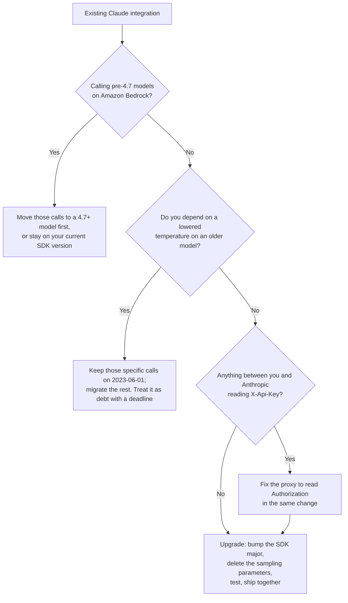

<LevelBadge level="intermediate" />

<VerifyNote lastVerified="2026-10-22" source="https://platform.claude.com/docs/en/api/versioning">
Die API-Version `2026-10-21` steht in der offiziellen Versionshistorie von Anthropic neben `2023-06-01` und `2023-01-01`. Jede Breaking Change, jede SDK-Versionsnummer und jede Feldumbenennung auf dieser Seite stammt aus dem [offiziellen Migrationsleitfaden](https://platform.claude.com/docs/en/api/migration-2026-10-21). Lesen Sie ihn vor dem Release erneut — ein Migrationsleitfaden ist die eine Art von Doku, die nach der Veröffentlichung *bearbeitet* wird.
</VerifyNote>

Dreieinhalb Jahre lang gab es genau eine Antwort auf „welche API-Version nutze ich?“ — `2023-06-01`. Jedes SDK sendete sie, jedes Tutorial kopierte sie, und niemand dachte je wieder darüber nach.

Am **21. Oktober 2026** änderte sich das. `anthropic-version: 2026-10-21` ist jetzt die empfohlene Version, und sie ist ein echter Breaking Release: **vier Änderungen auf Wire-Ebene und neun SDK-/CLI-Änderungen**, ein anderer Authentifizierungs-Header und eine Parameterentfernung, die **strenger ist als die modellbezogene Deprecation, die Sie vielleicht schon abgearbeitet haben**.

Hier ist der Teil, der Teams überrascht, und der Grund, warum diese Seite existiert:

> **Sie wählen diese Version nicht, indem Sie einen Header bearbeiten. Sie wählen sie, indem Sie eine Abhängigkeit aktualisieren.**

Die SDKs von Anthropic senden die API-Version, die aktuell war, als ihre **Major**-Version erschien. Ältere Majors senden für immer `2023-06-01`. Die neuen Majors senden `2026-10-21`. Ein routinemäßiges `pip install -U anthropic` oder `npm update`, das die Major-Grenze überschreitet, kippt also die API-Version für Ihre gesamte Anwendung — und bringt jede Breaking Change in einem Commit mit, ob jemand ein Changelog gelesen hat oder nicht.

<Callout type="objectives" items={["Warum Ihre SDK-Major-Version — nicht ein Header, den Sie kontrollieren — bestimmt, wann Sie 2026-10-21 übernehmen","Die Fünf-Minuten-Triage: welche der Breaking Changes tatsächlich Ihren Code betreffen","Warum Sampling-Parameter jetzt selbst bei ihrem Standardwert mit 400 antworten, und der eine verbleibende Notausgang","Die Authentifizierungsänderung von X-Api-Key zu Authorization: Bearer und die Proxys, die sie stillschweigend bricht","Die zwei Fußangeln, die ein falsches Ergebnis statt eines Fehlers liefern (doppelte Zugangsdaten, unterdrückte Key-Header)","Was sich auf dem Wire ändert und was sich nur in den Typen Ihres SDK ändert","Die Upgrade-Reihenfolge, die eine Produktionsintegration grün hält"]} />

`★ Insight ─────────────────────────────────────`
In diesem Release sind zwei sehr verschiedene Arten von Änderungen gebündelt, und sie zu vermischen kostet einen Tag. **Wire-Änderungen** (entfernte Parameter, abgelehnte Block-Platzierungen, umbenannte Antwortfelder) werden vom Header `anthropic-version` bestimmt, treffen also rohes `curl`, jedes SDK und Ihre Message Batches gleichermaßen. **SDK-Änderungen** (die `MessageParam`-Union, entfernte Text Completions, Enums mit einem Wert, die zu Konstanten werden) sind gewöhnliche Major-Version-Refactorings, die mitfahren — das JSON auf dem Wire bleibt unverändert. Wenn Sie die API über rohes HTTP aufrufen, gilt für Sie nur die erste Liste, und diese Migration ist klein. Wenn Sie ein SDK nutzen, machen Sie beide Migrationen auf einmal, weshalb sie größer wirkt, als sie ist.
`─────────────────────────────────────────────────`

## Zuerst: Sind Sie betroffen?

Führen Sie das aus, bevor Sie irgendetwas anderes lesen. Jeder Treffer verweist auf einen Abschnitt unten; keine Treffer heißen, Ihr Upgrade ist ein Versions-Bump.

<PromptCard title="Ihre Codebasis auf 2026-10-21-Brüche prüfen">{`# Wire changes — these break regardless of SDK or language
grep -rnE '\\b(temperature|top_p|top_k)\\b' --include='*.{py,ts,tsx,js,go,java,rb,php,cs}' .
grep -rn 'X-Api-Key\\|x-api-key' .            # auth header moved
grep -rnE 'workspace_id|group_type|actor\\.email|\\broles\\b' .   # Admin/Analytics renames

# SDK changes — only if you use an Anthropic SDK or the ant CLI
grep -rn 'MessageParam' .                     # now a union of three role types
grep -rn 'completions' --include='*.{ts,go,java,rb}' .   # Text Completions removed
grep -rn 'compactionControl\\|compaction_control' .       # client-side compaction removed
grep -rn 'models.list\\|models.retrieve' .    # betas moved to client.beta.models
grep -rn -- '--api-key \\|--auth-token ' .      # CLI flags removed`}</PromptCard>

| Wenn Sie per grep treffen… | Sind Sie betroffen von | Schweregrad |
|---|---|---|
| `temperature` / `top_p` / `top_k` | [Sampling-Parameter entfernt](#sampling-parameters-are-removed-even-at-their-defaults) | **400 bei jeder Anfrage** |
| `X-Api-Key` in einem Proxy, Gateway oder einer Middleware | [Authentifizierungs-Header verschoben](#authentication-moved-to-authorization-bearer) | **401 bei jeder Anfrage** |
| `X-Api-Key`, der einen Key *unterdrücken* oder *überschreiben* soll | [Die zwei stillen Fußangeln](#the-two-changes-that-dont-raise) | **Falsche Zugangsdaten gesendet** |
| Sowohl API-Key als auch Auth-Token an einem Client | [Ein Client, eine Zugangsdaten](#one-client-holds-one-credential) | Wirft bei der Konstruktion |
| `document`-Blöcke in Assistant-Turns | [Platzierung von Dokument-Blöcken](#two-rejected-block-placements) | 400 |
| `citations` an Text-Blöcken in User-Turns | [Platzierung von Zitaten](#two-rejected-block-placements) | 400 |
| `MessageParam(...)`-Konstruktoraufrufe, Subclassing oder Spread-Kopien | [MessageParam ist eine Union](#messageparam-is-now-a-union-of-three-role-types) | Typfehler / Laufzeit |
| `client.completions` | [Text Completions entfernt](#five-sdk-only-removals) | Methode weg |
| `compactionControl` | [Clientseitige Compaction entfernt](#five-sdk-only-removals) | Option weg |
| `models.list(betas=…)` | [`betas` verschoben](#five-sdk-only-removals) | Beta-Header nicht gesendet |
| `workspace_id`, `group_type`, `actor.email`, `roles` | [Umbenennungen in Admin & Analytics](#admin-api-and-analytics-api-field-renames) | Feld fehlt |

## Das Upgrade, der Reihe nach

<Steps items={[
  {title: "Entscheiden, ob Sie sie überhaupt übernehmen können", body: "Auf Amazon Bedrock ist 2026-10-21 nur für Claude 4.7 und neuere Modelle verfügbar. Wenn Sie auf Bedrock ein älteres Modell aufrufen, müssen Sie diesen Aufruf entweder zuerst auf ein 4.7+-Modell umstellen oder bei der SDK-Version bleiben, die Sie heute nutzen. Überall sonst — Claude API, Claude Platform on AWS, Microsoft Foundry und Google Cloud — ist sie jetzt verfügbar."},
  {title: "Das SDK anheben (das schaltet die Version um)", body: "Installieren Sie die erste Major-Version, die 2026-10-21 sendet, für Ihre Sprache — siehe Tabelle unten. Go und die ant CLI ändern außerdem ihre Modul-Importpfade, ein schlichtes \"go install …@latest\" auf dem alten Pfad liefert Ihnen also weiter v1, ohne Fehler oder Warnung. Wenn Sie die API über rohes HTTP aufrufen, setzen Sie stattdessen einfach den Header anthropic-version auf 2026-10-21."},
  {title: "Zuerst die Wire-Änderungen beheben", body: "Löschen Sie temperature, top_p und top_k. Verschieben Sie Dokumente aus Assistant-Nachrichten und Zitate aus User-Nachrichten. Benennen Sie die Admin- und Analytics-Antwortfelder um, die Sie lesen. Das sind die Änderungen, die 400er erzeugen, also die, die die Produktion lahmlegen."},
  {title: "Authentifizierung und Ihren Proxy beheben", body: "Das SDK sendet Ihren Key jetzt als Authorization: Bearer. Wenn irgendetwas zwischen Ihnen und Anthropic X-Api-Key liest — ein Gateway, ein Observability-Shim, ein Egress-Proxy der Firma —, sieht es keine Zugangsdaten mehr. Ändern Sie den Proxy oder fügen Sie den Header selbst wieder hinzu."},
  {title: "Die reinen SDK-Refactorings beheben", body: "MessageParam ist jetzt eine Union, Text Completions ist weg, die clientseitige Compaction im Tool Runner ist weg, betas wurden von den Nicht-Beta-Models-Methoden verschoben, und Enums mit einem Wert wurden zu Konstanten. Ihr Compiler oder Type-Checker findet die meisten davon für Sie."},
  {title: "Vor dem Release gegen 2026-10-21 testen, dann beides zusammen ausliefern", body: "Die Anweisung von Anthropic selbst lautet, den Versions-Bump und die Fixes im selben Deploy auszuliefern. Den Bump allein auszuliefern verwandelt eine geplante Migration in einen Vorfall."}
]} />

### Die SDK-Versionen, die `2026-10-21` senden

Ältere Majors senden weiter `2023-06-01`. Dies sind die ersten Versionen mit der neuen API-Version:

| Sprache / Tool | Erste Version mit `2026-10-21` | Außerdem beachten |
|---|---|---|
| Python | `anthropic` **2.0.0** | — |
| TypeScript | `@anthropic-ai/sdk` **1.0.0** | Plattform-Pakete (`bedrock-sdk`, `vertex-sdk`, `foundry-sdk`, `aws-sdk`, `google-cloud-sdk`) müssen im selben Upgrade auf **v1** wechseln, sonst installiert Ihr Paketmanager für sie eine zweite, ältere Kopie des Core-SDK |
| Go | **2.0.0**, Modulpfad `github.com/anthropics/anthropic-sdk-go/v2` | Jeder Import — auch von Unterpaketen wie `/option` — braucht das Präfix `/v2`. **Go 1.25+ erforderlich** |
| Java | `com.anthropic:anthropic-java` **3.0.0** | — |
| C# | `Anthropic` **13.0.0** | — |
| Ruby | Gem `anthropic` **2.0.0** | — |
| PHP | `anthropic-ai/sdk` **1.0.0** | `composer require` verwenden; `composer update` allein bleibt innerhalb Ihrer aktuellen Constraint |
| `ant` CLI | **2.0.0** | Go-Modulpfad ist jetzt `github.com/anthropics/anthropic-cli/v2`. **Der alte `go install`-Pfad installiert stillschweigend weiter das neueste v1** |

<Callout type="warning" items={["Zwei dieser Upgrades scheitern leise statt laut: der Go-CLI-Pfad (installiert v1 ohne Warnung) und die TypeScript-Plattform-Pakete (npm löst bereitwillig ein zweites, älteres @anthropic-ai/sdk für sie auf). In beiden Fällen kompiliert Ihr Code, läuft und sendet weiter 2023-06-01 — Sie schließen also, die Migration sei erledigt, obwohl sich nichts geändert hat."]} />

## Sampling-Parameter sind entfernt, selbst bei ihren Standardwerten {#sampling-parameters-are-removed-even-at-their-defaults}

Das ist die Änderung, die am ehesten Code bricht, den schon jemand „repariert“ hat.

AILmanac dokumentiert die modellbezogene Deprecation schon eine Weile: Bei Modellen der Claude-4.7-Generation und später liefert ein **nicht standardmäßiges** `temperature`, `top_p` oder `top_k` einen 400. Unter `2026-10-21` ist die Regel härter:

> Eine Anfrage, die `temperature`, `top_p` oder `top_k` sendet, liefert einen 400-Fehler — **selbst beim Standardwert des Parameters**.

Das defensive Muster, das früher sicher war — `temperature: 1.0` explizit festzupinnen, damit es später niemand „tunen“ kann —, ist jetzt auf jedem Modell ein garantierter Fehlschlag, auch auf den älteren, die zuvor jeden Wert akzeptierten. Die Parameter sind in den neuen Majors aus den SDK-Typen und den CLI-Flags entfernt, in einer typisierten Sprache fängt der Compiler es also ab; in einem aus Dict oder Hash gebauten Request-Body erreicht es die API.

```python
# Before — accepted under 2023-06-01 on every model
client.messages.create(model=MODEL, max_tokens=1024, temperature=1.0, messages=msgs)

# After — temperature: 1.0 is a 400 under 2026-10-21
client.messages.create(model=MODEL, max_tokens=1024, messages=msgs)
```

Das Weglassen der Parameter samplet mit exakt denselben Standardwerten wie eine `2023-06-01`-Anfrage, die sie wegließ, einschließlich `temperature` von 1.0. Für aktuelle Frontier-Modelle, die nicht standardmäßige Werte ohnehin ablehnten, **ändert sich die Ausgabe also gar nicht** — es ist rein eine Bereinigung der Anfrageform.

Der eigentliche Verlust ist enger und verdient Präzision. Bei älteren Modellen, die *andere* Werte akzeptierten — etwa Sonnet 4.6 —, verliert eine Anfrage, die `temperature` für konsistentere Ausgaben gesenkt hatte, diesen Effekt, und **keine andere Einstellung ersetzt ihn.** Die dokumentierten Optionen von Anthropic sind, den Parameter nicht mehr zu senden oder genau diese Anfrage auf `2023-06-01` zu belassen.

<Callout type="tip" items={["Da die neuen SDK-Majors die drei Parameter vollständig aus ihren Typen entfernt haben, heißt „diese Anfrage auf 2023-06-01 belassen“ in der Praxis, diese Aufrufe auf der vorherigen SDK-Major zu belassen oder sie über rohes HTTP mit dem alten Header abzusetzen — eine Schlussfolgerung aus zwei dokumentierten Fakten, kein dokumentiertes Muster. Wenn Sie für Determinismus auf eine gesenkte Temperature angewiesen sind, behandeln Sie das als technische Schuld mit Frist statt als unterstützte Konfiguration.", "Der dauerhafte Ersatz für temperature bei aktuellen Modellen ist kein Parameter. Pinnen Sie das Verhalten über den System-Prompt, und setzen Sie Rechenleistung bewusst über die Effort-Einstellung ein — siehe Extended Thinking & Effort und Effort tuning."]} />

## Die Authentifizierung ist zu `Authorization: Bearer` gewandert {#authentication-moved-to-authorization-bearer}

Das SDK und die CLI senden Ihren API-Key jetzt als `Authorization: Bearer <key>` statt als `X-Api-Key: <key>`.

```text
# Before
X-Api-Key: <key>

# After
Authorization: Bearer <key>
```

**Die Claude API akzeptiert einen Key in beiden Headern.** Wenn Ihr Programm also direkt mit `api.anthropic.com` spricht, ist diese Änderung unsichtbar — nichts zu tun.

Sie bricht die Schicht dazwischen. Alles, was `X-Api-Key` liest, setzt, umschreibt oder loggt, sieht keine Zugangsdaten mehr: ein LLM-Gateway, ein Kostenzuordnungs-Proxy, ein Egress-Filter der Firma, ein Test-Double, das den Header prüft, ein eigenes `fetch`, das Keys pro Tenant einfügt. Das Symptom ist ein glattes 401 von Ihrer eigenen Infrastruktur, nicht von Anthropic — genau die Art Fehler, die als Problem mit der Key-Rotation fehldiagnostiziert wird.

Zwei Auswege. Den Proxy so beheben, dass er `Authorization` liest (korrekt), oder den alten Header selbst wieder hinzufügen (praktikabel):

<PromptCard title="Weiter X-Api-Key an einen Proxy senden, der ihn braucht">{`// TypeScript — Authorization: null stops the key going out twice
const client = new Anthropic({
  apiKey,
  defaultHeaders: { "X-Api-Key": apiKey, Authorization: null }
});`}</PromptCard>

Python macht das mit einer `auth`-Funktion am HTTP-Client (sie läuft auch bei Wiederholungen), Go mit `option.WithHeader` plus `option.WithHeaderDel("Authorization")`, Java mit `putHeader` statt `apiKey`, PHP und Ruby mit einer Request-Middleware. C# verwendet `ExtraHeaders` und braucht **sowohl** `ApiKey` als auch `AuthToken` auf `null`, sonst geht eine in der Umgebung gefundene Zugangsdatenquelle trotzdem raus.

Drei Details pro Sprache, die man leicht übersieht:

- **`AnthropicFoundry` / `@anthropic-ai/foundry-sdk` / `FoundryBackend` senden weiter `x-api-key`.** Die Änderung gilt dort nicht.
- **Die Bedrock-Mantle-Clients sendeten bereits ein Bearer-Token.** Keine Änderung.
- **Das Ruby-SDK verwirft `Authorization`, wenn es einem Redirect zu einem anderen Origin folgt** — wozu auch ein `http` → `https`-Redirect auf demselben Host zählt. Der Key wird jetzt auch dort verworfen, wo er zuvor in `X-Api-Key` mitreiste. Wenn Sie das SDK auf eine interne `http://`-URL richten und sich auf den Redirect verlassen, kommen die Zugangsdaten stillschweigend nicht mehr an.
- **Verwenden Sie in PHP dafür nicht die `extraHeaders` des Clients.** Eine Anfrage mit eigenen `extraHeaders` *ersetzt* die des Clients — und jeder Endpunkt unter `$client->beta`, der einen Beta-Header braucht, hat welche. Nutzen Sie die Middleware.

## Die zwei Änderungen, die nicht werfen {#the-two-changes-that-dont-raise}

Alles oben scheitert laut. Diese beiden funktionieren weiter und tun das Falsche, weshalb sie sich lohnen, von Hand geprüft zu werden.

**1. Ein Header, der früher den Key unterdrückte, tut es nicht mehr.** Das Idiom, eine Anfrage ohne Zugangsdaten — oder mit *anderen* als denen des Clients — zu senden, zielte auf `X-Api-Key`. Dort lebt der Key nicht mehr:

```python
# Before — kept the client's key off this one request
client.messages.create(..., extra_headers={"X-Api-Key": omit})

# After — the key still goes out in Authorization. Suppress that instead.
client.messages.create(..., extra_headers={"Authorization": omit})
```

**2. Ein Key-Override pro Anfrage sendet jetzt zwei Keys.** Einen anderen Key in `X-Api-Key` zu übergeben, ersetzte früher den des Clients. Das tut es nicht mehr: Der Override geht in `X-Api-Key` raus und der eigene Key des Clients in `Authorization`, also **liegen beide auf dem Wire.** Um für eine Anfrage einen anderen Key zu senden, setzen Sie stattdessen `Authorization` (Python/TypeScript/PHP/Ruby) oder nutzen Sie `option.WithAPIKey(otherKey)` in Go.

Wenn Sie Key-Routing pro Tenant auf einem gemeinsamen Client gebaut haben, ist das der Absatz, auf den Sie reagieren sollten: Der Fallback ist nicht mehr „die Anfrage scheitert“, sondern „die Anfrage gelingt unter dem falschen Key“.

## Ein Client hält eine Zugangsdaten {#one-client-holds-one-credential}

Weil ein API-Key und ein Authentifizierungs-Token jetzt einen Header teilen, kann ein SDK-Client nur eine Zugangsdaten halten. Zwei zu übergeben, sendete früher beide, jede in ihrem eigenen Header. Jetzt wirft es bei der Konstruktion:

| SDK | Was zwei Zugangsdaten jetzt bewirken |
|---|---|
| Python | `ValueError` |
| TypeScript | `TypeError` |
| C# | `ArgumentException` |
| Java | `IllegalStateException` aus `build()`, mit Nennung beider |
| PHP | `InvalidArgumentException` |
| Ruby | `ArgumentError` |
| Go | `NewClient` liefert keinen Fehler, daher **scheitert stattdessen jede Anfrage des Clients** |

Zwei Verhaltensregeln haben sich zugleich geändert:

- **Eine im Code übergebene Zugangsdaten ist die einzige.** Der Client fällt nicht mehr auf die Umgebung oder ein Profil auf der Platte zurück. Früher konnte ein `ANTHROPIC_API_KEY` in der Umgebung neben — oder statt — des übergebenen Tokens gesendet werden.
- **Wenn nichts übergeben wird, ist die Rangfolge fest:** `ANTHROPIC_API_KEY`, dann `ANTHROPIC_AUTH_TOKEN`, dann das durch `ANTHROPIC_PROFILE` benannte Profil, dann die Variablen der Workload Identity Federation, dann das aktive Profil auf der Platte. **Diese Reihenfolge hat sich geändert:** Mehrere SDKs stellten das aktive Profil auf der Platte früher *vor* die Federation-Variablen. Wenn Sie sich per WIF authentifizieren und zusätzlich ein Profil auf der Platte haben, nutzen Sie jetzt möglicherweise andere Zugangsdaten als gestern. Setzen Sie `ANTHROPIC_PROFILE`, um das alte Verhalten festzupinnen.

Wenn sowohl `ANTHROPIC_API_KEY` als auch `ANTHROPIC_AUTH_TOKEN` gesetzt sind, gewinnt der Key, und das SDK loggt einmal pro Prozess eine Warnung. In PHP heißt das **einmal pro Web-Request** — entfernen Sie die Variable, die Sie nicht nutzen, sonst füllt sich Ihr Error-Log.

Das legitime Muster, das dies bricht, ist „Token für das Gateway, Key für die API dahinter“. Bauen Sie es explizit nach: Übergeben Sie das **Token** als einzige Zugangsdaten des Clients, setzen Sie `X-Api-Key` in Standard-Headern oder Middleware, und lassen Sie das Gateway seinen eigenen `Authorization`-Header vor der Weiterleitung entfernen. Die Claude API erwartet eine Zugangsdaten pro Anfrage.

## Zwei abgelehnte Block-Platzierungen {#two-rejected-block-placements}

Beide sind unter `2026-10-21` 400er, und beide gelten für die Messages API, für [Token-Zählung](/docs/api/tokens-and-pricing) und für **jede Anfrage innerhalb eines [Message Batch](/docs/api/message-batches), der mit der neuen Version erstellt wurde.**

- **Ein `document`-Block direkt in einer `assistant`-Nachricht.** Senden Sie Dokumente in `user`-Nachrichten. Ein *in* einen anderen Block verschachteltes Dokument — etwa ein Web-Fetch-Tool-Ergebnis, das Claude zurückgab — ist weiterhin in Ordnung, das Wiedergeben von Claudes eigener Ausgabe ist also sicher.
- **Ein `text`-Block mit nicht leerem `citations`-Array in einer `user`-Nachricht**, auch innerhalb eines `search_result`-Blocks. Entfernen Sie `citations` aus diesen Blöcken. Zitate an `text`-Blöcken in **Assistant**-Nachrichten werden weiterhin akzeptiert, ebenso `"citations": [brackets with enabled true]` als Einstellung an Dokumenten und Suchergebnissen.

Der zweite ist eine spezifische Falle für Retrieval-Pipelines. Wenn Sie Claude Suchergebnisse übergeben und die erhaltenen Zitat-Metadaten zurückspiegeln, endet dieser Round-Trip jetzt in einem 400 — während der oberflächlich ähnliche Fall, Claudes zitierte Antwort wiederzugeben, weiter funktioniert. Die Asymmetrie ist der ganze Fehler.

## `MessageParam` ist jetzt eine Union aus drei Rollentypen {#messageparam-is-now-a-union-of-three-role-types}

Der einzelne Typ `MessageParam` ist jetzt `UserMessageParam | AssistantMessageParam | SystemMessageParam`, und `BetaMessageParam` teilt sich genauso auf. **Das vom SDK gesendete JSON bleibt unverändert.**

Zuerst die gute Nachricht: **Eine Nachricht, die als einfaches Dict, Hash, Array oder Objekt-Literal geschrieben ist und ihre Rolle nennt, braucht überhaupt keine Änderung.** `[brackets: role user, content Hello]` besteht die Typprüfung weiterhin überall. Für die meisten Codebasen ist diese Änderung ein No-op.

Vier Muster brechen:

```python
# 1. Calling the type as a constructor now raises TypeError
message = MessageParam(role="user", content="Hello")      # before
message: MessageParam = {"role": "user", "content": "Hello"}   # after
```

```typescript
// 2. Spread-copying a message of unknown role — system messages differ
const copy: Anthropic.MessageParam = { ...message, content: blocks };          // before
const copy: Anthropic.MessageParam =
  message.role === "system" ? message : { ...message, content: blocks };       // after
```

```typescript
// 3. Extending or implementing the type — you cannot extend a union
interface StoredMessage extends Anthropic.MessageParam { id: string }   // before
type StoredMessage = Anthropic.MessageParam & { id: string }            // after
```

```go
// 4. Struct/builder literals name the role's type and drop Role
anthropic.MessageParam{Role: anthropic.MessageParamRoleAssistant, Content: blocks}        // before
anthropic.MessageParam{OfAssistant: &anthropic.AssistantMessageParam{Content: blocks}}    // after
```

Ein fünftes ist subtiler: Ein Dict, dessen `role` aus einer **Variablen** kommt, die mehr als eine Rolle halten kann, passt zu keinem Mitglied der Union, daher muss ein generischer Helfer `to_message(role, text)` pro Rolle verzweigen. Und in der Beta leben `clear_at` und `output_config` jetzt nur noch auf `BetaSystemMessageParam`, während dessen `content` optional ist — `message["content"]` kann also undefiniert sein.

Go versteckt im Refactoring eine echte Verhaltensänderung: **Eine Kopie eines `MessageParam` zeigt auf dieselbe zugrunde liegende Nachricht.** Das Setzen von `duplicate.OfUser.Content` mutiert beide, während in v1 das Setzen von `duplicate.Content` nur die Kopie änderte. Wenn Sie Konversationsvarianten durch Kopieren bauen, ist das ein echter Aliasing-Fehler statt eines Compilerfehlers.

## Fünf Entfernungen nur im SDK {#five-sdk-only-removals}

Der Wire ändert sich bei keiner davon — nur Ihr Code.

| Entfernt | Betrifft | Ersatz |
|---|---|---|
| **Text Completions API** (`client.completions`, `HUMAN_PROMPT`/`AI_PROMPT`, `ant completions create`) | TypeScript, Go, Java, Ruby, CLI | Die Messages API. Der Antworttext wandert von `completion` nach `content[0].text` — in der CLI wird `--transform completion` zu `--transform content.0.text` |
| **Clientseitige Compaction im Tool Runner** (`compactionControl`, `compaction_control`) | TypeScript, Ruby | Serverseitige [Compaction](/docs/api/compaction): Beta `compact-2026-01-12` mit einem Edit `compact_20260112`, Schwelle **≥ 50.000 Tokens**. Sie funktionierte in TS v0.129.0 / Ruby v1.74.0 bereits nicht mehr |
| **`betas` an den Nicht-Beta-Models-Methoden** (`--beta` bei `ant models`) | Alle SDKs, CLI | `client.beta.models` / `ant beta:models` aufrufen. **In Ruby wirft die Übergabe von `betas:` an `client.models` nichts — sie setzt den Header einfach nicht mehr** |
| **Enums mit einem Wert** (ein Pflichtfeld, das nur einen Wert halten konnte) | C#, Go, Java, PHP, Ruby, ein CLI-Flag | Das Feld löschen; es ist jetzt eine Konstante. Lesen Sie es über einen String-Vergleich: `event.Type == "agent.message"` |
| **CLI-Flags `--api-key` / `--auth-token`** | `ant` CLI | `ANTHROPIC_API_KEY` / `ANTHROPIC_AUTH_TOKEN`, `--api-key-stdin` / `--auth-token-stdin` oder `ant auth login`. Ein Befehl, der sie noch übergibt, bricht mit `flag provided but not defined` ab |

Die Entfernung der CLI-Flags ist ein Sicherheits-Fix, den man hervorheben sollte: Ein Key auf der Kommandozeile ist in der Shell-History und in Prozesslisten sichtbar. Die Flags gaben seit v1.27.0 eine Deprecation-Warnung aus. Beachten Sie, dass `--api-key-stdin` **die gesamte** Standardeingabe liest, ein Befehl, der es verwendet, seinen Request-Body also aus Flags beziehen muss.

<PromptCard title="Einen Key an die ant CLI übergeben, ohne ihn in argv zu legen">{`# From the environment
export ANTHROPIC_API_KEY="$KEY"
ant models list

# Straight from a secret manager
op read op://vault/anthropic/api-key | ant --api-key-stdin models list`}</PromptCard>

Zwei weitere Hinweise zu einzelnen SDKs: **Go** erfordert **1.25+** und streicht `vertex.DefaultVersion` / `bedrock.DefaultVersion` (Ruby streicht die entsprechenden `DEFAULT_VERSION`-Konstanten). **Java** fügt den Standard-Header `anthropic-version` jetzt *vor* den Interceptors hinzu, ein Interceptor, der eine eigene Version setzt, muss also `replaceHeaders` aufrufen — `putHeader` fügt jetzt einen zweiten Wert hinzu.

## Umbenennungen von Feldern in Admin API und Analytics API {#admin-api-and-analytics-api-field-renames}

Umbenennungen von Antwortfeldern. Die alten Namen fehlen unter `2026-10-21` schlicht, Code, der sie liest, bekommt also `undefined`/`nil` statt eines Fehlers — das bricht Dashboards, nicht Anfragepfade. Die Endpunkte selbst siehe [Die Admin API](/docs/api/admin-api).

| Endpunktgruppe | Alter Name | Neuer Name |
|---|---|---|
| RBAC-Gruppen (create, list, retrieve, update) | `roles` | `role_ids` |
| RBAC-Gruppenmitglieder (list, add, remove response) | `group_id` | `rbac_group_id` |
| RBAC-Rollen (list, retrieve) | `name` | `display_name` |
| Rate Limits von Organisation & Workspace | `group_type` | `group.type` |
| API-Keys (list, retrieve, update) | `workspace_id` | `scope` — **die Semantik ändert sich ebenfalls, siehe unten** |
| Analytics: Nutzungs- und Kostenberichte pro Nutzer | `actor.email` | `actor.email_address` |
| Analytics: Aktivitätszusammenfassungen | `summaries` | `data` |

Der **Query-Parameter** `group_type` an den Rate-Limit-Endpunkten und der **Filter** `workspace_id` am API-Key-Listen-Endpunkt bleiben unverändert. Nur die Antwortfelder wanderten.

**`workspace_id` an API-Keys ist keine Umbenennung — es ist eine semantische Korrektur.** Unter `2023-06-01` war ein `workspace_id` von `null` mehrdeutig: Es hieß *entweder* „an den Default Workspace gebunden“ *oder* „an keinen einzelnen Workspace gebunden“ (ein Key für alle Workspaces). Man konnte beides nicht unterscheiden. Unter `2026-10-21`:

- ein an einen Workspace gebundener Key, **einschließlich des Default Workspace**, hat `scope.workspace_id` auf die echte ID dieses Workspace gesetzt;
- ein Key für alle Workspaces hat einen `scope` von `[type: organization]` und **gar keine** `workspace_id`.

Die Mehrdeutigkeit ist weg, was strikt besser ist — aber jeder Code, der `workspace_id === null` als „Default Workspace“ las, ist jetzt falsch. Holen Sie die echte ID Ihres Default Workspace einmal ab (rufen Sie List Workspaces mit `include_default=true` auf und nehmen Sie den mit dem Namen `"Default"`) und vergleichen Sie gegen `scope.workspace_id`.

## Sollten Sie jetzt upgraden?



Die ehrliche Antwort für die meisten Teams lautet: **bewusst und bald upgraden, aber nicht zufällig.** `2023-06-01` ist nicht als auslaufend angekündigt, und das Kompatibilitätsversprechen von Anthropic für eine gegebene Version gilt weiter — bestehende Ein- und Ausgabeparameter bleiben erhalten. Es gibt keinen Termindruck. Das Risiko ist nicht, dass die alte Version aufhört zu funktionieren; es ist, dass jemand ein Update ungepinnter Abhängigkeiten ausführt und jede Änderung auf einmal übernimmt, ohne es zu merken.

<Callout type="warning" items={["Wenn Sie nur eine Maßnahme von dieser Seite mitnehmen: Pinnen Sie Ihr Anthropic-SDK in Lockfile und Manifest auf eine Major-Version. Das macht diese Migration von etwas, das Ihnen passieren kann, zu etwas, das Sie planen."]} />

## Häufige Fehler

- **Das SDK anheben und den Bruch in zwei Deploys beheben.** Das Fenster dazwischen ist ein vollständiger Ausfall für jeden Codepfad, der einen Sampling-Parameter sendet. Die Empfehlung von Anthropic selbst ist, beides zusammen auszuliefern.
- **Annehmen, die Sampling-Regel sei die, die Sie schon behandelt haben.** Die modellbezogene Deprecation lehnte *nicht standardmäßige* Werte ab. Diese Version lehnt die Parameter *überhaupt* ab. Code, der `temperature: 1.0` explizit festpinnt, war früher korrekt und ist jetzt ein 400.
- **Die Auth-Änderung als „nichts, die API akzeptiert ja beide Header“ behandeln.** Wahr für Ihre Anwendung, falsch für Ihre Infrastruktur. Dass die API beide akzeptiert, ist genau der Grund, warum der Fehler von Ihrem eigenen Proxy zu kommen scheint.
- **`X-Api-Key`-Overrides migrieren, indem man den Header umbenennt.** Wenn Sie `X-Api-Key` zum Unterdrücken oder Überschreiben von Zugangsdaten nutzten, genügt das Umbenennen nicht — Sie müssen verstehen, auf welches der beiden Verhalten Sie sich verlassen haben, denn das eine sendet jetzt zwei Keys und das andere jetzt einen, den es nicht senden sollte.
- **`go install …@latest` auf dem alten Modulpfad.** Es installiert das neueste **v1** und sagt Ihnen nichts. Dieselbe Klasse von Falle wie ein TypeScript-Plattform-Paket auf v0 zu belassen und npm ein zweites Core-SDK darunter auflösen zu lassen.
- **Einen Go-Client zwei Zugangsdaten halten lassen.** Er wirft bei der Konstruktion nicht — `NewClient` liefert keinen Fehler —, Sie merken es also erst, wenn jede einzelne Anfrage scheitert.
- **Message Batches vergessen.** Die Regeln zu Block-Platzierung und Sampling-Parametern gelten für jede Anfrage *innerhalb* eines mit `2026-10-21` erstellten Batches, nicht nur für den Batch-Aufruf selbst.

<Flashcards title="Die Zahlen, die man sich merken sollte" cards={[
  {front: "Welche SDK-Majors senden zuerst 2026-10-21?", back: "Python 2.0.0 · TypeScript 1.0.0 · Go 2.0.0 (Modulpfad /v2) · Java 3.0.0 · C# 13.0.0 · Ruby 2.0.0 · PHP 1.0.0 · ant CLI 2.0.0"},
  {front: "Was bewirkt das Senden von temperature unter 2026-10-21?", back: "Es liefert einen 400 — selbst beim Standardwert des Parameters und auf jedem Modell. Das Weglassen samplet mit denselben Standardwerten wie zuvor."},
  {front: "Welcher Header trägt jetzt Ihren API-Key?", back: "Authorization: Bearer <key>, gesendet von SDK und CLI. Die Claude API akzeptiert weiterhin X-Api-Key, es brechen also nur Proxys und Middleware."},
  {front: "Wo ist 2026-10-21 NICHT vollständig verfügbar?", back: "Auf Amazon Bedrock deckt sie nur Claude 4.7 und neuere Modelle ab. Claude API, Claude Platform on AWS, Microsoft Foundry und Google Cloud haben sie für alles."},
  {front: "Was passiert, wenn ein Client sowohl API-Key als auch Auth-Token hält?", back: "In den meisten SDKs wirft es bei der Konstruktion (ValueError / TypeError / ArgumentException / IllegalStateException / InvalidArgumentException / ArgumentError). In Go wirft es nichts, und stattdessen scheitert jede Anfrage."},
  {front: "Was hat sich an der SDK-Lizenz geändert?", back: "Die neuen Majors stehen unter Apache 2.0. Frühere Versionen bleiben MIT. Keine Codeänderung nötig, aber Inventare der Abhängigkeitslizenzen müssen aktualisiert werden."}
]} />

<Quiz title="Prüfen Sie sich selbst" questions={[
  {q: "Wie landen Sie bei der API-Version 2026-10-21?", options: ["Durch einen Feature-Flag in der Anthropic Console", "Durch ein Upgrade auf eine SDK-Major-Version, die sie sendet, oder indem Sie bei rohem HTTP den Header selbst setzen", "Automatisch an einem festen Datum für alle Konten", "Durch Opt-in pro Modell"], answer: 1, explain: "SDKs senden die API-Version, die aktuell war, als ihre Major-Version erschien. Ältere Majors senden unbegrenzt weiter 2023-06-01; die neuen Majors senden 2026-10-21. Bei rohem HTTP setzen Sie den Header anthropic-version selbst."},
  {q: "Was liefert unter 2026-10-21 eine Anfrage mit temperature auf ihrem Standardwert 1.0?", options: ["200, da der Wert der Standard ist", "200 mit einer Deprecation-Warnung", "Einen 400-Fehler, weil der Parameter unabhängig vom Wert entfernt ist", "Das hängt vom Modell ab"], answer: 2, explain: "Die Parameter sind entfernt, nicht nur eingeschränkt. Eine Anfrage, die temperature, top_p oder top_k sendet, liefert selbst beim Standardwert einen 400, auf jedem Modell — was strenger ist als die frühere modellbezogene Deprecation nicht standardmäßiger Werte."},
  {q: "Ihre Anwendung ruft api.anthropic.com über ein Firmen-Gateway auf, das Anfragen durch Lesen des Headers X-Api-Key authentifiziert. Sie aktualisieren das SDK. Was passiert?", options: ["Nichts — die Claude API akzeptiert beide Header", "Anthropic liefert 400 auf den entfernten Header", "Das Gateway sieht keine Zugangsdaten mehr, weil das SDK jetzt Authorization: Bearer sendet", "Das SDK sendet aus Abwärtskompatibilität beide Header"], answer: 2, explain: "Die Claude API akzeptiert einen Key in beiden Headern, ein direkter Aufrufer ist also nicht betroffen. Der Bruch liegt in der Mitte: Das SDK sendet jetzt Authorization: Bearer, daher sieht alles, was X-Api-Key liest, keine Zugangsdaten. Beheben Sie den Proxy so, dass er Authorization liest, oder fügen Sie den Header vom Client aus wieder hinzu."},
  {q: "Welche dieser Breaking Changes gilt NICHT, wenn Sie die API ohne SDK über rohes HTTP aufrufen?", options: ["Die Sampling-Parameter, die 400 liefern", "Ein Dokument-Block in einer Assistant-Nachricht, der 400 liefert", "MessageParam wird zu einer Union aus drei Rollentypen", "Das Admin-API-Feld workspace_id wird durch scope ersetzt"], answer: 2, explain: "Die Aufteilung von MessageParam ist ein Typ-Refactoring im SDK — das JSON auf dem Wire ist identisch. Die anderen drei sind Wire-Änderungen, die vom Header anthropic-version gesteuert werden und auch für Aufrufer über rohes HTTP gelten."}
]} />

<Callout type="takeaways" items={["2026-10-21 ist die erste neue anthropic-version seit 2023-06-01, und Sie übernehmen sie durch ein Upgrade einer SDK-Major-Version — nicht durch Ändern eines Headers. Pinnen Sie Ihre SDK-Major, damit dies eine Entscheidung ist und kein Unfall.","Trennen Sie Wire-Änderungen von SDK-Änderungen. Aufrufer über rohes HTTP müssen nur die erste Gruppe behandeln, was ihre Migration klein macht.","temperature, top_p und top_k liefern jetzt selbst bei ihren Standardwerten auf jedem Modell einen 400. Der einzige dokumentierte Ausweg für eine wirklich benötigte gesenkte Temperature ist, diese Anfrage auf 2023-06-01 zu belassen.","Die Authentifizierung ist zu Authorization: Bearer gewandert. Ihre Anwendung merkt es nicht; Ihr Proxy schon.","Zwei Änderungen scheitern leise statt laut — ein Key-unterdrückender Header, der nicht mehr unterdrückt, und ein Key-Override, der jetzt zwei Keys auf den Wire legt. Prüfen Sie diese von Hand.","Die Regeln zu Block-Platzierung und Sampling gelten auch für jede Anfrage innerhalb eines mit der neuen Version erstellten Message Batch.","Auf Amazon Bedrock deckt die neue Version nur Claude 4.7 und neuere Modelle ab; überall sonst ist sie vollständig verfügbar."]} />

## Weiter

- Eine Anfrage mit der neuen Version senden → [Ihr erster API-Aufruf](/docs/api/first-call)
- Was sonst noch eingestellt wird, und wann → [Deprecations & Migrationen](/docs/whats-new/deprecations)
- Der Ersatz für temperature bei aktuellen Modellen → [Extended Thinking & Effort](/docs/api/thinking-and-effort) · [Effort tuning](/docs/api/effort-tuning)
- Die Org-Endpunkte automatisieren, deren Felder umbenannt wurden → [Die Admin API](/docs/api/admin-api)
