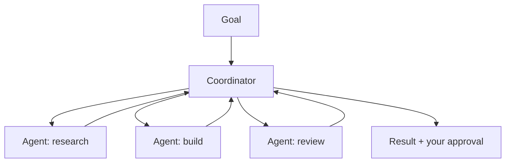

<LevelBadge level="advanced" />

<Callout type="objectives" items={[
  "Was Cowork ist — ein agentischer Desktop-Arbeitsbereich, in dem du die Ziele vorgibst und die Schleife bereitgestellt wird",
  "Was Agententeams sind — mehrere Agenten, die sich ein Ziel teilen, jeder mit einer Rolle und Tools",
  "Wie beide zu den drei Dingen stehen, die du selbst bauen kannst: Subagenten, dem Agent SDK und Managed Agents",
  "Warum mehr Autonomie mehr Beaufsichtigung bedeutet, nicht weniger",
]} />

<VerifyNote lastVerified="2026-07-23" source="https://platform.claude.com/docs">
Cowork und Agententeams sind sich schnell verändernde Bereiche von 2026 — Namen, Verfügbarkeit und Fähigkeiten ändern sich häufig. Überprüfe die aktuellen Details in der offiziellen Anthropic-Dokumentation/den Ankündigungen.
</VerifyNote>

Über einen einzelnen Agenten hinaus hat Anthropic Bereiche auf **Produktebene** veröffentlicht, mit denen Agenten dauerhafte, kollaborative Arbeit leisten können: **Cowork** (ein agentischer Desktop-Arbeitsbereich) und **Agententeams** (mehrere zusammenarbeitende Agenten). Diese Seite ist eine grobe Übersicht — überprüfe die Einzelheiten anhand der offiziellen Dokumentation, da sich diese schnell weiterentwickeln.

## Claude Cowork

Stell es dir als einen **Arbeitsbereich vor, in dem ein Agent echte, mehrstufige Arbeit** an deiner Seite leistet — er arbeitet über einen längeren Zeithorizont als eine einzelne Chat-Runde mit Dateien und Tools, während du beaufsichtigst. Es ist der auf Verbraucher/Profis ausgerichtete Verwandte davon, einen Agenten auf der API zu bauen: Die Schleife wird bereitgestellt, du gibst die Ziele vor.

## Agententeams

Wo ein Agent nicht ausreicht, **arbeiten mehrere Agenten zusammen** — sie teilen ein Ziel auf, jeder mit einer Rolle und Tools, und koordinieren sich auf ein Ergebnis hin. Konzeptionell spiegelt das die [Subagenten](/docs/claude-code/subagents) von Claude Code wider, jedoch als Produktbereich für dauerhafte Multi-Agenten-Zusammenarbeit statt für eine einzelne delegierte Teilaufgabe.

## Wie sich dies zum Rest der Website verhält

- Es selbst, programmatisch bauen → [Agenten bauen](/docs/api/building-agents) + das [Agent SDK](/docs/claude-code/headless-and-agent-sdk).
- Delegation innerhalb einer Coding-Sitzung → [Subagenten](/docs/claude-code/subagents).
- Gehostete Schleife/State/Scheduling → [Verwaltete Agenten](/docs/api/managed-agents).

<Flashcards title="Vier Wege, wie Agenten Arbeit erledigen" cards={[
  {front: "Cowork", back: "Ein agentischer Desktop-Arbeitsbereich. Die Schleife wird bereitgestellt; du gibst die Ziele vor und beaufsichtigst, während der Agent über einen längeren Zeithorizont als eine einzelne Chat-Runde mit Dateien und Tools arbeitet."},
  {front: "Agententeams", back: "Ein Produktbereich, in dem mehrere Agenten zusammenarbeiten — sie teilen ein Ziel auf, jeder mit einer Rolle und Tools, und koordinieren sich auf ein Ergebnis hin, das du freigibst."},
  {front: "Subagenten", back: "Delegation innerhalb einer Claude-Code-Session. Dieselbe Idee wie Agententeams, aber auf eine einzelne delegierte Teilaufgabe begrenzt statt auf dauerhafte Zusammenarbeit."},
  {front: "Managed Agents", back: "Anthropic hostet für dich die Schleife, den State und das Scheduling — die API-seitige Option, wenn du die Agentenschleife nicht selbst betreiben willst."},
  {front: "Agent SDK", back: "Du baust die Schleife programmatisch selbst. Maximale Kontrolle, und du verantwortest Orchestrierung, State und Fehlerbehandlung."},
]} />

## Quiz

<Quiz questions={[
  {
    q: "Du willst eine Agentenschleife, die du weder selbst betreiben noch planen musst und die du aus deinem eigenen Backend aufrufst. Auf welche Option verweist diese Seite?",
    options: [
      "Cowork",
      "Managed Agents",
      "Subagenten",
      "Agententeams"
    ],
    answer: 1,
    explain: "Managed Agents ist die Option mit gehosteter Schleife/gehostetem State/Scheduling. Cowork und Agententeams sind Produktbereiche, in denen du arbeitest, statt sie aufzurufen; Subagenten sind Delegation innerhalb einer Claude-Code-Session; das Agent SDK ist der Do-it-yourself-Weg."
  },
  {
    q: "In welcher Beziehung stehen Agententeams und die Subagenten von Claude Code, wie hier beschrieben?",
    options: [
      "Es ist dieselbe Funktion unter zwei Namen",
      "Agententeams ersetzen Subagenten, die veraltet sind",
      "Konzeptionell dieselbe Idee, aber Agententeams sind ein Produktbereich für dauerhafte Multi-Agenten-Zusammenarbeit statt für eine einzelne delegierte Teilaufgabe",
      "Subagenten laufen in der Cloud; Agententeams laufen lokal"
    ],
    answer: 2,
    explain: "Die Seite stellt Agententeams als konzeptionelles Spiegelbild der Subagenten dar, aber als Produktbereich für dauerhafte Multi-Agenten-Zusammenarbeit — während Subagenten innerhalb einer Coding-Session eine einzelne delegierte Teilaufgabe übernehmen."
  },
  {
    q: "Warum behandelt diese Seite die Beaufsichtigung als die Konstante beider Bereiche?",
    options: [
      "Weil Multi-Agenten-Arbeit über lange Zeithorizonte sowohl Nutzen als auch Risiko verstärkt",
      "Weil Agenten überhaupt keinen Tool-Zugriff erhalten können",
      "Weil Anthropic für jeden Tool-Aufruf eine manuelle Freigabe verlangt",
      "Weil die Bereiche Forschungsvorschauen ohne Sicherheitstraining sind"
    ],
    answer: 0,
    explain: "Mehr Autonomie über einen längeren Zeithorizont verstärkt Nutzen und Risiko zugleich. Die praktische Antwort: Menschen bei folgenreichen Aktionen in der Schleife behalten, den Tool-Zugriff eng beschränken und die Ausgaben überprüfen."
  }
]} />

## Die Konstante: Beaufsichtigung

:::warning[Mehr Autonomie, mehr Sorgfalt]
Multi-Agenten-Arbeit über lange Zeithorizonte verstärkt sowohl den Nutzen *als auch* das Risiko. Behalte Menschen bei folgenreichen Aktionen in der Schleife, beschränke den Tool-Zugriff eng und überprüfe die Ausgaben — siehe [Verantwortungsvolle Nutzung](/docs/security/responsible-use) und [Agenten absichern](/docs/security/securing-agents).
:::

<Callout type="takeaways" items={[
  "Cowork und Agententeams sind Produktbereiche: Die Agentenschleife wird bereitgestellt, und deine Aufgabe ist, Ziele vorzugeben und zu beaufsichtigen.",
  "Sie sind die Verwandten auf Produktebene dessen, was du selbst bauen kannst — Subagenten für Delegation innerhalb einer Session, das Agent SDK für volle Kontrolle, Managed Agents für eine gehostete Schleife.",
  "Diese Bereiche entwickeln sich schnell. Betrachte diese Seite als Übersicht und überprüfe die Einzelheiten in der offiziellen Dokumentation.",
  "Beaufsichtigung ist die Konstante: menschliche Freigabe bei folgenreichen Aktionen, enge Tool-Berechtigungen, überprüfte Ausgaben.",
]} />

## Weiter

- [Geplante Cowork-Aufgaben: Agenten, die ohne eingeschaltetes Gerät laufen](/docs/claude-app/cowork-scheduled-tasks) — der Web- + Mobile-Launch vom Juli 2026 in der Praxis, mit der Fähigkeitsmatrix nach Oberfläche und den vier Fallstricken, die stille Läufe zum Scheitern bringen
- [Subagenten & parallele Agenten](/docs/claude-code/subagents)
- [Verwaltete Agenten](/docs/api/managed-agents)
- [Native Multi-Agenten-APIs](/docs/models/native-multi-agent-apis) — wie die Multi-Agenten-Beta der Responses von OpenAI im Vergleich abschneidet und wo auf Anthropic-Seite die Lücke bei den Primitiven liegt
- [Verantwortungsvolle Nutzung, Ethik & Verifizierung](/docs/security/responsible-use)
